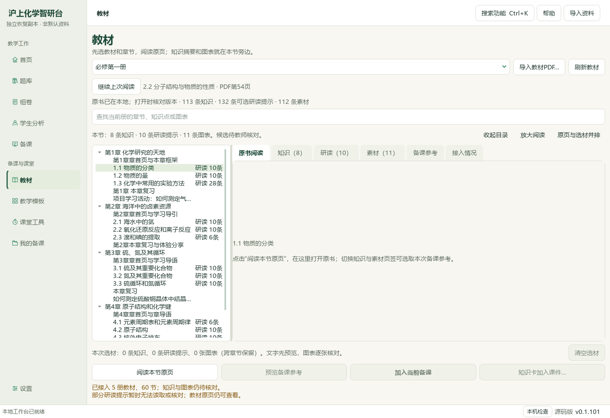
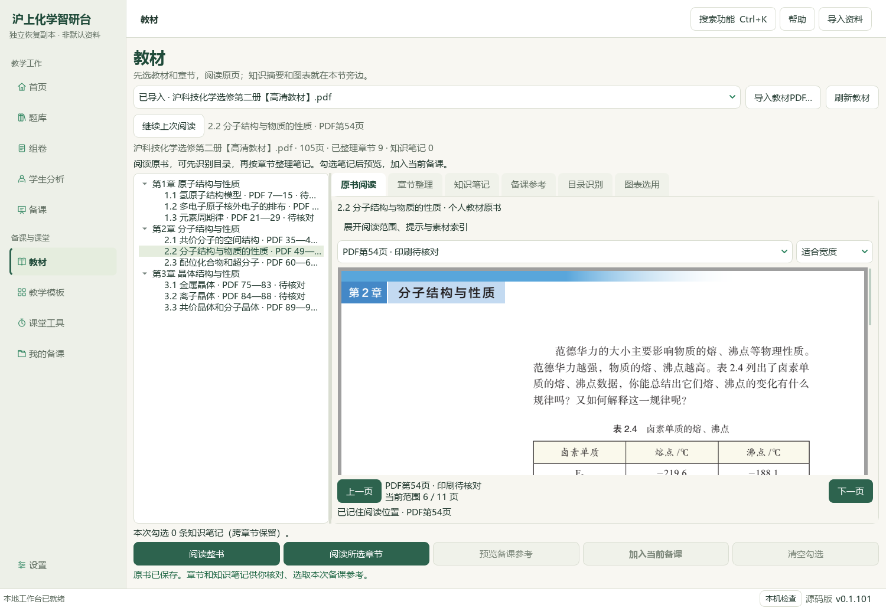
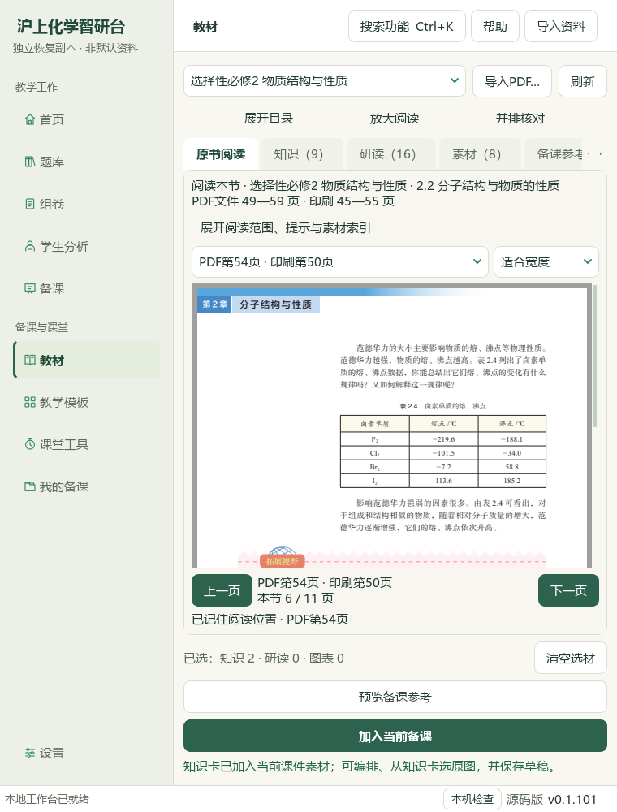

# 2026-10-06 教材继续阅读与备课联动验收

本轮是可复核的未发布本地进展，总目标仍active；没有独立人审或正式化学结论。检索文章0、有效新试卷0、下载0；个人教材归档复用已知原PDF1份，无中央新增资料。

## 当前结果

教材页新增“继续上次阅读”，记住同版本册、章节和PDF页；现有编号节、补充栏目、个人整书与个人章节可连续阅读。重新打开前仍由原服务核对原文件和范围，只有完整文件SHA、身份版本与明确页列表同时相同才使用旧页码。提示或目录候选指定原页优先，知识点核对、知识卡、单图定位窗口继续按请求锚点打开；阅读不代替选材或教师确认。

真实选必二原PDF105页、SHA `4eb751c3bc879d2ad41a2faa723b3b4af05b29ff78f3e89a2eaf9727ebb8a848`，2.2节PDF49—59／印刷45—55。原生操作复现PDF54→素材→PDF49，修正后返回54；新进程和实际CMD→快捷方式→Pythonw入口都恢复个人2.2节54。个人整书归档1份，按同版本登记目录保存9个待核对章节；未把目录识别当作化学研读。760×1000实际Qt窗口原页区域个人518px、现有教材351px；窄窗收起章节、冗余说明和暂不可用操作，展开章节保持原页。

明确勾选既有范德华力与氢键知识卡、预览、再加入当前五题备课，同来源版本去重，10素材／40分钟／6输出版本及五完整题保持。23草稿／138登记成品／50图片摘要再次通过普通备课ZIP恢复；该ZIP仍不含原教材、Word库、标签／范围／选择、阅读位置或模型设置。专用个人教材ZIP另带已登记个人原书、章节、笔记、候选和个人阅读位置；恢复原PDF字节及54页位置通过，兼容旧版无阅读位置的教材ZIP。外部正式五册原书与其阅读位置需另行保管。

1新模块、5既有应用模块、1新测试模块和1既有测试模块调整；新增10检查，最终767相关检查通过。初次766检查出现窄窗和旧Part-B摘要数量断言问题，第二次767仍受全套字体状态影响，当前版本修正后767全部通过；失败日志原样保留。旧断言的8知识／3方法与易错上限与已扩展来源卡不符，改为验证现用完整索引读取合同及原SHA／原块；Part-B与其他知识数据均未改写。README、文档策略和中央控制器另核。

参考BDL V10的56秒、V43的42秒两张原帧，核对完整视频SHA后实际查看章节与来源属性组织；未播放全片或核听音轨。本轮直接查看13张CODE Qt截图、1张基线Qt图和2张BDL帧，限原PDF54页的可见内容；不称人工审校或全书全文研读。没有新增化学知识记录、题目导入、正式题或中央标签；知识386／图表322／登记170、阅读身份734／冻结702保持。检索文章0、新试卷0、下载0、外部请求及模型调用0，微信读书永久停用。

当前源码候选可复核，旧EXE v0.1.101、渲染v17、HEAD与索引保持，未提交／推送／发行。总目标仍active，更多本地内容、四层标签和化学审校、整体UI、桌面发行继续；手机端排除，Q11／Q13及历史临时原字节例外保留。验收：[本轮记录](2026-10-06-textbook-reading-to-lesson-navigation-qa.md)；入口：`E:\项目\上海高中化学等级考\outputs\2026-10-06-textbook-reading-to-lesson-navigation\打开教材继续阅读候选.cmd`。

## 来源、范围与真实操作

先重新核对上一轮验收及全部证据SHA，确认前序为progress、全目标未完成；冻结3852条明确路径。以普通备课备份恢复23草稿／138成品，再复制465个已声明Word文件及标签／范围／5题选择，未复制teacher_workspace、供应商设置或密钥。初始辅助脚本收据残留22／132常量，实际恢复断言与终端均为23／138；原错误收据另存，修正收据附原SHA与原因。

原PDF源SHA见上；在完整工作台选择选择性必修2 → 2.2节，在54页核对表2.4位置，进入图表原页后返回原节。基线退回49，当前回到54。同节知识C05／C06仍需明确勾选、预览并点击加入，五题课件已有同版本来源，去重后原payload逐字段一致。没有新增知识卡或重新生成成品；前序实际Office25页与15同页检查仅按不可变成品SHA保持，没有冒称本轮重新转换Office。

通过原生导入对话框实际保存原PDF完整74172867字节／105页到候选个人教材目录；目录预览9项均来自完整SHA匹配的登记目录，保存为range_confirmed=false。新进程点击继续阅读，先等待个人章节载入，再重新读原PDF并回到2.2节49—59中的54；印刷页仍待核对。实际CMD调用快捷方式与Pythonw验证入口，读取同候选目录且不改旧草稿／阅读记录；安装EXE与真实用户目录未改写。

## 保存、备份与检查

导航仅保存selector、完整源SHA、明确PDF页列表、当前页和显示名称；64个范围上限，合并写入一项导航草稿，使用原状态存储的进程锁，不替换其他草稿或题篮。source_failed取消待存页；正文和目录服务继续处理来源核验，记录不是权威来源。连续阅读器显式启用记忆，独立知识与审核窗口默认不启用；指定锚点优先。

专用教材ZIP包含个人原书版本对应的阅读记录；恢复后重新核对源文件再使用。旧版无导航项的ZIP仍可读，不将中央外部册记录混入个人备份。普通备课ZIP的范围保持，23唯一输出版本／138文件及50图片摘要均逐字节恢复，个人原书和阅读记录不在其中；恢复服务暂无GUI按钮。

当前应用5既有文件和1新文件、1既有测试与1新测试共8文件调整。新10检查覆盖不同源／范围／版本不误恢复、明确锚点优先、两个状态实例交错保存、64范围上限、损坏记录只读、失败不落盘、关闭／新状态实例恢复、书架与个人异步入口、个人备份及旧ZIP、窄窗布局。最终767相关检查全通过。初次764通过／2失败，第二次766通过／1窄窗失败；记录不删除，当前窄窗按可用操作收紧布局，完整回归重新通过。旧知识卡上限断言改为核对现用索引读取合同；原Part-B知识／方法／易错／原块证据不删减。

本轮14张Qt图及2张BDL帧由根模型实际查看；26张CODE阶段截图按SHA保存，但不宣称每张都完成模型视觉复核。模型可见的教材内容仅已声明54页，不是105页全文研读，不替代reviewer-A/B。手机端不在范围。

## 证据位置与未完成项

主要机器证据位于 `E:\项目\上海高中化学等级考\outputs\2026-10-06-textbook-reading-to-lesson-navigation`：`native-navigation-before.json`、`native-navigation-accepted.json`、`personal-import-and-backup-verification.json`、`candidate-entry-verification.json`、`navigation-tests-accepted-command.json`、`backup-roundtrip-verification.json`、`root-visual-review-observations.json`。根验收另比较3852个冻结输入、源／测试与图片清单、中央登记、正式层级、人审状态、阅读账本、HEAD和索引。

整体教材蒸馏与题目导入、更多本地知识、Q11答题形态／答案冲突与Q13独立边界、四层正式身份和标签、化学与图形质量、整体UI对齐及桌面发行仍未完成；目标保持active。禁止把此次阅读位置与候选目录当作审校PASS，微信读书路线不再使用。
