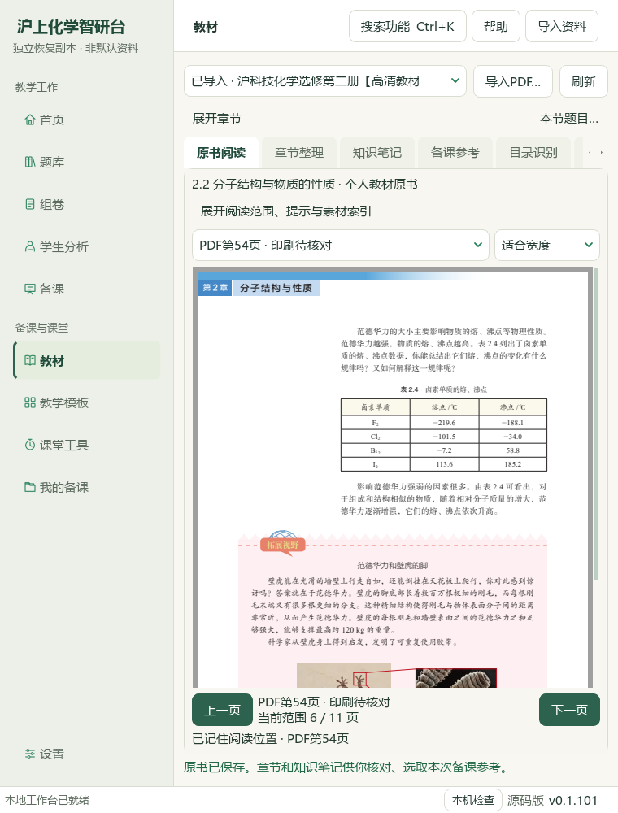
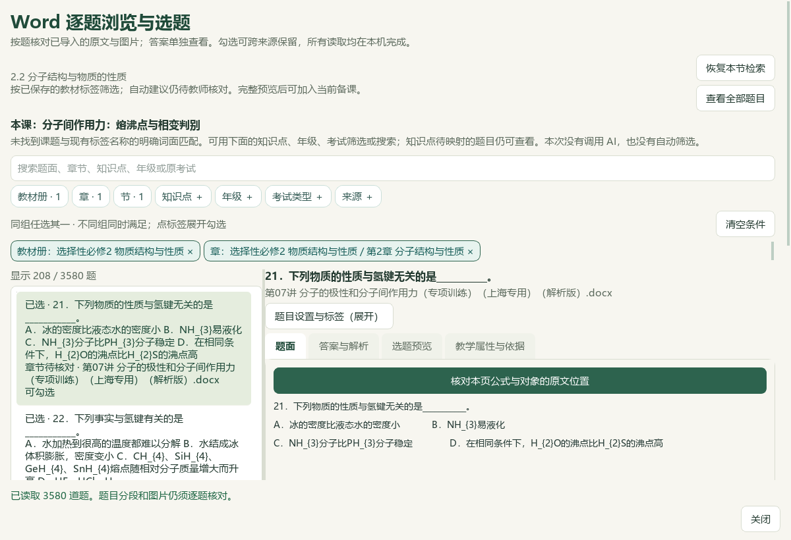

# 教材章节选题与十题备课候选验收 · 2026-10-06

当前为本地源码候选，未提交、推送或发布；旧 Windows EXE v0.1.101 与渲染 v17 保持。总目标仍为 active，整库和整体工作台未标完成。微信读书永久停用。

## 本轮结果与操作

教材页与个人教材页均提供“本节题目…”。已登记节核对激活目录、原PDF SHA与完整页范围；个人章节只有原书 SHA 和完整页序唯一对应才沿用教材目录标签。无法唯一对应或目录不可用时，明确进入可编辑的章节文字检索。题目窗口显示当前章节及候选说明，册／章／节条件须对应同一条归属；原有勾选保持。刷新及“恢复本节检索”重新核对原书和章节，过期上下文暂停本节结果；“查看全部题目”可明确清除条件。原文和答案分别预览，明确接入后才进入当前备课。

实际注册教材与个人选必二2.2节均对应原PDF49—59，阅读位置54保持。教材原书105页，SHA `4eb751c3bc879d2ad41a2faa723b3b4af05b29ff78f3e89a2eaf9727ebb8a848`；个人9个目录候选保持，未称全书全文研读。

PKG-065第07讲原DOCX SHA `5ba3b6599d3ceb6109ab0e4ac5ac600a9a9282a59f9f892d3521292af824b966`。第21题题面136—138／答案139—140块，原参考答案C；第22题题面141—145／答案146—147块，原参考答案B。原DOCX XML与预览逐块比较，范围不带入第20或23题。原印刷页码仍 unknown，原文块号不冒充页码。第20题有6个图形对象，本轮未接入，待原图质量核对；没有补写图形或答案。

当前10完整题为12—19、21、22，另有2既有知识卡、1原表和2关联活动，共15素材／2环节／40分钟／9输出版本。旧12份非练习活动素材、第一环节与两目标逐项保持；只明确刷新既有关联练习活动并新增2题。16:9、24磅与学生独立一栏保持。原讲义答案照录，化学正确性、认知难度与正式四层归档仍待审核；没有将讲义题号当作上海等级考卷面结构。

[打开章节选题候选](E:/项目/上海高中化学等级考/outputs/2026-10-06-textbook-section-question-link/打开教材章节选题候选.cmd) · [教师教案](E:/项目/上海高中化学等级考/outputs/2026-10-06-textbook-section-question-link/exported-copy/教学成品-2bf408e0-98lbm65a/lesson_plan.docx) · [教师PPT](E:/项目/上海高中化学等级考/outputs/2026-10-06-textbook-section-question-link/exported-copy/教学成品-2bf408e0-98lbm65a/lesson_presentation.pptx) · [学生学习单](E:/项目/上海高中化学等级考/outputs/2026-10-06-textbook-section-question-link/exported-copy/教学成品-2bf408e0-98lbm65a/student_worksheet.docx) · [学生PPT](E:/项目/上海高中化学等级考/outputs/2026-10-06-textbook-section-question-link/exported-copy/教学成品-2bf408e0-98lbm65a/student_presentation.pptx)

## 验证与保存范围

- 本轮26新检查计入644相关回归，全部通过；首轮19通过／1失败／2错误记录保留，修正缺少QHBoxLayout导入及合成标签状态后重跑22通过，另加4条实际窗口路由检查后全组通过。
- 实际Qt/QTest核对注册入口取消不改备课、个人章节入口、完整题答预览、旧8题去重、2题接入、关联练习刷新、生成保存。16张最终Qt截图留档；早期元数据已加载但PDF尚未绘制的空白截图保留，最终原PDF54实际绘制截图已复核。
- 安装的Word与PowerPoint实际打开四份输出并转PDF核对：教师Word9、学生Word4、教师PPT15、学生PPT11，共39页。全文、素材标题、原PNG字节、可编辑PPT文本、续页导航及学生答案隔离0失败。十题在两版Word和学生PPT中的30项完整题同页检查通过；教师PPT正常续页，第22题跨14—15页。
- 普通备课ZIP恢复26草稿／156登记成品／26唯一输出版本／50图片摘要。原25份草稿与150成品均保持。该ZIP不包含Word库、原教材、题目范围／标签／选择、阅读位置、模型配置或密钥；这些内容另行保存。实际CMD→快捷方式→Pythonw重开当前完整草稿，核对个人章节与PDF54通过。
- 98份Word／3580候选、465Word库文件、3684属性／9737历史、5手工范围保持，选择8→10。知识386／素材322／登记170、正式4／人工0保持。本轮不修改中央标签和来源登记，不新增正式题或化学知识记录。
- 实际阅读账本737→739，只新增两段完整题答身份；702冻结待办不重建、不重算。5356份未计划修改的原输入按完整字节SHA-256核对，无异常；新副本排除旧模型设置锁，真实用户资料路径与前序候选不写入。

前序扩大Word检查1755通过／12失败／8错误已在原索引复现相同20项失败／错误；历史断言与归档夹具问题仍未解决，本轮未重跑扩大检查，不称全套通过。README完整检查、文档策略和中央控制器有本轮独立回执。

BDL V10（56秒）与V17（79秒）原视频SHA及两张原帧已核，只参考章节目录／原页／来源组织与备课入口。没有播放全片、审核音轨或以视频代替官方化学卷式依据。检索文章0、新试卷0、下载0、外部请求和供应商调用0。

验收助手首次嵌套弹窗等待卡住，仅停止该助手进程；25旧稿保持，10选择已持久保存后重新预览。第二次助手因独占证据文件已存在退出；失败日志及证据保留，第三次完整流程成功。入口助手首次编码名错误修正后实际启动成功。这些助手问题不掩盖首次失败，不改旧验收记录。历史辅助临时原字节例外保持。

## 证据与未完成项

证据目录：`E:\项目\上海高中化学等级考\outputs\2026-10-06-textbook-section-question-link`。关键文件为 `section-contexts.json`、`section-link-regression-command.json`、`native-source-verification.json`、`native-verification-final.json`、`section-question-actual-office-verification.json`、`complete-question-page-verification-final.json`、`backup-roundtrip-verification-final.json`、`candidate-entry-receipt.json`、`preserved-inputs-verification.json`、`reading-identity-ledger.json`、`next-question-work.json` 与最终根验收回执 `root-final-acceptance.json`。最终回执成功才表示本片验收闭合。

知识库仅更新化学项目页及索引中的化学行，索引外项目的原字节保留。更多教材／讲义题目、Q11范围与作答形式、Q20原图、正式四层与化学审核、整体UI、历史夹具修复和桌面发行继续；手机端排除。当前源码候选不计入已发布功能。

[操作指南](../teacher/lesson-and-paper.md#textbook-section-questions) · [保存范围](../teacher/save-and-support.md) · [当前闭环](../WORKFLOW_STATUS.md)
