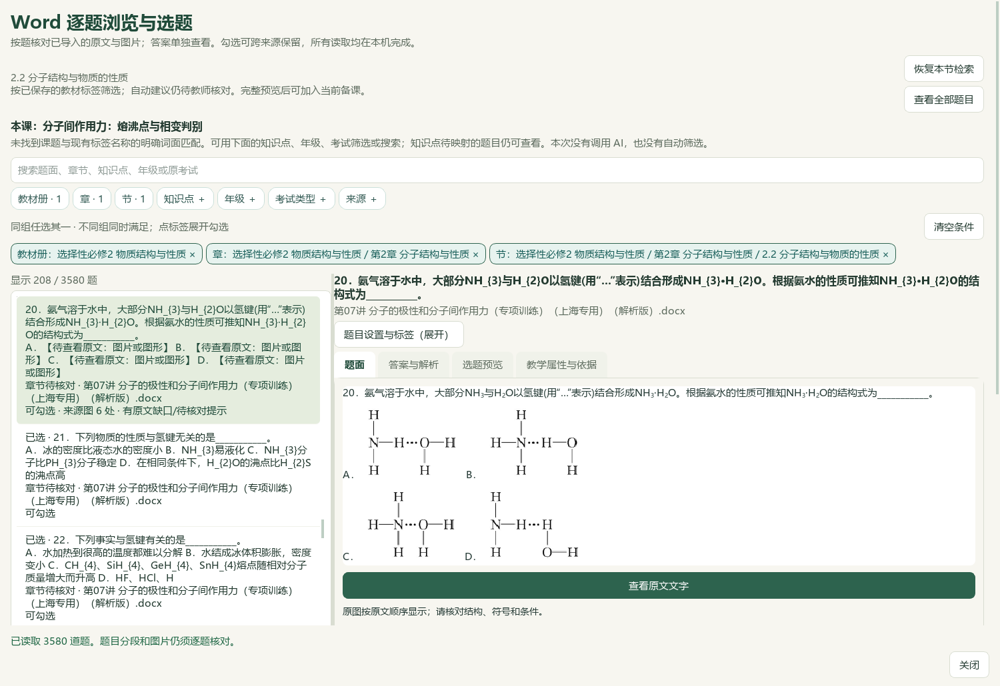
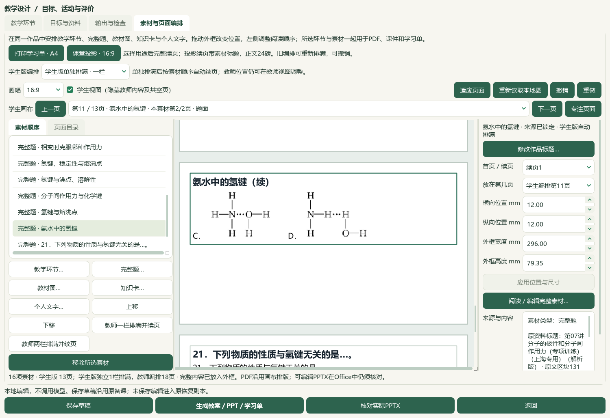

# Word原图按原文显示与十一题备课候选验收 · 2026-10-06

当前为本地源码候选，未提交、推送或发布；旧Windows EXE v0.1.101和渲染v17保持。总目标仍active，整库、独立化学审核与整体UI未标完成。微信读书永久停用。

## 结果与使用

本地Word题目窗口按原文位置显示结构图、原有上下标和小图符号。题面包含题面和共同材料，答案页单独读取原答案范围；宽窄窗均可滚动读完整内容，**查看原文文字** 可展开完整检索文字。服务严格比较原文件、题目版本、DOCX文本、原生对象次序和图像字节，失败时保留原完整文字与逐图预览并提示核对原Word。目录摘要仍保留来源占位与旧警告；原始记录、自动标签与人工审核状态不改写。

本轮从个人教材选必二2.2节“本节题目…”筛选中核对第07讲第20题。原DOCX SHA `5ba3b6599d3ceb6109ab0e4ac5ac600a9a9282a59f9f892d3521292af824b966`；题面131—133、答案134—135块，共四幅选项结构图、平衡箭头与离子小图六个原图。原参考答案B照录，独立化学与正式四层审核待行；原印刷页码unknown，块号不冒充页码。六原图直接查看并保留SHA、尺寸、原XML绑定；没有重画结构或补写答案。

实际Qt操作完成原题／答案宽窄窗阅读、十一题完整预览、去重接入、上移排列原题12—22、既有关联练习刷新、生成、保存和导出。当前11完整题／16素材／2环节／40分钟／11输出版本，作品标题“氨水中的氢键”，最终草稿 `prep-4492971b3eb0460fbbd6ab59322d87ee`。原14份非练习活动素材、第一环节与目标逐项相同；第27份中间稿仍保留。

[打开原图题目备课候选](E:/项目/上海高中化学等级考/outputs/2026-10-06-word-inline-image-reader/打开原图题目备课候选.cmd) · [教师教案](E:/项目/上海高中化学等级考/outputs/2026-10-06-word-inline-image-reader/compact-exported-copy/教学成品-c1140a57-ygsdl32f/lesson_plan.docx) · [教师PPT](E:/项目/上海高中化学等级考/outputs/2026-10-06-word-inline-image-reader/compact-exported-copy/教学成品-c1140a57-ygsdl32f/lesson_presentation.pptx) · [学生学习单](E:/项目/上海高中化学等级考/outputs/2026-10-06-word-inline-image-reader/compact-exported-copy/教学成品-c1140a57-ygsdl32f/student_worksheet.docx) · [学生PPT](E:/项目/上海高中化学等级考/outputs/2026-10-06-word-inline-image-reader/compact-exported-copy/教学成品-c1140a57-ygsdl32f/student_presentation.pptx)

## 验证与保存

- 11条新增检查计入150相关回归，全部通过；覆盖原DOCX位置和上下标、只读读取、题答复用图像、旧版本拒绝、HTML文字转义、宽窄窗原图像素、图像篡改拒绝及实际题目窗口回退。首轮10通过／1失败为测试假供应商的计数属性名错误，改为实际属性后全组通过。README完整14项、文档策略与中央控制器另核。
- 本机Word／PowerPoint实际打开四份最终输出并转PDF：教师Word10、学生Word4、教师PPT18、学生PPT13，共45页。完整文字、所有素材标题、原图片字节、可编辑PPT文字、续题导航与答案隔离检查通过；四份整页联系图及第20题原尺寸Word／投影页直接查看。原六图保存在Office包中，教师7图、学生5图包含原教材表。
- 两版Word十一题及学生PPT十个短文字题，共32项完整题同页检查通过；第20题在24磅投影下分两页，四幅结构图完整，第二页带续题标题。首次简标题助手仍断言单页，测得教师／学生各两片后退出，未保存新稿或生成输出。修正验收范围后保存第28份最终稿；不把两页说成单页，也不缩字号或省图。
- 普通备课ZIP恢复28草稿／168登记成品／28唯一输出版本／56图片摘要，缺失0；原26稿／156成品和第27份中间稿保留。原任务和备课引用图随普通备份恢复；Word库、标签／范围／选题、原教材、个人书籍／阅读位置、模型设置与密钥不在普通备课ZIP内，主候选中另行保留。
- 实际CMD→快捷方式→Pythonw重开完整最终稿，16素材／11题／11输出版本和个人教材PDF54核对通过。个人原书105页、9目录候选、2.2节PDF49—59保持，原教材SHA `4eb751c3bc879d2ad41a2faa723b3b4af05b29ff78f3e89a2eaf9727ebb8a848`；不称全书逐页研读。
- 98Word／3580候选与前序最终目录完全相同；465库文件、3684属性／9737历史、5手工范围未变，保存选题10→11。知识386／图表322／登记170和正式4／人工0保持，中央知识或标签新增0。完整题阅读身份739→740；冻结702待办及SHA保持，不重算整库待办。
- 684复制文件中682个不可变文件、1039冻结输入中1029个未计划修改的输入按完整字节SHA核对；另核对前序根验收505条引用，未递归重读此前5356输入。仅更新六份当前项目文档和知识库化学项目及索引化学行，索引其他项目字节保留。

首次原生导入助手实际上已成功保存第27稿。等待期间过早推断卡住，诊断在保存数前置断言处退出，进程匹配为0，没有执行停止进程或诊断复制；重复助手在26稿前置断言处退出，未覆盖原证据。原成功会话exit0与更正回执保留。文档助手生成器首次字符串嵌套语法错误发生于写入前，修正引号后才更新文档；这些问题不称首次全部通过。

前序扩大Word检查1755通过／12失败／8错误，冻结HEAD复现同一20项历史断言／夹具问题；本轮未重跑该扩大检查，不称全套绿色。图像原文位置验证属于候选呈现，不解锁化学正确性、难度、四层归档或发布。

中央库验证有效且错误0；保持170资料登记、4正式题／人工0。旧锁定数量以当前快照为准，公开原生文件从状态333到验证378，报告新增45文件的快照漂移提示。隐私保护继续禁止私有内容stat／open／hash，未执行旧版全工作区扫描；公开文件新增不等于新增正式题或化学审核。提示完整保留在控制器回执及根验收中。

## 证据与下一步

证据目录：`E:\项目\上海高中化学等级考\outputs\2026-10-06-word-inline-image-reader`。关键回执为 `Q20-original-reading.json`、`regression-verification.json`、`compact-title-native-verification.json`、`inline-question-final-actual-office-verification.json`、`complete-question-page-verification-compact.json`、`backup-roundtrip-verification-compact.json`、`candidate-entry-receipt.json`、`current-profile-final-verification.json`、`preserved-inputs-verification.json`、`reading-identity-ledger.json`、`next-question-work.json` 与 `root-final-acceptance.json`；最终根验收成功才表示本片闭合。

BDL V27第37秒、V32第39秒原帧及完整视频SHA已核，参考筛选→完整图文→保留选择→预览→备课成品；未播放全片或审音轨。检索文章0、新试卷0、下载0、外部请求与供应商调用0。更多本地教材／讲义内容、Q11范围和作答形式、独立化学与正式四层审核、整体UI、历史夹具和桌面发行继续；手机端排除。历史辅助临时原字节例外保持。

[操作指南](../teacher/lesson-and-paper.md#word-inline-reading) · [保存范围](../teacher/save-and-support.md) · [当前闭环](../WORKFLOW_STATUS.md)
