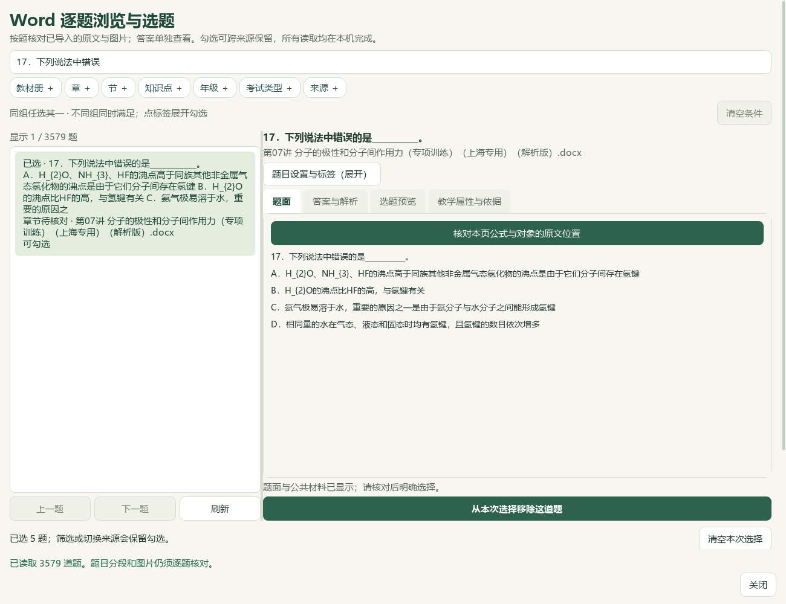
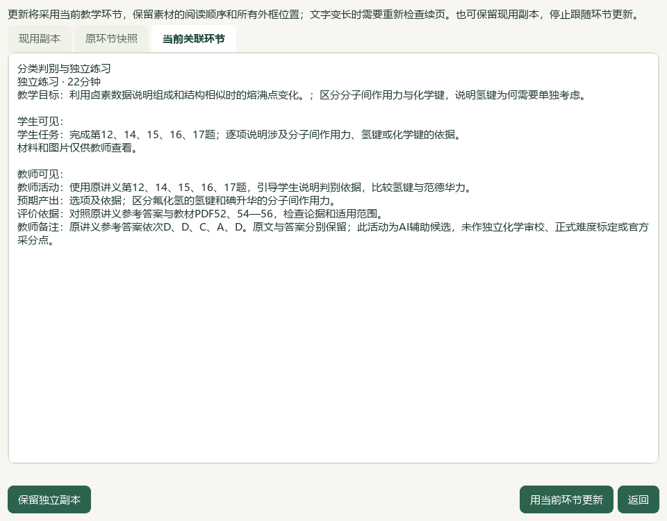

# 2026-10-06 完整题库首读复核与第17题接入验收

本片是未发布本地进展，总目标仍active，人工和独立化学审校未完成。检索文章0、新试卷0、重复下载0，新增完整题备课接入1；微信读书永久停用。

## 当前结果

本机候选完整读取98份Word来源、3579题，首次直接读取7.95秒；正常app.exec窗口9.55秒，实际CMD→快捷方式→Pythonw入口8.97秒。整份目录与首读基线逐项相同，465库文件字节、范围和标签校验保留。前序120秒未完成记录保留，本轮正常事件循环未复现长等待；候选验收等待改用QEventLoop/QTimer，没有改应用运行代码，不宣称已通过应用性能修复获得加速。3579项是机器目录解析数量，不等于模型全文研读。

第17题来自PKG-065第07讲专项训练解析版，原文块109—115，题面109—113／答案114—115，原XML全文已比较，图片0；相邻第18题不带入。原参考答案D照录，现用标题“氢键与沸点、溶解性”。K13、教材候选TB-M1-C3:3.2及TB-E2-C2:2.2、自动选择／填空标签按现状保留，未作人工确认或正式作答单元分类，四层身份仍unknown。原题、解析及自动标签仍待化学审校。

当前5完整题、2既有知识卡、1原表图和2活动共10素材／40分钟；练习环节显式更新为第12、14、15、16、17题，并核对关联活动后刷新。第一环节、2目标及除练习活动外的8份旧素材保持；学生独立一栏、16:9与24磅保持，教师为新增题重新排满。另存第23份草稿，当前第6输出版本；原22份草稿、132成品和旧5输出版本保持。

实际Office教师Word6／学生Word3／教师PPT10／学生PPT6共25页，全文、标题、续页导航、原PNG字节及答案隔离0失败。五题在两版Word与学生PPT中分别同页，共15检查通过；第17题位于学生Word第3页、学生PPT第6页，教师PPT第10页完整含答案。普通备份恢复23草稿／23唯一版本／138成品／50图片摘要；原教材、Word库、属性／范围／选题状态、供应商配置和密钥不在普通备课ZIP中，主候选的465库文件须另行保管。

本轮核对V27、V32两份本地BDL原视频SHA，查看既有联系图并抽取37秒和39秒原尺寸帧，参照筛选、完整题目预览、持久选择和可编辑成品流程；未播放全片或核听音轨，没有据其数学／生物卷式推断上海化学正式结构。现有桌面流程已实测，整体UI对齐继续。

3684属性／9737历史、3手工范围、知识386／素材322、170登记、734阅读身份及冻结702待办保持；第17题已在原阅读账本中，仅新增备课接入1题，选题4→5，正式题及中央标签0，既有正式4／人工0。应用与测试源码本轮0修改，前序225通过记录按未变源码保留，本轮不冒称新跑225项。README14项、文档策略和控制器本轮另核。

维护渲染v17，EXE v0.1.101、HEAD e08c3e7和空索引保持，无提交／推送／发行。检索文章0、新试卷0、重复下载0、外部请求及供应商调用0；微信读书永久停用。总目标仍active，手机端排除；Q11／Q13问题、更多资料、化学与四层审校、整体UI及桌面发行继续，历史辅助临时原字节例外保持。

验收：[本轮记录](2026-10-06-word-library-cold-load-qa.md)；入口：`E:\项目\上海高中化学等级考\outputs\2026-10-06-word-library-cold-load\打开五题备课候选.cmd`。

## 复核范围与输入输出

本轮先重新核对上一轮root-final-acceptance及其证据哈希，前序为progress，完整目标未完成。冻结3149条明确路径；六份CODE文档和两份匹配知识库笔记为计划内修改。保留所有既有脏文件和未跟踪文件，不改95-Source。原22草稿与132成品、465库文件均从上一候选按明确路径恢复并复核，不复制供应商配置、密钥或teacher_workspace字段。

直接冷读用cProfile定位，带探针为19.54秒，不作为普通耗时；第二个新facade普通冷读7.95秒，同实例再读5.09秒，整份目录相等。正常app.exec加250ms定时观察为9.55秒，实际普通CMD入口加QEventLoop/QTimer观察为8.97秒。旧入口的QTest.qWait轮询和120秒未完成诊断仍留在原验收；本轮没有用超时判定应用失败，也未证明该等待方式是唯一原因。数据仍经过全源字节、预览绑定、完整范围和保存属性校验，未用部分列表冒充整库完成。

完整第17题键 `word-question-82c541e325fcd900c58c5ebc`、版本 `43065a4f7f9df7de0708235145379699909c77029e87567c965e1271a460915b`、源SHA `5ba3b6599d3ceb6109ab0e4ac5ac600a9a9282a59f9f892d3521292af824b966`、来源版本 `e5e6f4d7139029bbf08049295758669f2cf39d4bb1f5b383dbae95ccca97f84b`；原文件、完整7原块及相邻边界保留。正式四层身份、原始年份／考试和难度未知字段不猜测。原解析关于气态水的表述照录，未由模型修改或认定为独立化学审校通过；选择与填空双自动标签、两个教材候选也未重标。

通过普通草稿打开对话框恢复第22份，新增勾选第17题，经五题完整预览接入；已核验的前四题未重复追加或替换现用副本。练习节点只改teacher_action、student_task、notes，并通过关联活动审阅窗口显式刷新。原第一节点、两目标、18+22分钟及其他8旧素材保持。另存第23份，原5成品版本不覆盖；新成品可独立复制，目录含6登记文件、OUTPUT-MANIFEST.json与使用说明.txt。

## 实际Office和模型视觉复核

实际安装Word和PowerPoint转换四份输出，共25页；原可编辑文件SHA不变，每个可见正文、素材标题、PPT续页标题和角色隔离均通过，原表图PNG字节仍嵌入。五题在两版Word与学生PPT中共15个完整题面同页检查通过。教师PPT按已有长答案续页，未要求全部题面在教师投影同页。第17题在教师Word6、学生Word3、教师PPT10、学生PPT6页完整出现，公式下标可读，学生页隐藏答案。

根模型直接查看4份25页联系图、上述第17题所在的4张原尺寸Office页，以及6幅原生Qt图；其他教师／学生页不声称本轮均作原尺寸细读。查看两份BDL既有联系图和两帧原尺寸截图，原视频SHA逐项复核。完整数量与SHA列表见root-visual-review-observations.json，机器全文比较与模型看图不等于真人审核或独立化学判定。

## 保存、验收和继续范围

普通ZIP恢复23草稿／23唯一输出版本／138成品／50图片摘要，已保存恢复副本与末次草稿相等。465 Word库、标签、手工范围与选择留在主候选中，普通ZIP不含这些库状态、原教材、供应商配置和密钥。普通CMD→WScript快捷方式→Pythonw真实执行，重开10素材／6输出版本／5选题／6学生页，原表缩窗适配与前序修订范围、标签保持。可编辑作品仍为候选，人工审核与正式发行门槛未解锁。

本轮没有应用和测试源码改动，不新增低影响数据导入的镜像单元测试；前序225通过报告保留且源码哈希未变。本轮重新跑完整README14项、文档策略及控制器。最终保护与源清单按验收脚本生成，原22草稿、132成品、SQLite属性／历史、全部旧公共路径和冻结队列逐项复核。

代码 `C:\Users\20671\.codex\worktrees\e6ae\上海高中化学等级考`；资料 `E:\项目\上海高中化学等级考`；证据 `E:\项目\上海高中化学等级考\outputs\2026-10-06-word-library-cold-load`；候选 `C:\Users\20671\AppData\Local\ShanghaiChem\LocalCandidates\2026-10-06-word-library-cold-load\profile`；最终草稿 `prep-c28ae5bb67b24c62aa839098eacb6f00`。入口`打开五题备课候选.cmd`；备份`五题备课候选-备份.zip`；独立成品`exported-copy`。正式题4／真人审核0不变，来源为个人讲义而非官方卷。Q11与Q13问题、更多教材和完整题目、整体UI、视觉主题与桌面发行继续，手机端排除。历史辅助原字节未恢复例外仍见2026-10-05-question-confirm-performance-slice/auxiliary-state-exception.json。
