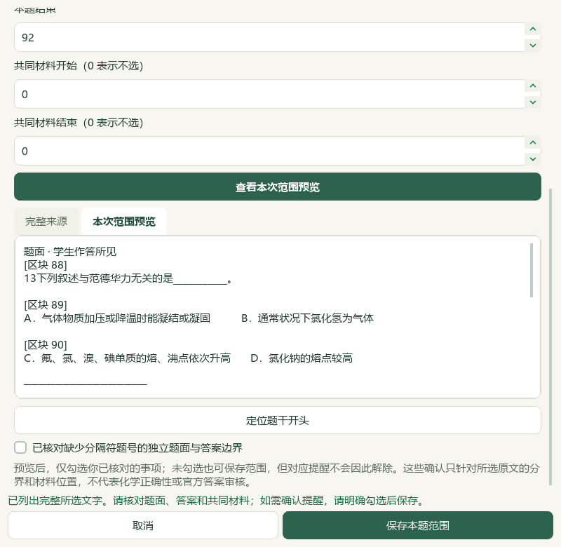

# 缺分隔符题目恢复与八题备课验收

2026-10-06，本地维护源码候选，尚未发布；总目标仍active。微信读书永久停用。本轮检索文章0、新试卷0、下载0、外部请求及模型调用0。只处理既有本地来源；没有新增官方答案、评分细则、中央知识记录、中央标签或正式题。

## 来源、候选与范围

来源为PKG-065《第07讲 分子的极性和分子间作用力（专项训练）（上海专用）（解析版）.docx》，401原生块、690368字节，SHA-256 `5ba3b6599d3ceb6109ab0e4ac5ac600a9a9282a59f9f892d3521292af824b966`。批次 `DESKTOPBATCH-b2f0b01ab11633066da08744a68db874`，来源归档ID `SRC-HANDOUT-065-5ba3b6599d3ceb61`。原文件不改写，Word块号不等于印刷页码；不据文件名推断年份、学校、官方身份或卷面四层位置。

第13题原文编号为“13下列……”，没有分隔符；旧自动边界曾把它带入第12题解析，前序人工修订的第12题81—87块已经排除。索引现在在强题干提示、邻近选项与显式答案共同成立时识别独立候选；没有选项、没有答案、计量数字或纯知识文字不能因此成为题目。候选带 `missing_number_delimiter`，须预览当前范围并明确勾选核对后才可导出。原文缺分隔符照录。

| 原题 | 现用标题 | 完整范围 | 题面／答案 | 原参考答案 |
| --- | --- | --- | --- | --- |
| 13 | 范德华力与物质状态 | 88—92 | 88—90／91—92 | D |
| 18 | 分子间作用力与化学键 | 116—122 | 116—120／121—122 | D |
| 19 | 氢键与熔沸点 | 124—130 | 124—128／129—130 | C |

第18题排除123块起的“03氢键”标题及其图像。三份完整题答文本均直接与原DOCX XML原生段落比较，所选范围图片0；纯文本图像读取入口在完成段落、资产和文本检查后到达预期 `image_scope_required` 终点。原生Qt／QTest操作读取原文、预览、保存范围、持久选择，再经普通主窗口预览接入备课。旧第12题手工范围及原五题标题／正文保留。

完整库98份来源3579→3580候选，只新增第13题；原3579条逐项完全相同，删除0、改变0。机器目录解析数量不代表模型研读数量。465个Word库文件字节、3684属性／9737历史保持；手工范围3→5、选择5→8。第18题旧自动建议尚须按新范围重核，第13题新自动建议未保存。正式四层身份、独立化学审核与难度证据仍unknown／待核。

## 最终备课与实际成品

从原第23份五题草稿恢复后增加三题，先保存第24份；发现第13题追加在第17题后，再用实际“上移”四次恢复原顺序，另存第25份。最终为第12、13、14、15、16、17、18、19题，源区块顺序81、88、93、98、102、109、116、124；13素材包含8完整题、2既有教材卡、1原表图和2关联活动。40分钟、2目标、2教学环节，16:9／正文24磅／学生独立一栏，当前备课8个输出版本。

排序前后13份素材内容逐项相同，仅顺序及页面编排变化。练习环节与关联活动显式更新为八题；第一环节、目标和原表／卡保持。原卤素表PNG SHA-256 `63e54e73499a6a7e97e2e50f8a912679ff0d05b6e130ea5bd0618ebe96430170`。原23份草稿和第24份中间稿不覆盖。

| 文件 | 实际安装的Office | 页数 | 核对 |
| --- | --- | --- | --- |
| lesson_plan.docx | Word | 8 | 八题题干与全部选项各自同页 |
| student_worksheet.docx | Word | 3 | 八题各自同页、无教师答案 |
| lesson_presentation.pptx | PowerPoint | 13 | 教师内容完整、正常续页 |
| student_presentation.pptx | PowerPoint | 9 | 八题各自同页、无教师答案 |

33实际Office页的全文／标题／原PNG／可编辑形状／续页导航／答案隔离机器检查通过。八题在两版Word与学生PPT共24完整题同页检查通过；教师PPT没有套用这一同页约束，第16题续在第9—10页。第13题位于学生Word第2页、学生PPT第4页。主代理查看最终四联系图、学生PPT第4页与重开入口图；另查看前序中间成品和原生范围图。联系图部分在工具中缩小，视觉检查限可见布局，不能称逐页原尺寸独立人工审校。

## 备份、入口与保存范围

普通备课ZIP实际恢复25草稿／25唯一导出版本／150登记成品／50图片摘要，恢复副本与草稿payload一致，成品字节逐文件一致。主候选保留完整Word库、5范围、8选择、个人原书及9目录候选和2.2节PDF54阅读位置；这些不在普通备课ZIP里。该ZIP只含备课草稿、引用图像、终结任务与登记成品，不含Word库、标签／范围／选择、原教材、阅读位置、供应商配置或密钥。个人教材专用ZIP的前序验证仍见[教材继续阅读验收](2026-10-06-textbook-reading-to-lesson-navigation-qa.md)。

实际CMD→快捷方式→Pythonw从隔离候选目录重开最终25份草稿中的八题备课；13素材／8输出版本与保存payload一致，题库98／3580、8选择和个人阅读PDF54保留。最终入口目录首读样本24.39秒；单样本不宣称稳定性能加速。真实用户目录和前序候选没有写入，模型配置没有复制；旧EXE v0.1.101未升级，渲染v17保持。

本机入口：`E:\项目\上海高中化学等级考\outputs\2026-10-06-word-omitted-question-recovery\打开八题备课候选.cmd`。成品独立副本：同目录下 `exported-final-copy`。启动仍依赖当前维护源码与本机Python环境。

## 测试与证据边界

本轮修改2既有应用模块：`desktop_word_question_index.py` 和 `desktop_workbench/word_question_dialog.py`，新增 `test_word_missing_number_delimiter.py`。12项新检查包含在522核心回归中，核心522全部通过；早期138子集不另加总。

扩大Word检查1755通过／12失败／8错误。冻结HEAD原索引在未恢复工作区的独立子进程复现同20项失败，基线44通过／12失败／8错误，失败身份逐项相同。5项旧范围修复脚本断言、1项长文字限制断言、6项缺失研读讲稿夹具和8项缺失返回候选夹具继续待处理。没有更改这些旧测试或宣称整个Word套件通过。README14项、文档策略和中央控制器状态／验证在最终文档上另跑，结果由最终验收记录绑定。

冻结4624既有路径；旧索引不在前序公开清单中，因此额外用初始Git状态证明它未修改，并核对重建原字节等于冻结HEAD，单独记录 `additional-source-before.json`，不补写初始冻结清单。所有变化限定为本轮两应用模块、一个新测试、六处规范文档、新验收图文及知识库项目／索引同步；历史输入与前序证据保留。具体哈希与变化清单以 `root-final-acceptance.json` 为准。共享知识库索引另有其他项目并发更新，化学行保持；该更新原样保留，以精确重建的本轮索引快照与独立回执核对，不恢复旧索引覆盖他人进度。

验证脚本第一次误删除初始化导致NameError、重跑遇到排他记录、排序脚本对QTextLayout做deepcopy失败的记录均保留；修正后使用正常Qt事件循环，未靠恢复／改写应用规避检查。初始原文检查回执只比较预览文本，却过早描述为原XML核对，已保留原回执并明确更正；有效依据为 `native-source-verification-accepted.json`。历史辅助临时原字节例外也沿用前序记录，没有把它写成原字节恢复成功。

## 持续范围

新增3份完整题答范围的模型实读身份，734→737；冻结702待办不重算。知识386／图表322／catalog170和正式4／人工0保持，本轮中央新增0。第13题独立候选恢复不代表化学、教材映射、官方来源或正式四层资格通过；Q11题面与答案形态问题继续。

BDL V27的37秒、V32的39秒原帧实际查看，完整视频SHA与登记一致；参照左侧筛选、完整题阅读、逐题加入、持久选择及输出流程。没有全片播放／核听音轨，没有据数学或生物样例推断上海化学卷式。整体UI、更多本地内容、四层与化学审校、桌面发行继续；手机端按既定范围排除。未提交／推送／发行，总目标仍active。

证据目录：`E:\项目\上海高中化学等级考\outputs\2026-10-06-word-omitted-question-recovery`。有效主报告包括 `native-verification-final.json`、`library-index-delta.json`、`native-source-verification-accepted.json`、`word-question-final-actual-office-verification.json`、`complete-question-page-verification-final.json`、`backup-roundtrip-verification-final.json`、`candidate-entry-verification-final.json`、`test-scope-verification.json` 和 `root-final-acceptance.json`。
