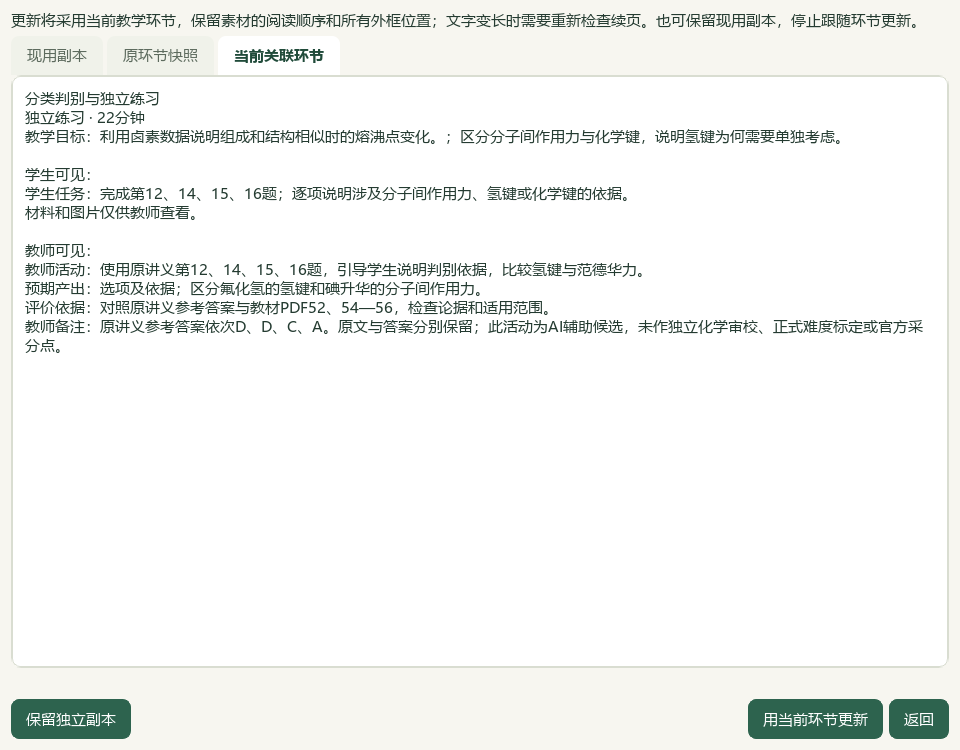
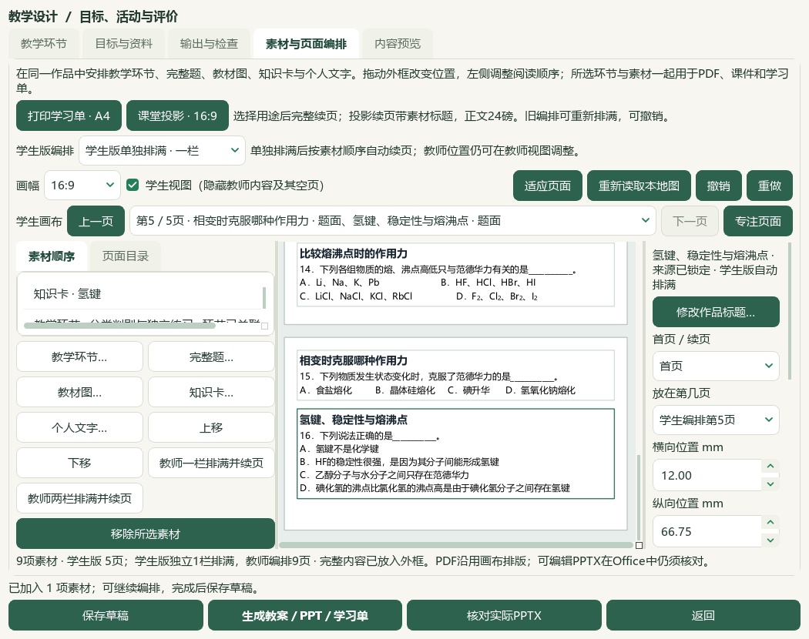

# 2026-10-06 Word完整短题分页、复制库去重与第16题接入验收

本片为未发布本地进展，总目标仍active，人工／教师审校未完成。检索文章0、新试卷0、重复下载0、新增完整题备课接入1；微信读书永久停用。

## 当前结果

Word导出对可以容纳在一张打印页内的连续公共材料、题干和全部选项设置整组分页，保留正文、公式和原图；答案、教师说明与来源备注按原角色另行流转。长题或高图仍完整续页。先在完全相同的8素材、原页面几何和教学环节上生成第4输出版本并另存第21份草稿，实际学生Word仍2页，原Q12题干与选项从跨页变为同页，Q14、Q15同样完整。

资料库复制后的真实导入发现原三题因source_path变化被重复追加，未保存的12素材现场保留。去重现以已核验的源文件SHA、来源版本、题目键和范围SHA等证据比较，忽略物理存储路径；版本、范围或题目身份变化仍分别接入。通过普通草稿打开流程恢复第21份，再用四题完整预览重新接入，原三题的标题与现用副本逐项保留，只新增第16题。

新增题来自PKG-065第07讲专项训练解析版，源SHA 5ba3b659…，原文块102—108，题面102—106／答案107—108；Q17从109开始未带入。原参考答案A保留，现用标题为“氢键、稳定性与熔沸点”。自动标签K13及教材候选TB-M1-C4:4.4按现状保留，尚须教材映射与化学审校。本轮不写标签、人工审核、官方身份或实测难度；四层正式身份仍unknown。

当前4完整题、2既有卡、1原表和2活动共9素材／40分钟；练习环节显式更新为第12、14、15、16题，再核对关联活动后刷新。原第一环节、2目标和7份旧素材逐项保持，教师编排为容纳新题重新排满，学生独立一栏保持。实际Office教师Word5／学生Word2／教师PPT9／学生PPT5共21页，全文、标题、导航、原PNG字节与答案隔离0失败；四题在两版Word及学生PPT中均各自保持完整题干和选项同页，教师PPT按长答案正常续页。

原20草稿／120登记成品保留；纯Word修复的第21份／第4输出版本保留，四题成品另存第22份／当前第5输出版本。普通ZIP恢复22草稿／22唯一版本／132成品／50图片摘要。实际CMD→普通快捷方式→Pythonw重开9素材、4选题、5学生页、缩窗及前序范围／标签。入口附加截图两次在120秒冷读限时内未获回执，前景诊断确认第79份来源仍在正常整理，记录保留；最终将原文冷读限时延长至300秒，目录完成后明确选择第16题。首次整库浏览仍较慢，首读性能优化继续。

3既有应用模块、2既有测试模块修改，20新增用例包含于最终225相关通过检查；Word14项与去重19项补验、前序41／206项和各次重跑不累加。README14项、文档策略和控制器另核。465 Word文件（包括SQLite）、3684属性／9737历史及3手工范围保持；仅选题由3增至4。中央知识386／素材322、catalog与corpus170、研读499存储／460可选、60正式节／77补充保持。第16题已在734阅读身份账本中，本轮重新核对不重复计数；冻结702待办不重建，新增正式题／中央标签／官方采分点0，既有正式4／人工审核0。

维护源码渲染v17，已发布EXE v0.1.101未升级；个人配置、前序候选、原教材／讲义、旧成品与冻结队列不改，HEAD e08c3e7及空索引保持，无提交／推送／发行。微信读书永久停用，本轮检索文章0、新试卷0、重复下载0，没有检索外部材料或调用模型供应商。普通备课ZIP不含Word库、标签／范围／选题状态、原教材或供应商配置，主候选中的465 Word文件需另行保管。

本轮未复看或新增BDL帧，未播放全片或核听音轨。总目标仍active，手机端排除；Q11答案／作答形态、Q13独立索引、更多资料、化学及四层审校、整体UI与视频功能对齐、视觉主题及桌面发行继续。历史辅助临时原字节未恢复例外保持。

验收：[本轮记录](2026-10-06-word-question-pagination-qa.md)；入口：`E:\项目\上海高中化学等级考\outputs\2026-10-06-word-question-pagination\打开Word分页与四题备课候选.cmd`。

## 两阶段原生验证

第一阶段不改变8素材的任何题目、原裁图、节点或页面几何，只因渲染v17生成第4版本并另存第21份。实际学生Word2页，原Q12、Q14、Q15全部题面分别在一页；根模型逐页原尺寸查看两页。Word逻辑按学生可见角色后的实际段落分组，包含连续公共材料、题干、选项及所属行内图片，保守估计须小于可打印高度减12mm。教师答案、来源、交错教师备注不被接入同一keep链；超长组沿用既有短开头和完整续页。

第二阶段真实四题预览先形成12素材，根模型读取恢复记录发现三题重复，仅原证据source_path变化；12素材未保存为正式草稿，现场和原生截图留档。去重只在SHA、来源版本、范围SHA及题目键有效时忽略source_path，其余证据严格保留。未知SHA仍被入口验证拒绝，不借去重解锁不完整来源。通过普通打开草稿对话框恢复第21份，而后四题预览接入只追加Q16至9素材。原三题现用标题与原始块保持。

Q16源文件为第07讲《分子的极性和分子间作用力》专项训练解析版，SHA `5ba3b6599d3ceb6109ab0e4ac5ac600a9a9282a59f9f892d3521292af824b966`，来源版本 `e5e6f4d7139029bbf08049295758669f2cf39d4bb1f5b383dbae95ccca97f84b`，题目键 `word-question-e1914b2b2de91e114a69580d`，题目版本 `b9adaf94a4ec9d65e060b6236d071baa1a16b17913352ddcb92db5597ed48e09`。范围102—108，题面102—106、答案107—108、图片0；从原XML核对整段，不包含Q17。保留来源答案A，现用标题另改，源文件和原快照不写。自动标签K13与教材候选4.4未更新或人工确认，正式四层身份unknown，原题不是官方材料。

练习节点仅更新teacher_action、student_task与notes三字段，并显式刷新其关联素材。第一节点、目标、18+22分钟及其他7旧素材不变。教师重新排满一栏以容纳新题，不能宣称此次教师位置完全不变；学生独立一栏及16:9、24磅保持。新增题在学生画布只有1片段，原Q12／Q14／Q15也各为1片段。

## 实际Office与视觉范围

实际安装Word／PowerPoint转换四份文件，源文件SHA保持，教师Word5／学生Word2／教师PPT9／学生PPT5共21页，全文、可见标题、续页导航及角色隔离0失败；各两版内含完整原裁图PNG字节。两版Word和学生PPT的4题共12个同页题面检查均通过，学生Word四题均在第2页，学生PPT第4页含Q12／14、第5页含Q15／16。教师PPT依长答案正常续页，Q16跨8／9页。

根模型看四份21页联系图，以及全部2页最终学生Word、5页最终学生PPT原尺寸页；未称全部教师页已原尺寸细读。初次原生源题截图在界面布局稳定前抓取，正文区域空白，保留但不当作完整原文视觉核验；原XML、完整预览与最终画布／Office正文另行核对。入口补验两次未获完成标记，各5幅已重开截图保留；前景诊断显示120秒时仍正常整理第79份来源，未判作应用失败。最终将附加原文冷读限时延长至300秒，目录完成后明确选题并重开题面和答案。首次整库浏览仍较慢，本轮仅调整验收限时，性能优化继续。机器与模型视觉证据不等于真人审核或独立化学答案审校。

## 回归与数据保护

11新增Word用例覆盖纯文字选项、公共材料、长文本／高图、交错教师答案、行内公式／原图和渲染指纹；9新增去重用例覆盖复制路径、现用副本保留、源SHA／来源版本／范围SHA／题目键变化分别接入、未知证据拒绝及同批复制去重，共20新增case包含于最终225通过检查。Word首轮8失败／6通过因测试夹具未创建Qt应用，改为有效静态来源夹具后14通过；去重首轮3失败／16通过因未知证据夹具误期待追加，按现有入口拒绝契约改正后19通过。41项较窄初验、206项去重修复前回归及各重跑不累加为最终数量。

22草稿／22唯一版本／132登记成品／50图片摘要备份恢复通过。原20草稿与120成品、第21份纯Word修复和当前旧4输出版本逐项保持；第22份另存当前第5版本。独立成品目录有6登记输出及OUTPUT-MANIFEST.json、使用说明.txt。普通ZIP只含备课作品、引用图片、终态任务及成品，465 Word库、标签／范围／选题状态、源教材、供应商配置与密钥不在其中。

当前主候选465 Word文件（含SQLite）逐字节保留，3684属性和9737历史payload保持；3手工范围不写，只新增Q16为第4选择。中央386知识／322素材、170登记及既有正式4／人工0保持；734阅读身份不增加，第16题只是重读，冻结702待办不重算。个人配置、全部前序候选、教材PDF／Word原件与旧公共证据按明确路径SHA核对。初始2426路径冻结，计划内修改为3应用、2既有测试、6CODE文档、2项目知识库笔记共13；如INDEX由其他项目更新，只接纳已记录的当前基线并保留所有非化学行，95-Source不写。

## 路径与继续范围

维护代码：`C:\Users\20671\.codex\worktrees\e6ae\上海高中化学等级考`；数据：`E:\项目\上海高中化学等级考`；本片证据：`E:\项目\上海高中化学等级考\outputs\2026-10-06-word-question-pagination`；候选：`C:\Users\20671\AppData\Local\ShanghaiChem\LocalCandidates\2026-10-06-word-question-pagination\profile`；最终草稿：`prep-1009ce19ea5845b481ae3b4ad0eded68`。

入口`打开Word分页与四题备课候选.cmd`；备份`Word分页与四题备课候选-备份.zip`；独立成品`exported-copy`。维护源码v17，EXE v0.1.101、HEAD e08c3e7和空索引不变，无提交／推送／发行。主要证据见native-verification-current、word-flow-only-actual-Word-verification、native-handoff-unexpected-duplicates、canvas-layout-verification、complete-question-page-verification、word-question-actual-office-verification、backup-roundtrip-verification、candidate-entry-verification、related-tests-handoff-final.xml、reading-identity-ledger、next-question-work及最终保护／视觉／验收回执。

没有新BDL帧、全片观看或音轨核听。Q11／Q13问题、更多资料、化学和四层审校、整体UI及视频功能对齐、视觉主题与发行继续，手机端排除。历史J缺NH₂误判纠正保持；`outputs/2026-10-05-question-confirm-performance-slice/auxiliary-state-exception.json`的辅助临时原字节例外仍未恢复。
