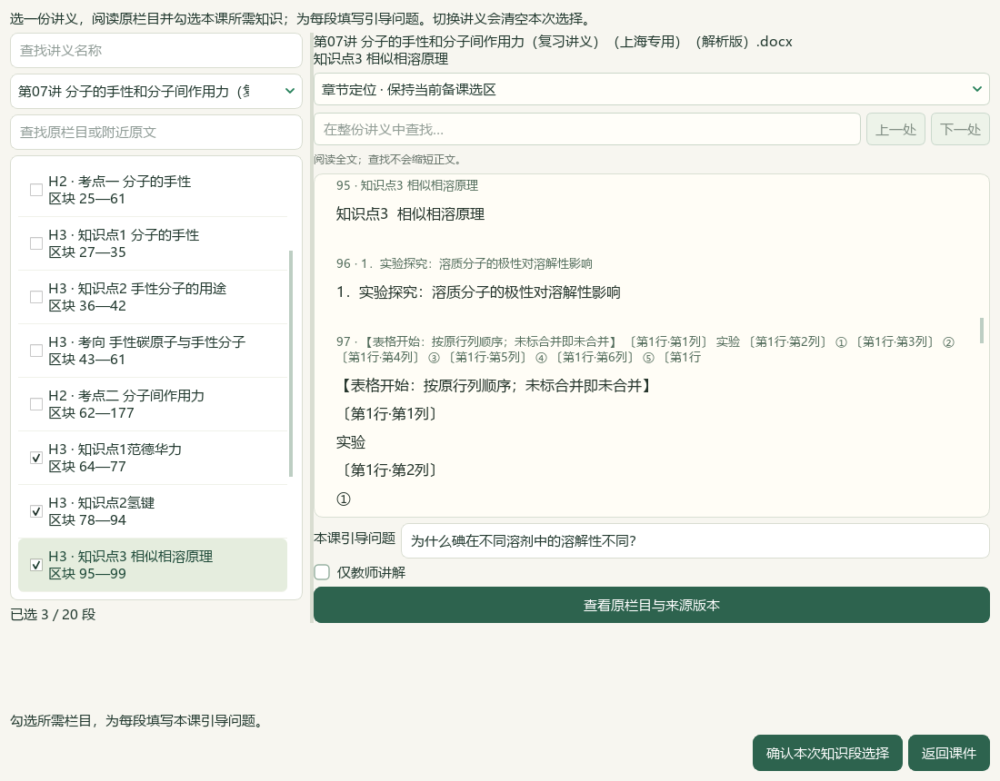
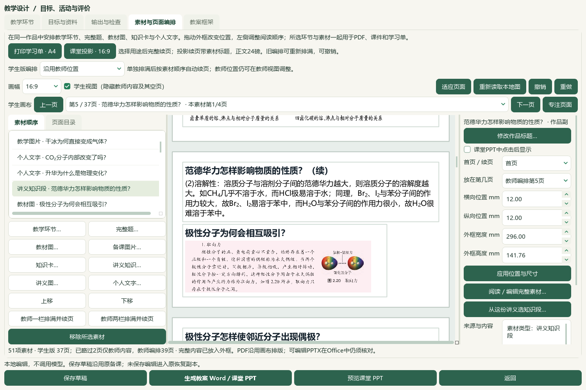
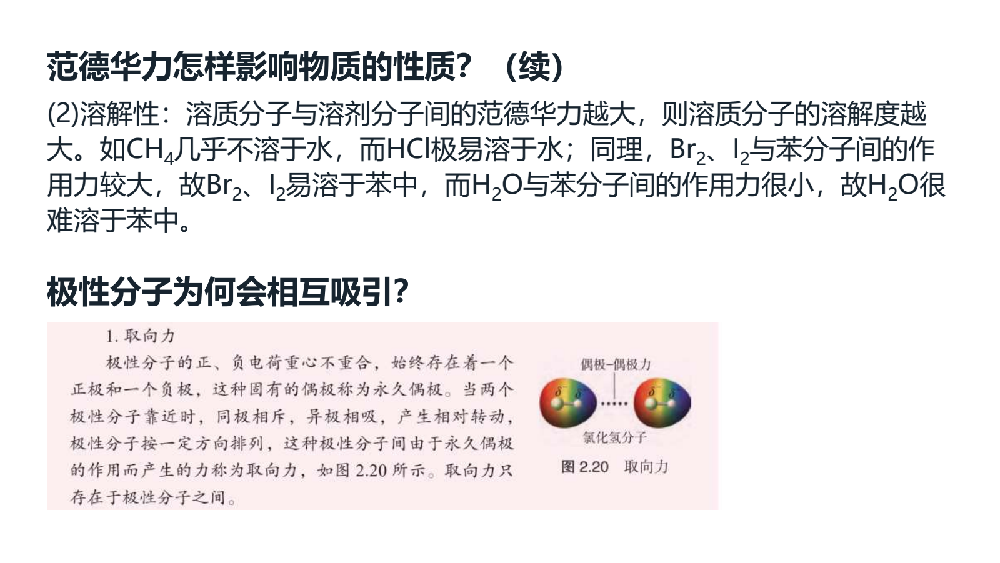
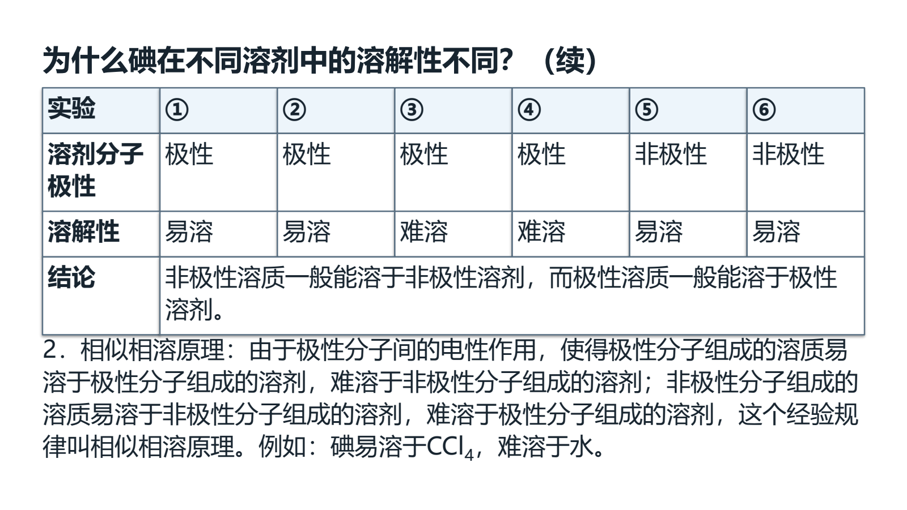

# 完整讲义知识栏目与知识网加入课堂课件

本轮接通“素材与页面编排 → 讲义知识…”以及所选讲义原图／知识段的“从这份讲义选知识段…”。先从已存元数据选择一份Word，再读取该份原文和明确的1—9级栏目；按完整知识段串联讲解、原图和知识结构网。每批1—20段，各段填写本课问题标题、设置“仅教师讲解”，确认后整批加入同一课件，加入可一次撤销与恢复。最终分子间作用力课堂经实际Microsoft Office导出、根代理限定视觉检查、普通工作台另存及原生重开；当前为维护源码增量，未发布新EXE。

## 来源、完整范围与导入行为

实际目标是PKG064《第07讲 分子的手性和分子间作用力（复习讲义）（上海专用）（解析版）》，原DOCX SHA-256为`084da90dae9f2a26007164e070290255325995241de4c34051c4ffc97bbe3d71`。原生预览193块／79素材元数据，原preview revision `c52af5a16efb4dde13a7107e229188bcbf11ac53f6d992273ffa59b232f15a95`保持。独立栏目索引revision `c0e9daa4ebbdb6ff98e8db09d1d571176175353f0bdfbf718a163b17d6ef316a`，未改旧预览字段或重新计算其他97份讲义。

| 原Word范围 | 本轮实际使用范围 |
| --- | --- |
| 19—20 | 纯图一级栏目与完整原知识结构网；保留两个原图出现位置 |
| 64—77 | “知识点1范德华力”完整知识段及第76块两幅原图 |
| 78—94 | “知识点2氢键”完整知识段、原图及第94块比较表 |
| 95—99 | “知识点3 相似相溶原理”完整知识段及第97块实验表 |

原始标题、连续原块、文字、上下标、可读取公式、表格原行列／合并结构及每次图片出现位置封存在来源快照中；本课问题标题和作品编辑独立保存。同版本同栏目重复加入保留已有编辑。既有教师图片范围继续保护，包含已识别题目、共同题材或答案的栏目须走完整题入口。源Word、栏目版本或范围变化，已知来源问题、原图损坏／不能完整对应或图片容量超限均阻断整批，图片保存沿用事务回滚。

图片使用完整嵌入原图像素，Word裁剪、透明／亮度等显示设置不直接应用到新像素；对象XML SHA和原尺寸作为内部来源证据保留。该入口不复刻原Word排版，课堂教师需精裁时可继续图片／教材裁片入口。课堂正文不插入解析器附加提醒或来源说明。

## 已通过的检查

| 检查范围 | 已收到的结果 |
| --- | --- |
| 栏目后端 | 32项通过；含多段、H3独立索引、图文／化学脚本、表格、题答范围、来源变化、容量及回滚，实际归档facade限定目录只读 |
| 选材Qt相关 | 51项通过；原文栏目、问题标题、教师范围及来源重核的界面回归 |
| 课件交接UI | 12项通过；批量加入、取消、重复保持编辑、撤销与恢复 |
| 保存范围 | 3项通过；与前述32＋51＋12合为98项定向范围 |
| 表格与渲染 | 37项通过（28＋9）；原行列／合并结构、可编辑表格、完整文字与渲染对应 |
| v33相关回归 | 32项通过；投影续页、来源显示、正文提醒过滤与点击显示 |

本轮已验证第64—77／78—94／95—99完整栏目与完整原知识网的选用、取消及整批撤销恢复，原数据保持。上述数字分别说明本轮定向范围，不计作全套测试、全库化学审校或跨轮累计。

后端回执为[E盘后端检查](<E:/项目/上海高中化学等级考/outputs/2026-10-07-handout-knowledge-sections/source-audit/backend/implementation-checks.json>)与[PKG064检查](<E:/项目/上海高中化学等级考/outputs/2026-10-07-handout-knowledge-sections/source-audit/backend/PKG064-backend-check.json>)。新定向测试分别位于`test_handout_knowledge.py`、`test_handout_knowledge_picker_ui.py`、`test_handout_knowledge_handoff_ui.py`和`test_handout_knowledge_tables.py`；相关集合数量以根代理终核为准，不从单个文件名推算，也不合并为去重后的全仓通过数。

## 最终课堂与实际Office检查

v1先保留原表坐标文字，造成课堂输出增加页面，当前改为原生可编辑表格呈现原行列和合并结构；完整原文仍封存在来源中，原DOCX不修改。最终输出记录为`OUT-fff87b006def45dfa621bb24dd1ec687`，渲染revision `shchem.composition-classroom-exposition.v33`。

| 最终成品／内容 | 实际结果 |
| --- | --- |
| 课时与资源 | 两课时共80分钟；51资源，37学生课堂页 |
| 课堂材料 | 13教材图资源、6实景照片、3完整讲义知识段、1完整知识网、2完整原题 |
| PPT点击 | 9点击显示资源；PPTX时序读回17个`clickEffect`，373个DrawingML文字片段 |
| Word教案 | Microsoft Word实际导出28页 |
| Word课堂讲义 | 独立Microsoft Word实际导出18页；源DOCX与登记摘要一致且转换前后不变 |
| 标题与正文 | 资源工作标题均为问题；成品正文没有来源或防御性提醒 |
| 封存来源 | 来源snapshot revision不变；三处化学勘误仅改作品副本 |

本轮新加教材两处完整段落及图：TB-E2《选择性必修2 物质结构与性质》PDF第53页／印刷第49页的取向力／图2.20与诱导力／图2.21；教材源SHA-256 `4eb751c3bc879d2ad41a2faa723b3b4af05b29ff78f3e89a2eaf9727ebb8a848`，裁片摘要及坐标见最终课堂回执。新增两张原尺寸实景为壁虎足与水黾，连同既有照片共6张，并非本轮新加6张。内部来源记录保留[壁虎足原文件页](https://commons.wikimedia.org/wiki/File:Green_gecko_paw.jpg)（Peter Heeling，CC0-1.0）和[水黾原文件页](https://commons.wikimedia.org/wiki/File:Water_strider.jpg)（TimVickers，PD-self）、原图URL、采集时间和SHA；不把来源字段插入课堂正文。

三处化学修订为：不用分子对称性单独给二甲苯异构体范德华力排序；氢键定义补足受体孤电子对及分子内／分子间范围；纠正水与邻羟基苯甲醛的氢键分类。原资料、来源快照和原题答案身份不改。结尾另有教师课堂解释，身份与原题解析分别保留。

实际PowerPoint PDF SHA-256为`ad6a55a698aa1cc5116dbb80a5fde5d63951c6cadf9c78c0f1fc1520734746b7`；实际教案PDF为`05eb4397a4bc42ec790d84b573225d10a1e93ec9abf1f42f4240be23f4f2d869`；实际课堂讲义PDF为`ad706e0cfbd83780e0936b4c805b6cd51087502a238d8d3b821174ad5df57d87`。各DOCX/PPTX摘要与登记及教师成品包对应。

根代理模型视觉检查范围：37页实际PPT缩略总览、范德华力完整4页、氢键完整7页、相似相溶两张原表页、新增两处教材与两张实景、结尾同页题答；教案第1／2／27／28页；课堂讲义第1／6／11／16／18页。教案与讲义其余页未逐张视觉检查；静态图片不证明逐帧放映，点击效果依据PPTX时序读回。模型视觉不等于独立真人化学审核，正式review flags没有提升。

事实回执：[最终课堂与视觉范围](<E:/项目/上海高中化学等级考/outputs/2026-10-07-handout-knowledge-sections/classroom-final-v10/classroom-verification.json>)（`root_visual_passed`） · [成品结构与PPT时序](<E:/项目/上海高中化学等级考/outputs/2026-10-07-handout-knowledge-sections/classroom-final-v10/package-verification.json>)（`passed`） · [独立Word课堂讲义](<E:/项目/上海高中化学等级考/outputs/2026-10-07-handout-knowledge-sections/classroom-final-v10/word-lecture-verification.json>)（`root_visual_passed`）。

## 普通工作台保存、原生重开与保护范围

新稿`prep-2918fbadebc64b2087749a33e052e04c`另存到常用SOURCE工作台，经原生草稿对话载入并回到设计编辑页；恢复payload可重开新设计，dirty状态回读为false。旧51个已存对象中的47备课逐条保持，新增1份备课后为48备课／52对象。989个保护文件中仅`desktop-state.v1.json`和`recovery/preparation.v1.json`发生本次授权保存变化，其余987匹配；历史选题保持。新稿29图资产，6份登记成品摘要回读一致，完整知识来源及独立栏目版本重新核对通过。

[工作台检查](<E:/项目/上海高中化学等级考/outputs/2026-10-07-handout-knowledge-sections/saved-workbench/workbench-verification.json>)状态`passed`，保留保存前备份；[根代理最终回执](<E:/项目/上海高中化学等级考/outputs/2026-10-07-handout-knowledge-sections/root-final-acceptance.json>)汇总本轮范围。源码未提交发布、EXE未重建，未改题库正式资格；原59项及X01—X10仍按原完整范围维护。

## 原生界面与实际Office截图归档

截图以原字节复制到[归档目录](screenshots/2026-10-07-handout-knowledge-sections/source-manifest.json)，15份源／归档SHA逐一相同，未修改像素。宽窄选材图来自较早的原生选用验收，普通工作台两图来自最终保存重开；`actual-`图片来自实际Office输出，不能混称为同一次屏幕截图。

[420px窄窗上下阅读](screenshots/2026-10-07-handout-knowledge-sections/picker-narrow.png)。

[同一新稿的教材原文页与选图控件](screenshots/2026-10-07-handout-knowledge-sections/saved-textbook-question-page.png)。

[壁虎足课堂页](screenshots/2026-10-07-handout-knowledge-sections/actual-gecko-paw.png) · [水黾课堂页](screenshots/2026-10-07-handout-knowledge-sections/actual-water-strider.png) · [结尾同页题答布局](screenshots/2026-10-07-handout-knowledge-sections/actual-final-question-and-click-answer.png)；后一静态图仅说明布局，点击事实见时序回执。

[实际教案第1页](screenshots/2026-10-07-handout-knowledge-sections/actual-word-plan-page-1.png) · [实际课堂讲义第11页原生表格](screenshots/2026-10-07-handout-knowledge-sections/actual-word-lecture-page-11.png)。37页实际PPT总览分为[第1组](screenshots/2026-10-07-handout-knowledge-sections/actual-all-pages-1.png)、[第2组](screenshots/2026-10-07-handout-knowledge-sections/actual-all-pages-2.png)、[第3组](screenshots/2026-10-07-handout-knowledge-sections/actual-all-pages-3.png)、[第4组](screenshots/2026-10-07-handout-knowledge-sections/actual-all-pages-4.png)。

文档检查命令为`python runtime/deeptutor_shchem/documentation_policy.py`与`python -m pytest -q staging/coordination/deeptutor_gateway/tests/test_complete_readme.py`，实际命令、结果、README篇幅、文档SHA及截图源／归档SHA记录在[E盘文档检查回执](<E:/项目/上海高中化学等级考/outputs/2026-10-07-handout-knowledge-sections/docs-checks.json>)。

[当前闭环记录](../WORKFLOW_STATUS.md#handout-knowledge) · [教师课堂编排](../teacher/lesson-and-paper.md#classroom-purposes) · [原59项与X01—X10](../roadmaps/audit-followup.md)
