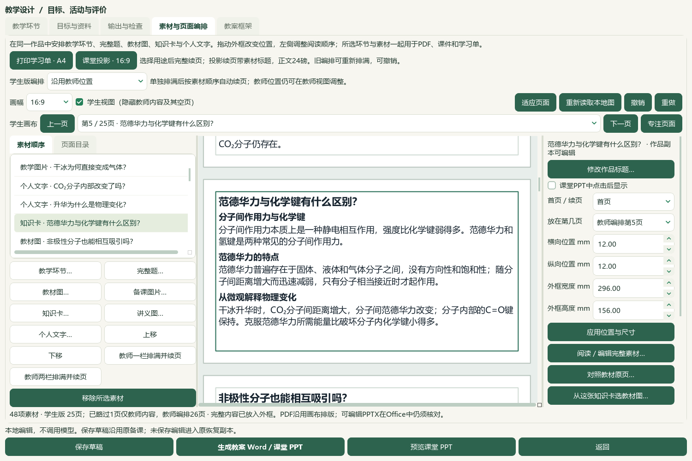
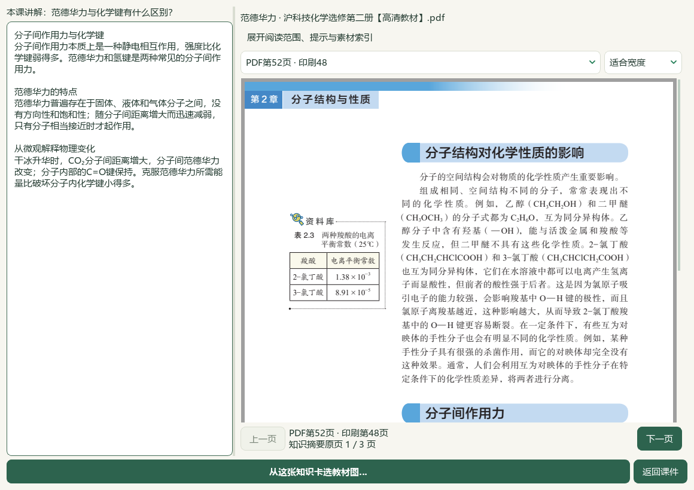
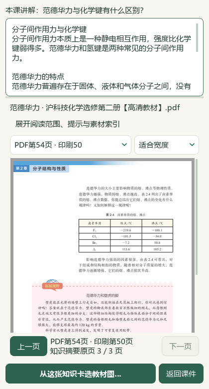
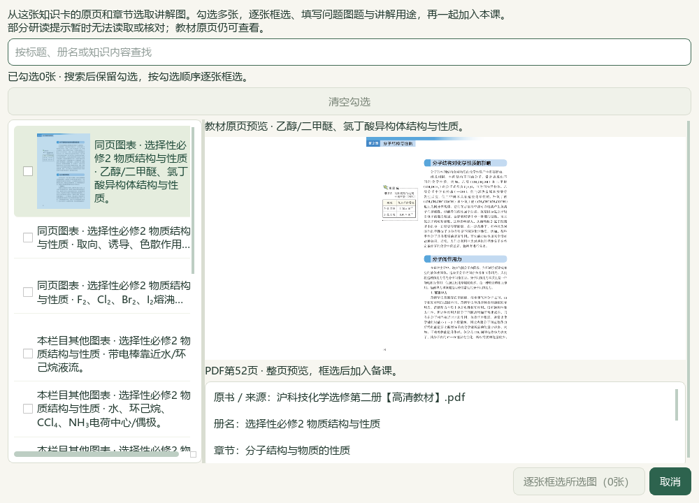

# 知识卡讲解与教材原页同窗阅读

本轮接通课件知识卡的“对照教材原页…”。窗口完整保留本课讲解文字，教材原页按知识卡封存身份定位；宽窗并排、420px窄窗上下阅读。作品中的问题标题不改变原书、知识记录或页码。原页阅读不保存，继续选图先重核来源与草稿，再进入原有批量裁片流程。

应用落点为 `desktop_knowledge_reading.py`、`desktop_workbench/knowledge_card_reader.py` 与 `desktop_workbench/lesson_composition_panel.py`。登记阅读笔记、教材概念、个人知识卡分别恢复真实身份，核对原内容、来源SHA、页码和目录/研读版本；原内容缺失、变化、重复或读取期间改变时不交接。不读取题库筛选，不以课堂问题标题检索或猜测原页。

后端66项通过（新阅读接口37、来源选题25、可读素材4）；界面及相关回归33项通过（新阅读界面16、知识选题15、知识卡选图绑定2）。范围不与前序检查重复累计。完整README14项和文档策略通过。最终绑定记录为 `E:/项目/上海高中化学等级考/outputs/2026-10-07-question-textbook-evidence/root-final-acceptance.json`。

实际Qt隔离副本载入48素材“分子间作用力”，从范德华力原卡打开选必二PDF第52—54页，1160px宽窗与420px窄窗完成阅读；可见PDF像素绘制完成后截图。关闭保持原课，继续选图经重核进入同知识卡原页/章节列表，取消保持原课。47保存备课、历史选题及989主候选文件SHA保持，无新稿、Office或中央资料写入。根代理模型查看当前实际截图，不代替独立真人化学审核；源码未发布新EXE。

初次界面检查1项失败是测试在闭包捕获函数后再替换函数，已拆分为独立来源变化和关闭回调案例，最终33项通过。原生辅助脚本曾误设两页范围/选图字段，并过早抓取空白PDF；失败输出保留，不计通过。最终固定脚本 `native_card_reader_final.py` 使用真实三页范围与原页行身份，等可见PDF像素后执行，`native-reading-final/native-verification.json`通过并绑定截图摘要。

本轮原Word只读副本转换诊断保留在同目录 `word-diagnosis/`。它未生成原排版PDF，根因未证实；不据此提升第07讲11—19题候选关系或化学审核状态。已绑定教材PDF阅读不依赖该转换。视频V28/V30/V43原件身份核对和既有帧接口参考保存在 `video-audit/`；本轮没有完整播放或听音轨，不把独立UI设计推断称作视频展示的自动关联。

用户正常源码入口为 `E:/项目/上海高中化学等级考/outputs/2026-10-07-same-lecture-questions/打开教材图与问题导学工作台.cmd`。既有14页手性课堂和25页分子间作用力课堂保持；本轮只改善选材阅读，不追加保存稿或重建Office。微信读书停用，整体目标继续。
