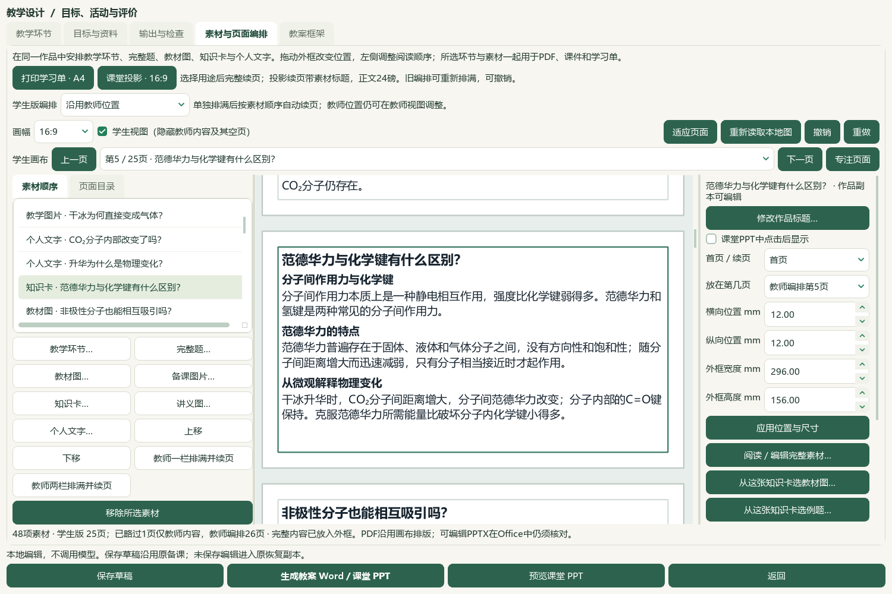
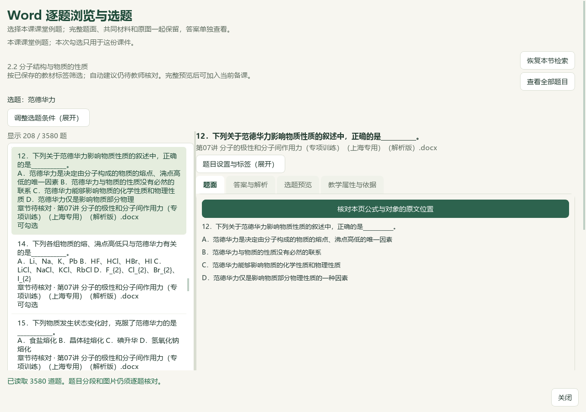
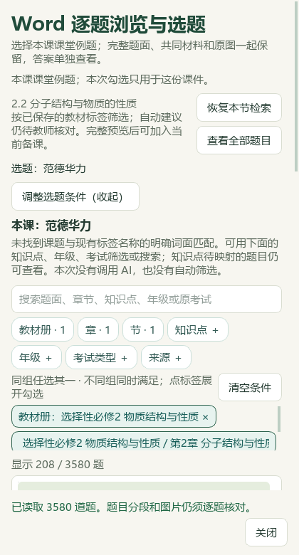
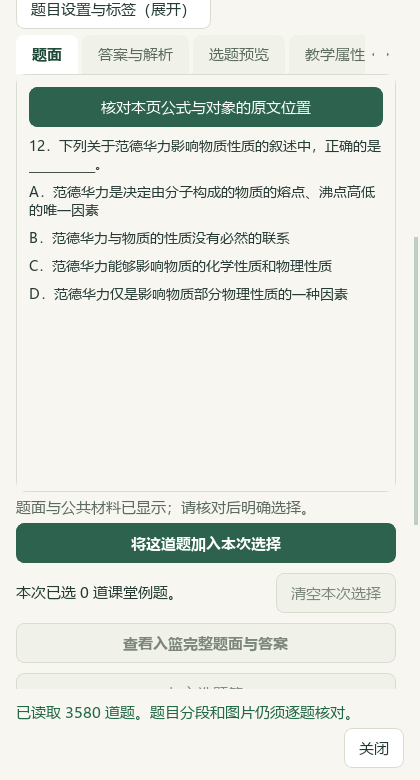

# 知识卡继续选择课堂例题：本地验收

2026-10-07，当前e6ae源码，未发布。知识卡已能继续选教材图，本片接通同一张卡的课堂例题入口，使知识讲解、原图和少量练习可以在同一课件里编排。

## 实际操作

在“备课 → 教学环节 → 素材与页面编排”选中知识卡，点“从这张知识卡选例题…”。读取原卡身份、原标题、教材和笔记版本；工作副本的问题标题不改动来源身份。有真实章节的卡片带入教材册、章、节，未归节概念使用原标题文字检索。章节筛选依据已保存标签，不代表逐题精确概念匹配。

本课勾选独立。先读完整题面、公共材料、原图及教师答案，勾选并预览，再确认加入课件。确认后重新核对原卡来源和草稿状态，取消不追加；同版本重复题保留已有编辑，新增内容可以一次撤销与恢复。原答案和教师范围保持。选题期间的绑定只用于本次流程，完整题仍保留自身原始证据，不添加教材图片专用字段。

课堂例题窗口默认收起筛选区，已应用条件继续生效；点“调整选题条件（展开）”即可检索和修改条件。窄窗按上下顺序显示选题与阅读区，可向下滚动读完整题面。参考模式和限定原来源的独立选择文案分别显示实际用途。

## 真实资料与保护范围

使用原正常候选档案的隔离副本，实际载入已保存的“分子间作用力”课程：48素材；原知识卡ID为TB-E2-C2-S22-C05，原标题“范德华力”，课堂工作标题“范德华力与化学键有什么区别？”。真实选必二2.2节条件在3580道完整题目录中显示208题。

实际取消后原课件保持；第12题完整预览及原答案D保留，确认后同一课程由48增为49素材，一次撤销恢复通过。原48素材、47已保存备课、11条全库历史选择和989主候选文件SHA保持；没有保存新的备课稿或生成教学Word/PPT成品。新增题目仅在隔离副本中用于功能验证，不替换正常档案中的课堂设计。

根代理检查了真实Qt宽窗、420px窄窗、原卡和完整题页面；属于模型视觉检查，不冒充独立真人化学审校或原Word页排版审校。本片保持原25页/14页课堂设计及Word教案、PPT和讲义；没有增加图片、调用生成供应商或改变动画。

证据目录：[本轮文件](E:/项目/上海高中化学等级考/outputs/2026-10-07-knowledge-card-question-link/)。真实当前流程回执为`native-v2/native-verification.json`；较早的`native-v1`保留收起筛选前的实际检查，不冒充最终界面。正常入口仍为[打开教材图与问题导学工作台](E:/项目/上海高中化学等级考/outputs/2026-10-07-same-lecture-questions/打开教材图与问题导学工作台.cmd)，加载当前源码；旧EXE v0.1.101未更新。

## 检查与保留记录

- 后端25项通过：登记研读、个人笔记、登记概念、未归节检索、原快照篡改、重复身份、页码变化、来源变化、取消及只读范围。
- 当前UI及相关回归54项通过：卡片入口、独立勾选、取消、迟到回调、草稿/图片变化、关闭、原来源重核、去重、一次撤销恢复、首轮检索及默认收起条件。三个测试模块范围重叠，不把计数扩写为全套测试通过。
- 完整README与文档策略的结果见本轮`root-final-acceptance.json`，文档链接和截图随当前源码检查。

首轮UI有一项测试注入在函数被捕获后才修改，修正测试注入时机后通过；后端早期缺失目录元数据触发KeyError，现入口转为明确ValueError并保持关闭。首轮日志/XML与最终回执均保留，不把失败轮次计为通过。

## 教材与原题关联候选

只读核对第07讲11—19题的当前key、revision、完整题面与原答案，并与原Word XML重新生成的预览逐项比较。候选关系连接11个既有概念、10个图表和19张有SHA的教材原页。完整题范围内原图均为0，不把教材图误算作原题图。

第11题保留原D答案，候选记录标出A与教材表述、D缺比较条件的疑点；第13题有独立key但没有已保存属性；第18题旧属性仍绑定旧范围；九题未完整覆盖分子内/分子间氢键比较。文件在`content-audit/q11-19-candidate-map.json`和`q11-19-content-audit.md`。未修改真实题目属性、质量notes、原答案或中央清单，未正式导入这些关系。

原解析版Word含两个失效的外部页眉/页脚图片链接，转换器首先未启动Word。随后另存只去除外链的本地阅读副本；正文与嵌入图片逐ZIP部件比对保持，但实际Word仍在打开阶段报COM错误，未产生PDF。失败会话记录和副本保留。根代理本片只直接看过教材PDF52/53整页，原Word视觉页数为0，不将XML预览等同原Word排版页。此限制保留在内部记录，未写入课堂成品。

微信读书永久停用；源码未提交、推送或发布。整体目标继续，更多资料、原题具体概念关系、正式四层数据、化学审核及整体UI按原59项和X01—X10范围推进。
