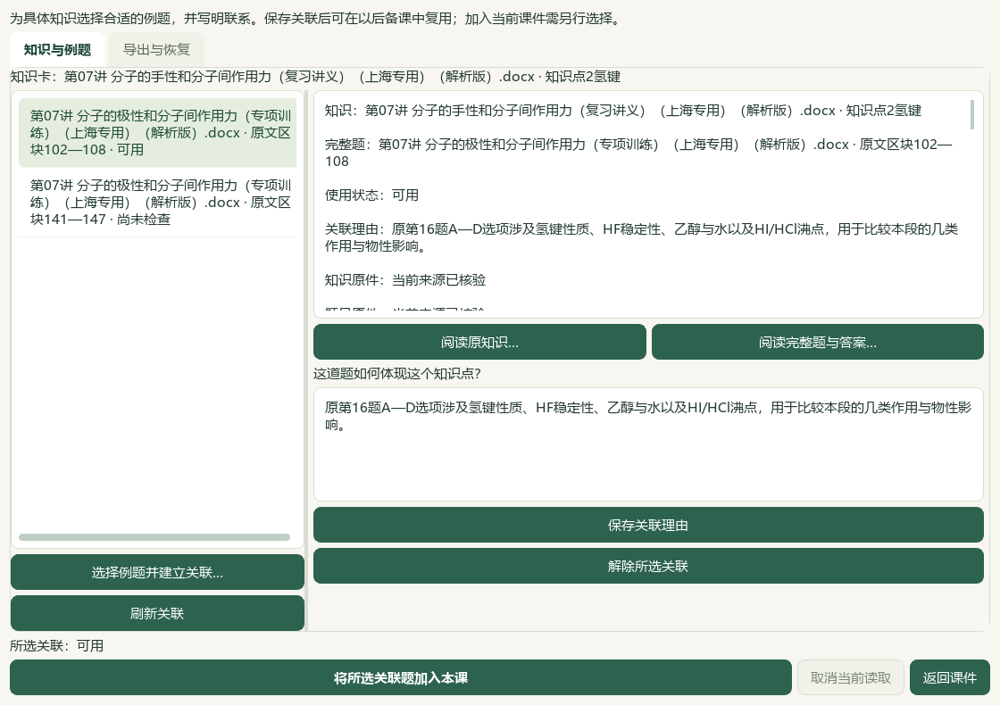
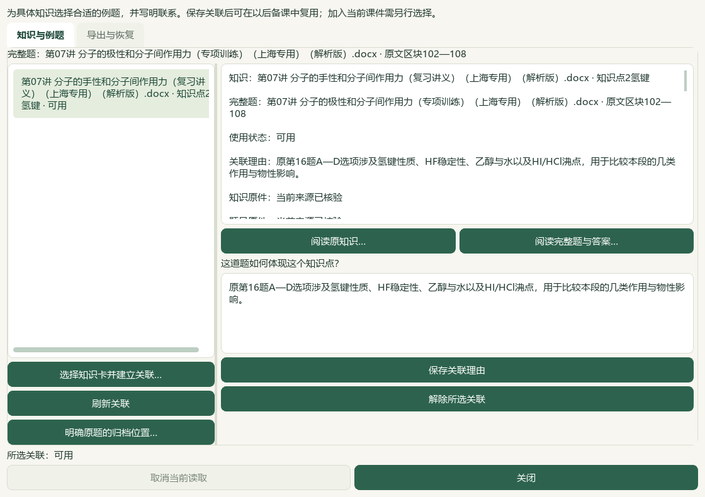
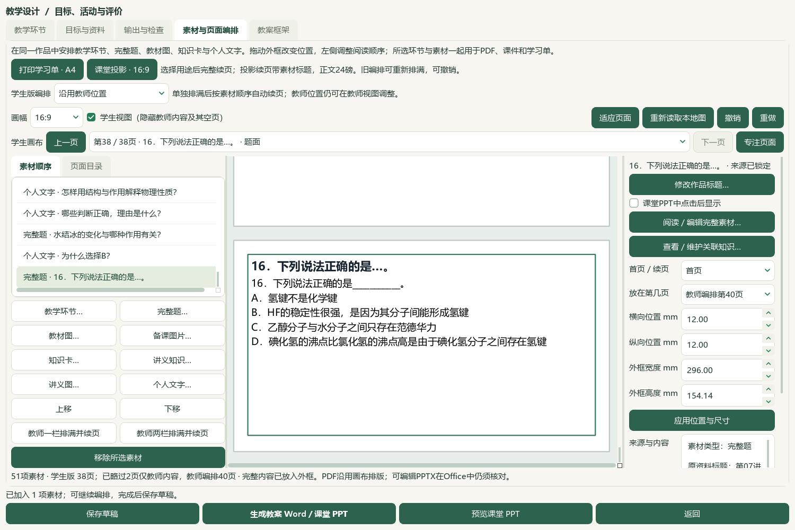
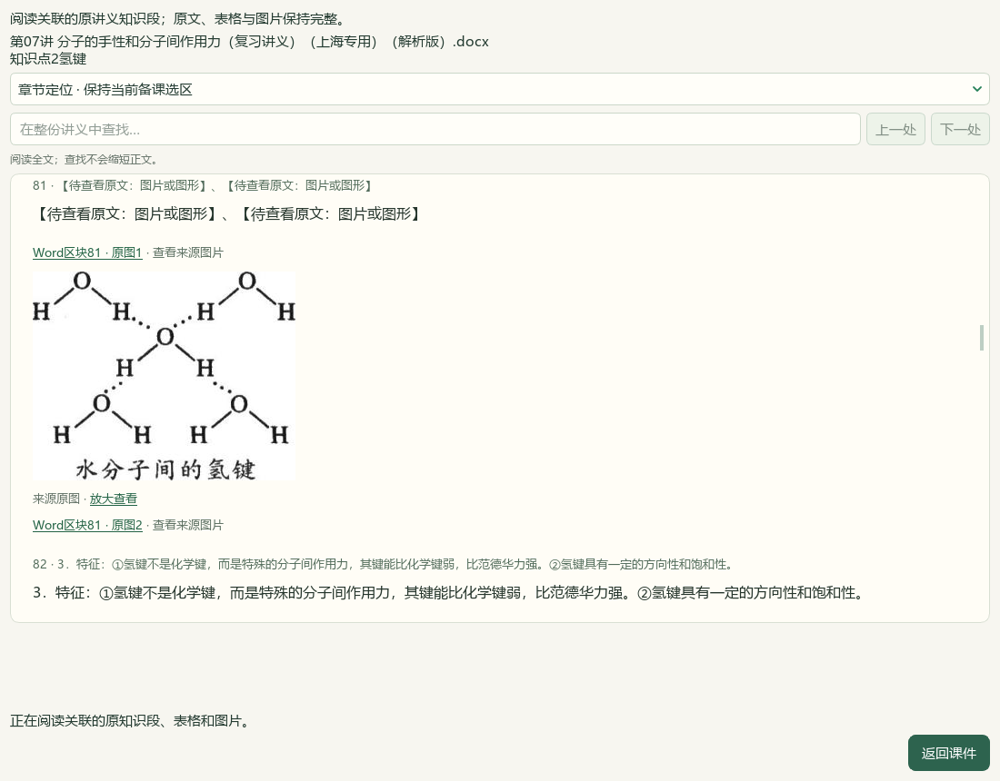
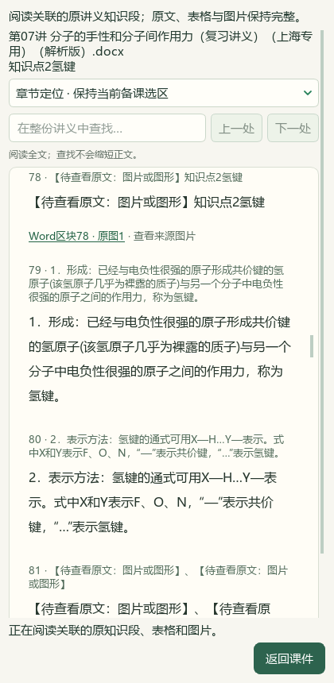

# 知识与具体完整题的可维护关系验收

2026-10-07，e6ae维护源码，未发布。知识卡和完整讲义栏目现在可以保存具体完整题、关联理由和两端版本，题目侧可反查。当前课堂仍为51资源、37学生页；13教材图资源、6实景、3完整知识段、1原知识网和2原题及实际Word/PPT沿用[前序课堂验收](2026-10-07-handout-knowledge-sections-qa.md)，本轮没有重新生成Office文件。

## 实现与保存范围

- 独立`knowledge-question-links-v1`集合保存登记concept、登记研读笔记、个人BNOTE或完整讲义栏目与完整Word题的关系。知识端保留原身份、版本、SHA、栏目边界和完整原块；题端保留确切批次/归档、角色、原SHA、当前预览、题答连续范围与范围摘要。作品问题标题和讲解不改变原端点。
- 可保存、修改理由、解除、反查、阅读原知识及完整题答，或明确将关联题加入当前课件。元数据列表不枚举全部Word，缺失/过期端点仍保留理由和历史。当前有效且重核一致的端点才能交接；同字节多归档需明确选择。
- 保存前及CAS内重核两端；理由修改、解除也核对当前记录版本。Word锁、任务发布事件、状态CAS保持顺序；取消/关闭/迟到不交接。入课前后核对知识端点、完整题、当前课程和图片，单次撤销恢复，重复原题保持作品编辑。
- 独立JSON检查严格schema、重复键、非有限数、容量、摘要和历史。恢复预览列新增/重复/冲突，确认前重核文件与集合版本；默认不覆盖冲突，显式保留当前记录可只加新关系。重复恢复零写，原件缺失仍保留关系并等待重核，不复制原Word或教材。
- 现有备课ZIP没有扩大范围，关系JSON须单独保存。未写题目属性、选题历史、K01—K19标签或正式资格。

## 分版本定向检查

| 范围 | 结果 | 输出目录内证据 |
| --- | --- | --- |
| 后端与transfer合组基线 | 115通过；在末次范围/锁序修正之前 | `relations-transfer-final.xml` |
| 冻结代码的全部transfer | 76通过 | `transfer-current-final.xml` |
| 冻结后端的范围/迟到交接 | 3通过，41未选 | `knowledge-links-final-guards.xml` |
| 当前关联UI | 27通过 | `ui-relations-final.xml` |
| 前序关联UI和知识/Word入口 | 91通过，含较早24项关联UI | `ui-relations-checks.xml` |
| 旧入口与阅读布局 | 87通过，2旧来源正文断言失败 | `ui-old-entry-regression.xml` |
| 按用户输出契约修正后的Word入口 | 14通过 | `word-opening-final.xml` |

后端/transfer跨版本共120个唯一测试身份，不声称120项在同一最终源码回合通过；各UI集合也有重叠。两条旧测试要求课堂正文写来源，与用户要求冲突，已改为检查正文无来源且内部输入证据保留，没有放宽完整题答检查。具体命令、测试SHA和版本范围见`backend-checks.json`、`transfer-checks.json`与`evidence-index.json`。README完整14项和文档策略由最终回执记录。

## 实际Qt流程与原文

在隔离profile中加载正常工作台的最新51资源课例，使用真实氢键栏目78—94及同批次训练解析原第16/22题。`native-r4`通过实际按钮保存两条初始关系、420窄窗固定页脚与反查；该保存阶段通过回执单独保留。`native-r6`实际题面/答案页所有原文QLabel逐字一致：第16题题面102—106、答案107—108。此题没有原图，使用普通段落阅读器。

`native-r7`从关联恢复原题入课，临时50→51资源，撤销/恢复/回退后原51资源完全恢复。加入后的38页仅是临时选材结果，未另存或替换当前37页课堂。最终独立恢复使用项目外的空profile：两条关系精确回读、缺原件关系保留、重复零字节/mtime写，没有恢复原件。`native-r7/verification.json`明确分开保存、阅读、交接和独立恢复阶段；不是把全部前序失败回合称为一次通过。

原知识只读入口实际载入同8字段来源和唯一氢键栏目，17原块、整份193块、6行表内容及8张原图逐一核对；包含同图不同出现位置。修改/确认/导航等选材控件隐藏，420窄窗返回可达，关闭无选择request，任务全部释放。SOURCE1016文件、STATE1072文件SHA/mtime完全一致，未取应用实例锁，也没有profile写尝试。当前此阅读入口表格为完整逐格正文，未自动显示网格；课件中的可编辑表格仍沿用前序实现。不能把此处阅读说成Word原排版复刻。

原生辅助脚本的前序问题均保留：r1/r2在产品仍变化时中断；r3总计时上限过短；r4/r5误要求无图题使用图像阅读器；r6硬编码错误题答范围；r7把空profile放进项目目录触发路径保护。分别修正脚本并补范围检查，产品没有因此绕过保护。原知识r1完整阅读后因另一个隔离实例释放57字节锁文件而失败；r2在该实例结束后重跑，两个profile完全一致。最终代码SHA冻结、原文件保护及各通过阶段见回执。

## 正常工作台与备份

正常profile保存两条氢键栏目与原第16/22题关系，各为v1初始历史，使用原题实际内容填写理由。两端重新读取后均为current，不导入测试中的修改/解除历史。旧52对象/48备课逐条保持，新增关系集合后53对象；全1016文件中仅授权的`desktop-state.v1.json`变化，另1015文件字节/mtime不变。题属性、历史、教材/Word档案、51资源/37页和既有六输出保持，重复保存零写。

独立导出为`normal-publication/知识与例题关联.json`；完整前后清单、旧状态保护副本与保存回执在同目录。关系文件单独备份，不算已进入普通备课ZIP。[教师操作](../teacher/lesson-and-paper.md#knowledge-example-relations) · [当前状态](../WORKFLOW_STATUS.md#knowledge-example-relations)。

## 证据与后续

本机输出目录：`E:/项目/上海高中化学等级考/outputs/2026-10-07-knowledge-question-relations/`。根代理查看实际关系、反查、题答、临时入课、原氢键图、表格正文及窄窗截图，摘要在截图`manifest.json`；属于限定模型视觉检查，未作独立真人审校。

参考44视频清单中的V43原42秒帧，关注细知识、标签与反向链接；核对原视频SHA和帧，证据在`video-reference.json`。本轮没有完整播放44视频，不据此宣称全部参考功能复刻或化学质量达标，也没有外部请求。

C09部分推进：显式关系维护和两条真实课例已落地，全部教材概念/题目覆盖、自动语义映射和整体59项/X01—X10继续。渲染v33、提示词v35、EXE v0.1.101保持，源码未提交发布，微信读书停用，中央正式标志与整体active状态保持。
