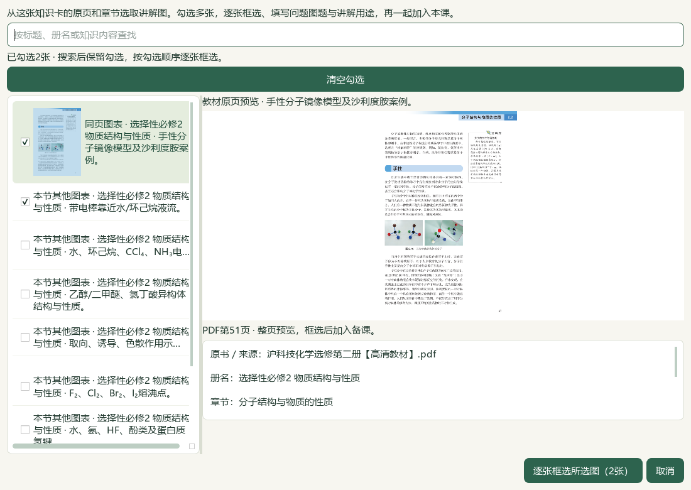
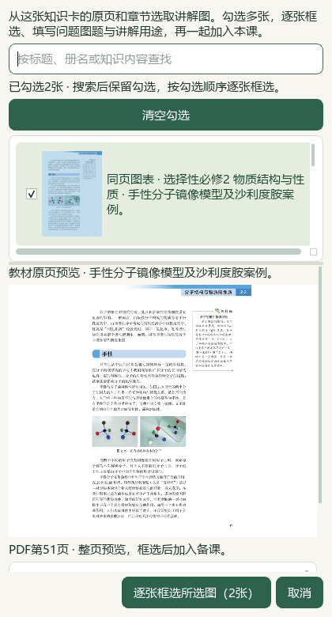
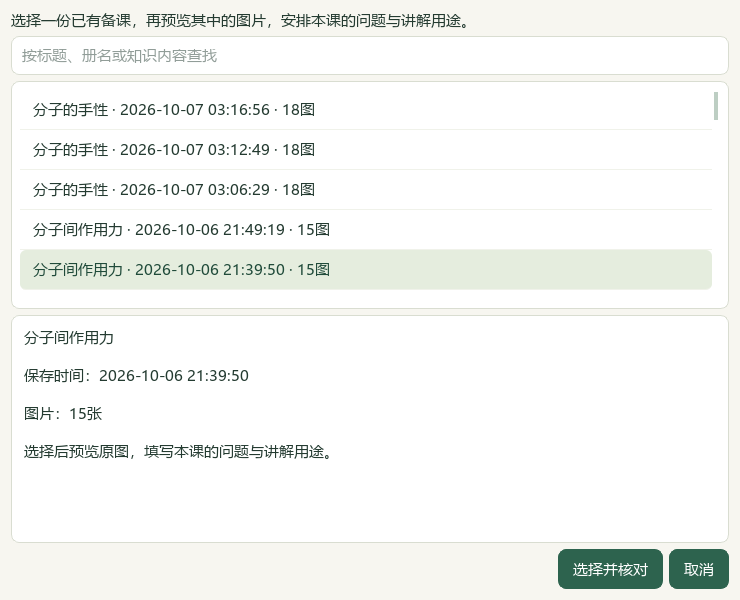
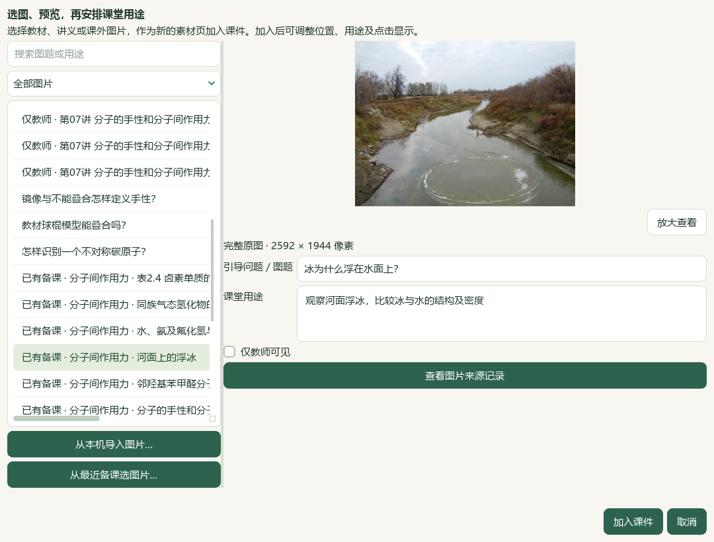
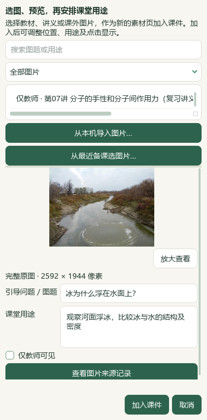

# 知识卡批量教材图与已有备课图片复用

2026-10-07，维护源码，未发布。教师可从一张知识卡连续选取多张教材图，并从最近课程复用已有图片；选图时填写本页引导问题和讲解用途，安排概念、图示与比较材料。

## 操作

1. 在备课的 **教学环节 → 素材与页面编排** 选中知识卡，点 **从这张知识卡选教材图…**。
2. 查看原页预览并勾选所需条目。搜索前后保留勾选，按勾选顺序进入下一步；只选中查看不会加入材料。
3. 点 **逐张框选所选图（N张）**。沿用教材原页裁选窗口，逐张框选、填写本课问题图题和讲解用途、预览与确认。
4. 完成全部裁片后点 **加入当前备课（N张）**，整批进入当前课件，每张可回到选材时的原知识卡。一次撤销移除整个批次，再次恢复也作为整个批次。

每批及当前备课最多48张，沿用现有字节和图像容量约束。同页不同登记图仍可单独框选；图片缓存按原像素摘要复用。两个选择窗口均可取消，保留现有设计。整个列表先重核原知识卡与原页，成功后才交给作品；磁盘失败可保留关闭使用资格的缓存，不能带入部分作品。

窄窗采用上下选择和原页预览，预览与完整说明可滚动。新增多选窗口最低360×650，保留完整缩略图行和原页图像尺寸。

## 复用已有课程的图片

1. 在同一素材编排页点 **备课图片… → 从最近备课选图片…**。
2. 按课程名、保存时间及图片数选择一份课程；最近入口列出当前架上最近50份有效备课中有图片的课程。
3. 选择并完整预览原图，填写 **引导问题／图题** 和 **课堂用途**，点 **加入课件**。同一张图片可用于不同的课堂问题，加入可一次撤销、恢复。

此入口只读取源课程和既有图片，不复制图片或修改源课。源课程、内容版本、图像摘要、原素材及旧环节关联保存在当前作品的内部来源记录；成品正文和备注不添加来源或核验提醒。本课已有同图时保留本课原元数据。任一教师关联继续仅教师可见；完整题图片沿 **完整题…** 入口保留题面与答案范围。预览或交接时来源、像素变化及容量超限会保留当前课件。

## 实际使用与证据

验证在独立复制的本地个人档案中进行。原有47份备课和当前22素材设计保持；从实际本地教材选取两页，验证第二页取消时整批不追加、确认时原像素与知识卡快照完整进入同一作品、整批一次撤销与恢复。再从已有“分子间作用力”课读取河面浮冰照片，验证预览后取消、填写问题加入、原字节与来源版本绑定、撤销/恢复及JSON回读。照片演示为独立副本中的交接测试，不改写实际手性课程或判定两课的化学关联。此次不另存新稿、不生成新Word/PPT；989主候选文件SHA保持。

| 检查范围 | 通过数 | 重点 |
| --- | ---: | --- |
| 教材批量后端，6模块 | 95 | 新29例；有序批量、版本与原像素、一次提交、迟变拒绝 |
| 教材批量UI，4模块 | 27 | 新9例；跨搜索、取消、当前作品变化、整批撤销 |
| 最近备课图片后端，7模块 | 119 | 新35例；只读、保存重开、同SHA别名、教师/完整题范围、容量与去重 |
| 最近备课图片UI，3模块 | 15 | 新5例；两段读取取消、迟到结果、保存时间、图题编辑与窄窗 |
| 完整README | 14 | 图片、链接、目录锚点和发行入口 |

范围部分重叠，不累加为全库通过数；文档策略另检。根代理以模型视觉检查实际Qt截图，非独立真人化学审校。最终源码、日志、原生记录与SHA见 `root-final-acceptance.json`。原生批量最终记录为 `native-final-v7/`，照片为 `native-saved-pictures-final/`。

诊断中曾出现辅助脚本异步等待失当、超时，以及一次定时栈采集运行的Windows access violation；原因未据此定论，旧失败日志保留。后续独立Qt等待探针测得两种主线程等待方式的后台吞吐有明显差异，改用事件处理加短sleep后，完整取消/加入流程再次通过。一次重复书架读取已从产品移除，仍保留预检、提交前和最终返回前的版本核对。初次新增UI测试缺少 `window` 夹具导入，修正后通过；以上失败不计作产品功能通过。

证据目录：`E:/项目/上海高中化学等级考/outputs/2026-10-07-knowledge-textbook-batch/`。源代码界面与正常入口均在当前e6ae工作区；旧EXE v0.1.101未更新。

## 入口与范围

当前入口：[打开教材图与问题导学工作台](E:/项目/上海高中化学等级考/outputs/2026-10-07-same-lecture-questions/打开教材图与问题导学工作台.cmd)。该入口加载本工作区维护源码与原正常候选个人档案，现有Word教案、课堂PPT及讲义保持。

本轮连接已有教材候选和已有课程图片，未新增知识、原题、外部图片或化学相关性判定。新增更多教材、题目、课外素材与整体工作台任务继续。微信读书停用；现有14页与25页课堂成品保持。
