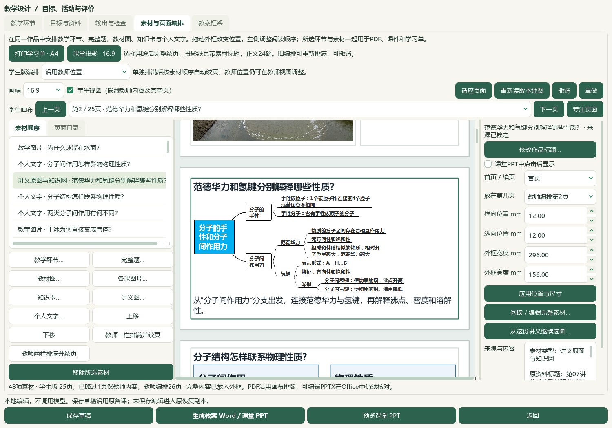
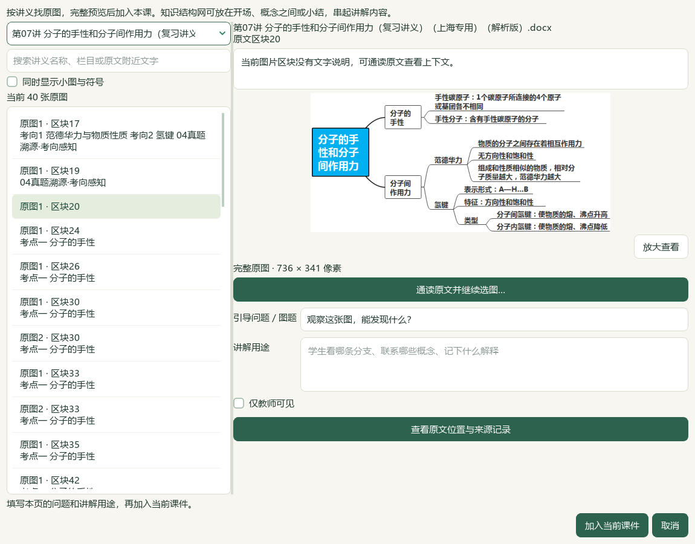
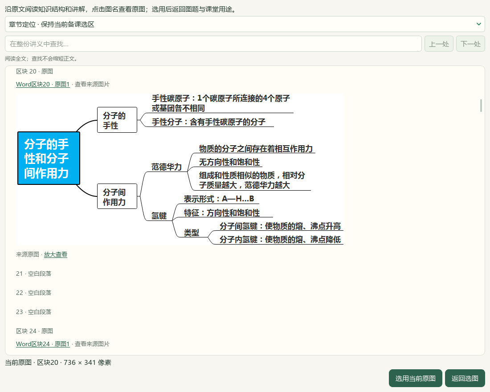
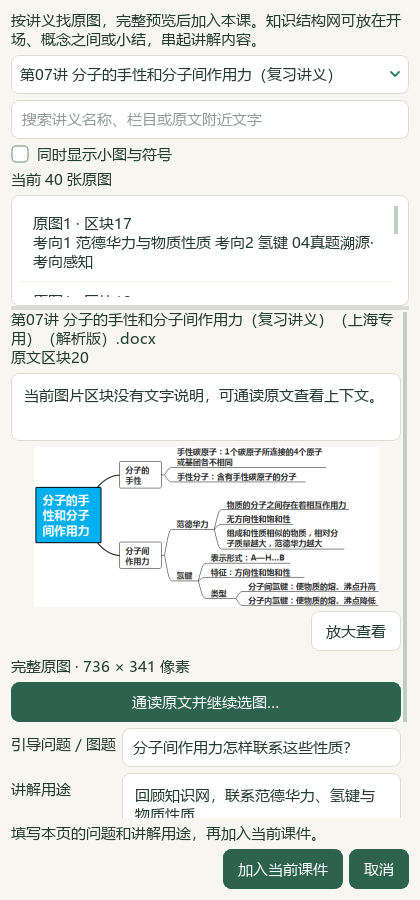

# 2026-10-07 讲义原文与选图联动验收

本片为本地维护源码进展，尚未发布。对应用户继续利用讲义知识结构网、教材图和课堂设计的要求；生成教学正文的来源与防御提醒策略保持，微信读书永久停用。

## 实际操作

在教学设计的素材与页面编排点“讲义图…”，按原文栏目与附近文字搜索，点“通读原文并继续选图…”阅读全文。点击原图、“选用当前原图”返回，填写引导问题和讲解用途后明确加入同一课件。选中课件中的讲义图，点“从这份讲义继续选图…”再次从该讲义选材。

## 范围与证据

- 第07讲原Word：193区块、79图像出现位置；默认隐藏小图后40条。第20块原知识网736×341、38,241字节，SHA `2bc2f3d396ab23ee276b077bfb60cd0c1df2bd06c804d08a55c41cafbf566790`。这是原图选择与阅读联动，不是79个知识网的语义导入。
- 原栏目与附近原文字面搜索；导航省略解析器占位和扁平表格，不修改原文快照。选图阅读隐藏解析器附加提醒，原文字、原答案、图像关系和全文搜索保留。未知图不自动命名或标知识点。
- 恢复到新目录不再把旧物理路径当版本变化；继续核对文件SHA、revision、asset、区块、MIME、图像SHA及大小。旧来源位置保留。同图、图题、用途与范围一致时去重。
- 最终11模块119项相关检查通过，见 `related-final-v4.xml/log`；完整README14项与文档策略结果见最终回执。初轮漏导入window夹具、目录恢复路径误判、长摘录挤占原图及Qt来源下拉框空白均已修正。真实启动验收脚本的局部变量遮蔽修正后再次通过，原失败日志保留。README初轮超出9000字入口预算，精简后文档策略与14项检查通过。
- 实际Qt流程：原网定位与150%放大；切到另一原图出现位置返回；重新选原网，写本课问题与用途，加入同一课件；48→49→撤销48→恢复49→撤销48，原48素材及引用像素保持，最终完整payload等于前片。另一出现位置是第17块横幅，用于验证选择身份，不作为化学内容认可。
- 主代理查看最终8张原生截图，包含宽/窄窗、全文、放大、回选、加入和撤销。实际CMD→.lnk→Pythonw重开44草稿、48素材、27输出版本、8点击素材、完整笔记和Word讲义开关通过，截图09。属于模型界面检查，不代替独立真人化学审校或逐帧课堂放映。
- 当前独立候选从前候选924文件复制；1194受保护输入与前候选最终完整SHA对照、候选状态实际差异见 `root-final-acceptance.json`。原教案25页、课堂PPT25页、Word讲义14页沿用前片，没有生成新Office文件或新增草稿。
- 重新核对V28原始本地视频SHA并查看38、59、80、101、119秒五个完整帧，参考原图解释、知识结构收束与输出入口。没有连续播放或听音轨，不据此宣称教学效果或十倍效率。

旧扩大Word12失败／8夹具错误和中央原问题未在本片解决；不宣称全库门禁或整个测试套件通过。中央正式资格、题库与catalog未写入，无新题导入、供应商、微信读书或外部下载。渲染v29、提示词v34、EXE v0.1.101保持，未提交、推送或发行；总体工作未完成，原59项/X01—X10保持。

## 本机入口与回执

入口：`E:/项目/上海高中化学等级考/outputs/2026-10-06-lecture-image-reading/打开讲义原文与选图工作台.cmd`。

回执目录：`E:/项目/上海高中化学等级考/outputs/2026-10-06-lecture-image-reading/`；最终 `root-final-acceptance.json`、`native-context-verification-v4.json`、`candidate-entry-receipt-v2.json`、`video-reference-binding.json`、`documentation-final-v3.log/xml`。输出目录沿用10月6日开始的切片命名，完成日期为10月7日。

[课堂操作](../teacher/lesson-and-paper.md#classroom-purposes) · [前片成品验收](2026-10-06-handout-maps-and-classroom-images-qa.md) · [当前闭环](../WORKFLOW_STATUS.md)。
