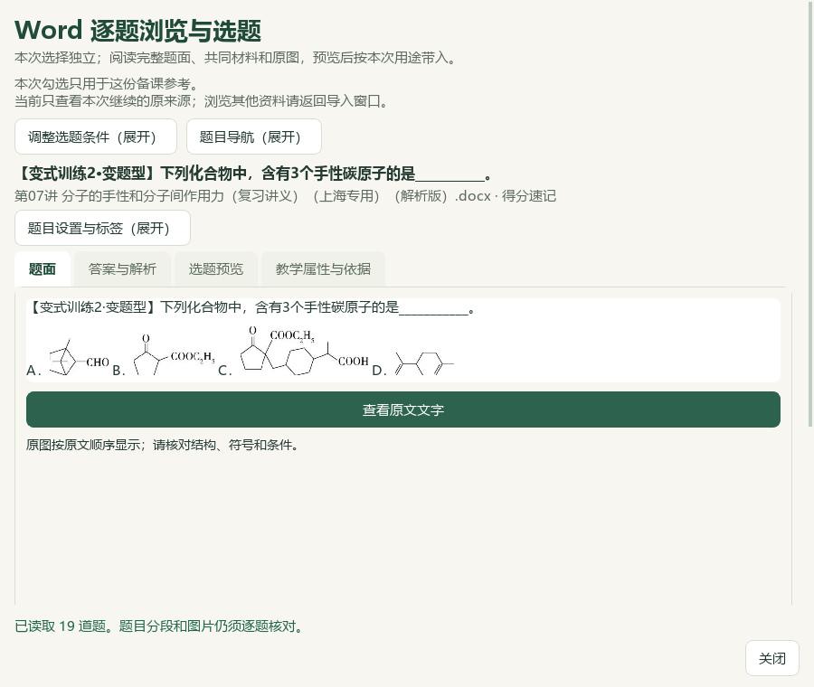
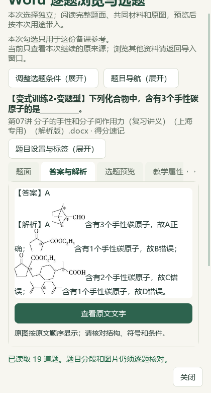

# 关联例题私有阅读空间验收 · 2026-10-07

当前为维护源码更新，未提交、发布或重建EXE。教师操作见[关联例题先阅读全文](../teacher/lesson-and-paper.md#private-reference-reading)。本轮只调整私有备课参考入口的初始布局，已有题目、来源和章节身份、检索条件、范围、标签、分值及原有动作继续使用。

## 阅读流程与作用范围

教材具体知识／已保存知识笔记的关联例题中，点 **阅读完整题与答案…**，直接打开确切来源及当前题。**调整选题条件** 与 **题目导航** 并排、默认收起；**题目设置与标签** 也默认收起。需要检索、换题或维护时展开，收起后搜索词、当前来源、章节范围、当前题和分值保留。题面与共同材料、原答案、全部原图继续按原角色和原位置显示；长内容可滚动读完，底部状态与 **关闭** 持续可达。

作用范围为 `persist_selection=False` 且 `handoff_mode='reference'` 的私有入口。普通持久化题库仍保留原筛选默认布局，有初始题时继续自动展开题目设置；私有composition原有筛选折叠与题目设置行为保持，both行为保持。按入口原有权限，选题、分值、范围／标签维护、入篮、导出、预览与明确带入动作均保留；讲义selection_only仍先收集本批选择，不立即导入或保存题库历史选择。

最终 `word_question_dialog.py` SHA-256：`35b8a8a59eced8e0b3a04de91d4c7eb4f2e7b5fede7ffb66a20104d50120d6f3`。AST审计确认产品改动仅在 `WordQuestionDialog.__init__`；读取、过滤、来源绑定、保存及动作方法的AST保持。

## 真实原题与实际窗口

主代理在隔离QA状态中读取两道既有真实原Word题：原第16题（题面来源区块102—106、答案107—108）及PKG-064结构题（验收名Q50，题面区块50—51、答案52—53）。Q50题面与答案各4处原图，保留原文顺序与图像字节。区块号用于原文定位，原印刷页码和原卷身份沿既有记录，不从验收名推定。

`native-r1/verification.json` 结果为 `passed`；两题分别在900×760与420×780窗口读题面／答案、核对末段及最后内容。正文首屏实际可见高度如下；所有检查中状态全文、关闭按钮完整可见，横向溢出为0。Q50两页签的末段和第4张原图均可达。

| 真实材料 | 900×760首屏正文 | 420×780首屏正文 | 原内容检查 |
| --- | --- | --- | --- |
| 原第16题 | 351px | 307px | 完整题面5块与答案2块；末段可达 |
| PKG-064结构题，验收名Q50 | 351px | 294px | 题面／答案各4处原图；末段与最后图可达 |

上述3张实际像素由根模型主代理查看。属于模型视觉复核；本轮没有独立真人视觉或教师化学审核。脚本回执的 `root_model_visual_review_pending` 字段保留其生成时状态，后续主代理已确认这3张的查看范围。

## 定向检查、回归与状态保护

以下两组分别报告，不累计重跑次数。定向组使用合成界面夹具与临时原生DOCX验证布局及动作；真实原题证据来自上节 `native-r1`。

| 检查组 | 通过数 | 回执 |
| --- | --- | --- |
| 私有reference定向Qt | 14 | `private-reference-reader.junit.xml` |
| 相关7文件回归 | 167 | `reference-reader-regression.junit.xml` |

定向14项覆盖有／无初始题、320／420／900宽度披露按钮与横溢出、筛选／导航／标签分值展开再收起、搜索条件和来源保持、私有选择及普通持久化行为，以及长题面／答案各4图的正文面积、末段／末图和footer可达。相关回归分组为：题目对话框52、reader_layout33、inline_reader11、selection_visibility10、knowledge_question_links_ui27、knowledge_question_handoff_ui15、handout_material_workspace_ui19；均为0失败、0错误、0跳过。

主代理逐文件核对正常profile的1016个文件，SHA-256、大小和mtime不变，正常写入尝试为空；既有QA state保持。本轮未保存新的正常题库选择、课程或关系，也未修改原Word、教材文件或生成Office成品。独立化学判断、原卷／官方评分核验、正式四层归档与桌面发行保持各自既有状态。

证据目录：`E:/项目/上海高中化学等级考/outputs/2026-10-07-private-reference-reader/`。关键回执为 `validation_receipt.json`、`implementation_ast_audit.json`、`product_scoped.diff`、两组JUnit，以及 `native-r1/verification.json`、原题完整阅读JSON与正常profile前后清单。合成截图单独留在该私有目录；本文3张截图来自真实原题回合，按原字节复制。

| 文档截图副本 | 与native-r1原图一致的SHA-256 |
| --- | --- |
| `q16-text-420x780-tab0-first.png` | `95d940d92c39814b52362f4bc7a007fcab1b2292afdb4b4f74c4bdfffc802863` |
| `q50-original-images-900x760-tab0-first.png` | `d05fa7b071b7d4e99c2537ca7be19f51b62b6dd7022c9a426de37435b55cce76` |
| `q50-original-images-420x780-tab1-end.png` | `9804fccf1857834643efc163e332b1815b48cde4ab062b2500262fa9a523610c` |

[教师操作](../teacher/lesson-and-paper.md#private-reference-reading) · [原文选材与关联题交接](2026-10-07-source-material-workspace-qa.md) · [Word原文位置阅读](2026-10-06-word-inline-image-reader-qa.md)
