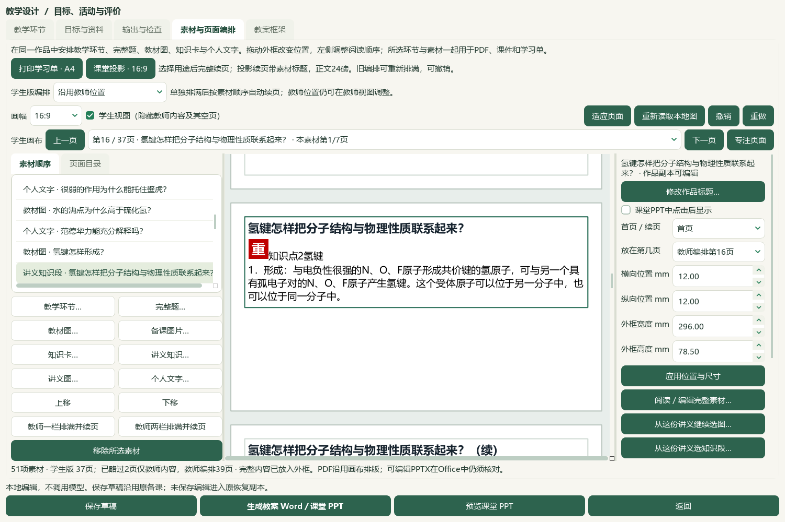
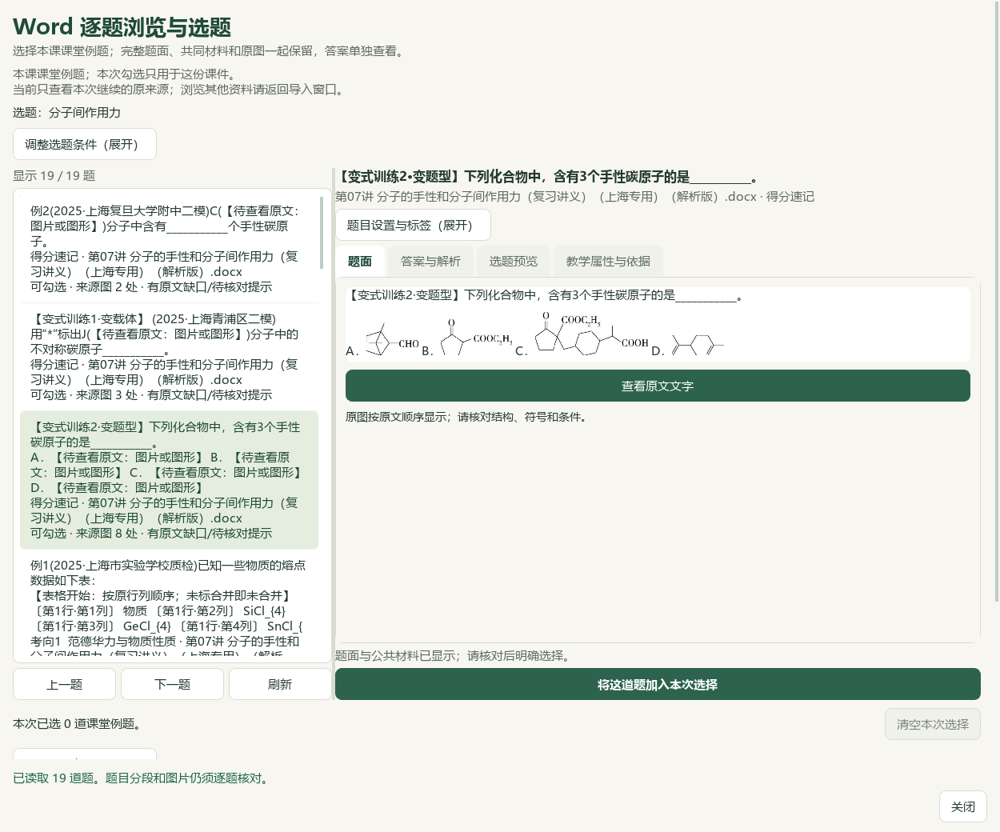
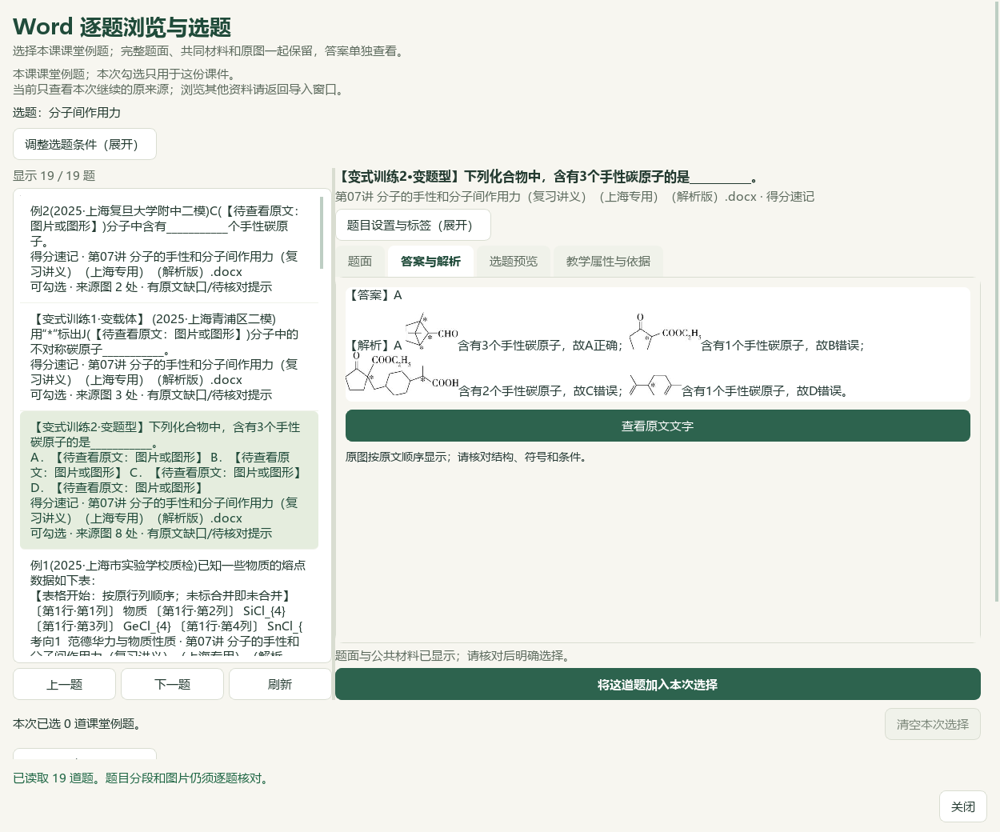
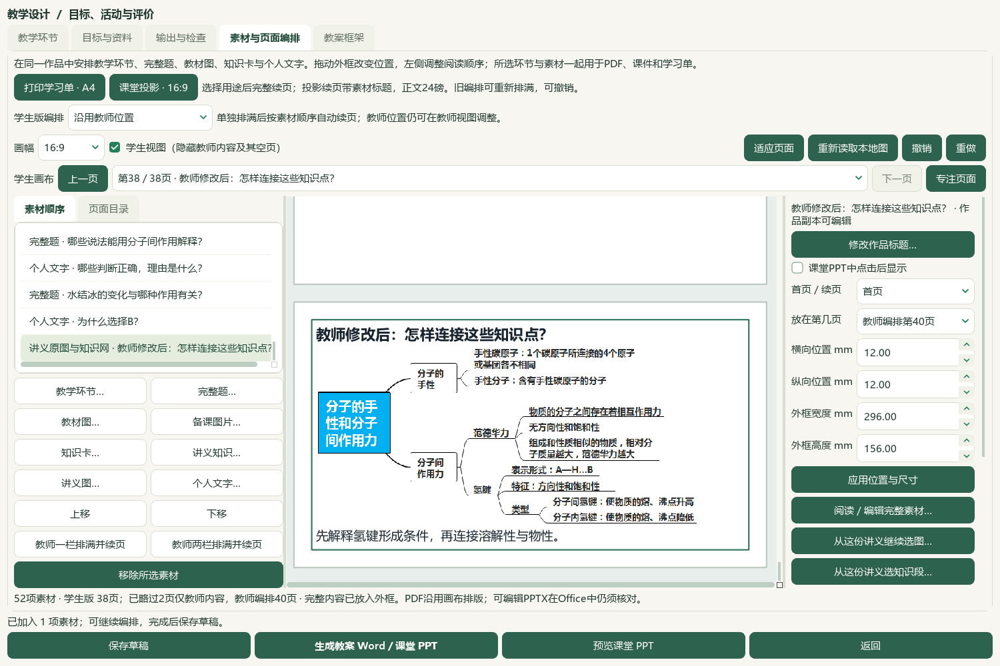

# 完整讲义知识连续选材与返回定位验收

2026-10-07，当前e6ae源码，未发布。实现覆盖完整知识段继续选择同份Word原图与完整题，并恢复本次编辑位置；本轮没有改写当前课堂成品。当前两课时、51资源／37学生页、13教材素材／6实景／3完整知识段／原网／2原题及实际Word／PPT检查范围见[课堂成品验收](2026-10-07-handout-knowledge-sections-qa.md)。

## 实现与边界

- 文档来源严格8字段，图片来源严格12字段；知识段使用`document_source`，不伪造首图或图片身份。确切batch／archive、原文件SHA、名称、角色、提取版本重核；相同字节的另一归档不能替代当前文件。旧图片出现位置校验保持。零图Word仍可继续选完整题。
- 每个原题作用域操作在既有原生RLock下重核来源前后状态、目录与选题身份；本次勾选独立，教师原答案保持角色。关闭、停止、草稿／图片改变及迟到回调不交接，取消保留作品。
- 原图按真实出现位置、封存原用途和范围去重。教师修改作品标题和讲解后，再次选原用途保留修改；不同用途或范围可独立选用。未修改原封存记录或图片像素，未新增schema字段。
- 页面、素材、续页、节点、目录／素材页签、教师／学生与专注模式只保存在当前备课页对象。成功退出再返回才记住位置，恢复文件保存失败不提前覆盖；新设计不沿用，删除／隐藏素材按当前可见页回退。位置不进入草稿、成品或ZIP，也不声称跨应用重启恢复位置。
- 外部教材／题库的新素材加入在构造完成后优先选中，无延迟回调重新覆盖为旧位置。响应式预览页移入教学环节时保持预览。

## 定向检查

| 范围 | 结果 | 本机回执 |
| --- | --- | --- |
| 双来源、原题作用域、旧原图／知识后端 | 115通过 | `root-backend-checks.xml` |
| 新完整知识同源27＋旧图片／阅读／题／知识交接44 | 71通过 | `ui-source-handoff-checks.xml`及同名JSON |
| 返回位置新9＋页面导航9＋教学设计7 | 25通过 | `root-session-checks.xml` |
| 原图去重与工作副本修改 | 15通过，包含在后端115内 | `root-image-duplicate-checks.xml` |

上述回执位于[E盘本轮目录](<E:/项目/上海高中化学等级考/outputs/2026-10-07-same-handout-material-flow/>)。各组范围不同，不累计为全库或独立真人审核。完整README14项及文档策略由本轮`docs-checks.json`记录。

## 真实原生操作

由实际Qt应用与正常字体／样式在隔离profile加载普通工作台保存的`prep-2918fbadebc64b2087749a33e052e04c`。原51资源课例中选中氢键知识段（原78—94块），打开绑定第07讲：79真实图片出现位置，默认略去小图后40条；同Word19道题。此处按原文件限定题目，不宣称19题均对应氢键细概念。

`native-v1`验证原图和完整题的取消、加入、重复及一次撤销／恢复，原50—53块题面和答案各4幅图原顺序回读。首轮选图使用默认第17块栏目横幅，只用于隔离交接测试并撤销，未作为课堂知识网交付。去重修复后另用`native-edited-image-return`明确选择第20块736×341原知识网，验证取消／加入、修改标题与讲解、重复保持及撤销恢复。原图与原完整题始终保留，正式／真人资格未提升。

两轮均退回原51资源、37学生页；再退出并重开教学设计，仍选中氢键第7段、学生第22页及页面目录。原保存的48备课／52对象和历史选题保持，本轮未保存新稿或生成新Office。`native-v1/native-verification.json`与`native-edited-image-return/native-verification.json`分别记录实测范围；根代理查看以下实际截图，不计独立真人审校。

图片的原路径、归档路径和SHA在同目录`manifest.json`中。正常profile989个前序保护路径在原生回合前后匹配；独立备份验收另检查正常profile全部1016文件。

## 最新完整ZIP恢复

`backup-roundtrip/latest-48-74028663fb33-roundtrip-verification.json`通过，使用现有普通备份API选图片与成品，恢复到全新子目录，未激活或覆盖工作台：

- 52个源draft对象中的48份备课逐条record／payload相等；4个其他对象按该API范围排除。
- 当前51资源、3个知识段的严格来源与完整证据相等，当前六份成品byte／SHA完全匹配。
- ZIP384文件：94图、288成品、桌面状态与备课恢复，缺失0；没有进行中的任务。
- 正常profile全部1016文件前后摘要与版本清单相等，3684题属性和9737历史保持。
- 原教材、原Word／题库、学生档案、模型配置与题属性历史库不在此ZIP；草稿中的来源引用保留，不能据此宣称这些原库已迁移。

[备份回执](<E:/项目/上海高中化学等级考/outputs/2026-10-07-same-handout-material-flow/backup-roundtrip/latest-48-74028663fb33-roundtrip-verification.json>)。ZIP约568MB，SHA为`f6007c6e3df4ad9347306e2e7367525191b69b5cf1482afb7efc326bf32a2252`。首轮平台ctime预检失败记录保留；正式恢复是该回执对应的74028663fb33回合。

## 整体目标核对

| 目标要求 | 已验证 | 继续处理 |
| --- | --- | --- |
| 原教材／完整讲义进入同一备课 | 实际目标课例、完整知识、原图／题及同源入口 | 全部98讲义与扫描／复杂公式未全量证明 |
| 可编辑教学设计与Word／PPT | 当前真实Office课例、问题标题、完整笔记、图与点击流程；本轮返回位置 | 复杂节点绑定与更细的内容组织 |
| 保存、恢复与既有作品保护 | 最新48备课完整ZIP及3知识段／6成品回读 | 全业务库迁移仍是其他范围 |
| 视频工作台对齐 | V43细知识树／属性与V28页面／目录／原网抽帧实际查看 | C09细概念关系维护，章节命中不算精确关系；HTML／音轨不自动加入用户Word/PPT目标 |

44原片入口`C:/Users/20671/Downloads/BDL`解析到`E:/下载/BDL`，主索引44唯一记录／4482.659秒，SHA`29187a141aa1eb55e4acc874c86e0a04c44a0a25ab2cccc9bcc3a3a2598f1d66`。本轮只实际查看既有V43第42秒、V28第80秒帧；不称完整播放或听完44片。V43显示细层知识树，不能由帧推断精确教材映射已实现；V28的0:00/0:00控件不能证明可用声音。

同源原题读取仍有反复读目录成本，三次只读操作为目录6.75秒、图9.22秒、原文9.12秒；调用分析与两项优化建议存于`performance-diagnosis.json`，本轮未优化。复杂原Word排版、C09精确关系与原59项／X01—X10仍按完整范围继续。中央资料、正式资格不改；渲染v33／提示词v35、EXE v0.1.101保持，源码未发布，整体目标active。
