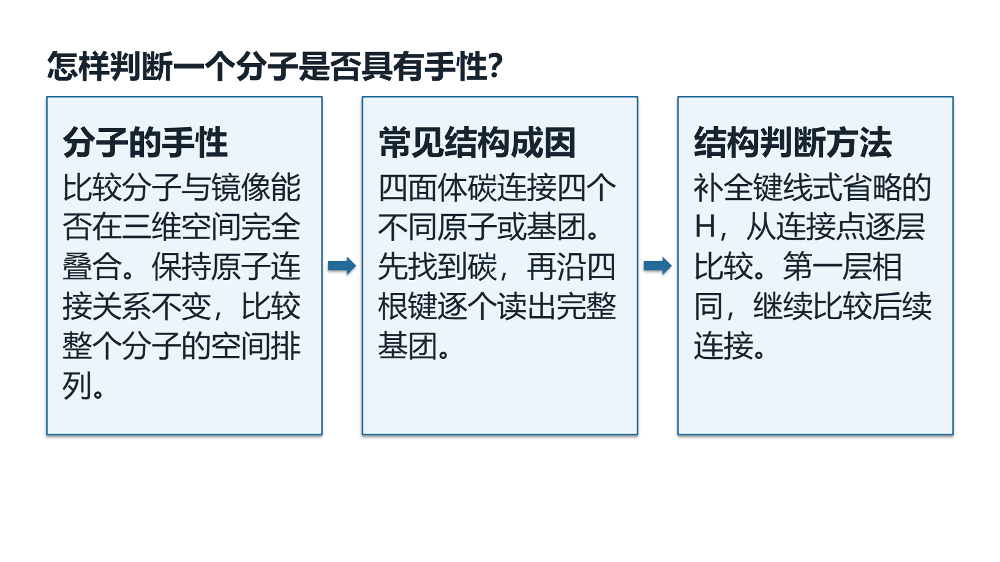
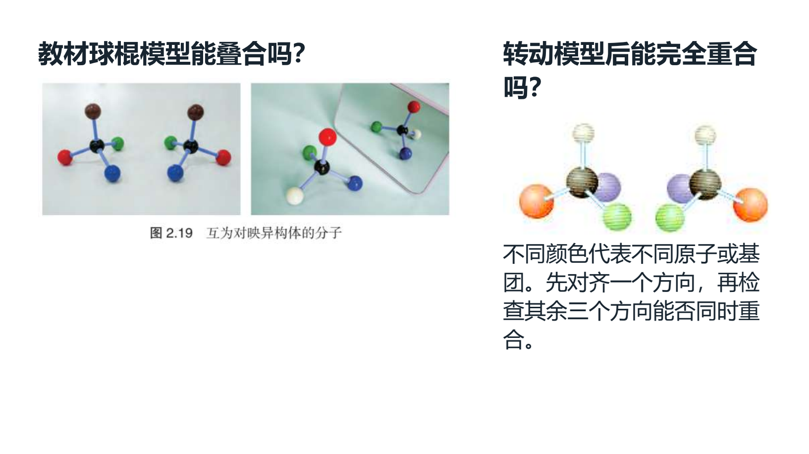
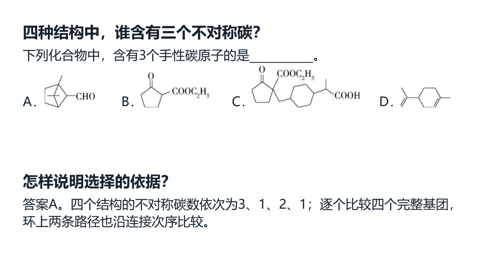

# 2026-10-07 同讲义例题、教材裁片与问题标题验收

本片将讲义知识网的手性分支、原教材定义与球棍模型、讲义结构图、双手实拍与两道完整原题串成40分钟课堂。当前为源码与本地工作台候选，EXE v0.1.101未重建；旧25页分子间作用力课堂和44份既有备课草稿保留。总目标仍active，不提升正式入库、独立真人审核或发行资格。

## 使用与实现

选中课件中的讲义原图，点“从这份讲义选例题…”进入同份Word的独立选择。题干、选项、公共材料及教师原答案原图完整读取；预览后明确加入、同版本去重、一次撤销与重做。取消与来源变化不交付内容。跨批次、同字节不同归档均重核批次、源SHA、原文版本和题目范围；每次源读取在既有服务锁内重新定位。11条历史选题不读入或改写。

提示词v35要求后续课堂页左上使用可从本页或紧邻材料回答的具体问题，删除知识点标题优先的矛盾要求。原生非封面标题左对齐，知识笔记仍保留定义、条件和稳定小节名；工作台组合渲染v29保持。教师生成正文和PPT备注无来源页脚、待核实或防御提醒，版本、来源和原始快照在内部保留。

## 真实材料与课堂

14页、22素材、6环节40分钟；知识讲解为主，两个完整原题辅助。三处教材裁片分别为手性定义、球棍模型、不对称碳条件；四张讲义讲解图为镜像模型、乳酸、重复基团与四基团结构。双手实拍用于全班掌心同向的叠合活动。教材原文、原图和完整课堂笔记保留，问题反馈在第11、12页同页点击显示，第3、10页三步解释。

教材为选必二原PDF第51页、印刷47页，SHA `4eb751c3bc879d2ad41a2faa723b3b4af05b29ff78f3e89a2eaf9727ebb8a848`。裁片依据个人书实际CropBox栅格，目录旧PNG含额外套准边，不据旧图比例裁剪。讲义为SRC-HANDOUT-064第07讲，源SHA `084da90dae9f2a26007164e070290255325995241de4c34051c4ffc97bbe3d71`；原知识网第20块内部关联，取手性分支重建可编辑教学顺序。整体手性按教材的镜像与不能叠合判断；不把有不对称碳写成所有分子的唯一判据。WMF与未完整索引的顺铂段未引入。

原题范围44—46和50—53；第二题的四题图、四教师解析图按原次序及原字节保留，答案角色不改。课堂工作副本只省略出处和训练导航前缀，题目的化学内容、空格和图像出现位置保持；原始快照不改。学生同页反馈为独立可编辑讲解文字。

双手照片读取Commons原始许可页和原文件，使用Own work/PD-self材料：[许可页](https://commons.wikimedia.org/wiki/File:JfHands_raised_worshipfvf.JPG#Licensing)。原照片SHA `97816e6d1937186647eb8b54fd1057b0a766971d8d2cc343e5f11fc660220d61`。NIGMS另图未能确认许可，未下载或使用。外部网页读取有实际请求，不记为0；微信读书永久停用。

## 实际验证与保留诊断

初始相关137项全部通过，22项为新增；问题标题和模板组33通过、1跳过。记录位于 `E:/项目/上海高中化学等级考/outputs/2026-10-07-same-lecture-questions/worker-checks/` 与同级 `header-tests-final.log`。最终源文件与补修后的检查绑定见root-final-acceptance.json，不将前序源文件SHA当作补修后版本。

实际Qt同源选例题完成题面/答案读取、预览取消、明确加入、编辑后去重、撤销与重做；原48素材/25页恢复，读入图缓存保留。独立profile未保存新稿或生成Office，44旧稿与11历史选择保持。根代理检查旧第03截图发现解析区被按钮遮挡，此图仅验证数据字节，不通过可见性验收；已修正题面/答案页布局高度约束，v6宽窗与420×760窄窗的全文和四张解析图根代理直接查看通过，按钮无覆盖。补修后的同组8模块137全部通过，另86 UI检查通过；v6完整取消/加入/去重/撤销恢复通过。

首轮实际Office检查发现第三页三步流程留白较多，已扩成完整判断笔记并更换具体问题标题，另存refined-classroom，首稿保留。随后把六环节教师引导、学生行动、预期产出、对应目标及评价依据分别写清，另存teaching-flow-final，前两稿继续保留。真实Qt生成/导出/保存及实际Microsoft Word、PowerPoint转换通过后，逐页PNG、完整文字、原图包内字节、教师答案范围与实际动画时序见最终回执。

一次Office验证助手在新回执写完前读取，因文件尚不存在退出；失败日志保留，等待实际生成结束后重跑。辅助脚本初轮源版本字段、QTextLayout序列化及用途字段失败均保留，未绕开生产校验。旧扩大Word12失败/8夹具错误未解决或重跑；不称全测试套件通过。

最终实际Office为Word教案12页、课堂PPT14页、课堂讲义7页，共33页。根代理直接查看改进版全部14张PowerPoint整页和最终19张Word整页；最终PPT composition不变、14张实际PNG全部与已看页面SHA相同。完整正文、所有可编辑文字与原图包内字节逐项核对。实际PowerPoint MainSequence读回8个Appear/OnPageClick：第3、10页各3步，第11、12页各1同页反馈；源文件只读且SHA保持。静态PDF展示展开完成状态，未进行独立真人逐帧放映。

常规ZIP独立恢复47份备课草稿、47唯一输出版本、282登记文件、80引用图片摘要；364清单文件原字节一致，缺失0。主STATE为51记录，4条非备课对象排除于此备份；原初48、改进前49、最终前50对象全部保持，三份新增稿各有一版成品。普通ZIP不含Word库、原书、阅读位置、模型配置、密钥或Office预览缓存。原1194输入、前候选924文件及旧回执127 Office/PDF成品SHA保护全通过。

普通入口实际完成CMD→快捷方式→Pythonw→原生窗口恢复最终第三稿，6环节/40分钟/22素材/2完整题/14课堂PPT页，三成品SHA一致。静态学生画布12页，隐藏两页点击流程；PPT保留14页，教师编排16页包含两页原答案续页。入口只读验证51记录及历史选择原字节不变，没有保存或新增输出，确切PID退出且锁重新获取/释放成功。

## 实际课堂页面

## 证据入口与下一步

最终源设计及成品回执：`E:/项目/上海高中化学等级考/outputs/2026-10-07-same-lecture-questions/teaching-flow-final/`。普通入口：同级上层 `打开教材图与问题导学工作台.cmd`。实际Office逐页、动画、入口重开、ZIP回读、旧输入/草稿/成品保护和文档策略以本片 `root-final-acceptance.json` 的最终计数、文件SHA和范围为准。

当前知识卡的教材图入口仍为单选，尚未接书架48条批量裁片交接；课外图片入口支持已有图与本机文件，尚无跨教材语义推荐。更多知识与题目、Q11答案冲突、正式四层、独立化学审核、整体UI与发行继续。中央status仅只读检查，catalog171与既有正式资格不变。
