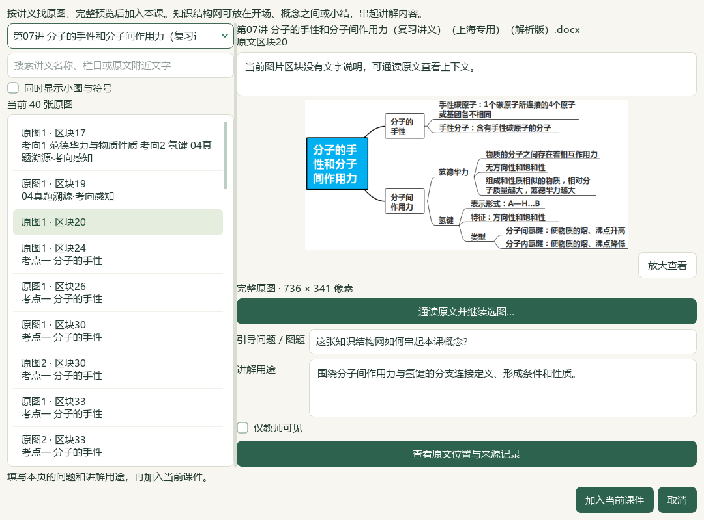
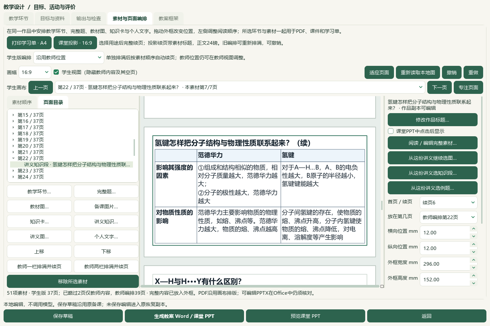

# 同源读取性能与可见选材入口验收

2026-10-07，e6ae维护源码，未发布。讲义知识段右栏优先显示阅读、继续选图／知识段／例题，位置参数在其后。同源题目操作只读取指定归档，知识导航复用有界内存预览。本轮保持已保存的51资源／37课堂页及Word／PPT，未增加新稿或Office版本。[课堂素材与实际Office范围](2026-10-07-handout-knowledge-sections-qa.md) · [连续选材及最新ZIP范围](2026-10-07-same-handout-material-flow-qa.md)。

## 实现范围

- 知识8字段导航直接重读所选批次／归档文件，核对实际全文件SHA、声明SHA、source ID、名称与角色；返回前再次重读。预览缓存绑定归档身份、来源版本与当前提取版本，验证完整摘要；私有内存LRU最多4项、16MiB序列化权重，并返回独立副本。没有新增磁盘缓存，不用mtime代替原文件核验。图片12字段的原出现位置校验保持。
- Word库存提供显式位置时，不再枚举全部导入批次；直接读取所选descriptor、原生manifest和指定原文件。来源闭包、实际SHA／大小、确切ID集合、原文与题目版本校验保持。全局目录路线不变；窄注入门面继续按已有恢复接口校验。讲义题目适配器继续在RLock中核对操作前后状态。
- 阅读与选材按钮移到右栏上方，标题、点击显示和位置尺寸仍可编辑。没有修改草稿schema、页面布局、题目属性、历史或课程内容。

## 定向检查

| 范围 | 结果 | 回执 |
| --- | --- | --- |
| 来源上下文、同源题、旧原图与图片服务 | 101通过 | `source-context-regression.xml` |
| 限定库存、全局库存、原Word阅读、离线标签、自动属性 | 352通过，4组 | `inventory-backend-checks.json`索引 |
| 完整知识同源UI与1400／1000窗口入口可见性 | 29通过 | `source-actions-ui.xml` |
| 阅读窗口几何、缺失来源与历史选择隔离 | 33通过 | `reader-layout-checks.xml` |

各组有重叠，不累计为全库检查。旧几何测试在缺失来源`MISSING`时期待导入其他来源已选Q2，首轮失败记录保留在`inventory-attributes-reading-checks.xml`。修正为全局浏览器搜索空结果的几何测试，并增加“缺失来源保留历史，但本次预览／导入为空”的独立检查；最终33项通过，没有改变产品范围约束。

## 同来源服务计时

真实普通profile与当前第07讲8字段来源，193原块／79图片资源／19题，两轮读取同一原题、revision和10322字节原图。只读服务验证使用仅配置paths／state的门面，不调用普通应用构造或应用锁；导入前即禁止输出目录之外的Python文件变动。现有原生磁盘预览只读。

| 服务 | 前序观察 | 本轮冷轮 | 本轮暖轮 |
| --- | ---: | ---: | ---: |
| 同讲义目录 | 6.747秒 | 4.475秒 | 4.331秒 |
| 原题图片 | 9.216秒 | 5.872秒 | 6.232秒 |
| 原题全文 | 9.121秒 | 6.460秒 | 6.265秒 |

这是同来源服务观察对照，不是受控A/B、整窗打开或全库冷启动验收。冷轮指本进程内存缓存初始为空，目录操作会使随后图／原文读取变暖。六项操作各保留4次精确归档读取；全批次枚举、知识提纲、标题重解析、持久缓存保存均0。知识全文预览只在首个目录操作解析1次，其余11次命中内存预览。所选manifest与严格库存核验仍有耗时。

[完整计时与源码摘要](<E:/项目/上海高中化学等级考/outputs/2026-10-07-scoped-source-performance/scoped-readonly-1022e996ce4f-verification.json>) · [可复现脚本](<E:/项目/上海高中化学等级考/outputs/2026-10-07-scoped-source-performance/scoped_source_readonly_benchmark.py>)。

## 真实Qt备课流程

实际字体、样式和隔离profile加载普通工作台最新48份备课中的37页课例。氢键完整知识段的阅读、选图／知识／例题四按钮无需滚动即可完整显示；真实右栏视口293×589，按钮底边不超过302。第20块736×341完整知识网取消／加入／修改作品图题与讲解／重复保持／一次撤销恢复通过。完整第50—53块题面和答案各四幅原图按原顺序阅读，取消／加入／重复／一次撤销恢复通过。最终返回原51资源、氢键第7段、学生第22页与页面目录。

原生流程回执`native-current/native-verification.json`通过。外层脚本最后将完整文件清单与被`exec`覆盖的课堂history变量比较，导致辅助保护断言失败；界面流程已完成，产品代码没有报错。独立`verify_native_protection.py`随后核对全部1016文件，与原生回合之前的完整备份基线及同期服务前后清单逐文件SHA／大小／mtime相等，保护检查通过。外层脚本已改为隔离执行命名空间并保存唯一清单；未重复完整界面回合，不把脚本修正说成另一轮产品验收。

普通48备课／52对象、3684属性／9737历史、原文件、当前六份成品保持；未保存新备课或提升正式资格。根代理查看6幅实际截图，范围见同目录`manifest.json`，不计独立真人化学审核。最新普通ZIP的48备课／94图／288成品范围沿用前序验收，本轮未创建重复ZIP。

## 继续处理

同份Word的19题目录和章节筛选还没有建立可维护、可反查的细概念—具体题关系。C09下一实现应明确保存知识身份／版本／原书SHA、完整题key／revision／范围及教师关联理由，支持编辑、解除、反查和独立导出恢复；知识或题范围改变时不能静默重绑。当前K01—K19属性与教材章节继续保持，未写入候选概念映射。

复杂原Word排版、更多资料覆盖和原59项／X01—X10按完整范围继续，整体目标active。渲染v33／提示词v35、EXE v0.1.101不变，源码未发布，微信读书停用。
