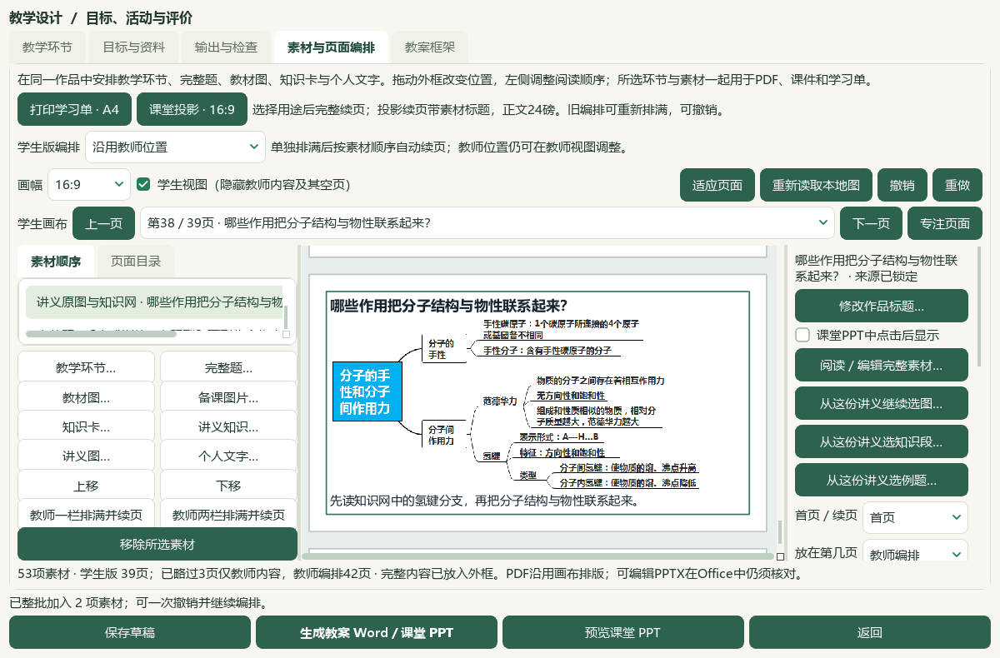
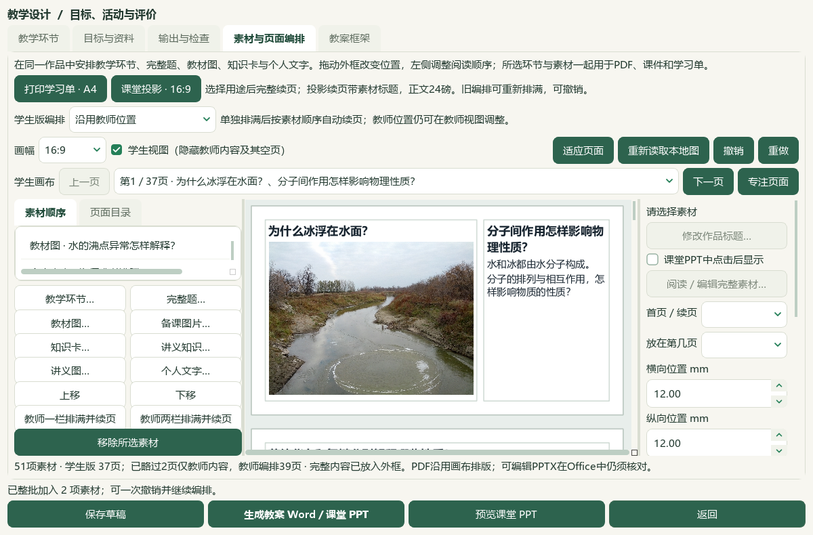

# 原文选材工作台与教材例题入口验收

2026-10-07维护源码增量，未提交、发布或重建EXE。工作区为`e6ae/上海高中化学等级考`，实际资料在`E:/项目/上海高中化学等级考`。教师操作见[整批选材](../teacher/lesson-and-paper.md#source-material-workspace)，状态见[当前闭环](../WORKFLOW_STATUS.md#source-material-workspace)。

## 教师可用流程

备课“从讲义选材…”与题库“讲义选材…”先打开一份确切原Word；目录、原文、原图和知识结构网放在同一个选材窗口。完整知识栏目、原图和完整题答各自勾选，汇总到本批清单，可移除或清空；整批确认后才制作课堂副本。切换来源清空本批，停止／关闭／来源变化不追加课程。知识与图各填问题标题和教学用途，再按课堂进程组织知识解释、观察与笔记，题目作辅助。

本节知识、研读提示及个人已保存知识笔记旁新增“关联例题…”，打开当前具体知识的关系。未保存笔记先保存；只读和关闭不加入课程，明确点击“将所选关联题加入本课”才交接。真实作用域对象沿个人教材、书架和主窗口传递，JSON证据独立复制。

单批加入形成一次编辑历史，撤销／重做恢复素材、学生页面与原课程编辑。已编译图片仍留在图库供复用。撤销重新定位画布，解决页码／标题回到首页而画布还显示原末页的问题。

## 检查范围与版本

本轮输出目录：`E:/项目/上海高中化学等级考/outputs/2026-10-07-source-material-workspace/`。各组有重叠，以下数量不相加为全库验收。

| 范围 | 检查与回执 | 结论 |
| --- | --- | --- |
| 原文选材UI与旧Word／题库入口 | `handout-material-workspace-ui-regression-r1.xml`、`handout-ui-checks.json` | 88项通过；完整选材、来源切换、420px底栏及旧入口 |
| 三类教材知识入口与真实作用域引用 | `book-relations-opaque-handoff-ui.xml` | 36项通过；旧69项基线含重复范围，另列 |
| 主窗口路由 | `main-window-routes.xml` | 5项通过；路由夹具，不证明化学内容 |
| 撤销画布修复 | `viewport-undo-before.xml`、`viewport-undo-after.xml`、`viewport-undo-regression.xml` | 旧码2失败／2通过，修复4通过，相关48通过；纯内存合成A4／16:9的真实Qt几何 |
| 整批交接、只编译一次与两端重核 | `linked-readonly-handoff-guards-final.xml`、`linked-readonly-handoff-checks.json` | 当前backend 58通过／3条件跳过；45原检查与16新检查 |
| 备课异步交接、历史与窗口终态 | `studio-handoff-terminal-status-final.xml`、`studio-handoff-terminal-status-checks.json` | 当前Studio 14通过，backend为延迟夹具；旧073d版本13项另存 |

画布修复仅在`LessonDesignDialog.travel`同步页面后调用已有`fit_view()`。教师视图保留原选页面。合成几何验证不能替代真实37页课程的画布检查。

关联题交接初次仍完整编译；发布前后改为只读核对关联快照、原知识身份、确切Word归档／范围／版本与新鲜原题引用，再比较封存结果。重核不再次调用题目导入或复制旧图库。图片写入与两端版本守护、取消、并发拥有者及失败回滚继续验证。

最终backend SHA为`5b4f37f88ca36224d9f072114e9e8bb2c094fb35d1d83e04cb48d3313c4cb00c`，画布修复SHA为`c74942adffc51cac35155f5dd6503b94aa6925c4aee6cb31dcf093838b27292c`。旧339版本42通过／3跳过与中间875版本54通过／3跳过仅作历史基线，不挂到最终版本。3跳过来自无图夹具的图片分支；有图对应分支已通过。计数夹具证实一次完整题编译、29旧图只复制到一个临时根一次；旧图实际读取87次为准备29与发布前／后各29，保留字节核验。计数不证明真实时长改善。

原生BNOTE重复交接还发现教学设计窗口保留“正在加入”的启动提示。Studio的`receipt()`现在在发出终态信号前同步窗口文字；新增／重复、停止、失败与迟到分支14项通过，普通撤销／重做提示逻辑未改。最终Studio SHA为`fa370178ef9f33d774436cf3c8ea0591ef6c1db57b04a1bf3b146889071851bd`。

## 原生资料与课堂

原生窗口使用真实Qt离屏运行，实际主窗口、原文件与既有备课。原讲义193块／79原图／19完整题；选氢键78—94完整栏目、第20块完整知识网、原手性题50—53及题面4图／答案4图。手性题仅用于混合交接QA，不保存到正常氢键课程。

`native-r6`在旧交接版本通过原文选材、两项新增、53资源／39学生页和一次撤销／重做，数据恢复原51资源／37页；同时发现旧撤销截图仍显示末页，故不作为修复后的画布证据。三教材入口按真实concept、研读笔记和BNOTE身份打开后关闭通过，未通过这个回合保存新关系。

`native-book-r1`真实BNOTE阅读原第16题102—106与答案107—108后明确交接，但等待终态超时，不能算通过；调用路径暴露重复编译／旧图库复制。`native-book-r2`在交接前因实际载入37图库图而保存记录为29图的断言停止。原因是验收脚本`QMessageBox.done(Yes)`实际返回NoButton，取消了载入，留下上次测试的恢复状态；产品载入不会合并图库。改为点击真实Yes按钮并核对完整表单／设计／29图一致。

`native-book-r3`完成真实保存稿载入后，在隔离重复关系夹具准备期间原生访问冲突退出。Windows Event1000／1001确认Python PID86820在python312.dll发生0xc0000005；尚未进入新交接，不归为超时或死锁，也未建立与周期faulthandler的因果。独立完整核对1016源文件SHA／大小／mtime不变。后续复用已有隔离夹具、移除周期堆栈采样，保留这些失败回合。

`native-book-r4`在最终5b4f backend／旧073d Studio下通过：真实51资源与29图库图载入全等；从已保存BNOTE打开确切关系，逐字读取完整第16题5块及答案2块，再显式加入，真实作用域对象沿书架／主窗口交接，最终duplicate。原编辑、51资源、29图库图和空新增历史保持，正常1016文件字节／mtime不变，隔离既有夹具重复新增0。总回合347.797秒含启动、原题阅读、关系核验与保护核对，不能当作入课单步耗时；没有受控性能A/B。

`native-current-r1`在同backend／旧Studio下通过当前主窗口真实混合交接、53资源／39学生页、单批撤销／重做后原51资源／37页及三次画布中心几何，正常1016文件／53状态对象保持。总回合115.406秒。选材UI本身没有新变更，沿用当前UI源码一致的`native-r6`原生选择证据，此回合从其已确认请求开始并重新核对真实原件，不声称重复了所有选材点击。

最终`native-current-r2`在5b4f backend／fa370 Studio／c749画布版本下重跑通过，完整载入保存稿51资源／29图；整批新增2项后53资源／39页，窗口完成文字与真实终态回执一致。撤销、重做、再撤销均核对导航／实际画布中心，最后恢复51资源／37页及原编辑，旧29图保持，额外8题答图库图留作复用。正常SOURCE的1016文件SHA／大小／mtime、48备课和53状态对象保持，零写入尝试；本轮未保存新正常课程。总回合118.109秒，仍不是入课单步性能指标。

book-r4之后Studio只增加一行终态文字同步；从最终文件删去该行的字节SHA精确等于旧073d版本，backend和书架／个人教材／主窗口等其余9模块字节一致。完整BNOTE真实交接沿用book-r4，终态同步由新14项Qt检查和current-r2实际新增交接验证，不声称又执行了一遍最终Studio下的完整BNOTE流程。

主代理查看原知识网、完整知识栏目及所选题答的实际像素，并逐字核对原题阅读JSON。BNOTE题答截图可见正文首段，完整已载入文本需滚动查看；不宣称整道题／解析均在该截图同屏。原生检查未重新调用Office，也未执行独立真人课堂放映。

真实原教材完整PDF141及选二PDF55／57／58已生成原页像素并由主代理查看，覆盖共价键方向、氢键X—H···Y、水与分子内外氢键例图；原文件不改。参考用户44视频清单，核对V10原32秒与V27原29秒帧，借鉴原文目录、完整材料和知识层级；未声称看完44部或完成音频审阅。回执为`real-book-endpoints.json`、`video-reference.json`。

## 保存与现有成果

本轮正常SOURCE只读保护，逐文件核对SHA、大小与mtime；既有48备课、53状态对象和两条正常知识题目关系保留。BNOTE关联夹具仅在隔离QA副本建立。原课堂为两课时80分钟／51资源／37学生页，含13教材素材、6实景、3完整知识段、原知识网和2完整题；已有教案Word28页／课堂讲义18页／课堂PPT与17点击效果保持。

本轮没有新增正常备课、Office文件或EXE。最新普通备份仍为48备课／94图／288成品，知识题目关系另存JSON；原教材和Word另行保管。渲染v33／提示词v35、试用包v0.1.101和正式资格保持，微信读书停用。原59项与X01—X10、全资料覆盖和复杂Word继续，不按本片计全部完成。

最终清单：`root-final-acceptance.json`与`evidence-index.json`；公开文档截图副本逐张SHA、来源回合与主代理像素查看范围见同目录截图`manifest.json`。失败回合、旧检查和Windows崩溃分类证据均保留。独立真人逐帧或化学资格审核未在本轮执行。

[教师使用说明](../../README.md) · [前轮关系验收](2026-10-07-knowledge-question-relations-qa.md)
