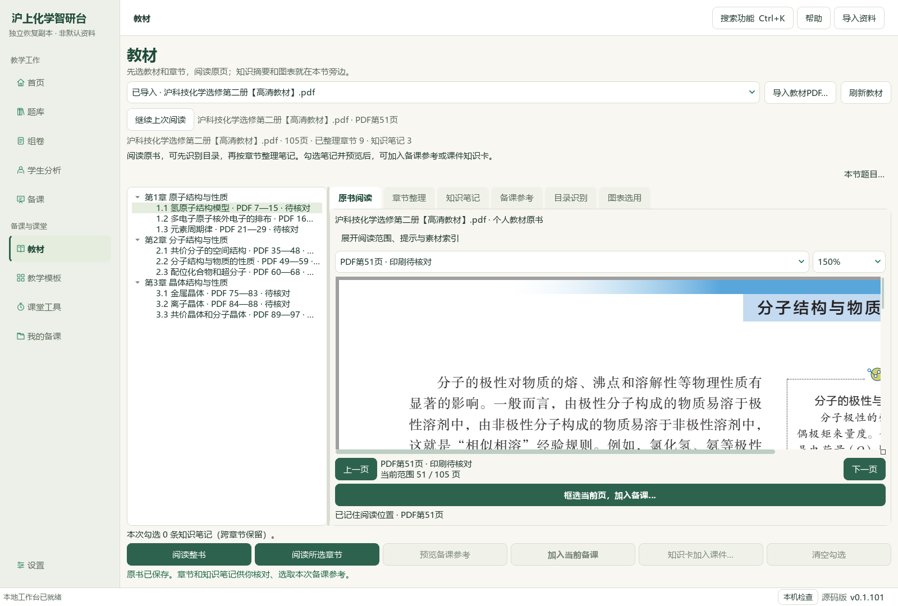
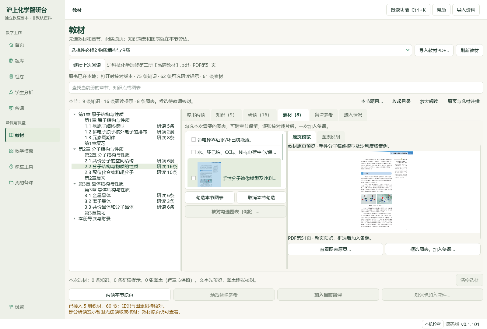
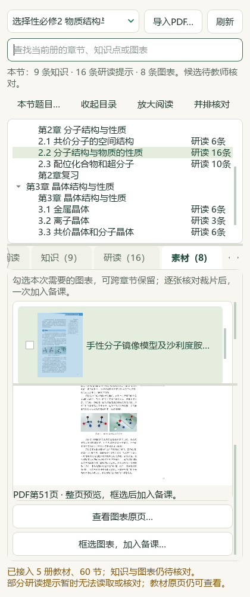

# 教材当前页裁选与可见选图

当前源码进展，旧EXE v0.1.101保持。上一轮同讲义完整例题与14页手性课堂已有实际成品；本轮改善日常教材选材，不新增备课稿、Office成品或中央教材记录，总目标继续。

## 操作与实现

个人教材嵌入阅读器新增“框选当前页，加入备课…”，用实际阅读器页序定位，整书或保存章节均可。点击才同步裁选页码，翻页不选材；复用原裁片、图题、用途、预览与明确加入流程。父面板在打开与确认返回核对书籍SHA、当前阅读器、章节范围及页码；取消保留原页和缩放。

教材书架、独立素材浏览、课件教材图及知识卡关联教材图选择，使用同一只读原页预览。仅选中且可见时加载；大图最多640×960，列表最多保留8个80×108缩略图，不预渲染整库、不猜图框。每次选择重新核对来源，开始读取前清除该项旧缩略图；异步旧结果、取消和关闭不恢复旧像素。图标更新隔离勾选事件，预览不会选择或加入材料。宽窗并排、窄窗纵排，书架两栏可滚动。

原始教材、题目、答案角色、来源版本和正式资格保持。普通备课及个人教材备份范围沿用既有实现，无新格式或发行包。当前正常入口仍为 `E:/项目/上海高中化学等级考/outputs/2026-10-07-same-lecture-questions/打开教材图与问题导学工作台.cmd`。

## 视频对齐依据

根代理本轮直接查看既有V10第56秒与V32第39秒完整帧：前者可见章节目录与原页并排，后者可见分类、候选池与题面预览。支持在选材旁保留完整内容预览；缩略图方案是针对本工作台痛点的设计推导，未称视频已展示教材自动识别或智能推荐。没有新下载、连续播放或听音轨。帧路径分别在 `outputs/2026-10-06-textbook-reading-to-lesson-navigation/` 和 `outputs/2026-10-06-word-library-cold-load/`，历史SHA绑定沿用其原回执。

## 检查与诊断

当前页最终4模块54项通过，包含25项新增检查；此前9模块114项在增加请求类型守卫前通过，计数重叠。可见选图6模块初轮57项通过，补修来源变化后旧缩略图清除后58项通过。增加书架并排布局后相关检查及实际原生验收以本轮最终回执为准，不累加重叠检查。

初轮新增像素检查只测试红色通道变化，合成页红通道固定，修正为检查任一RGB通道。原生助手首轮把“textbooks”误写成“textbook”，未启动书架读取，失败诊断保留；第二轮完成实际操作和截图，但把允许变化的独立阅读位置记录误判为备课变化。比对确认只改变副本的 `textbook-reading-positions-v1`，47份备课稿与历史选题保持；最终按各记录实际范围检查。模型检查不是独立真人化学审校。

实际Qt使用105页选必二原书第51页，先取消后确认；确认原像素进入原备课图片区，原22素材课堂设计保持。独立副本的阅读位置允许变化，47份保存的备课稿和11条历史选题不变；989份主候选文件及前轮三份成品最终SHA匹配。没有新保存的备课稿或Office输出。

实际界面复核又发现书架列表被纵向按钮挤压，以及420窄窗章节状态纵向断行、底部知识按钮挤占图表预览。已改为书架宽窗两栏、窄窗纵排滚动；状态单独一行，图表页临时隐藏知识操作，返回知识页恢复。缩略图加载后将所选条目滚入可见区域，并增加完整行的空间。先前仅几何点位通过的截图保留为诊断，不作为最终可用性依据。书架布局47项、最终窄窗36项及最后显示检查的范围与当前源码SHA见最终回执，计数不累加。

证据目录：`E:/项目/上海高中化学等级考/outputs/2026-10-07-textbook-visual-selection/`。根代理实际界面、来源与成品保护、最终测试及文档检查绑定见该目录最终回执；不会用窄测试声称整个题库、全部UI或目标已完成。
