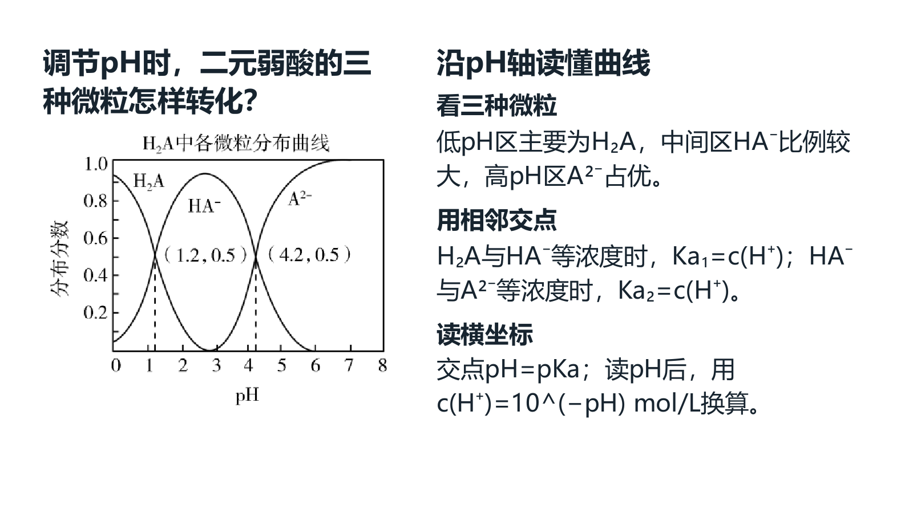
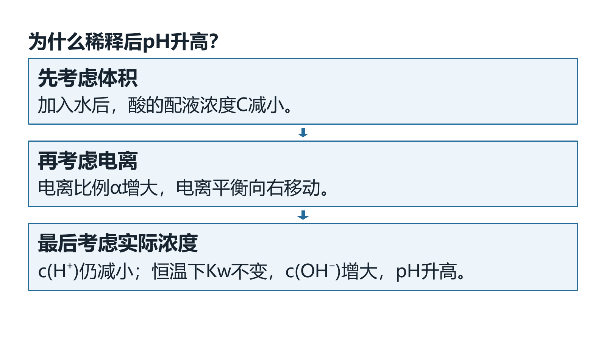

# 弱电解质两课时课堂稿 QA（保存与实际 Office 已完成）

2026-10-07。本轮沿正常工作台的生产导入与导出入口另存《弱电解质的电离平衡：从实验到微粒》，保留已有选材稿；未提交、发布、修改应用版本或重建 EXE。
证据根目录 `ROOT = E:/项目/上海高中化学等级考/outputs/2026-10-07-weak-electrolyte-classroom/`。

## 当前可证范围

- 最终工作台布局为 `classroom-final-layout-v3`：课堂 24 页、38 资源、12 图，6 个节点合计 80 分钟。
- 12 图包括 6 张教材原图、3 张 Word 原图（含完整 b23 图）和 3 张实景图；原图与旁栏文字按同页外框组织。
- 3 个点击资源包括两题的独立教师讲解及一个三步过程；原题答案角色、来源快照和原图身份保留。
- 三范围布局无 errors：教师 26 页、学生静态 23 页、课堂 24 页；这是当前渲染器布局检查。
- 实际 Microsoft PowerPoint 为 24 页；Microsoft Word 教案 23 页、课堂笔记讲义 11 页。PPTX 审计记录 5 个原生点击效果：第 8、22 页各一条同页讲解，第 20 页三步过程。
- 根模型检查实际 PPT 全部 24 页联系表及 01、05、08、16、18、20、22 页大图、Word 1／2 页和笔记 1 页；没有独立人类复核或 live 动画放映检查。
- 新稿 `prep-6c5e8582608546b2a708890556d4c79c` 经真实服务保存重开，revision 为 `84c2bdaec9cdf8a0e80e7358f521a1491d3153cd3657b59852116f7e190ab914`。
- 当前 50 份备课／55 对象，之前 54 对象完整保留；原选材稿和主稿 51 资源／37 页保持。正常文件清单 1026→1047，旧文件仅授权的 `desktop-state.v1.json` 变化，新增 21 个本课图片、裁片、成品与预览文件。
- 正常保存稿的真实 `LessonCompositionPanel` 重开读回通过：学生静态 23 页、教师 26 页均无布局错误，15 张学生与 8 张教师截图；全部 1047 文件的 hash／bytes／mtime 和桌面状态相同，无实际修改。
- 根模型看学生知识网／教材原文／分布图的 v2 同 UI 同 payload 代表截图，以及 v3 教师原题与讲解、三步过程。最终范围与文件保护只引用 v3 回执；v2 误记教师页数与隐藏资源定位的字段已留纠正记录，v1 在展示前中止。
- 新普通 ZIP 独立恢复通过：402 文件、106 图、49 成品包／294 成品文件；恢复 50 份备课的完整记录全部相等，本课 payload／revision、12 图和 6 个登记输出的 SHA／bytes 与 ZIP 及恢复文件一致。
- 备份 `弱电解质课堂-含图片及Word和PPT.shchem-backup.zip` 为 625300036 bytes，SHA-256 `8b161c1ee69ad8862430306eddeed3902eb06ee448a0e3762f2b45ed82b9f106`；正常 1047 文件的 hash／bytes／mtime 和状态保持，0 越界写。

## 演示与笔记范围

`classroom_notes=True`：课堂讲义 Word 是完成态笔记，包含教师明确选择的分步讲解；不声称 Word 隐藏答案。
学生静态 PDF 省略点击讲解，课堂 PPT 放映按点击出现；实际 Office 导出的 PPT PDF 是完成态，不能替代无答案学生静态稿。
原题的 answer／analysis 等教师角色继续留在教师范围；点击解释来自独立 derived 资源，不改写原题作用域。
来源、许可和提醒保留后台，生成正文呈现课堂问题、定义、条件与推理。

以下为工作台 render 预览，原样复制，**不是实际 PowerPoint／Word 渲染截图**：

## Evidence paths

- `ROOT/classroom-final-layout-v3/preparation-payload.json`、`layout-summary.json`、`classroom-contact.png`、`page-*.png`：最终编排与工作台预览。
- `ROOT/classroom-build-v6/derived-question-explanations.json`：两题派生讲解与原题证据绑定；该轮 construction-proof 是早期 37 资源／23 页，不能代替最终布局计数。
- `ROOT/source-outline-probe/production-outline-binding-verification.json`：生产原 Word 目录与来源身份核对。
- `ROOT/external-photo-probe/photo-candidate-receipt.json`：Brandy Vinegar 的 CC0 原 JPEG 来源、作者、许可和哈希；已进入私人课堂，许可记录保留后台。Sasa 候选未入课。
- `ROOT/classroom-office-v1/office-proof.json`、`actual-ppt.json`、`actual-word.json`、`教师成品/教案与课堂PPT-dc0ff6d6-ipdxpxsg/`：真实 Office 转换、页数与点击效果审计。`office-proof.json` 保留导出时的 `requires_root_visual`；后续限定根模型检查见保存回执。
- `ROOT/saved-classroom/save-proof.json`、`saved-draft.json`：真实服务保存重开、对象及逐文件保护、最终页数和根模型检查范围。
- `ROOT/native-classroom-readback-v3/verification.json`、`*-native.png`：保存稿的真实学生静态／教师两范围 UI 读回和 1047 文件保护；此处不是 24 页课堂 PPT 范围。
- `ROOT/native-classroom-readback-v2/proof-correction.txt`：早期 UI 回执的范围字段与隐藏资源定位纠正，未作为最终教师范围通过依据。
- `ROOT/ordinary-backup/verification.json`、`弱电解质课堂-含图片及Word和PPT.shchem-backup.zip`：普通桌面备份及独立目录恢复、全部 50 份备课与本课图片／成品一致性。
- `ROOT/final-acceptance.json`：根代理独立汇总和成品 SHA 复核，终态为 `machine_pass_with_limited_root_model_visual_scope`；包含追加的 Office 第 1 页检查范围，人类与 live 验收为 false，中央 validate 为 1。
- `ROOT/current-host-validation.txt`、`startup-validation.txt`：全局验证与旧入口边界，不合并为本课材料验收通过。

## Limitations

当前 host 全局 validate 退出码为 1，存在旧 snapshot 的 catalog mismatch 与既有 quality gates open；旧 PowerShell 入口缺少 Get-FileHash。本轮未修改 central catalog，也未宣称全局验证通过。
普通 ZIP 恢复 50 份备课，按其范围排除其余 5 个状态对象；不包含 DATA 原资料库、关系、配置和学生历史，不称恢复 55 对象或完整项目备份。
ppt-master 仅作教学结构参考；其 SKILL／generate-pptx 默认要求 SVG 与交互模板。用户要求设计保留在工作台，并授权常规自主推进，本轮继续使用既有 workbench renderer；未运行技能 SVG 生成，不声称该技能 pipeline 通过。
服务保存重开、实际 Office 转换、真实两范围 UI 读回、普通 ZIP 独立恢复与上述限定根模型检查已经完成；本稿不授予人类复核、live 放映验收或正式晋级，不解锁发布或材料人审标志，整体目标继续 active。

本轮文档终检：documentation_policy.py 退出码 0；完整 test_complete_readme.py 14 passed（1.09 秒）。日志保留 ROOT/documentation-policy.txt 与 complete-readme-tests.txt，版本及应用代码未变。
