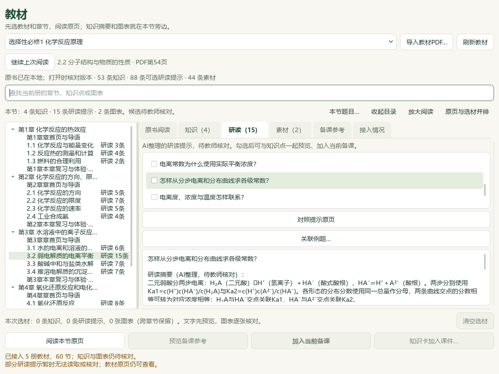
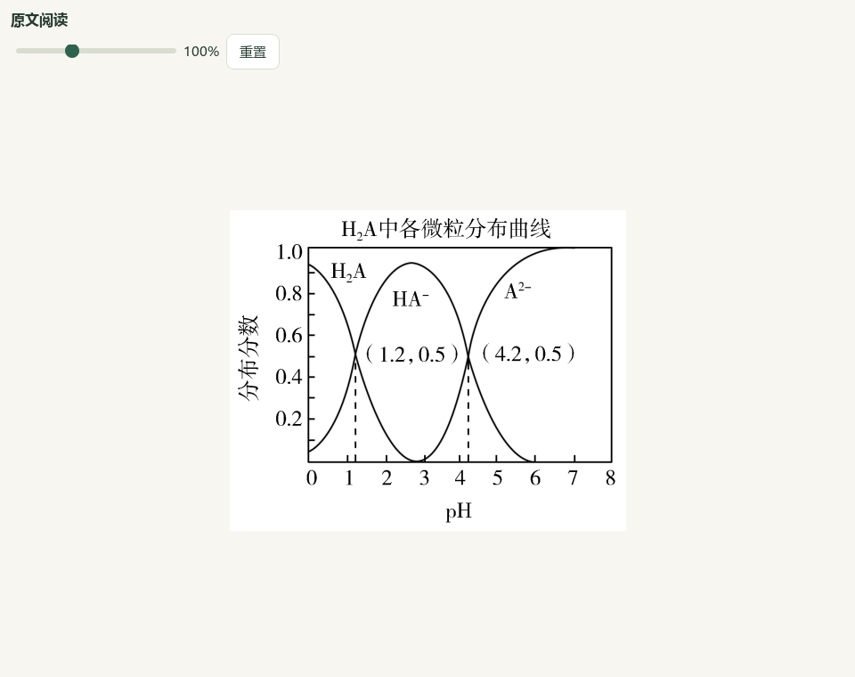

# 弱电解质教材—讲义问题导学恢复 · 2026-10-07

当前源码与本地DATA工作台新增7条研读候选，保留旧7条原始档案、原教材和原Word。操作见[教师指南](../teacher/lesson-and-paper.md#weak-electrolyte-connections)。未增加正式题库资格或发行版本。

## 内容与来源

7条依次为实验区分强弱与浓稀、速率图和平衡响应、实际平衡浓度、分步电离与分布曲线、电离度与温度、稀释与pH、导电性与微粒变化。标题均为可由材料回答的问题，保留旧ID `READ-TB-E1-20260927-WEAK-01` 至 `07`。

新派生文件在CODE与DATA的 `knowledge/textbook/reading-notes-20261007-weak-electrolyte-connections.json`，字节相同，SHA-256 `e4e4f9e08829e6025b910f658dd424a42b28b60b6275c1b2e10cd8c3dcd64180`。旧档案缺少当前候选／来源页码／适用范围字段而未进入可选目录，本轮重读原件后另存，未覆盖旧文件。

教材选择性必修1原PDF70—73／印刷64—67页，SHA `79e1e8391749b01a2d9d632531615ef9b644613130e28b98279aaea71aab2b05`。PKG-056原Word《第06讲 弱电解质的电离平衡（复习讲义）（上海专用）（解析版）》558373字节，SHA `8cda068028bafa475614cd124effaf56caea133084813b9609926af8e325bfb2`。当前298区块、134原图出现位置，preview revision `465eee61e5e2c5d94a478c24b857e17eb64f9d33e3725d75aadea3eff8f20556`；原XML和图片SHA重新映射，未直接沿用旧编号。

根模型查看教材4整页、分类／速率／分布3原PNG，核读Word29—74、122—132、203—224和227—231支撑文字。次氯酸例补全初始量、加酸定容、实测氢离子浓度；电离度公式明写单一一元弱酸、无其他相关离子、忽略水电离等条件。原碳酸Ka₂表／正文差异、旧对象／特殊字体提取缺口及未知原考试出处保留在证据字段；未认证全Word公式、官方答案或评分。

| 原图 | 原SHA-256 |
| --- | --- |
| 区块31分类图 | `1d1574a13a15c508224d72ba2c680a0ef38b3870abe0ccd0d3f42e10c41a4787` |
| 区块40速率图 | `8c9458a39ac2a943b095f040b67ce089a2cb544300d1144501e88fe5d3937f6b` |
| 区块218分布曲线 | `5ab9fe0498417ce6621951c7b8bd8fa6a6ef22640259e5ac303db12999cfb4bf` |

## 实际结果与保存

DATA可选研读460→467、本节8→15，旧460条归一化记录及revision逐条保持；目录revision仍 `3fb5e6c02c37191ca464d36ebfde8020e22e85aec39265eab660c19831b5f9aa`。五册60节、386知识候选、322教材素材保持；没有新增教材图表登记，也未宣称39条旧内容全部恢复。

7条均通过实际 `_note`、`reading_reference`、`import_knowledge_note` 和学生／教师课堂投影，正文无来源、SHA、待核验及防御提醒，化学条件保留。候选、human_reviewed=false及教学／生成／发布正式资格false保持。

实际SOURCE自身manifest、closure、归档Word和3图provider读取分别核对，不从另一profile推断当前入口。native-r2实际Qt显示15条研读、7个新问题标题和全文；同份讲义读取298原块／134原图，3图按原位置阅读及放大。三图仍由讲义选材入口明确选择，本轮没有自动笔记—图片精确关系，没有入课或保存新课。

原59个DATA研读文件SHA／大小／mtime保持，原包、PDF、Word和旧复核记录保持；正常1016文件及QA state保持。DATA `sh-chem-db/catalog.csv`只追加1条派生记录，关联两原件与旧包SHA；CODE不含原始数据catalog，不创建另一份。根模型查看上述原像素和实际窗口，不等于独立真人审核。无新Office、EXE，既有37页课堂与Word/PPT保持。

首安装脚本完成两个JSON、目录兼容、7课堂投影及DATA catalog追加后，误假定CODE也有catalog而中止，不计整体通过；只读补核确认所有结果和保护清单，形成最终 `root-installation-verification.json`，未重复安装或追加。失败分类保存在 `root-installation-first-attempt.json`。

当前60文件／506原始notes，512上限余6，无效旧记录也占额度。后续大量扩展前须处理有界读取容量；本轮未改验证器或上限。

证据目录：`E:/项目/上海高中化学等级考/outputs/2026-10-07-weak-electrolyte-note-recovery/`。含完整候选／XML／原图映射、实际SOURCE核验、原4页PNG、安装及课堂投影、native-r1/r2与正常清单。关联题窗口另见[阅读QA](2026-10-07-private-reference-reader-qa.md)。完整资料与原59项／X01—X10继续，整体active，微信读书停用。
