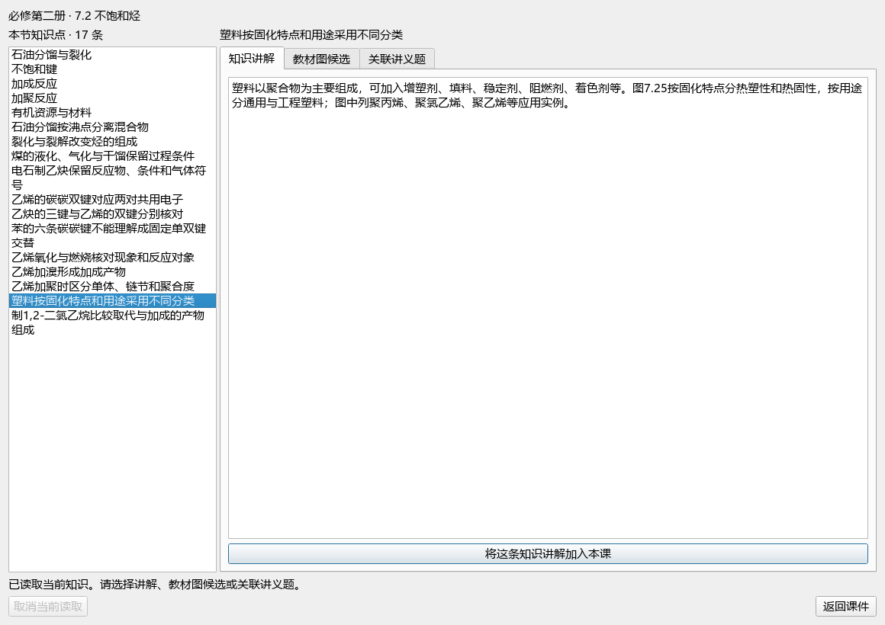
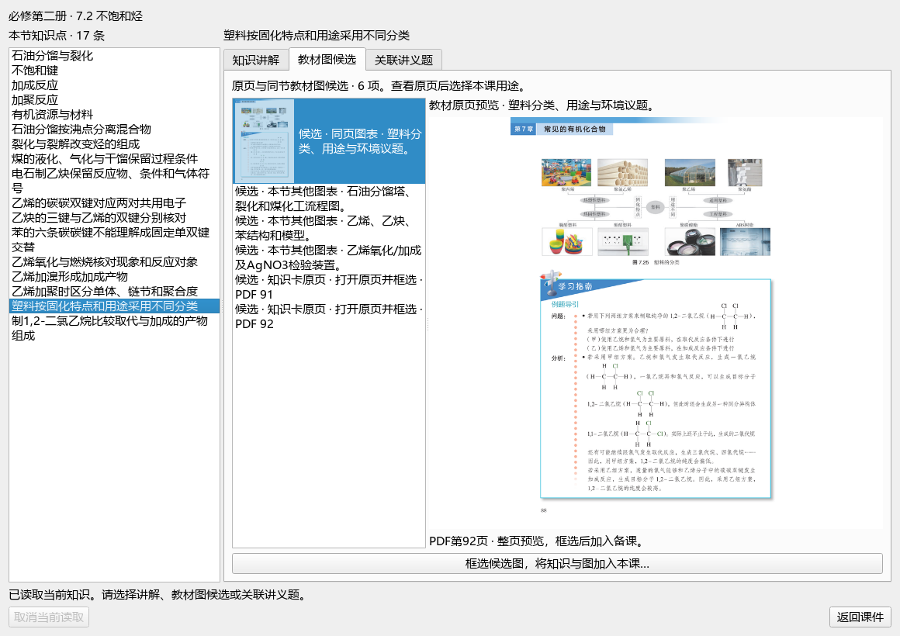
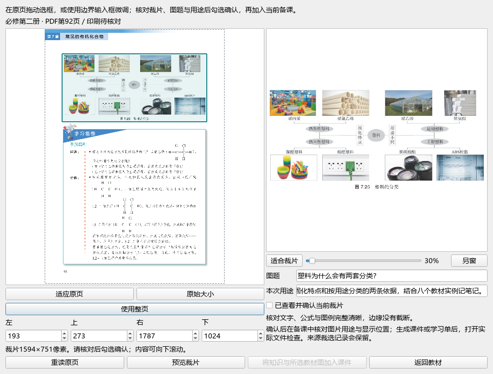

# 教材原页后按本节知识点统一选材验证

日期2026-10-09，维护源码。ROOT=`E:/项目/上海高中化学等级考/outputs/2026-10-09-contextual-section-materials`。本轮是整体active的选材切片；未提交、发布、重建EXE或升级renderer38／prompt35。操作见[原页后选材](../teacher/lesson-and-paper.md#section-materials-after-reading)。

## 结果与边界

六产品完成只读真实章节上下文、统一知识／教材图／讲义例题选择、最终来源重核及原页桥接。知识的工作提醒为空但完整Original保持，来源／版本／页码／SHA后台保留。图是同节或原页候选，不是已确认教学关联；讲义题只显示实际保存的关系，空关系可明确从讲义题库选完整题，保留全部题面／题图／答案。candidate=true，其余human／official／generation／publication=false。

已存在同版知识时不覆盖教师工作内容，新图指向实际保留card ID/hash；读取和最终提交都核原书／原文／来源版本、插入token和当前作品。切换素材、画布或页面使旧请求失效，不能由A→B→A恢复旧回调。一次history批次包含新知识和图／题。提交前失败仅在表单仍精确等于本批时恢复旧图片表单并清理未引用发布图；提交后sync失败保留被history引用的图。教材服务已完成的候选裁片缓存可能保留，不承诺删除所有文件。

## 验证证据

| 范围 | 结果与记录 |
| --- | --- |
| 真实上下文与取消／错来源 | 41例，context-worker/pytest-4.xml；登记／概念／补充／个人教材与无课内知识卡裁片 |
| 原文与裁图最终交接 | 15例，context-worker/handoff-2.xml；真实PDF、保留card绑定、源变prepare/publish拒绝、完整原文及提醒投影 |
| 统一窗口及两阅读器 | 25例，ui-worker/junit-ui.xml；切换／迟到／关闭／重试，宽窄布局与完整题请求 |
| 最小真实Panel＋controlled源 | 23例，ui-worker/junit-panel.xml；三位置、单undo／redo、源变、意图冻结和提交前后图片异常 |
| 根旧插入回归 | 28例，root-regression.xml；现有插入行为保持 |
| 独立边界复核 | 39例，independent-review/independent-review.json；真实DOCX编译/MaterialPublication＋controlled端点的linked/browse，2已修P2及迟到回调 |
| 独立实际Normal三裁片 | PDF90／91／92从真实原书SHA/RGB/receipt定位TB-M2-C7:7.2；无课内knowledge_note；actual-normal-three-crop-scope.json |
| 根真实完整课程原生Qt | native-section-course-v8/verification.json；正式字体、原页新按钮、17本节知识、READ-20261005-UNSATURATED-11讲解、完整图7.25及问题图题；原81资源／位置exact、2项同批／1undo／redo、原生无裁切 |
| 原数据与代码 | root-final-audit.json；Normal1523／QA415全SHAbytesmtime，六原件、上一QA及原59未修改冻结源码；union70最终AST/SHA冻结 |
| 文档 | documentation-policy.json与readme-tests.xml；README长度、链接／图片／锚点及完整README检查 |

源码冻结清单核对为：上轮60个文件中Panel一项更新、59项保持；两个既有阅读器本轮首次纳入冻结，另有3个新产品模块与5个新测试，共70项。初次最终审计错误假设三旧产品都在上轮60项清单中，失败保留并据实际清单修正，源代码未改。

各组按自己的输入与独立程度记录，不把重叠回归相加为独立功能数。原生Qt使用只读FrozenState＋facade.__new__及OWN候选task，不实例化MainWindow、Recovery或StateStore；不是真人课堂、化学评审或正式发布验收。

## 实际界面

根直接查看宽／窄知识窗、教材图候选、完整图7.25裁片预览及加入后画布；这是指定截图的人工观察，没有逐页精读全部课程。学生画布83资源42页只是OWN新功能验证稿，未保存为新日常课程、未导出新Office。日常稿仍40页22教材切片7实景9点击与原讲义知识网；三现成Office来自上一已验证增量。

## 保留的失败与修正

handoff-1.xml真实接口反例发现根新增输入检验把crop_binding误当dict，实际是64位SHA字符串；已按公开接口修正并真实15例复验。独立P2资源选择A→B→A及提交前图片表单悬空保留首轮失败，同输入修复后39例通过。

root native v1／v2只有QApplication而未install_ui_font，在原题rich layout发生native访问异常；独立默认／正式字体同一单题A/B定位环境差异，v8使用正式字体完整课程通过，未修改renderer。v3／v4只读FrozenState缺draft_snapshot；v5—v7读取旧图片时普通ImageStore初始化的noop mkdir被audit拒绝，profiles实际仍exact。v8补纯_draft_snapshot读口、原生安全IMG字节读口，final全profile相等且零写尝试；旧失败和脚本不覆盖。

最终审计首次把模型3个click_reveals资源组误当9次原生clickEffect；已读取现成PPT XML核对40页／9次点击，并分别记录3组与9次，实际课与文件未改。失败脚本和解释保留。

本轮没有重新采集外图、新增视频阅读或全44视频验收，不把三个来源字段缺省猜成已关联。旧EXE未更新，资料资格没有由工程测试提权，微信读书路线仍停用；原59、X01—X10、QUOTE完整范围／44视频及整体active继续。
