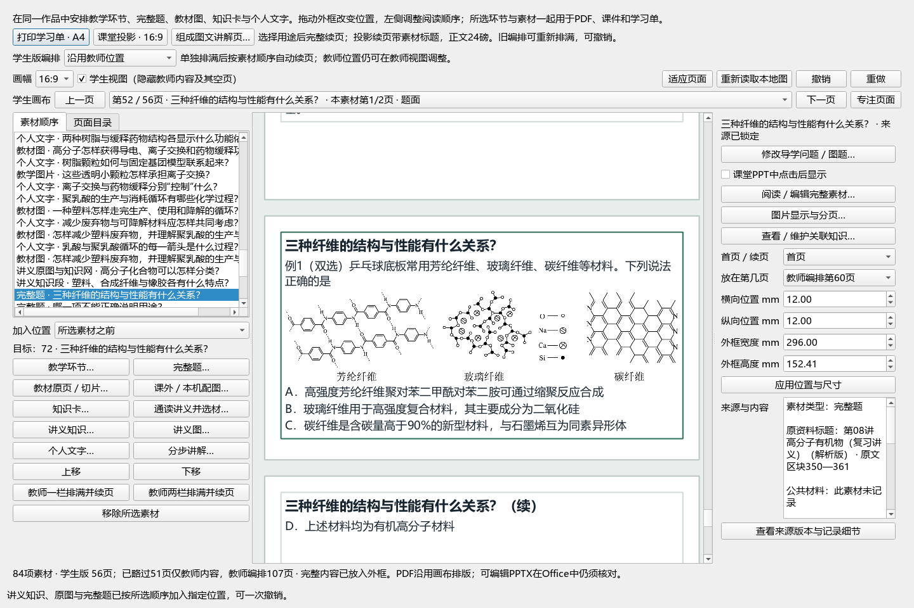

# 入课前引导问题与课堂题面投影：验证范围

2026-10-09，维护源码局部进展。整体目标active，旧试用EXE未更新。

## 实际行为

混选清单在题目加入课件前允许编辑左上引导问题。原始空初值改为干净题面预填；显式教师标题保留，同确切题源重选也保留。题源、题答和分值设置保持；标题overlay在完整原题封存后和旧课去重前执行。

本题原首段“例1（双选）（24-25高三上·上海·阶段练习）乒乓球……”中，仅工作文本区间[6,24)的18字符出处删除，例1／双选／题干／全部题图／选项／答案及所有presentation保持。Original全字、八字段证据与自身SHA仍有效，fresh CB UUID规范化后与旧封存题全文和证据相同。新标题为“三种纤维的结构与性能有什么关系？”。

识别仅限首段明确年份·地域·考试标签；未知学校、异常或歧义格式保持原文。化学括号、图标、上下标、EQ不能跨删除区间，实际渲染token须与算术位置投影相同。不是任意删除括号或来源资格升级；既有教师工作稿不迁移。

## 实际运行和输出

真实最小Qt／TaskBridge：只读Normal81素材／87图，私有课程按分类网B45→完整栏目B254—297→完整题B350—361加入，得到84素材／107图；44源块／3表／32原图出现保留。默认标题不改保存、改问题标题、同题重选、旧81／87内容与位置、单undo／redo及同源空清单取消均通过。三新增素材原生输出2Word／2PPT／2画布PDF：学生16页、教师16页为画布／包内页数；四包正文无本题18字出处，23源图字节一致，题号／双选／题图／选项与教师答案保留，学生答案隐藏。未启动Office，Word物理页数未知，不等同现场放映。

作者标题60、来源投影44与独立3分别通过，不叠加旧运行。源码union101＝旧96中94 exact／2改，另纳入3新建文件与2既有修改文件。课堂新题默认未启用点击，完整题仍分页；本轮是交接验证片段，课堂教学设计和图片补充继续。Normal1523／56备课／61对象、QA415、六原件、既有45页成品及课程ZIP保持；未保存日常课／注册新课，renderer38／prompt35／EXE0.1.101不改，无发布或资格升级。

16张原生截图是采集量。根模型直接查看默认标题窗、手填标题窗、加入后的知识网／完整知识首帧／题面首帧，以及导出重点页；不是全56学生页、107教师页或真人教学验收。完整题的D选项仍到续页，教师答案默认隐藏；本轮没有把分页或未启用点击评为课堂设计完成。

## 测试与证据分层

- 标题作者60（新38、既有metadata22）：受控题源与最小Qt；无真实Word读入。
- 来源投影作者44：三份真实题段，富文本／角色／图片、混批发布／重核／去重及Word／PPT序列化。
- 独立3：八字段逐项反例、封存B350与显式标题／stamp、A→B→A及关闭迟到；不计入旧44或作者60。
- 真实Native run-1：真实Word、Workspace子窗、TaskBridge、prepare／publish／history；私有只复制87原图库文件，不复制整个profile或69裁片凭据。
- fragment-export-2：三个实际已发布资源原样输出六文件及原始SHA；四包XML全题块角色与23源图字节核验。画布PDF是内部渲染，Office物理渲染和Word页数未验。

证据根：E:/项目/上海高中化学等级考/outputs/2026-10-09-question-classroom-copy/。

entry-title-exploration/implementation-receipt-v2.json与tests-final-3-prefill/junit.xml；source-prefix-exploration/question-classroom-copy-implementation.json与tests-run-4/junit.xml；source-prefix-exploration/independent-title-review/independent-title-review.json；actual-question-course/run-1/verification.json、question-classroom-copy-proof.json与fragment-export-2/verification.json；根101代码冻结、保护清单及最终回执。

此前58／42等开发运行不累计；首次pytest NUL日志、作者新fixture8失败与导出首轮fitz缺失均保留。第二次导出只修OWN页数检查依赖，不修改产品、不覆盖首轮。无完整应用／Facade／StateStore／Recovery构造，无Normal或QA写入、Office启动、提交发布或人工资格升级；微信读书持续停用。

未新增教材或课外照片，本轮使完整原知识／图／题进入现有课堂设计并能预先写好问题；更多选图、知识内容、同页点击与整堂课设计继续，原59／X01—X10、固定60、44视频及整体均未标完成。
