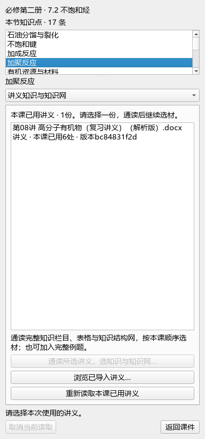
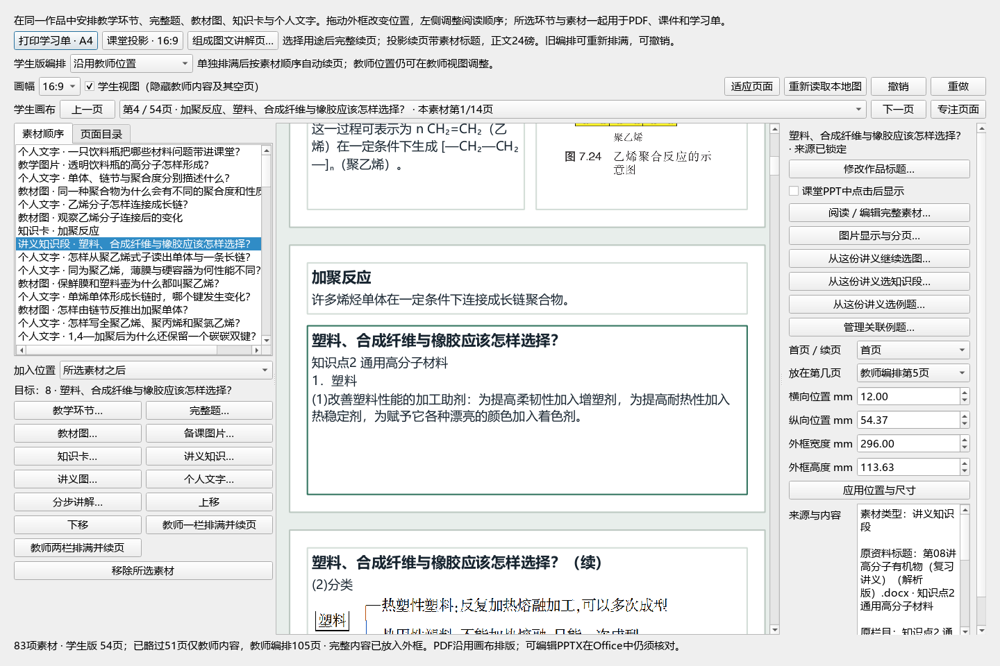

# 2026-10-09 本节教材与完整讲义知识网衔接 QA

局部推进，整体goal保持active。ROOT：E:/项目/上海高中化学等级考/outputs/2026-10-09-section-handout-knowledge；CODE为e6ae，DATA为E盘项目。日常Normal课程和旧EXE0.1.101本轮未改。

## 行为与来源

真实本课封存来源候选，明确选择锁完整八字段，或浏览资料库手选。连续阅读器返回混合request，知识／表格／知识网／原图／完整题按selection_order与教材知识同批进冻结位置；同版去重保留工作编辑，一次undo-redo。无自动语义关联或资格提升。预选physical source_path与当前归档outline不同则拒绝，不能同名替代；原手工讲义内容不当作生成提醒清除。

静态EQ去重仅规范化完整snapshot中图基底的逐次composition block UUID；原文字、条件、crop、container SHA、source refs和完整栏目继续比较。真实缩聚B90—144为55块7EQ、其中2图基底；两次native import的新UUID不同但同一原范围相等，教师已编辑课程再选0新增；独立同字节不同出现反例仍不等。

## 验证证据

- 作者helper25：context-worker/pytest-2.xml；真实DOCX及安全归档resolver。首轮1个fixture缺字段失败保留，后补齐；不是产品问题。
- 作者UI扩展94：ui-worker/junit-2.xml；最终布局50（34新）：junit-3.xml，重叠范围不相加。两fullMainWindow fixture按本轮边界未运行。
- 根原回归53：root-regression.xml；原section handoff与插入模块。
- 独立54：independent-review/junit-final-r1.xml及independent-review.json；真实DOCX混合原生compiler／出现绑定／源锁／异步失效／prepare-publish→最小Panel的单undo-redo、提交前清理与提交后保留图。首轮fixture缺preview和错误IMG-ID文件名端口已修，失败证据保持；无未解决P1/P2。
- 根native-handout-eq-duplicate-1/verification.json：实际完整81资源87图、真实縮聚全范围重复、教师编辑exact。
- 根native-section-handout-course-1/verification.json：实际81资源Qt课、正式Microsoft YaHei UI及Fusion；六封存卡合一原Word来源，旧B29知识网及新通用材料B254—297明确选用。通用材料44连续块／3原生表／32原图出现，旧网络去重，教材知识＋完整栏目一批；私有83资源105图54学生页，全部旧81资源位置、单undo-redo exact，无native clipping error。7截图，根直接看知识网、材料正文、混合清单与当前private Panel页，不称全54逐页人工精读；本轮无Office导出或Normal保存。
- 最后native-section-handout-final-view-2/verification.json：最终UI源码SHA的1366／420原生窗2截图，窄屏完整名称下拉；首次整合期间后续仅页签布局变更，读选契约未变。独立只机器核对9张截图元数据与当前UI SHA，未重复全课或宣称人工视觉。

## 文件与边界

四既有产品修改＋一新helper、两新tests，code-final-freeze union74：前70中67 exact／3更新，加既有Workspace1和新3。源码AST及SHA／bytes／mtime冻结。旧维护说明union68属于上一历史；上一root-final-audit实际union70为本轮起点。Normal1523／QA415、六原件、上一QA和旧未改代码全保护核对，见root-final-audit.json；无MainWindow／Recovery／StateStore构造或保护区写尝试。

九新离散帧：V10 27/38/62s、V43 28/37/47s、V27 25/33/41s，原MP4逐SHA／bytes／mtime核验。根直接看到原文／目录／当前来源、筛选列表／本次清单并列，采用明确阅读与选用组织；这是本地设计推导，不证明参考App隐藏行为。无音轨／连续播放或44完成，见video-frames-manifest.json及reference-ui-observations.json。cv2初试缺模块且未创建输出，改已装ffmpeg；根首轮嵌套脚本语法错误未写文档；次轮因旧标题混合换行断言，仅完成计划中的README行，其余六文档未变。最后从冻结原文先规划全部内容、CAS核对当前状态再写，失败记录保留。

现有Normal56备课61对象，40课堂页22教材裁片7实景9PPT点击保持。无本轮新外部图片采集／日常采用／Office／提交／发布／EXE／renderer38或prompt35变更。原59、X01—X10、QUOTE完整范围及44视频与整体goal继续。文档策略和完整README14测试最终见final-entry-and-documentation-checks.json。
