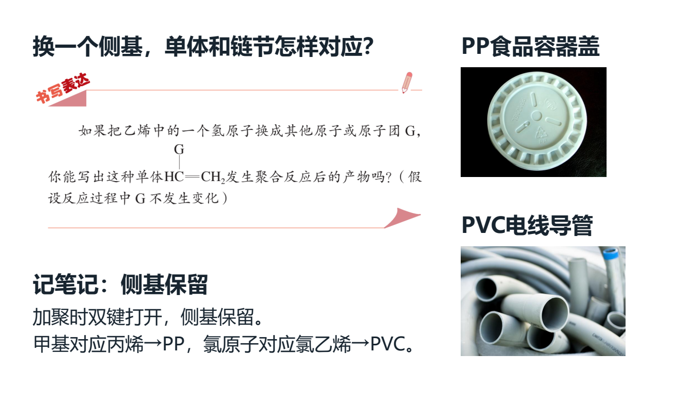
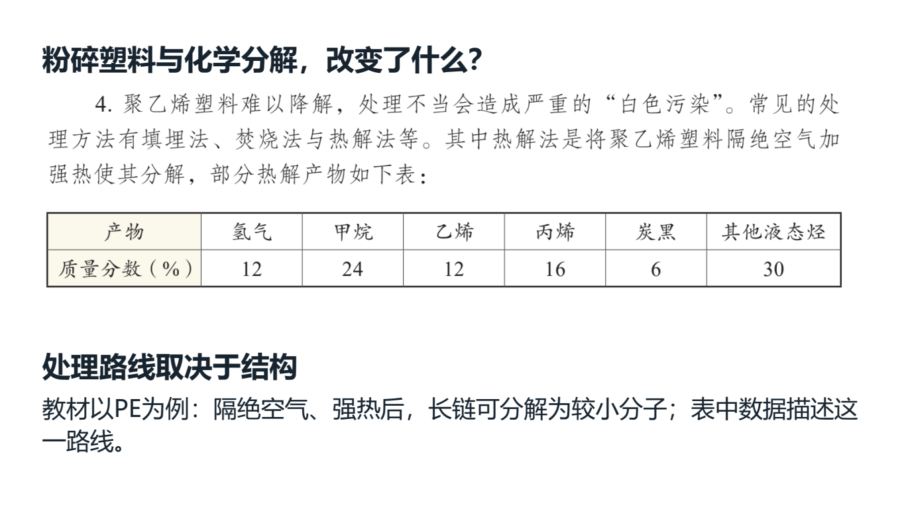

# 2026-10-09 Word静态QUOTE完整栏目与课堂副本交接

本轮为维护源码的局部进展，整体目标、原59项、X01—X10与44视频对齐继续。renderer38、prompt35及公开试用包v0.1.101保持。证据根为 `E:/项目/上海高中化学等级考/outputs/2026-10-09-word-quote-materials`。

## 完整来源与事务

PKG-072原卷B33—46、解析版B34—47的完整14块、7次原图出现、5个唯一原图SHA保留；QUOTE三个出现位置全部封存，显示其中两个。源SHA、revision和旧预览保持。v2重解析原段落及样式、栏宽、锚点、透明效果和缓存；Character缩进仅接收已实测的Normal字号21／24半磅与匹配的字符值、twips及字体基准，未知结构、外链和不一致几何仍拒绝。原B37两个PUA在原Word及嵌入字体中无字形，未猜作括号；原生流程明确编辑课堂工作副本，Original保持。

混合讲义、教材本节选材、普通讲义知识三个入口共用待交接批次编辑。二次核源在工作线程完成，加入前再核位置、历史和图片；整批一次history，取消不部分入课。提交后刷新异常只精确回滚本事务；后续编辑或undo／redo仍引用的图片保留。来源、教师范围和五资格字段不因排版成功而改变。

## 分组检查与实际成品

frame82通过（55旧＋27新）；独立几何9、最终v2真实双版2、交接API20分别留证，不相加为一个总数。旧完整源47只覆盖v1。UI按node ID去重为54（41＋31−18）；后续仅入口文案修改的21另记版本，不能声称54在该文案版重跑。

Native3把完整栏目加入真实81素材课的私有副本，82素材／45学生页，旧81资源与位置、六讲义绑定和一次undo／redo保持。新增栏目占5页，原生流程通过；明显留白及局部文字密集仍在，未通过教学排版验收。独立真实Office16完成5页单栏目及45页课堂、49页教案、22页讲义物理渲染；新增5页像素与单栏目相等，9个原生点击对象保留，未实际逐次播放。无页外字符或幻灯片外形状；textbox文字bounds诊断仍有单栏目17、整课学生105、教师487项，不能据此称全排版通过。此段依据独立Office回执，不改Native3早先的false字段。

## 问题导学新稿与保护范围

新图文稿最终结果：最终独立副本45课堂页／95素材／98资产，新增3教材原片、3实景图、1完整知识网及5问题导学页；真实API保存并读回prep-65ca51a279c44d76b212defdedf66465。真实Office为PPT45页、Word教案54页／讲义24页，7新增图字节一致，9点击参数保持；无页外裁切，104个框宽提示（新页15个）留证，未实播点击

最终交付为native-question-guided-delivery-v2；V1—V4构建及design-v1失败回执均保留。完整栏目是14个源文字块加7个图块，共21素材块；全栏目仅教师可见。新增课堂页实际为8、19、24、33、34，原40页的Original与位置保持。图片出处与授权集中后台，课堂正文用问题、观察和解释。日常40页原稿22教材图、7实景、9点击保持；Normal1523／QA415／六原件的最终保护结果：Normal1523文件、56备课／61业务对象及QA415文件、六原件SHA／字节／mtime全等；只新增私有课程与成品。

主要证据：`native-full-quote-course-3/verification.json`、`context-worker/independent-scene-office/office-final-verification.json`、`explorer/pending-material-edit-receipt.json`、`scope-audit/quote-import-tests/independent-detached-api-review.json`及`illustration-gap-audit/illustration-gap-audit.json`。自动检查和模型观察不提升化学、真人视觉或发布资格。没有新EXE、提交或发布；旧失败回执及历史文档保留。

无APP0／APP1的合法JPEG兼容：仅verify通过的JPEG在python-docx未识别元数据时按原字节加入ImagePart，要求明确尺寸；25项测试（14旧＋11新）及真实Word16单图均通过。launcher标准库12测试及实际CMD只读预检通过，动态支持继续编辑。生成正文不加来源脚注，图片授权单独存放。最小Qt owner用于课堂观察；仅实际私有保存使用DesktopStateStore，没有构造MainWindow／Recovery，也未用完整状态构造作QA。

最终证据：`native-question-guided-delivery-v2/verification.json`、`context-worker/new-illustrated-office/independent-office-review.md`、`question-guided-launcher/launcher-manifest.json`、`image-word-export-diagnosis/fix-final-review.json`及`root-final-audit.json`。

