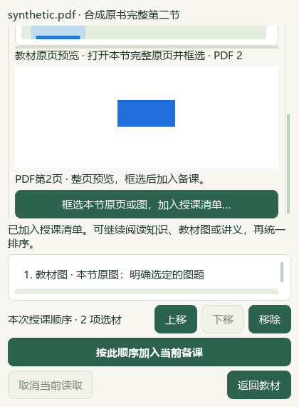

# 2026-10-13 工作台设计、EXE 补链与知识库交付

本轮继续完成工作台工具栏与本节选材窗口设计、前次EXE恢复链，以及GitHub普通应用包／含本地知识库应用包交付。教师入口见[README](../../README.md)，原59项与X01—X10见[原任务表](../roadmaps/audit-followup.md)。本页按实际执行、组件承接、真实资料链与剩余教学／外部范围记录。

## 最终包及七项收口字段

| 字段 | 当前可核事实／最终回执 |
| --- | --- |
| 版本与BuildTag | **0.1.103／v0.1.103-20261013-full-r1**；自然构建exit0 |
| EXE SHA-256及两种ZIP | **e5374dbc3e3a1da809041766dc565fb0407fc57e8b74de48f2cbe3443021af42**；512包文件／186108950字节；两ZIP已本地封口，大小、SHA及成员核对见[实际ZIP](#final-zips)，GitHub发布尚未发生 |
| 最终源码ledger | **4e696080f63abac32078a6d20d50d5efa3cc3a3888f378174249bdf53848f780**；682源码／503 AST／157资源（119知识资源） |
| 源码对应、受影响检查与组件承接 | 当前C与682源码copy全部SHA对应；r4共有673成员未改、精确7改＋2新增知识笔记；88 UI／11既有资源／22资源负例检查通过，新包普通冷启动0／九页资源探针0／4自有Word严格退出通过 |
| 真实SourceFirst／完整来源恢复与知识seed | **PASS_requested_instrumented_QA_scope**，七check全部true；真实3材7资产／B37／完整undo-redo／保存重开／98原Word ZIP／生产恢复／第二factory两课全字节。知识搬迁机器读取通过：196原件SHA、5册、129不可变资料、全196目录与所选原文／图像；首次全目录567.954s |
| 最终资料保护 | **通过**：全部新UI／Office／MainQA结束后，1938 profile元数据＋31完整SHA、0差异；迁E兼容junction的路径变化单列 |
| 文档policy／完整README检查 | **本次通过**：Root精确合入七文档后，documentation_policy.py自然exit0，完整README测试14 passed（控制台1.79s；`docs/readme-final-v1.xml`）。后续发行链接或文案编辑按改动再做必要核对，不提前计入本次结果 |

公开v0.1.101旧Release和附件保留。本轮v0.1.103远端发布尚未发生时，不能把准备好的ZIP或候选下载地址计为发行成功。

## 已核基线与本轮改动

前次受控整合12源码、45测试，共57目标；680源码成员与r4 ledger **57257ac6a62d328f2d2816c9ba2f256bf25236e4999ab4ebb9dc63275cb095ea**相等，1404份其他成员未变。原始失败与必要回放保持，源码／测试候选已整合，不再记作全部尚未应用。

0.1.102 r4：BuildTag **v0.1.102-20261012-full-r4**，EXE SHA **5bab11ff70d6e4520b0bfd42ce2a4d2962a6428fbc235a67eb4de8abde8b6208**；680源码／503 AST／65资源／420文件／183483539字节，构建自然0。普通detached真实factory无QA flag，自然启闭0，全部420复制文件SHA一致。r3→r4只有QA模块变化，产品／入口字节及65资源未变、418包文件SHA相等，base_library.zip内155成员相等；据此保留r3扫描Office组件结果，不冒称r4重新执行。

本轮原始反例：800×760工具栏9处标签裁切，420×570／430×600选材正文内裁图入口被父框裁切。工具栏改为原控件换行，44检查通过，真实独立MainWindow800×760与1200×800九按钮完整布局；选材正文自动垂直滚动，底部确认／返回在正文之外，420×570／430×600原图／Word／讲义操作和非空清单可滚动、聚焦与点击，4短窗＋16既有＋24无卡检查通过。两组共88源UI定向检查，不等所有屏幕尺寸或人类化学内容验收。

两图来自隔离E状态的源码Qt布局验收；普通EXE启闭、真实资料恢复与Office检查按各自回执另列。

## 源码和UI检查：原始结果与必要回放

| 组 | 原始记录结果 | 后续处理与范围 |
| --- | --- | --- |
| 后端3993 | 3747 pass／83 call fail／141 setup fail／22 skip，自然exit1 | 原224失败全部分类；647源码manifest当时无漂移 |
| 后端补充4434 | 4259 pass／100 call fail／49 setup fail／26 skip，自然exit1 | 收集190候选，实际189文件；1历史脚本缺失明示 |
| 后端合计 | 8427具名节点自然终态 | 不把重复回放加为新的unique通过数 |
| 必要ACL回放 | 184 pass／1本机HTTP policy blocked | 原185组保持；另cache-recheck1 pass，总计186次必要回放，未计真实API连通 |
| 源码UI2016 | 原1197 pass／24 fail；补757 pass／38 fail | 137文件最终ledger覆盖，无待执行节点；原harness两次OwnStop／一次AV记录保留，必要原节点自然补验分列；关联证据不等整功能通过 |
| UI必要修订回放 | legacy4→12；narrow7→39＋4；new15→23；supp36→194 | 原62失败保留；修订45测试已整合，各组独立不求和成新unique |
| 后端合同必要回放 | 旧合同9相关44＋类spy3；mixed2相关32；Word2相关4 | 验证具体新合同或反例，不抹去原失败 |

42个archive inspector policy拒绝、历史输入／资产缺失、审计guard误拦、外部固定路径写入、旧合同与产品缺口各自分类。原日志、节点、自然退出和后续回放保留在E盘审查根，不统一写成产品失败或全部通过。最终文档检查不重复上述完整宽组。

## 真实资料链与历史失败

| 版本／步骤 | 实际证据 | 后续边界 |
| --- | --- | --- |
| r1普通EXE | 真实13素材／11资产保存，8.105秒生成新六文件；Original、图、角色和旧版保持 | 教学节点为0、框架多空，文件生成不证明完整教学质量 |
| r1实际Office | 教案Word6页／学生PPT9页；实际第9页答案shape11、trigger1并自然退出 | 只读Timeline，未做现场Slideshow点击 |
| r2正式冻结QA | 主稿保存重开及三出口SHA相等 | SourceFirst报来源变化、exit15；ZIP／第二恢复未执行 |
| r3扫描Office | 合成题图新卷／改号undo／换序CAS／区域复用／两版1与2页／8文件出口；4个自有Word严格退出，自然0，137秒 | 未做真实OCR、模型或全题库化学质量核验 |
| r3正式真实QA | 主稿13／11／OUT31保存重开及三出口相等 | 三材知识原文含私人区字形，产品拒绝not_added0、exit15 |
| r4正式真实QA | 绑定冻结SHA，真实生产factory主稿保存重开和三出口相等；教师正常工作副本编辑B37，原文封存；三材料／七资产、全量Original与角色相等 | 一次加入历史相等；撤销后纯QA读取空结构composition字段KeyError，exit15；未执行ZIP／第二恢复 |
| 本轮0.1.103 | 同SHA真实冻结生产factory：3／7、B37工作值、完整undo／redo、保存重开、98原Word带源ZIP、生产恢复、第二factory两课payload／资产／六输出全字节；七check全部true | PID28396自然0、无kill／terminate、锁已释放；进程内Qt QA，普通人工完整链／API／人审仍未宣称；同机原教材依赖保留 |

工作副本B37使用此前教师已明确保存的聚乙烯表达，仅工作文字与解锁状态变化；Original、源SHA和角色保持。r4已经完成三材料事务，后续QA失败不能写成三材加入仍失败。本轮技术恢复已经完成，旧G20中的SourceFirst／带源ZIP／第二factory阻塞已关闭；主稿目标、活动、评价和完整课堂质量仍分别核对，不保留固定“20未完成组”计数。

## 知识版内容与数据边界

干净知识seed通过两次真实导入生成，仅保留2导入草稿、空题篮与196原Word；199文件／504615137字节＝196原件395854067字节＋2生产manifest108575784字节＋state185286字节。98原卷／98解析的CSV真实角色保持，解析不伪标官方评分，图随完整DOCX保存。全部来源因含图／对象进入awaiting_visual_provider，native_quick_count=0；这是原文件登记与候选，不是196题已识别或正式题库／评分。OCR、视觉模型与AI后续由教师另行确认。

种子构建未运行Office renderer；实际分类为全部awaiting_visual_provider，不能称延期模式已触发具体Office blocker。搬迁核验恢复默认正常renderer，普通启动路径、旧私库根不存在；196归档重定位SHA与129不可变资料407358210字节核对通过。教材5册／60节／77补充栏目／386概念／322素材／474研读提示可读；保留“部分研读提示暂无法读取或核对”的通知。讲义196原件可读，46知识目录已索引、warnings为空；实际3份完整Word原文／所选图、1知识图资源、1533字符题面与4图引用已读取，另1无法完整读取图形／公式的知识单元未入批。

两包启动器：普通包 **启动沪上化学智研台.cmd**／同目录EXE；知识版 **启动本地知识版.cmd**。知识版运行正常EXE，工作根为同目录`_internal`，用户根为同目录`本地用户数据/ShanghaiChem/DesktopWorkbench`；仅资料目录完全不存在才复制干净seed，已有目录不合并或覆盖。TEMP优先E盘，无E时使用同目录临时文件。普通EXE冷启动与真实课程恢复已通过，知识普通facade搬迁读取另有机器通过证据；本地两ZIP封装与实际知识版普通factory范围见下文。

普通包与含知识库包分别提供。全196候选题目录冷读取567.954秒（约9.5分钟）：7498候选题段含原卷／解析重复，7465 selection_ready、19个K选项，关键词“高分子”命中137；7498不计独立原题或正式题。单来源元数据1.329s／原卷outline3.921s／24题目录7.297s可能复用并行盘缓存，不称全库瞬时或受控全冷。旧central87／163整卷映射未迁，G05性能仍partial；题库册章侧栏可转关键词，教材书架与已登记Word直接使用。知识目录原版README保留不可变SOURCE字节，历史相对docs未全随包，操作需在线源码教师手册，普通UI不依赖这些链接。实质高分子知识单元B33—46读取1资源／5图通过；更大B31—186包含题答，生产守卫拒绝，保留正确作用域，未以读取通过代替化学人审。知识版使用干净初始状态，不复制个人课稿、学生档案、成绩、作业批次、模型设置或密钥。资料原出处照实保留，未知层级／标签保持unknown或待核验；随包可检索不提升为官方材料、人工化学审核或实测难度。

## 保存与备份范围

| 范围 | 已有能力 | 核对边界 |
| --- | --- | --- |
| 默认备课ZIP | 已保存草稿、作品分类、题篮引用、恢复记录 | 图片及登记成品按勾选范围 |
| 图片与裁片回执 | 对应稿件引用图片、有效裁片回执、登记输出 | 未选或未登记的文件另保管 |
| 显式完整Word来源 | 课程引用的完整source batch与同批原Word | .103本轮完整98源／生产恢复／第二factory全payload及字节通过，同机原教材依赖另列 |
| 外部教材原PDF／位置 | 原书SHA与本机位置明确关联 | 普通备课ZIP不默认包含五册原书或机器绑定 |
| 个人教材专用ZIP | 原PDF、目录／章节、候选修订、笔记 | 与课程包及外部五册范围分别核对 |
| 学生／考试／复练 | 各业务记录和已实现保存 | 全模块迁移、长期身份、附件和跨设备范围仍未完整 |

## 72功能六层矩阵

每行“实现”来自原模型声明的输入—动作—保存—重开—输出范围；后端/UI计数是具名关联，功能之间重叠，不相加为覆盖率。历史EXE只写具名检查；本轮根据最终源码hash承接未改组件，改动或依赖变化需对应复验。真实资料栏只列发生过的业务子链。

E02＝r1九页／设置／草稿／作品／备份等限定合成smoke；E04＝r1合成Word检索阅读；E05＝r1合成学生复核；E06＝r1合成作业批次；E07＝r1合成XLSX统计／报告；E08＝r1固定回调初稿入环节；E16＝r1复练组件具体检查为真但外层Office scope未接受；E20＝r2教学设计限定Office；E35＝r3扫描限定Office。其余身份回执不计该功能操作通过。

| 功能／实现 | 具名源码关联（原pass／fail；UI） | 历史EXE组件 | 真实资料子链／本轮复验 | 原要求剩余 |
| --- | --- | --- | --- | --- |
| F01 独立包启动、版本、数据目录与实例锁：有 | 55/0；UI passed:31 | E02限定smoke | .103普通冷启动0；同SHA全恢复链／新九页资源探针 | H02 |
| F02 九页导航、快捷搜索与布局：有 | 0/5；UI passed:48 | E02限定smoke | 新主窗800×760／1200×800；.103九页资源探针 | H02 |
| F03 最近作品、当前编辑与题篮：有 | 2/9；UI passed:31 | E02限定smoke | 具名历史组件保留；未改成员SHA承接，受影响UI复验 | 无新增产品缺口断言 |
| F04 环境诊断与JSON导出：有 | 29/0；UI 无直接关联 | E02限定smoke | 具名历史组件保留；未改成员SHA承接，受影响UI复验 | H02 |
| F05 模型设置、预算与连接测试：有 | 100/30；UI passed:58 | E02限定smoke | 具名历史组件保留；未改成员SHA承接，受影响UI复验 | F02/F03/F05 |
| F06 帮助搜索、操作清单与本地手册：有 | 14/0；UI passed:15 | E02限定smoke | 具名历史组件保留；未改成员SHA承接，受影响UI复验 | H05 |
| F07 普通Word/PDF/图片分角色导入：有 | 73/0；UI passed:65/failed:1 | E02限定smoke | 具名历史组件保留；未改成员SHA承接，受影响UI复验 | C02/A08 |
| F08 Word重复续接与同名新版本：有 | 16/0；UI passed:18 | E02限定smoke | 具名历史组件保留；未改成员SHA承接，受影响UI复验 | 无新增产品缺口断言 |
| F09 失败Word重试、图片续做/重做与本机修复：有 | 66/0；UI passed:47/failed:1 | E02限定smoke | 具名历史组件保留；未改成员SHA承接，受影响UI复验 | C02/F03 |
| F10 视觉识别发送页预览、取消与结果核对：有 | 257/2；UI passed:131/failed:1 | E02限定smoke | 具名历史组件保留；未改成员SHA承接，受影响UI复验 | C02/C03/F02/F04 |
| F11 范围、章节、标签检索与分页取消：有 | 66/1；UI passed:65 | E04检索阅读 | 具名历史组件保留；未改成员SHA承接，受影响UI复验 | D02/D08 |
| F12 完整题答、同源Word与图片/公式原件定位：有 | 239/0；UI passed:92/failed:3 | E04检索阅读 | 具名历史组件保留；未改成员SHA承接，受影响UI复验 | C03/C04 |
| F13 Word题答范围修订与旧标签重核：有 | 94/0；UI passed:23 | E02限定smoke | 具名历史组件保留；未改成员SHA承接，受影响UI复验 | C03/C07 |
| F14 教学属性、自动标签建议与变化审核：有 | 120/0；UI passed:37 | E02限定smoke | 具名历史组件保留；未改成员SHA承接，受影响UI复验 | C07/C09 |
| F15 待整理清单→原题修复→原筛选返回：有 | 80/0；UI passed:48 | E02限定smoke | 具名历史组件保留；未改成员SHA承接，受影响UI复验 | 无新增产品缺口断言 |
| F16 原页/裁片并排审核与历史：有 | 23/0；UI passed:22 | E02限定smoke | 具名历史组件保留；未改成员SHA承接，受影响UI复验 | 无新增产品缺口断言 |
| F17 公共选题篮持久排序与30步撤销：有 | 61/1；UI passed:43 | E02限定smoke | 具名历史组件保留；未改成员SHA承接，受影响UI复验 | 无新增产品缺口断言 |
| F18 书架、章节、本节知识/研读/素材：有 | 112/0；UI passed:30 | E02限定smoke | 具名历史组件保留；未改成员SHA承接，受影响UI复验 | C09 |
| F19 原页专注阅读、书内查找与续读：有 | 57/0；UI passed:69/failed:27 | E02限定smoke | 具名历史组件保留；未改成员SHA承接，受影响UI复验 | 无新增产品缺口断言 |
| F20 个人整本PDF、目录候选与章节整理：有 | 153/1；UI passed:136/failed:7 | E02限定smoke | 具名历史组件保留；未改成员SHA承接，受影响UI复验 | C02/A08 |
| F21 手工笔记、知识候选与切换保稿：有 | 34/0；UI passed:64/failed:1 | E02限定smoke | 具名历史组件保留；未改成员SHA承接，受影响UI复验 | C09 |
| F22 批量裁图、跨章队列与来源回读：有 | 113/1；UI passed:145/failed:27 | E02限定smoke | 具名历史组件保留；未改成员SHA承接，受影响UI复验 | A08 |
| F23 选材清单与接收备课目标切换：有 | 21/5；UI passed:118/failed:12 | E02限定smoke | 具名历史组件保留；未改成员SHA承接，受影响UI复验 | 无新增产品缺口断言 |
| F24 无卡本节三材混选、来源先选、一次入课：有 | 54/0；UI passed:170/failed:2 | E02限定smoke | .103本节3／7、B37工作值／撤销重做／存重开／恢复 | A08 |
| F25 显式知识—完整题关系、编辑/解除/反查：有 | 148/0；UI passed:76/failed:2 | E02限定smoke | 具名历史组件保留；未改成员SHA承接，受影响UI复验 | C09 |
| F26 个人教材与笔记专用ZIP：有 | 80/0；UI passed:15 | E02限定smoke | 具名历史组件保留；未改成员SHA承接，受影响UI复验 | A08/X09 |
| F27 教学要求、课时、资料与正式草稿：有 | 382/9；UI passed:144/failed:1 | E02限定smoke | .103真实13／11主稿保存重开及第二factory | 无新增产品缺口断言 |
| F28 未保存恢复、正常退出与异常重开：有 | 26/3；UI passed:57 | E02限定smoke | 具名历史组件保留；未改成员SHA承接，受影响UI复验 | 无新增产品缺口断言 |
| F29 AI初稿、发送确认、停止与继续：有 | 103/2；UI passed:31 | E02限定smoke | 具名历史组件保留；未改成员SHA承接，受影响UI复验 | F02/F03/F04 |
| F30 返回稿修复、总体修订与版本：有 | 223/8；UI 无直接关联 | E02限定smoke | 具名历史组件保留；未改成员SHA承接，受影响UI复验 | B02/F03 |
| F31 教学环节、目标/活动/评价/材料/用时编辑：有 | 36/0；UI passed:30 | E08初稿入环节；E20教学设计Office | 手工功能有证据；真实主稿nodes=0 | 无新增产品缺口断言 |
| F32 教案框架、栏目同步与即时内容预览：有 | 26/6；UI passed:11 | E02限定smoke | 预览功能有证据；真实主稿框架多空 | 无新增产品缺口断言 |
| F33 同讲义连续混选知识网/栏目/图/完整题：有 | 107/0；UI passed:332/failed:3 | E02限定smoke | .103三材知识／原图／完整题精确加入与恢复 | 无新增产品缺口断言 |
| F34 完整题入课、课堂标题与原答案点击：有 | 80/0；UI passed:80/failed:1 | E02限定smoke | 具名历史组件保留；未改成员SHA承接，受影响UI复验 | B09 |
| F35 本机/已有课程配图搜索复用与批量入课：有 | 67/0；UI passed:106/failed:1 | E02限定smoke | 具名历史组件保留；未改成员SHA承接，受影响UI复验 | A08 |
| F36 素材工作副本、角色/锁/历史与表格逐格编辑：有 | 10/4；UI passed:199/failed:1 | E02限定smoke | .103Original／角色／唯一B37工作修订及undo／redo相等 | B02 |
| F37 画幅、拖动尺寸、一/两栏与页面目录：有 | 30/11；UI passed:77/failed:2 | E02限定smoke | 真实13／11编排重开；新工具栏44检查／两尺寸 | B06 |
| F38 图文讲解页、图片显示尺寸与局部重排：有 | 87/1；UI passed:68/failed:1 | E02限定smoke | 具名历史组件保留；未改成员SHA承接，受影响UI复验 | 无新增产品缺口断言 |
| F39 分步讲解/比较、点击与静态讲义：有 | 69/4；UI passed:20 | E02限定smoke | 具名历史组件保留；未改成员SHA承接，受影响UI复验 | B09 |
| F40 环节入画布、跳回与版本更新：有 | 25/2；UI passed:92/failed:2 | E02限定smoke | 具名历史组件保留；未改成员SHA承接，受影响UI复验 | 无新增产品缺口断言 |
| F41 六成品、三文件交付与过期输出版本：有 | 43/2；UI passed:31 | E08初稿入环节；E20教学设计Office | r1新六文件；.103主三出口及恢复六输出SHA相等 | A08 |
| F42 实际PPTX预览、逐页讲稿与本机朗读：有 | 57/1；UI passed:8 | E02限定smoke；E20教学设计Office | r1实际Word6／PPT9页及Timeline；未实播放映 | B09 |
| F43 内置模板、收藏与预览应用：有 | 16/0；UI passed:10 | E02限定smoke | 具名历史组件保留；未改成员SHA承接，受影响UI复验 | 无新增产品缺口断言 |
| F44 自存结构模板、版本核对、删除恢复及ZIP：有 | 13/0；UI passed:8 | E02限定smoke | 具名历史组件保留；未改成员SHA承接，受影响UI复验 | A08 |
| F45 独立新卷、保存继续与题篮隔离：有 | 79/0；UI passed:44 | E02限定smoke；E35扫描Office | r3扫描新卷、保存与题篮隔离 | 无新增产品缺口断言 |
| F46 混合题源、公共材料、题序和配分：有 | 58/2；UI passed:90 | E02限定smoke；E35扫描Office | r3合成换序／配分，真实上海结构另核 | D03 |
| F47 图片题号区域调整与原图保护：有 | 29/0；UI passed:12 | E02限定smoke；E20教学设计Office；E35扫描Office | r3扫描改号undo／原图与区域复用 | D03/A08 |
| F48 细目、显式层级与缺失分值：有 | 35/0；UI passed:28 | E02限定smoke | 具名历史组件保留；未改成员SHA承接，受影响UI复验 | D03 |
| F49 两版内容、实际分页、逐页确认和导出：有 | 26/0；UI passed:25 | E02限定smoke；E35扫描Office | r3两版1／2页、8出口／严格Office | 无新增产品缺口断言 |
| F50 本次Office生成/分页停止与原成果保持：有 | 18/2；UI passed:10 | E02限定smoke | 具名历史组件保留；未改成员SHA承接，受影响UI复验 | F03 |
| F51 教材要求、AI方案、草稿与审校历史：有 | 102/2；UI passed:20 | E02限定smoke | 具名历史组件保留；未改成员SHA承接，受影响UI复验 | G07/F04 |
| F52 当前卷/方案/教案/考试建议追加备课：有 | 19/0；UI passed:34 | E02限定smoke | 具名历史组件保留；未改成员SHA承接，受影响UI复验 | X03 |
| F53 匿名学生、原题/答案/作答准备与页匹配：有 | 16/58；UI passed:31 | E05学生复核 | 具名历史组件保留；未改成员SHA承接，受影响UI复验 | X04 |
| F54 视觉分析发送确认、停止和历史：有 | 21/56；UI passed:31 | E05学生复核 | 具名历史组件保留；未改成员SHA承接，受影响UI复验 | E02/F02/F04 |
| F55 作答/评分同屏与教师终判诊断：有 | 38/5；UI passed:44 | E05学生复核 | 具名历史组件保留；未改成员SHA承接，受影响UI复验 | E02 |
| F56 作业批次、多学生暂存与真实情况：有 | 18/21；UI passed:10 | E06作业批次 | 具名历史组件保留；未改成员SHA承接，受影响UI复验 | 无新增产品缺口断言 |
| F57 正式评分同卷统计与不可用原因：有 | 14/24；UI 无直接关联 | E16外层未接受 | 具名历史组件保留；未改成员SHA承接，受影响UI复验 | X03/X07 |
| F58 按确认错因/章节查真实候选：有 | 51/2；UI passed:26 | E16外层未接受 | 具名历史组件保留；未改成员SHA承接，受影响UI复验 | E03 |
| F59 XLSX示例、映射、核对与本地图表：有 | 30/0；UI passed:11 | E07成绩报告 | 具名历史组件保留；未改成员SHA承接，受影响UI复验 | X01/X04/X05/X06/X07 |
| F60 原卷、可选API建议、历史与HTML报告：有 | 30/0；UI passed:26 | E07成绩报告 | 具名历史组件保留；未改成员SHA承接，受影响UI复验 | F02/F03/X10 |
| F61 本机改分、重算、旧建议与任务重核：有 | 35/0；UI passed:15 | E02限定smoke | 具名历史组件保留；未改成员SHA承接，受影响UI复验 | X03 |
| F62 对象目标计划与独立有序题集：有 | 51/4；UI passed:57 | E16外层未接受 | 具名历史组件保留；未改成员SHA承接，受影响UI复验 | E03/X03 |
| F63 本任务两版实际分页与导出：有 | 51/4；UI passed:20 | E16外层未接受 | 具名历史组件保留；未改成员SHA承接，受影响UI复验 | E03 |
| F64 实际复测日期、分数状态与回写：有 | 14/4；UI passed:18 | E16外层未接受 | 具名历史组件保留；未改成员SHA承接，受影响UI复验 | E04/X06/X08 |
| F65 倒计时与演示窗口：有 | 53/4；UI passed:10 | E02限定smoke | 具名历史组件保留；未改成员SHA承接，受影响UI复验 | G04 |
| F66 点名轮次与随机分组：有 | 53/4；UI passed:10 | E02限定smoke | 具名历史组件保留；未改成员SHA承接，受影响UI复验 | G04/E07 |
| F67 简化动态平衡演示与图像另存：有 | 53/4；UI passed:10 | E02限定smoke | 具名历史组件保留；未改成员SHA承接，受影响UI复验 | G03 |
| F68 反馈JSON与当前备课追加：有 | 69/9；UI passed:10 | E02限定smoke | 具名历史组件保留；未改成员SHA承接，受影响UI复验 | G04 |
| F69 全量作品搜索、续编与成品打开：有 | 9/26；UI passed:31 | E02限定smoke | .103主稿／SourceFirst两课保存、picker与第二factory重开 | 无新增产品缺口断言 |
| F70 重命名、归档、回收与还原：有 | 0/26；UI passed:10 | E02限定smoke | 具名历史组件保留；未改成员SHA承接，受影响UI复验 | 无新增产品缺口断言 |
| F71 范围、裁片回执与可选Word完整批次：有 | 78/0；UI passed:6/failed:1 | E02限定smoke | .103完整98原Word ZIP，0缺失，生产恢复／六输出字节相等 | A08/X09 |
| F72 检查/独立恢复、新窗口重开与缺图补回：有 | 61/0；UI passed:3/failed:1 | E02限定smoke | .103第二factory两课全payload／资产／六输出字节相等 | A08/X09 |

## 原要求仍需完成的部分

下列沿用原任务编号，不新增路线或按固定组数统计未完成。各条“已有”与缺口分开；技术恢复完成后移除相应阻塞，教学质量仍独立记录。

| 原要求 | 已有 | 剩余范围 |
| --- | --- | --- |
| B02 | 材料／答案／图锁、整体修订 | 限定节点与字段AI修订、保条件与锁答案 |
| B06／B09 | 学生一／两栏、教师位置、两版讲稿、点击机制 | 完整主题／结构分离、独立学生屏与隐私核对 |
| C02／C03／C04 | Word重试、图片续做／修复、段落／单元格定位 | 损坏汇总历史、复杂跨页题答、OLE／浮动图／表格OMML全兼容 |
| C07／C09 | 有效标签、教师保护、显式知识—完整题关系 | 统一全业务有效定义、全概念覆盖与语义映射 |
| D02 | 目录投影、同源有界预览、限定库存缓存 | 全库持久索引与受控端到端耗时 |
| D03 | 当前题序、登记层级与已知／缺失分值 | 预计用时、目标覆盖的可核依据 |
| D08／D09 | 按来源检索、完整题阅读 | 跨源融合、解释替题与去重 |
| E02／E03 | 教师分数理由、诊断、实际题集关联 | 逐评分点批改、批注卷输出、个性化排序覆盖去重 |
| E04／X08 | 实际复测日期、满分、分数及状态 | 原作答批改、确认历史与长期档案 |
| E07／X04 | 匿名档案、单场Excel编号 | 别名与Excel—作答—复测持久身份绑定 |
| F02—F05 | 模型设置、发送确认、阶段提示、部分读回 | 真实质量矩阵、统一恢复、质量集与真实用量费用 |
| G03／G04 | 计时、点名、分组、简化平衡、手动反馈 | 平衡语义、环节直接调工具、反馈目标／学生关联 |
| G05—G07 | 教材要求、AI方案、原页引用、审校历史 | 可编辑装置、有机结构与完整双版题图答案成品链 |
| H02—H05 | 本机Qt缩放、九页包检查、部分缓存、手册 | 多屏／无Office环境、facade拆分、完整缓存维护与帮助同步；本轮窄短窗仅按实际尺寸验收 |
| X01／X03 | 单次.xlsx映射、本机改分、过期建议与任务重核 | 映射方案复用、外部Excel比较重导、下游分发过期传播 |
| X05—X07 | 实际导入统计、任务复测 | 完整名册、多场可比、原卷号—成绩列—主题绑定 |
| A08／X09 | 备课／个人教材包、裁片、可选完整Word批次 | 本轮带源恢复技术链已闭合；全学生／考试／复练模块迁移与身份仍未完整 |
| X10 | 班级范围离线HTML、匿名模型载荷 | 匿名教研／明细选择、脱敏核对与打印分发 |
| 本次真实课教学质量 | 已保存材料、编排与输出，手工节点／框架编辑 | 主稿nodes=0、框架多空；完整目标—活动—评价设计、人工化学及真实课堂质量 |

实时API、现场放映、跨设备、全学生全业务恢复与长期教学效果没有对应实际证据时保持未核验。源码断言、合成请求、COM结构读取、模型看图与真人教学评价分别记账。

## 证据定位与保护

原始检查根：`E:/任务输出/上海高中化学等级考/2026-10-12-exe-full-function-audit`。本轮根：`E:/任务输出/上海高中化学等级考/2026-10-13-workbench-design`。公开仓库不复制私人profile或未授权原始日志；下列路径是本机审查定位。

| 内容 | 原根内相对路径 |
| --- | --- |
| 72功能／69要求机器模型 | `inventory/report/feature-state-model.json` |
| 原3993／补4434／必要回放 | `backend-tests/result-summary.json`、`backend-tests/supplement/result-summary.json`、`backend-tests/acl-recheck/result-summary.json`、`backend-tests/cache-recheck/result-summary.json` |
| UI2016／逐功能关联 | `ui-tests/UI-summary.json`、`ui-tests/UI-feature-evidence-72.json` |
| r4包／未改组件 | `packaging/build-v0.1.102-20261012-full-r4/r4-package-identity.json`、`r3-r4-carry-scope.json` |
| r4冷启动 | `packaging/build-v0.1.102-20261012-full-r4/cold-factory-r4-v2/local-package-smoke.json` |
| r4真实链与KeyError | `packaged-workflows/qa-r2-final-real-r4-v1/process.json`、`final-report.json`；自然退出为`qa-candidate-v4/final-r4-execution-exit.json` |
| 57目标源码整合 | `integration-plan/execution-20261011T222526393330Z/execution-receipt.json` |
| 历史分版本说明 | [2026-10-12 EXE审查](2026-10-12-exe-full-function-audit.md) |

全部新UI／Office与MainQA结束后，最终保护自然0：Normal1523＋QA415共1938文件元数据、31完整SHA、0差异，含六原件、ROOT4状态、旧六产物与Normal模板。LocalCandidates迁E兼容junction仅路径变化，数据SHA保持；最终回执`protection/final-103-after-ui-office.json`。全部新构建、输出、下载、临时文件与seed在E:。

## 本轮最终实证定位

| 回执 | 审查根与相对路径 |
| --- | --- |
| .103身份／源码承接 | 本轮根`packaging/build-v0.1.103-20261013-full-r1/package-identity.json`、`source-component-carry-scope.json` |
| 普通冷启动／新九页包检查 | 同目录`cold-factory-103-r1/post-cold-identity-and-protection.json`、`package-probe-103-r1/run-completion.json`、`office-strict-review.json` |
| 实际MainQA七check | 前次根`packaged-workflows/qa-r2-final-real-103-r1-v1/final-report.json` |
| MainQA自然退出／锁 | 本轮根`formal-workflows/final-real-103-r1-v1/final-103-execution-exit.json` |
| 工具栏／短窗 | 本轮根`toolbar/checks/toolbar-evidence.json`、`actual-window-evidence.json`、`section-window/section-window-report.md` |
| 干净seed／普通搬迁读取 | 本轮根`knowledge-edition/audit/sanitized-seed-manifest.json`、`relocated-reader-proof.json`、`single-source-readonly-proof.json`；原candidate清单不是最终发行清单 |
| 实质知识与最终交付allowlist | 本轮根`knowledge-edition/audit/substantive-handout-unit-proof.json`、`delivery-inputs.json`；335文件／912311899字节，清单SHA **72ab1a171a9e918c4f7055305f8d9046ffdd5f265218efb400a8857ac1741112** |
| 全过程后保护 | 前次根`protection/final-103-after-ui-office.json` |

## 实际 ZIP 与发行状态

两份Windows ZIP已在E盘实际封口，所有成员SHA与ZIP CRC核对通过，封装自然exit0。发行资产名是中文原包的同卷硬链接，文件字节相同；校验文件包含这两份本地资产。权威回执为本轮根`packaging/build-v0.1.103-20261013-full-r1/final-release-assets.json`。

| 资产 | 实际大小B／成员文件数 | SHA-256 |
| --- | --- | --- |
| `ShanghaiChem-0.1.103-Windows-x64.zip` | 82942209／555 | `8f13ca928e2452073edfcd9a3125a68fdf646e740d93d072bbcb942bf1ab16f6` |
| `ShanghaiChem-0.1.103-Knowledge-Windows-x64.zip` | 874066226／775 | `1492dd8b642fcabedf4c593969497885d08a69dd7ce8b49cc721929328ef2d65` |

知识版编译EXE的普通factory额外启闭一次，PID35664自然exit0，无QA flag、无Office；两个导入批次与199份公开seed SHA保持。可能使用已有缓存，不据此声明G05冷性能通过；被遮挡的桌面截图已拒绝且未随包交付，不计实际教材窗口视觉验收。最终知识版清单明确：整个profile及state均不存在才初始化，已有profile不合并或覆盖；原candidate audit清单较弱的初始化文字未复制到公开ZIP。

**GitHub上传与发布尚未发生。** 本次回执为本地封口证据；[预定发布页](https://github.com/2067169120-png/shanghai-chemistry-teaching-agent/releases/tag/v0.1.103)及标签版教师文档仅在发布后生效，实际发布URL和下载核验等待Root回执。源代码包由Root单独负责，不在本代理的ZIP构建或验证声明中。

知识readerproof SHA **4d4c217cb624e71fc30fab513c3e0f53484d58b775da1617f6a9a21129ba1115**；原seedmanifest SHA **7b5be6d09c6cecb1773d0a0d0c2b21ee91ad1fdf94b9302a6afb7b14e478835f**，作为历史candidate引用，最终发行清单按整个profile不存在才初始化的启动器契约，不沿用原清单较弱的state不存在表述。实质知识单元回执SHA **5bf44e1c7b9b4cfb24939e7a7dc37b81a6917a1d135769a2ed6c2a19be15a6b1**。
