# 备一节课，出一份卷

## 当前备课工作台：选材与教学设计

维护源码的备课页上方提供 **从教材选材／从讲义选材／教学设计**。先从原页或完整讲义选好材料，再点 **教学设计**：首个页签仍为 **教学环节**，也可切到 **素材与页面编排／教案框架／输出与检查** 继续编排和生成。**教学要求／备课资料／进度与结果** 定位本页已有栏目；底部 **保存草稿** 保存正式稿，**恢复选项** 中的自动恢复副本用于继续编辑。小窗口中上方按钮会按可用宽度换行。

本节选材窗口较窄或较矮时，上方页签可用下拉框切换；正文区域可以上下滚动，向下找到原页、图候选、讲义与知识操作，底部授课清单与加入／返回按实际布局核对。保留当前材料、加入位置和原页，再继续本次选择。[当前工作台验收](../qa/2026-10-13-workbench-design.md)

以下课例、截图和历史验收保留各自记录的版本；旧v0.1.101试用包使用其原界面。

## 从教材本节出发，按授课顺序选好整批材料（维护源码）

1. 先在备课页确认接收课程与加入位置。进入 **教材**，选择册、章节和小节，点 **本节备课选材…**；空白备课也可以开始。
2. 先核对窗口首行的当前教材、节名和原页范围，再阅读完整原页。可直接从本节选教材图、讲义知识／知识网或完整题，无须先建知识卡；只有确实需要知识讲解时，才明确点 **将这条知识讲解加入授课清单**。
3. 在 **教材图候选** 回看原页并框选；在 **讲义知识与知识网** 查看已导入讲义的完整栏目或分类网。需要例题时，点 **从讲义题库选例题…**，先选目标讲义，再看其中完整题面、原图与答案；也可明确点 **浏览全部 Word 题库…**。子窗返回同一清单，可继续选四类材料；点知识只是定位阅读，不隐式加入知识材料。
4. 在 **本次授课顺序** 用 **上移／下移／移除** 排好这批材料，点 **按此顺序加入当前备课**。成功整批可一次撤销／重做，继续编排、保存并核对生成版本。原图与来源随各自材料保留。

已导入讲义也可在导入回执或历史批次点 **去本地 Word 题库** 查读；从导入返回同一查询时接着原列表位置查看。

[本轮验证](../qa/2026-10-12-direct-section-and-course-reuse-qa.md) · [课件原页继续选材](#section-materials-after-reading) · [多图批次](#image-batch-classroom)。维护源码功能，试用EXE未更新，微信读书停用。

## 备份时带上原讲义，恢复后继续用普通工作台备课（维护源码）

1. 打开 **备课作品备份与恢复**，核对本次草稿范围，再按需勾选图片和已结束成品。若恢复后还要从原讲义继续选材，勾选 **包含本课原讲义及同批原文件，恢复后可继续选材**；默认不勾选。它包含引用讲义所属的完整导入批次，文件较多时需等待实际完成。
2. 到 **检查与恢复** 核对清单和文件，点 **恢复到新目录**。完成后点 **在独立窗口打开恢复副本**，或使用 **打开已有的恢复目录…**，进入恢复副本的普通备课页。
3. 从已保存草稿继续打开本课，查看原讲义、补充知识网／原图／少量例题，再回教材原页裁图或按本节补选。修改后保存，再生成并核对Word／PPT的新版本。

现成示例可按[在工作台继续编辑本课](E:/项目/上海高中化学等级考/outputs/2026-10-11-direct-section-and-course-reuse/交付文件/在工作台继续编辑.md)打开，在 **备课 → 打开已有备课…** 搜索“合成高分子”，选 **10-12 02:16:24 · 合成高分子：结构、分类与材料**，点 **打开这份备课 → 教学设计 → 教学环节**。课堂稿9页，依次安排结构、完整分类网、教材整表及三种材料细节，最后用一道完整例题与点击显示的短答案反馈。

可编辑标题、移动素材、保存新版本；生成前勾选 **Word 学生文档按课件顺序生成课堂讲义（含分步讲解）**。已生成的[教案Word](E:/项目/上海高中化学等级考/outputs/2026-10-11-direct-section-and-course-reuse/交付文件/教案与课堂PPT-ca875efd-odgrtdhs/教案.docx) · [课堂讲义Word](E:/项目/上海高中化学等级考/outputs/2026-10-11-direct-section-and-course-reuse/交付文件/教案与课堂PPT-ca875efd-odgrtdhs/课堂讲义.docx) · [课堂演示PPT](E:/项目/上海高中化学等级考/outputs/2026-10-11-direct-section-and-course-reuse/交付文件/教案与课堂PPT-ca875efd-odgrtdhs/课堂演示.pptx)可直接查看，更多长栏目可从说明中的完整素材库入口补选。

[当前九页课堂稿概览](E:/项目/上海高中化学等级考/outputs/2026-10-11-direct-section-and-course-reuse/root-review/final-nine-page-overview.png)

教材原PDF和授权信息仍须另行保管。带源备份、普通恢复窗口和本轮实际文件输出的范围见[本轮QA](../qa/2026-10-12-direct-section-and-course-reuse-qa.md)；旧[独立原生Panel稿](#classroom-material-ux)与[49页交付](#integrated-course)继续保留。

## 教材概览配细节，用知识网和少量例题组织课堂（维护源码）

本轮已保存可继续编辑的原生课堂稿。先看[查看与编辑课堂稿](<E:/项目/上海高中化学等级考/outputs/2026-10-11-classroom-material-ux/native-final-proof/查看与编辑课堂稿.md>)，运行[打开主讲草稿.ps1](<E:/项目/上海高中化学等级考/outputs/2026-10-11-classroom-material-ux/native-final-proof/打开主讲草稿.ps1>)进入素材与页面编排，修改标题、调整素材或页面顺序，切换学生、教师及课堂答案预览。完成后点 **另存OWN原生草稿** 保存新稿。

1. 先读教材完整原表概览，再看同原页的尼龙-6、凯夫拉和聚乳酸三个完整行；原表题、表头、结构式与生活图片一起核对。
2. 用讲义核心知识和完整分类网梳理链节、单体、聚合度与分类，再联系材料用途。课堂稿已去掉长栏目；需要更多内容时打开[完整选材库](<E:/项目/上海高中化学等级考/outputs/2026-10-11-classroom-material-ux/native-final-proof/打开完整选材库.ps1>)继续查读。
3. 用一道完整例题辨析，保留题干、三幅结构图和A—D。通过 **题面同页／点击原答案…** 明确选择原答案，检查课堂答案预览与静态学生范围；本课问题可在工作副本里编辑。
4. 在16:9逐页核对。独立图在外框内居中，长题续页保留24磅单行导航及“（续）”；明确示例导语与对应原例图同页，完整正文和原图保留。

主讲稿为14项素材、11个引用图像资产，原生学生／课堂预览各12页、教师13页；完整选材库保留15项／31资产。这是独立原生编辑入口，Word／PPT生成、Office分页及现场放映另行核对。

[原图批次](#image-batch-classroom) · [原答案点击](#question-page-answer) · [旧49页高分子课](#integrated-course) · [当前验证](../qa/2026-10-11-forward-section-materials-qa.md#classroom-material-ux)。v0.1.101试用EXE未更新。

## 继续编辑新版高分子图文课（本机独立工作副本）

新版《合成高分子：从单体到材料》已另存，并生成课堂课件、课堂讲义和教师教案。打开[课堂PPT](<E:/项目/上海高中化学等级考/outputs/2026-10-11-classroom-integration/expanded-course/native-final-delivery-v1/交付文件/高分子材料-课堂课件.pptx>)、[课堂讲义Word](<E:/项目/上海高中化学等级考/outputs/2026-10-11-classroom-integration/expanded-course/native-final-delivery-v1/交付文件/高分子材料-课堂讲义.docx>)或[教师教案Word](<E:/项目/上海高中化学等级考/outputs/2026-10-11-classroom-integration/expanded-course/native-final-delivery-v1/交付文件/高分子材料-教师教案.docx>)即可查看；其余教师辅助课件及两份画布PDF在[交付文件夹](<E:/项目/上海高中化学等级考/outputs/2026-10-11-classroom-integration/expanded-course/native-final-delivery-v1/交付文件>)。

课堂课件49页，保留讲义知识结构网、完整讲解和原题。新增三处衔接：用酯化反应原图解释双官能团单体延链，用直链淀粉原图辨析连接关系与空间形态，用肽键示意和蚕茧实景比较天然纤维与尼龙。原题在第46页完整显示，明确配置的“B”答案按点击出现；第47页展开“为何选B？”的反馈。原有9组点击保留，静态学生讲义隐藏本题按教师答案角色登记的原文块，课堂解释仍按原设置保留。

继续修改时，双击[打开高分子材料工作副本.cmd](<E:/项目/上海高中化学等级考/outputs/2026-10-11-classroom-integration/expanded-course/native-final-delivery-v1/打开高分子材料工作副本.cmd>)，进入 **我的备课** 打开《合成高分子：从单体到材料》，到 **素材与页面编排** 调整内容。这里使用本次独立工作副本，修改后保存并生成新版本。入口已生成并核对目标；本轮未启动完整工作台主窗口。

[完整课程备份ZIP](<E:/项目/上海高中化学等级考/outputs/2026-10-11-classroom-integration/expanded-course/native-final-delivery-v1/高分子材料-完整课程备份.zip>)已在本机独立目录恢复并重读课程，包含本课102张图片、28条教材裁片回执和6份输出；28条裁片回读使用本机现有原书绑定路径，未验证跨电脑迁移。教材原PDF、原始讲义及本机原书位置关联仍须另行保管；它不包含全部业务资料。实际PowerPoint确认课堂49页，已检查全49页缩略布局及第14／19／28／46／47页；教师辅助课件104页仅核页数。Word与放映的核验范围见本轮QA。

[本轮验证范围](../qa/2026-10-11-classroom-integration-qa.md) · [多图集中选材](#image-batch-classroom) · [题面同页与原答案点击](#question-page-answer)。当前为维护源码，v0.1.101试用EXE未更新。

## 多张教材裁片与照片，排好顺序后一次入课（维护源码）

1. 在 **教学设计 → 素材与页面编排** 先选 **加入位置**，再点 **教材原页／切片…** 或 **课外／本机配图…**。两个入口都会打开 **本批教学图片**，可把教材裁片、真实情境照片与已有备课图片放在同一批中。
2. 点 **继续选教材原裁片…** 核对原页并框选；需要同一页的另一幅图时，在清单选中这张裁片，再点 **从这张原页再裁一片…**。点 **多选本机情境照片…** 可一次选多个文件；已有图用 **从本课／已有备课选图…** 查找。
3. 在左侧缩略清单逐项填写 **左上导学问题／图题** 与 **本次课堂用途**，用 **上移／下移** 调整授课顺序，或移除本次不用的图。换图、回看和调序会保留已填内容。原属教师范围的图片继续仅教师可见。
4. 点 **预览整批 16:9／A4…**，逐页查看完整画面；可切换投影与打印画幅，再返回修改。当前画幅的全部页看完后确认预览，再点 **将本批…项加入当前课**。本批按所选顺序进入原先指定的位置，可一次撤销／重做。改过问题、用途或顺序后，需要重新预览。

预览与暂存清单不等于已加入课程。取消本批、关闭窗口或停止处理不会只加入其中几张；中途改了备课、图片或加入位置时重新选材。成功加入后，继续调整课页、保存草稿并生成 Word／PPT 的新版本。问题和用途用于本课讲解，原图与来源保留在后台；同一原图可用于不同问题，不按原页机械合并课堂用途。

维护源码每课最多128项素材、128张图片；同一幅图的多种课堂用途按多项素材计算。教材原PDF仍须另行保管。此入口属于维护源码，v0.1.101试用包尚未更新。

## 完整题面同页，点击显示明确选定的原答案（维护源码）

1. 在 **素材与页面编排** 选中已加入的完整题，切换 **课堂投影 · 16:9**，点右侧 **题面同页／点击原答案…**。先核对 **启用完整题面同页**；默认不选择任何答案，也可只启用题面同页。
2. 对照列表中的原文区块与完整文字，明确选择标题旁要点击显示的那一块原答案。**当前最多一块短的单行文字答案**；多行答案、答案原图及公式对象不适用。解析即使在原讲义中与答案同类登记，也须逐块辨认，不能整组勾选。未选的答案、完整解析和教师备注继续留在教师范围。
3. 切换 **课堂点击前／课堂点击后／静态学生页／教师完整页**，或点 **预览一次点击**，检查完整题干、选项、原图和24磅正文。静态学生 Word／PDF 隐藏这些教师答案；只有明确设置的课堂PPT答案按点击出现。完整题使用这个专用入口，不再显示整项素材的通用点击勾选框。
4. 点 **应用到这道完整题** 一次应用；取消不改课程，应用后可一次撤销／重做。要修改当前答案文字，仍在 **阅读／编辑完整素材…** 明确解锁作品副本；原答案区块的身份与原始快照保持。

题面放不进一页时会提示处理，不会删减条件、选项或自动缩小24磅正文。可先调整图片显示上限和外框，或取消同页设置继续完整续页。拖动或修改外框后仍须满足教师、课堂点击和静态学生三种范围的完整布局。取消 **启用完整题面同页** 只移除该设置，保留当前外框和分页。

切到 A4／A3 时，课堂同页与答案点击设置暂不启用但会随草稿保留；切回16:9后恢复。修改后保存草稿、重新生成文件，再在 **输出与检查** 核对真实 Word／PPT。原生预览不能替代实际 Office 分页与放映核对。

这组[点击前功能验证图](<E:/项目/上海高中化学等级考/outputs/2026-10-11-classroom-integration/panel/native-final/actual-native-answer-before.png>)、[点击后功能验证图](<E:/项目/上海高中化学等级考/outputs/2026-10-11-classroom-integration/panel/native-final/actual-native-answer-after.png>)与[窄窗验证图](<E:/项目/上海高中化学等级考/outputs/2026-10-11-classroom-integration/panel/native-final/actual-native-answer-narrow.png>)来自真实完整题的隔离功能验证副本，不是新交付课程的成品截图。当前仍使用维护源码，旧试用EXE未更新。

## 选例题时先写好课堂引导问题（维护源码）

1. 在 **素材与页面编排 → 通读讲义并选材…** 阅读讲义，先选完整知识栏目、知识结构网和原图，再用 **选完整题与答案…** 选少量例题。
2. 在 **本次授课顺序** 选中题目，点 **编辑所选素材…**，填写 **本课引导问题**。例如“三种纤维的结构与性能有什么关系？”。窗口会先填入题面开头；保存后重新勾选同一道题，这个问题仍保留。
3. 用 **上移／下移** 排好知识网、讲解、比较与例题，再点 **加入当前备课**。一次加入可一次撤销。题号、双选提示、题图、选项与教师答案随完整题保留，教师答案默认隐藏；需要同页点击展示时，使用[题面同页与原答案入口](#question-page-answer)。

新题课堂副本会清理可明确识别的印刷出处前缀，原题和来源记录保存在后台。左上问题、完整知识讲解和教材原片继续编辑；正文留足解释供记笔记，另用 **课外／本机配图…** 补充贴合知识的实景图。已有课件中的教师修改保留。

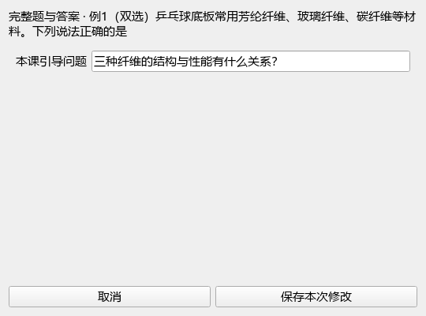

保存后生成 Word 教案、课堂PPT和讲义的新版本。这次三素材输出是流程验证片段，现成45页图文课见[课堂文件与继续编辑入口](#word-quote-materials)。维护源码已接入，v0.1.101旧EXE未更新。[验证范围](../qa/2026-10-09-question-classroom-copy-qa.md)。

## 在页面编排里通读讲义并选材（维护源码）

1. 在 **素材与页面编排** 选好 **加入位置**，点 **通读讲义并选材…**。选择一份已导入讲义，在左侧栏目目录定位，右侧通读完整内容。
2. 用 **选知识栏目与知识网…**、**选原图与知识网…** 和 **选完整题与答案…** 选择本课材料。填写具体的 **本课引导问题**；图片再写清讲解用途。在 **本次授课顺序** 用 **上移／下移** 把图、讲解和少量例题串起来。
3. 点 **加入当前备课**，整批进入最初指定位置，可一次撤销／重做。再次打开会续读本次会话上次成功读过的讲义，本批清单为空；也可换另一份讲义。取消不加入。

完整栏目保留原表格、公式条件和原图；知识网可用于开场、概念衔接或小结。选入后继续编辑左上问题、正文和图片布局，课堂文字可保留充分解释方便记笔记。选中完整题后，点 **修改导学问题／图题…** 可写“三种纤维的结构与性能有什么关系？”等本课问题。教师答案默认隐藏，课堂需要时用[题面同页／点击原答案](#question-page-answer)明确选定。教材原片及情境配图从[本批教学图片](#image-batch-classroom)集中补充。

保存草稿后生成Word教案、课堂PPT及讲义的新版本。此入口已加入维护源码，v0.1.101试用EXE尚未更新。[图文课与成品](#daily-course-materials) · [验证记录](../qa/2026-10-09-composition-lecture-materials-qa.md)。

## 分几批给同一节课补讲义原图（维护源码）

从 **备课 → 从讲义选材** 或 **题库 → 讲义选材…** 选择讲义，通读后选择完整知识、原图和少量题目。确认加入或返回后，再打开这个入口会续读上次成功读过的讲义，本批从空清单开始；可直接补其他知识网或图片，也可改选另一份讲义。

每次仍重新读取原文件。原件缺失或版本改变时，回到讲义目录手动选择。切换文件会清空本批选择。这里记住的是本次打开工作台期间的阅读来源，不自动替课程关联来源；本课加入位置仍在备课页选择。填写具体的 **本课引导问题** 和图片用途，整批确认后继续制作Word／PPT。

真实高分子讲义已验证“完整分类知识 → 关闭 → 同源空清单 → 另选原图 → 关闭 → 取消续读”；[验证记录](../qa/2026-10-09-continuous-lecture-selection-qa.md)。

## 完整讲义加入课件，遇到排版问题怎样继续？（维护源码）

1. 在 **素材与页面编排** 先选加入位置，点 **通读讲义并选材…**，通读并选择完整栏目、知识网、原图和少量题。只选知识时也可点 **讲义知识…**。也可从备课页 **从讲义选材**，或教材原页 **本节按知识点选材… → 讲义知识与知识网** 进入。按本课顺序排列知识、原图和完整题，再整批加入。
2. 遇到不能完整排版的提示，打开 **编辑这批课堂素材**，选择对应素材，再进入编辑窗。用 **导学问题／图题** 写左上角的问题；需要改正文时明确解锁课堂副本，逐处修改。返回后点 **核对并加入本课**，等重新核对与排版完成。取消会放弃本批，已有课堂保持；成功加入可一次撤销。
3. 用 **教材原页／切片…** 与 **课外／本机配图…** 补充能帮助观察、解释和比较的图片；图题可写“怎样从长链读出单体？”等具体问题，笔记说明学生要观察什么。完成后保存草稿，生成新版本，在 **输出与检查** 打开Word和PPT，核对结构图、正文、课堂顺序与点击展示。

原件中的缺字要先对照原文，再自行写清课堂解释；课堂编辑不改原件。新问题导学课可双击 `E:/项目/上海高中化学等级考/outputs/2026-10-09-word-quote-materials/question-guided-launcher/打开问题导学图文课程-独立副本.cmd` 继续编辑；成品在同根 `课堂文件`。本轮完整栏目及新图文稿的验证范围见[本轮记录](../qa/2026-10-09-word-quote-materials-qa.md)。

## 从本节教材知识选入完整讲义与知识网（维护源码）

在 **素材与页面编排** 设置加入位置，读教材裁片原页或知识卡后点 **本节按知识点选材…**，切换到 **讲义知识与知识网**。先明确选中 **本课已用讲义** 中的一份，再点 **通读所选讲义，选知识与知识网…**；也可 **浏览已导入讲义…** 自己选择另一份资料。窄窗口通过上方下拉框切换完整名称的页签。

讲义窗左侧是原栏目，右侧通读完整原文；点击目录只阅读。点 **选知识栏目与知识网…**，勾选完整栏目或原图知识网，填写“塑料、合成纤维与橡胶应该怎样选择？”等本课引导问题。表格、公式条件和每次原图出现位置随完整栏目保留。需要单独的图或少量例题时，使用 **选原图与知识网…**、**选完整题与答案…**，在 **本次授课顺序** 调整先后。

点 **将知识与讲义选材加入本课**，当前教材知识及所选讲义材料同批加入最初选择的位置；同版本知识网、知识栏目已在课内时保留教师原来的编辑。一次撤销恢复整批加入前。继续编辑问题标题、知识解释、图片和点击展示，保存后生成 Word 教案、课堂PPT和讲义。

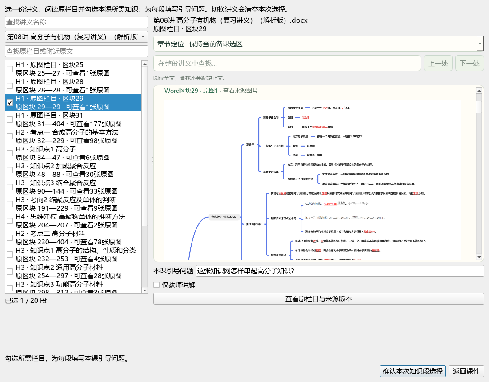

本课已用列表来自本课实际封存来源，选材须明确确认。来源、版本和使用范围保存在素材后台。预选来源的归档路径若已搬迁，请从资料库重新读取，不会按同名文件替换。当前日常40页课及现成Word／PPT保持；图中的完整栏目加入是隔离验收稿，日常修改后需保存并生成新版本。[日常课程](#daily-course-materials) · [验证范围](../qa/2026-10-09-section-handout-knowledge-qa.md)。

## 读完教材原页，继续按本节知识点选材（维护源码）

在 **素材与页面编排** 选中教材裁片或知识卡，设置 **加入位置**，点 **对照教材原页…**。读完原页后点 **本节按知识点选材…**，左侧可切换该教材本节的已保存知识点，右侧阅读完整讲解、查看教材原页图候选或选用讲义完整题。

在 **教材图候选** 选择图或知识原页，点 **框选候选图，将知识与图加入本课…**。图题可以写“塑料为什么会有两套分类？”等本课引导问题；框选并预览后确认，知识讲解与教材图一起加入最初选择的位置。已有同版本知识卡的编辑保留，新图接在该卡的真实来源上。一次撤销恢复整批加入前，重做恢复整批材料。

**关联讲义题** 显示教师已保存的关联；没有关联时，可点 **从讲义题库选例题…**，阅读完整题面、原图和答案后明确选入本课。同节图是供教师选用的候选，讲义题的实际关联和出处保存在素材后台。生成正文保留知识内容，来源提醒不带入课堂副本；Word教案、课堂PPT与学生讲义继续使用本课编排。

日常课程和入口见[教材图文课](#daily-course-materials)。本轮改进选材流程，当前40页课的22张教材切片、7张实景照片、讲义知识网和9项点击展示保持；修改后保存并生成新版本。此功能在维护源码中可用，旧试用EXE未更新。[验证范围](../qa/2026-10-09-contextual-section-materials-qa.md)。

## 在日常工作台继续编辑教材图文课（维护源码）

高分子课的教材图文版已新增到日常 **我的备课**。双击 `E:/项目/上海高中化学等级考/outputs/2026-10-09-workbench-course-adoption/normal-launcher/打开工作台-教材与课件.cmd`，在草稿预览中点 **打开这份备课**。这个入口每次定位到本次保存的课程，进入 **素材与页面编排** 后可继续调整内容、图片、标题和课堂顺序。

课堂PPT共40页，使用22张不同的教材原内容切片、7张相关实景照片和1张原题图，保留讲义知识结构网与9项点击展示。左上问题标题串起“乙烯分子怎样连接成长链？”“塑料为什么会有两套分类？”等讲解；教材塑料正文、大幅分类图和注塑设备实景相互承接。正文有完整解释供学生记笔记，题目与答案同页点击展示。

选中新增教材裁片，点 **对照教材原页…** 可以回看对应原页。教材阅读、知识目录与课件均使用实际资料目录。修改后保存草稿，在 **输出与检查** 生成 Word 教案、课堂PPT和课堂讲义的新版本。

现成三份文件位于 `E:/项目/上海高中化学等级考/outputs/2026-10-09-workbench-course-adoption/native-office-source-binding-v1/课堂文件/`。来源、页码和图片授权保存在素材后台及单独授权说明，课堂正文没有来源尾注或待核实提醒。原有备课仍可从 **我的备课** 打开。[验证记录](../qa/2026-10-09-workbench-course-adoption-qa.md)。

## 用教材原图和实景照片组织问题导学课（维护源码）

高分子课的新素材版已保存为可继续编辑的工作台副本。双击 `E:/项目/上海高中化学等级考/outputs/2026-10-09-textbook-edit-space/launcher-worker/打开教材图与问题导学工作台-新素材版.cmd`，在弹出的草稿预览中点 **打开这份备课**。进入 **素材与页面编排** 调整页面、知识笔记和素材；修改后保存并生成新版本。

本版课堂PPT共40页，课堂实际使用22处不同教材原内容切片、7张相关实物／现场照片和1张原题图。新增完整乙烯聚合示意图、教材塑料正文、双轴塑料分类图与注塑机实景；左上用“乙烯分子怎样连接成长链？”“塑料为什么会有两套分类？”等问题引导观察。分类图独占一页，完整解释紧接下一页。保留讲义知识网、课堂笔记及原有9项点击显示。

现成文件位于同目录 `native-office-more-materials-v2/课堂文件/`：`课堂PPT.pptx`、`教案.docx`、`课堂讲义.docx`。课件文字可编辑；题目与答案同页按点击出现。来源、原页位置及授权记录存于素材后台和单独的图片授权说明，正文没有来源尾注或待核实提醒。新稿与原工作台是两个独立保存位置，继续编辑时使用上面的新素材版入口。

另在 **教材 → 知识笔记** 的窄窗口中，六项阅读／选材操作收在 **阅读与选材…**，正文、保存和取消获得更多高度；宽窗保留直接按钮。[验证记录](../qa/2026-10-09-textbook-edit-space-qa.md)。

## 切换教材时继续编辑知识笔记（维护源码）

在 **教材 → 知识笔记** 编辑名称、正文和原页位置。切换笔记、章节、书籍或刷新后，再回到这条笔记，能继续本次输入；同一章节重复点 **添加笔记** 会返回该节尚未保存的新稿。追加目录、保存章节和整理知识后的刷新也保留笔记输入；尚未填标题的章节页范围同样保留。

实际修改后需重新勾选原页确认，再点 **保存知识笔记修订**。保存后勾选并预览，可加入当前备课参考或课件知识卡。所选笔记若还有未保存修改，界面会返回该稿；保存或点 **取消本次修改** 后再选用，避免把旧内容带入课件。取消只恢复当前这条的已保存版本。

来源版本或同一笔记的已保存内容变化时，旧输入仍可找回；可先复制需要保留的文字，取消本次修改后再编辑当前版本。关闭工作台有未保存笔记时，默认 **返回编辑** 并定位原稿；明确选择 **放弃未保存修改并关闭** 才结束。

暂存限本次教材页面会话，继续下次工作仍须点保存。本轮维护源码未重建旧 EXE，没有新增照片或替换现有高分子课；其中19处教材切片、6张相关实物／现场照片及问题导学结构保持。[本轮验证](../qa/2026-10-09-textbook-note-navigation-qa.md)。

## 逐格编辑讲义知识表格（维护源码）

在 **教学设计 → 素材与页面编排** 选中讲义知识素材，点 **阅读／编辑完整素材…**，解锁工作副本，再选表格和需要修改的单元格。可修改该格的文字、空行，以及原图前后各段文字；原图缩略图固定在相应文字之间，同一图片出现多次时各自保留。表格的行列、横向与纵向合并保持原样；纵向合并的续接格只读，请在合并起点编辑。

默认勾选 **内容增加时只为这项素材续页**。点 **应用** 时，只有单元格确有变化且现有外框放不下，才按完整正文大小重新安排这一项素材的全部内容；其他素材及其位置、共用页面保持。原框足够时保留现有页和位置。取消勾选后若仍放不下，窗口会提示勾选该选项，输入文字保留；不能安全跨页的合并格也会明确提示，不缩字或截去内容。

切换单元格、表格或原图条目后可继续编辑。点 **取消**，或打开后未修改便应用，都保持原作品；只改标题也不会重排表格。应用成功后，教学设计中的一次 **撤销** 同时恢复本次文字和局部分页，**重做** 恢复整次修改。

生成的 Word 使用原生可编辑单元格，保留原图和合并关系；PPT 保留原图，表格中的工作文字仍可编辑。课堂投影表格正文保持24磅，较长内容按完整排版续页。只供教师使用的来源继续保持教师范围。

已采用 **知识讲解与笔记** 排版的素材，须先点 **切换普通图文排版以编辑表格**。过去已直接改写成整段文字的旧工作稿继续使用原编辑入口，不会自动反推成原表；其文字和独立原图仍保留。

此功能属于当前维护源码（排版版本v38），旧试用 EXE v0.1.101 未更新；新保存的单元格工作稿请从源码入口打开。本轮改善表格编辑，没有增加课外照片，也没有替换原35页高分子课程；其中19处教材原内容切片和6张实物／现场照片保持。[本轮验证与范围](../qa/2026-10-09-native-table-cell-workbench-qa.md)。

## 把完整栏目和原图放到指定知识点附近（维护源码）

在当前备课，先设置 **加入位置 → 所选素材之前／之后**，再选择 **目标素材**，然后点 **从教材选材** 或 **从讲义选材…**。在画布选材时，加入位置以当前所选素材为目标。整批新材料及全部续页一起加入，点一次撤销可回到加入前，重做恢复整批内容。目标素材若和其他内容共用页面，新批放在该页之前或最后一张续页之后；已有图文位置保持。

《第08讲 高分子有机物》的 **知识点2 通用高分子材料** 现在能完整选择：44个连续原文块、3个原生表格和32处原图共同入课，包括尼龙反应中的N—H片段与原括号方向。填写 **本课引导问题**，例如“塑料、纤维和橡胶的性能为什么不同？”，再确认加入。原图和知识网用于讲解，课堂继续配合[高分子课例](#polymer-classroom)中的19处教材原内容切片与6张相关实物照片；图文旁保留完整解释。

小窗口中，选材清单与加入位置固定在左侧上方，下方操作区可以滚动，按钮不再挤在一起。

来源记录保存在素材后台，生成正文不附来源、核验或防御提醒。当前改动属于维护源码；旧试用包未更新，新导入保存稿请从源码入口打开。完整栏目已在学生预览、实际Word／PPT及隔离保存恢复中核对，原35页课堂稿保持。[本轮验证范围](../qa/2026-10-08-polymer-paint-preview-workbench-qa.md)。

## 用完整教材图文讲合成高分子（维护源码课例）

用原源码CMD重开工作台，在 **我的备课** 搜索 **合成高分子：从单体到材料**，选中后点 **打开**。这是两课时、每课时40分钟的新备课。按单体与链节→加聚及共聚→缩聚与逆推→结构、性质和用途串讲，页左上用问题引导学生观察；原图旁保留完整解释，便于记笔记。

课堂实际使用19处不同教材原内容切片、6张相关实物／现场照片及1张完整题原结构图。本轮新增11张教材切片和电木开关、离子交换树脂两张照片，包含教材定义、反应式、性质及应用原文。照片与PET、尼龙、橡胶、热固性塑料和功能高分子知识相邻。课堂的图数与保存的83个图片资产分别计数，后者还包含教师完整讲义读稿原图。

进入 **教学设计 → 素材与页面编排**，继续编辑问题、图文和知识对照。两段反推流程各分四次点击；一道完整四选项题与解析同页，点击后显示答案，全课9组点击。知识对照和完整应用说明同页排放，学生Word按课堂顺序生成完整笔记。六个完整讲义知识单元及知识网另在教师读稿保留，共138个原文块、78次原图出现，原来源快照不改。

本机Microsoft Office已转换35页课堂PPT、45页教案和19页课堂讲义，可直接打开[课堂PPT](<E:/项目/上海高中化学等级考/outputs/2026-10-08-polymer-classroom-workbench/native-office-v4/课堂文件/课堂PPT.pptx>)、[教案Word](<E:/项目/上海高中化学等级考/outputs/2026-10-08-polymer-classroom-workbench/native-office-v4/课堂文件/教案.docx>)、[课堂讲义Word](<E:/项目/上海高中化学等级考/outputs/2026-10-08-polymer-classroom-workbench/native-office-v4/课堂文件/课堂讲义.docx>)。正常工作台已经明确打开并核对保存全文；独立单课保存、重开和普通ZIP恢复核对74素材、83图及六登记成品。普通单课备份保存作品、图片与成品，原教材／讲义和后台裁选、许可回执仍需另存。正文不附来源、待核实或防御提醒。

Word教案补齐教学目标、重点难点、导入、活动流程、巩固、作业与板书，图文按知识顺序相邻。教材页码定位保存在素材后台，图片说明用于观察与讲解。

维护源码每课图片上限已扩至128；旧试用包仍为48，继续用原源码入口编辑本课，试用包v0.1.101未更新。[本轮验证范围](../qa/2026-10-08-polymer-classroom-workbench-qa.md)。

## 完整缩聚知识与反应原图入课（维护源码）

用原源码CMD重开工作台，在当前备课打开 **从讲义选材… → 选知识栏目与知识网…**，选择《第08讲 高分子有机物》中的完整缩聚知识段。填写 **本课引导问题**，例如“缩聚反应怎样连接出高分子链？”，确认选择后回到 **本次授课顺序**，把知识、教材原图和少量完整题交错安排，再点 **加入当前备课**。

该段55个原文块及33次原图出现共同入课，保留结构式、催化剂、H⁺与加热条件。在 **素材与页面编排** 用 **一栏 → 按顺序排满并续页** 显示完整讲解；过长的含图表格继续到下一页并重复表头。保留原文用于笔记，再在相邻页搭配教材切片、尼龙／PET等实物图，用左上问题引导观察和解释。

生成Word教案／课堂讲义和课堂PPT时，原图与文字按知识段相邻排列。出处记录在素材后台，正文保持课堂讲解。本轮已用本机Office核对完整来源显示稿；完整课堂现已另存，见[合成高分子课例](#polymer-classroom)。[操作验证范围](../qa/2026-10-08-polymer-static-eq-workbench-qa.md)。源码排版已更新v37，试用包未更新。

## 用教材原图串起蛋白质与核酸（维护源码课例）

用原源码CMD重开工作台，在 **我的备课** 搜索 **蛋白质与核酸：结构怎样决定性质与功能？**，选中后点 **打开**。本轮已更新这份原备课，旧登记成品保留。课程为两课时，每课时40分钟；按氨基酸→肽键→蛋白质结构与性质→核苷酸→DNA与RNA组织讲解，原图旁保留完整解释，便于学生观察和记笔记。

进入 **教学设计 → 素材与页面编排**，继续编辑问题标题、图文配对、三幅知识网及两段分步讲解。本课为28页课堂，只安排一道完整四选项题，答案与解释同页点击显示；两段流程各分四次点击，全课9组点击。课堂16页含图片，共17次图片出现：教材原内容裁片9次、讲义图5次、实物照片3次。教材裁片对应8个不同素材，其中含一处教材原文段落截图；其余配图与正文共同讲解。60份保存素材和48个图片资产还包含教师读稿、完整讲义原图等后台内容，资产池数量不等于课堂图数。

| 课堂页 | 本轮加入的图文讲解 |
| --- | --- |
| 4 | 加入教材图4.6两性离子原图，观察NH₃⁺、COO⁻、R与α碳上的H；右侧保留与酸、碱反应的完整解释。来源为PDF第84页、印刷第80页。 |
| 15 | 加入教材图4.11黄色反应原图，对照试管、浓硝酸与黄色现象；旁边保留结构解释与适用范围。来源为PDF第87页、印刷第83页。 |
| 16 | 加入真实蚕茧照片，把细丝与氨基酸、肽键和蛋白质的空间组织联系起来；酶的完整知识仍在相邻栏。 |
| 24 | 复用已有DNA教材配对图，配合“只数一条链，还能断言A＝T吗？”及双链计数说明；复用同一图片资产。 |

四个完整讲义知识单元及原知识网在教师读稿中保留；四个知识单元共89个来源块、45次原图出现。原54份素材的来源快照全部保留；氨基酸表原先的教师改写读稿另存为教师笔记“六种常见氨基酸怎样比较？”，完整源表在教师读稿中显示。教师画布54页。扩图保留原27页的顺序，修改其中3页并插入1页，其余24页不变；三幅知识网、两段流程、完整题及9组点击保留。新增图文在Word中也放在对应知识段落旁。

本机Microsoft Office已转换28页课堂PPT、34页教案、14页课堂讲义，可打开[课堂PPT](<E:/项目/上海高中化学等级考/outputs/2026-10-08-native-image-table-workbench/native-expanded-course-office-v10/课堂文件/课堂PPT.pptx>)、[教案Word](<E:/项目/上海高中化学等级考/outputs/2026-10-08-native-image-table-workbench/native-expanded-course-office-v10/课堂文件/教案.docx>)和[课堂讲义Word](<E:/项目/上海高中化学等级考/outputs/2026-10-08-native-image-table-workbench/native-expanded-course-office-v10/课堂文件/课堂讲义.docx>)。正常工作台已重开核对完整保存稿；独立Windows QA完成保存、重开和普通单课备份恢复，核对60素材、48图及六登记成品。这种单课备份不包含原教材／讲义库和后台来源、许可回执，原件仍需另存。生成正文不附来源、核验或防御提醒。

聚合物目前完成三个完整命名栏目与一道完整题的候选导入，父单元和整份讲义仍有字段、图片变换等缺口。[本轮实际验证范围](../qa/2026-10-08-native-image-table-workbench-qa.md)。继续用原源码CMD启动工作台；该课例使用排版版本v36，试用包v0.1.101未更新。

## 使用含原图的讲义知识表格（维护源码）

在 **教学设计 → 素材与页面编排** 查看完整讲义知识。源表图文保持完整且与所选来源对应时，画布、PDF和PPT会把文字与原图放在原来的单元格内；跨页按整行继续，并重复表头。蛋白质课的氨基酸表为7行3列、21个单元格，包含9次图片出现；其中重复使用的同一图会在各自位置保留。Word教案使用可编辑的真实表格，图片按单元格可用宽度排放；PPT中的文字仍可编辑。

需要保留单元格对应关系改文时，使用当前的[逐格编辑入口](#native-table-cell-edit)。过去已直接改写成整段文字的旧工作稿继续显示教师内容，系统不会用封存原表盖回；其图片按工作稿顺序独立排放，旧外框可能放不下全部内容。此类旧稿仍需按原方式增加外框或排满续页，不能自动反推回原表。该历史回退路径已验证可完整显示9次原图。

只供教师使用的完整源表和教师笔记继续保留教师范围，不会自动进入课堂页。旧v35／v36登记成品可按原文件校验继续打开；当前维护源码重新生成时使用v38排版并登记新成品，旧成品保留原版本。[此前图文表格及编辑回退的验证记录](../qa/2026-10-08-native-image-table-workbench-qa.md#native-table)。

## 从教材实验串起完整方法（维护源码课例）

用现有源码CMD重开工作台，在 **我的备课** 搜索 **实验方案的设计与评价：从证据到结论**，选中后 **打开**。这份新副本按两课时组织51素材／23图：先从目标产品倒推实验方案，再观察浓度、温度和装置原图，串起假设、变量、证据与评价。教材原内容切片8处、实物／现场照片4张、完整讲义五方法单元与知识网共同讲解；练习保留一道完整五小问题。

在 **教学设计 → 素材与页面编排** 调整问题、图文和课堂顺序。五步假设与五步评价逐次点击，四步总结同页分四区出现；原题答案仍在对应题页点击显示。文字保留完整知识便于笔记，照片旁安排学生记录任务。保存本课后，可继续生成Word教案、课堂讲义和PPT。

本机Office已转换38页PPT、26页教案、15页课堂讲义；打开[课堂PPT](<E:/项目/上海高中化学等级考/outputs/2026-10-08-experiment-method-classroom/native-office-v4/课堂文件/课堂PPT.pptx>)、[教案Word](<E:/项目/上海高中化学等级考/outputs/2026-10-08-experiment-method-classroom/native-office-v4/课堂文件/教案.docx>)、[课堂讲义Word](<E:/项目/上海高中化学等级考/outputs/2026-10-08-experiment-method-classroom/native-office-v4/课堂文件/课堂讲义.docx>)。新副本已保存到正常工作台，原课保留；普通单课QA备份核对全文、23图和六登记成品，原教材／讲义另存。[本轮实际验证范围](../qa/2026-10-08-experiment-method-classroom-qa.md)。源码可用，试用包未更新。

## 查找配图与管理本次教材选材（维护源码）

在 **素材与页面编排 → 备课图片… → 从已有备课选图片…**，按作品名称或原课题搜索当前架上的备课，或用 **上一页／下一页** 浏览。每页25份，列表显示准确图片数；选一份含图片的备课，点 **预览这份备课的图片**。

图片列表显示缩略图，可继续搜索图题或用途；选中后看完整原图，必要时 **放大查看**。填写本课的 **引导问题／图题** 和 **课堂用途**，再 **加入课件**。例如用洗气瓶照片提问“气体为什么从长管进入？”，让学生对照导管与液面解释气路。旧课的原图与用法保留，本次用途单独编辑；仅教师图片保持范围，原题图仍从完整题入口选用。归档或回收站中的备课先回“我的备课”处理；只查看、搜索和取消不会加入本课。

固定教材跨章节勾选后，点摘要旁 **选材清单…**，查看知识、研读提示、图表及已知原页位置。选一项点 **移除这一项**，只取消该项勾选，保留其他选择与当前阅读页；已加入备课的内容不随清单移除。知识或研读变化后重新预览，图表变化后重新核对本批裁片。点 **定位所选素材** 会明确切到该书、章节和条目，再按原入口阅读原页；定位不会自动入课。个人教材继续使用原有笔记与待选图表入口。

[操作与验证范围](../qa/2026-10-08-material-discovery-qa.md)。源码工作台重开后使用，试用包未更新。

## 在个人教材中查找原文，并选用讲义方法单元（维护源码）

打开个人教材，点章节旁 **在书内查找…**，输入本课关键词、化学式或一句原文。选择 **整本书** 或 **当前章节**，再选择查找原文、已保存目录与知识笔记，点 **查找**。结果每页25项，用 **上一页／下一页** 浏览；选中结果后查看原文摘要或完整笔记，再选择依据PDF页，点 **定位原页** 回教材阅读、框选或整理笔记。查找时原勾选与待选图表保留，点 **停止查找** 或 **关闭** 可继续原阅读。没有PDF原生文字的页可从已保存目录和笔记查找，再定位原页。

从 **备课 → 从讲义选材… → 选知识栏目与知识网…** 打开《化学实验方案的设计和评价》。目录中的 **思维建模** 可按完整单元阅读和勾选，包括物质制备、猜测假设、方案评价，以及两类表格实验题的判断／解题流程。选中后读完整正文与方法图，为本课填写 **引导问题**，点 **确认本次知识段选择**。

回到 **本次授课顺序**，将方法单元与原图、完整题交错安排，用 **上移／下移** 调整顺序，再点 **加入当前备课**。例如先观察装置，再用物质制备思路梳理目的、原理与步骤，最后用完整题练习；原有知识卡可继续使用和关联例题，同段再次选用会保留已有教师编辑。

该次入口验收核对了实际查找、分页与原页定位，以及在既有课程内存副本中确认完整方法段、重复选择与撤销／重做；该次入口验收未保存正常课程或生成新Office。操作与限定截图范围见[该次QA](../qa/2026-10-08-personal-textbook-search-and-methods-qa.md)。试用包未更新。

## 用完整步骤引导讲解（维护源码）

1. 在当前备课打开 **教学设计 → 素材与页面编排 → 分步讲解…**。填写 **左上导学问题**，例如“怎样用实验验证一个合理的假设？”，让学生先明确要解决的问题。
2. 在步骤列表选一项，填写 **步骤标题** 和 **说明（可留空）**。用 **新增步骤／删除步骤** 保留2—6个完整步骤，用 **上移／下移** 调整推理顺序；标题和说明按填写内容保存，不截断。讲义原流程已有完整文字时，将每一步标题与说明完整填入。
3. 选择 **纵向流程** 或 **横向流程**。默认纵向；完整五步讲解可以尝试横向。当前16:9课堂投影默认勾选 **课堂PPT逐步点击显示**，放映时每步及其箭头按顺序出现，左上导学问题始终显示。当前A4打印画幅也能加入完整步骤，点击选项关闭，不会自动切换整课画幅。
4. 看下方实际排版预览。流程说明保持27磅，放不下时须先改变方向或课堂页组织，再预览；仍超出时保留所有步骤与说明，改用完整文字讲解页分区排列或连续讲解，不删短原文或缩字塞入一页。教材原图和讲义知识网可以保留在流程前后，短流程可与原图搭配，并检查组成页的完整预览。
5. 点 **加入分步讲解** 后继续调整课堂顺序。点 **取消** 不改原作品；本次加入可用教学设计的 **撤销** 一笔恢复，**重做** 重新加入全部步骤。保存草稿后生成课堂PPT；需要完整Word课堂笔记时，在输出中勾选 **Word 学生文档按课件顺序生成课堂讲义（含分步讲解）**。

完整讲解文字和原图用于课堂内容，出处与原文依据留在素材记录中；教案、课件和讲义正文不附来源或核验提醒。[入口操作与实际验证范围](../qa/2026-10-08-step-flow-entry-qa.md)。源码工作台重开后使用，试用包未更新。

## 窄窗阅读与选材（维护源码）

先勾选教材笔记，再回原页对照。窄窗阅读时，打开 **选材操作…** 可预览备课参考、把笔记作为知识卡加入课件，或清空本次勾选。

确认顶部接收作品名，核对预览后点旁边的 **加入当前备课**。点 **阅读详情** 可展开阅读说明；需要重新选择时回到笔记页，拉宽工作台会恢复完整选材按钮。阅读与选材操作沿用同一份原教材，清空勾选后也可继续看原页。操作与实际范围见[本轮QA](../qa/2026-10-08-narrow-textbook-reading-qa.md)。试用包未更新。

## 教材选材时确认备课（维护源码）

打开教材书架后，先看顶部 **正在接收素材：** 的作品名，以及下方课题、课时和修改状态，确认这批教材内容要用在哪份备课中。阅读原页时将工作台拉宽，便于对照教材。

点 **继续编辑** 返回当前备课；点 **打开已有备课** 选择另一份，或点 **新建备课** 开始新课。返回教材时，原书、章节、阅读页和勾选仍保留。取消切换也可继续阅读。

切换后对照新的作品名，检查原有预览，再明确加入这份备课；之前课程的已加入标记会重置。操作与范围记录见[本轮QA](../qa/2026-10-08-textbook-preparation-context-qa.md)。试用包未更新。

## 完整讲义与矢量原图预览（维护源码）

从 **备课 → 从讲义选材** 打开确切讲义，在知识入口阅读全文、知识结构与原图，为所选栏目填写引导问题，再点 **确认本次知识段选择**。图文入课时保留原栏目顺序、表格和公式，继续在本次授课清单调整知识、图与例题的位置。

选图入口可查看完整原文和原图，矢量图读取后标为 **本地转换显示**；默认小图筛选保留可尝试的矢量图，勾选 **同时显示小图与符号** 可查看全部原图。选用后填写图题与用途，点 **加入当前课件**；原图字节保留，预览转换另存。

进入 **素材与页面编排 → 图片显示与分页…** 调整原图大小和当前素材续页。完整表格保留上下标，紧邻短说明随首个表头和数据行同页；可继续在作品副本补充课堂笔记，再用 **撤销／重做** 核对修改，最后生成 Word 教案／课堂讲义和课堂 PPT。

在原 CMD 入口启动工作台，从 **我的备课** 选择 **弱电解质的电离平衡：教材与完整讲义**。这份新副本有41素材19图、31页实际PPT／26页实际教案；完整栏目放在 Kₐ 后、多元弱酸前，定义与原速率图同页，教材 pH计与真实电导率仪照片组成测量对照页，放在第一题前。旧课程与模板保留。

成品可直接打开[教案 Word](<E:/项目/上海高中化学等级考/outputs/2026-10-07-handout-vector-images/最终课堂/弱电解质的电离平衡-教案.docx>)、[课堂 PPT](<E:/项目/上海高中化学等级考/outputs/2026-10-07-handout-vector-images/最终课堂/弱电解质的电离平衡-课堂PPT.pptx>)和[学生学习单 Word](<E:/项目/上海高中化学等级考/outputs/2026-10-07-handout-vector-images/最终课堂/弱电解质的电离平衡-学生学习单.docx>)。已从保存稿重开工作台并核对完整知识续页；普通备课ZIP恢复51份备课，本课19图与6份成品一致，原教材裁选记录与素材许可说明另存。记录见[本轮 QA](../qa/2026-10-07-handout-vector-images-qa.md)。试用包未更新。

## 调整原图大小与当前素材分页（维护源码）

在 **教学设计 → 素材与页面编排** 选中含原图的素材，打开 **图片显示与分页…**。在 **设置哪张图** 按原图区块选图，查看缩略图，填写 **宽度上限 mm／高度上限 mm**；0 为自动，也可点 **恢复这张图的自动大小**。可只填一项，完整原图按比例缩小，实际大小还受页面可用空间约束。

对照 **教师完整页／课堂PPT完成态／静态学生页** 的完整预览，用页码和 **上一页／下一页** 阅读续页，或点 **放大预览**。分别调整栏目装饰图和知识网，例如把装饰 banner 的高度上限设为 6 mm、知识网设为 125 mm，再检查完整图与正文能否同页。

**重新排这项素材** 默认勾选，使当前素材使用独立页并完整续页，其他素材及共享页保持。要沿用当前外框和分页，取消勾选。检查预览后点 **应用图片显示与分页**，点 **取消** 不改动；可用教学设计的 **撤销** 整步恢复，再保存草稿和生成新成品。

同一图片上限也用于生成 Word 教案及课堂讲义／学习单：先适配 Word 可用宽度，再按上限等比缩小；Word 正文仍按自身排版续页。隔离副本已核对真实取消／撤销／重做、30 页实际 PPT、26 页实际 Word 教案的指定页及普通备份恢复，详细范围见[本轮 QA](../qa/2026-10-07-teaching-image-display-qa.md)。正常 24 页课堂、旧课程及模板继续保留，试用包未更新。

## 按授课顺序混合选择讲义素材（维护源码）

从 **备课 → 从讲义选材** 打开确切讲义，先读原文、知识网和完整题答。知识、原图和完整题可以交错加入；下方 **本次授课顺序 · 按这个顺序加入备课** 按编号展示本批顺序。

选中一项，用 **上移／下移** 调到课堂需要的位置，移动后仍选中这一项；用 **移除所选素材** 或 **清空本次选材** 继续调整。例如可依次安排原图观察、知识讲解、一道完整题、另一原图与补充知识。

在清单中选中知识栏目或原图，点 **编辑所选素材…**，可改 **本课引导问题** 和 **仅教师可见**；原图还可改 **讲解用途**。点 **保存本次修改** 后，该项仍在原授课位置，来源、原栏目与原图保持；点 **取消** 保留原设置。答案讲义中的素材始终仅教师可见。

同一原图可按不同用途或适用范围选用多次。若修改后与另一项的用途和范围完全相同，系统提示本次修改未保存，两项都保留。完整题保留原选题设置，这个编辑入口保留原题答和分值；入课后可继续编辑课件讲解。

检查完整清单后点 **加入当前备课**，系统会重新核对讲义来源版本。确认期间清单不能改动；同批新增素材按这条授课顺序进入当前作品，已有素材与教师编辑保留。已入课素材请到 **素材与页面编排** 选中，打开 **阅读／编辑完整素材…** 修改作品副本。如提示来源版本已变化，需重新读取讲义再选材。整批导入可用教学设计的 **撤销** 恢复。

此前已在隔离副本核对五项交错入课、单次撤销／重做、实际 PPT、保存及恢复，见[混合顺序验证](../qa/2026-10-07-mixed-material-teaching-order-qa.md)；本次清单内编辑的验证范围见[所选素材编辑 QA](../qa/2026-10-08-handout-material-metadata-edit-qa.md)。以上入口属于维护源码，试用包未更新。

## 把原图、问题和解释组成讲解页（维护源码）

在 **教学设计 → 素材与页面编排 → 组成图文讲解页…**，确认当前作品中的两项不同素材。第一项放左侧或上方，第二项放右侧或下方；填写 **左上导学问题** 与 **讲解标题**，选择左右或上下布局。

需要先提问再反馈时，勾选 **第二项内容在课堂PPT中点击后显示**。按 **教师完整页／课堂PPT完成态／静态学生页** 切换，逐页查看并 **放大预览**；完整长文会续页。点击讲解在静态学生页省略，原题的教师答案范围保持。

**课堂PPT与静态学生页沿用组成页的位置** 默认勾选；已有学生单独排版时，会切换为这次组成页的位置。要继续现有学生排版，取消勾选并检查学生范围预览。确认后点 **应用图文讲解页**，其他素材的原位置和内容保持；可用教学设计的 **撤销** 整步恢复。再保存草稿并重新生成成品。

## 保存并复用自己的教学结构（维护源码）

在 **教学设计 → 存为我的教学结构模板…** 起一个名称，勾选要保存的环节，选择是否保存教案框架、目标列表与环节关联；先读右侧完整预览，再点 **保存我的模板**。

模板保存环节类型、时长和标题、教师活动、学生任务、预期产出、评价依据，以及所选框架和目标。原材料、独立答案字段、图片、来源和成品留在当前备课；自由填写的教学文字会按原文保留，其中的答案或姓名需要教师自行检查和修改。

从 **教学设计 → 从我的模板预览应用…**、**备课 → 我的模板…** 或 **教学模板 → 我的模板 · 搜索、管理与预览应用…** 搜索并读取完整预览。默认 **在已有环节之后新增模板环节**；**替换当前空白环节结构** 只在环节确实未编辑且没有课件页面绑定时可选。**将模板教案文字补入当前空白栏目** 保留已有教师文字，新增环节可继续改，应用可整步撤销。

在 **我的模板** 可重命名、撤销最近最多 30 步重命名、移到已删除列表或恢复。活动与已删除模板均随普通备课 ZIP 保存。模板复用教学组织，教材和本课题目仍应重新选择核对。

本轮在独立副本中核对实际组合、6 环节模板保存／预览应用／一次撤销，实际 PPT 第 16 页原图与解释同页，隔离稿和模板随 ZIP 恢复一致；正常弱电解质课程及 50 份备课保持。[本轮验证范围](../qa/2026-10-07-teaching-page-and-templates-qa.md)。试用包未更新。

## 继续弱电解质两课时课堂稿（维护源码）

在 **我的备课** 打开已保存的 **弱电解质的电离平衡：从实验到微粒**，按两课时共 80 分钟继续编辑。该稿有 24 页课堂 PPT，教材原图、完整讲义图和相关实景配旁栏解释；原来的图文选材稿与分子间作用力 37 页课堂保留。

1. 在 **素材与页面编排** 按问题标题检查原图、定义、条件与推理。教材图与解释同页放置，调整外框后查看完整内容；实景用于提出观察问题，不作为浓度或导电性测量数据。
2. 两道完整题先让学生作答，再点击显示本课反馈；稀释过程按三步展开。原题教师答案保留，课堂解释单独编辑。实际 PPTX 已记录五个点击效果，授课前仍需在 PowerPoint 放映中检查点击前后顺序。
3. 保持 **Word 学生文档按课件顺序生成课堂讲义（含分步讲解）**，得到完整笔记。当前实际教案为 23 页、笔记讲义 11 页；讲义包含点击后的解释，发放无答案静态稿时使用 23 页学生静态画布。实际 PPT 转换 PDF 也呈现完成态。
4. 修改后重新生成、核对实际 Word／PPT，再保存草稿并导出独立副本。来源、许可及原内容记录可从工作台后台查阅，生成正文直接呈现教学内容。

本课已保存，并经服务及真实工作台重开读回；学生静态 23 页、教师 26 页均无布局错误。新普通 ZIP 在独立目录恢复后，本课及全部 50 份备课、引用图片和登记成品匹配；原资料库、关系、配置及学生历史仍需分别保管。限定根模型检查与备份范围见[本轮记录](../qa/2026-10-07-weak-electrolyte-classroom-qa.md)。试用包未更新。

## 用教材原图和实景提出课堂问题（维护源码）

正常源码工作台已保存 **弱电解质电离平衡：教材原图与问题导学素材**。从 **我的备课** 继续该选材稿，可编排7条完整问题讲解、4张教材原内容切片和2张相关实景；这是图文选材与环节草稿，继续组织讲解与少量例题后再生成Word教案和课堂PPT。

在其他课程的 **素材与页面编排 → 备课图片… → 从已有备课选图片…**，搜索上述备课，逐图预览、**放大查看**，填写本课问题与用途后点 **加入课件**。例如：

- **速率相等时，微粒浓度也相等吗？** 对照完整教材速率曲线，区分反应速率与微粒浓度。
- **电离常数为什么使用平衡浓度？** 先读教材定义和公式，再联系同温度下的常数表。
- **稀释后，电离度与氢离子浓度怎样变化？** 用教材电离度定义串起比例与实际浓度。
- **pH色卡能单独判断酸的强弱吗？**、**用仪器测酸碱性时，还要记录哪些条件？** 用实景引出酸碱性、强弱、浓度和测量条件。

先讲知识、联系图像，再安排少量例题和点击反馈；课堂正文与标题保留学生需要记录的定义、条件与推理。来源记录在工作台后台查看，教案与课件正文不附来源或防御提醒。

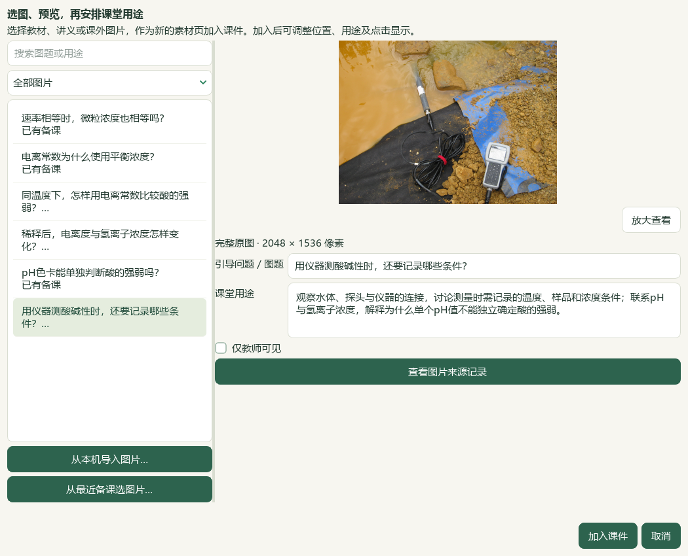

讲义目录优先显示原栏目文字；纯图栏目显示原图区块与可查看的图数，明确的1—9级标题可导航。原Word、公式、图像和栏目边界保留；选择知识网或图后，另外填写本课的问题标题。教材研读目录已扩容，容量不足时会明确提示；整书原页仍可继续阅读。

该选材稿和六张原图已随最新普通备课ZIP导出并在新目录恢复读回。原教材、Word题库、知识与例题关系及模型设置仍按各自保存范围保管。[本轮图文、目录与备份验收](../qa/2026-10-07-reading-catalog-scalability-qa.md)。原37页两课时课堂与Word成品保留，试用包未更新。

## 弱电解质：用问题、原图和完整讲义串起讲解（维护源码）

在 **教材 → 选择性必修1 → 3.2 弱电解质的电离平衡 → 研读**，可选15条讲解；新7条按实验判断、速率图、实际平衡浓度、分布曲线、电离度、稀释和导电性组织。勾选需要的条目，再用 **知识卡加入课件…** 放入当前课堂；问题标题和讲解可继续编辑。

在 **备课 → 从讲义选材…** 选《第06讲 弱电解质的电离平衡》，先阅读完整栏目，再选分类图、速率图、分布曲线等原图。原图中的 **放大查看** 可完整阅读；填写本课的问题标题与用途，把图和讲解串起来，再选择少量完整题答。三图仍从原讲义选择，研读笔记不会自动替教师选图。

[本轮教材与讲义内容验收](../qa/2026-10-07-weak-electrolyte-note-recovery-qa.md)。当前源码入口可用，试用包未更新。

## 关联例题先阅读全文（维护源码）

在教材具体知识或已保存知识笔记的 **关联例题…** 中，点 **阅读完整题与答案…**。窗口先显示当前完整题；**调整选题条件**、**题目导航** 和 **题目设置与标签** 默认收起，给题面与原图留出阅读空间。切到 **答案与解析** 查看原答案，长题和多图题可在页签内向下滚动；底部 **关闭** 持续可达。

需要换题、调整检索或维护题目时，展开对应按钮。当前原文件、教材章节检索范围、搜索词与分值保留；按入口原有权限继续选题、修改标签／范围、入篮、导出或预览后明确带入备课。这里的选择独立于题库历史选题，浏览与关闭不加入课程。普通题库的默认筛选与已有题目设置展开方式保持。

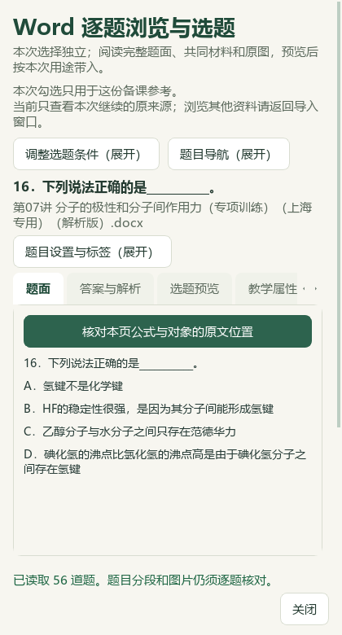

[本轮原题全文、题答原图与保存保护验收](../qa/2026-10-07-private-reference-reader-qa.md)。当前为维护源码更新，试用包未更新。

## 从讲义原文开始组织本课（维护源码）

1. 在 **备课** 点 **从讲义选材…**，或在 **题库** 点 **讲义选材…**。选择一份已导入Word，先阅读目录、完整原文和原图。
2. 用 **选知识栏目与知识网…**、**选原图与知识网…**、**选完整题与答案…** 准备本批材料。完整栏目保留定义、解释、表格和图；知识网可放在开场、概念联系与小结处。知识段和原图分别填写问题标题与教学用途。题目阅读完整题面、共同材料和答案后再选，每类最多20项。
3. 在 **本次已选素材** 检查、移除单项或清空，点 **加入当前备课**。材料重新读取完成后，一起进入 **素材与页面编排**；可继续调整阅读顺序、知识讲解与笔记、投影页和点击反馈。切换原文件会清空本批选择。
4. 一次 **撤销** 回退本批新增素材及页面，一次 **重做** 恢复；原有标题、讲解和教学环节保留。已经存入本课图库的图片仍可复用，撤销不删除本地图片缓存。最后保存草稿，再生成Word教案、课堂PPT和所需课堂讲义。

选题阶段只读取与勾选，整批确认后才制作课堂副本；关闭、停止或原文变化时，本批不会追加到课程。先组织知识与图像讲解，再挑少量例题辅助理解。

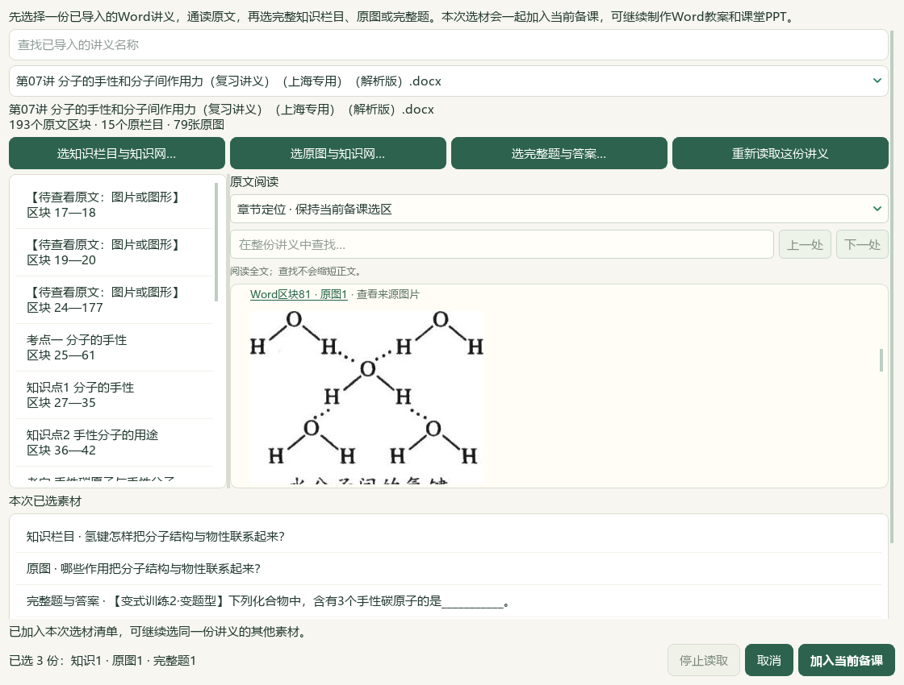

[本轮原文选材与课堂联动验收](../qa/2026-10-07-source-material-workspace-qa.md)。

## 保存知识与具体例题的关系（维护源码）

在“素材与页面编排”选中知识卡或讲义知识段，点击 **管理关联例题…**；选中完整题时，点击 **查看／维护关联知识…**。原Word题窗口也有反查入口。选择两端原内容，阅读完整题面与答案，填写这道题体现知识点的理由，再点 **明确保存新关联**。可以修改理由、解除关系，或在下次备课时继续使用。

也可在 **教材 → 本节知识／研读提示** 选中具体条目，点 **关联例题…**；个人教材在 **知识笔记** 选中已保存笔记后使用同一入口。个人笔记有未保存修改时先保存。浏览与关闭不加入课程，只有点 **将所选关联题加入本课** 才交接到当前课堂设计。

关联保留知识卡、原栏目范围、题目与答案的确切版本。课件中改过的问题标题与讲解不改变原知识。原件缺失或版本变化时，保存的理由与原知识仍可查看和维护；补齐原件后重新检查，当前有效的关联题才能点 **将所选关联题加入本课**。同版本题重复加入会保留已有编辑，一次加入可撤销与恢复。

同字节原题有多个归档时，先点 **明确原题的归档位置…**，选择本次使用的原批次和文件。关系只记录明确选择，不由同章、同文件或K标签自动推断。

在 **导出与恢复** 页保存独立关联JSON。恢复前先看新增、重复与冲突；冲突可明确保留当前记录，只恢复新关联。原教材和Word题库需要另行保管，关系JSON不复制原文件。这些关系不会随现有备课ZIP导出，换电脑时应单独带上关联JSON。

2026-10-07维护源码更新：完整讲义知识段可继续选同份Word的原图与完整题；退出教学设计再返回，保留本次页面和素材位置。当前分子间作用力课例为两课时、37页，使用完整知识网、原知识段、13处教材素材和6张实景，配有Word教案与课堂讲义。[连续选材](#handout-continuity) · [课堂成品记录](../qa/2026-10-07-handout-knowledge-sections-qa.md)。试用包未更新。

[返回教师使用说明](../../README.md) · [首次使用](getting-started.md) · [考试与复练](assessment.md) · [保存成果](save-and-support.md)

## 明天要讲一节新课

### 准备什么

课题、授课对象、预计课时、学生已学内容、可以检查的学习目标，以及本次真正要用的教材节选、完整例题或实验资料。目标不要只写“掌握知识”，而要写出学生需要完成的任务。

### 怎么做

1. 在“备课”填写要求与实际材料，先保存草稿。需要结构参考时从“教学模板”预览后带入；已有材料不应因选模板而被替换。
2. 点备课页 **教学设计**，进入首个页签 **教学环节**，按课堂进程安排提问、解释、例题、独立练习和反馈。每个环节填写学生任务、预计用时、预期产出与评价依据。
3. 已有完成初稿时，点“从已有初稿加入…”→选择作品→“读取所选初稿并预览”→勾选→“加入勾选环节”。转换只追加所选内容，不重新调用 API，也不覆盖已有手写环节。
4. 逐条核对目标是否有相应任务与检查证据。看到“待核对”时先检查，不把标签命中当成目标已经覆盖。
5. 保存草稿，生成教案、PPT 和学习单；核对实际文件，再导出独立副本交付。

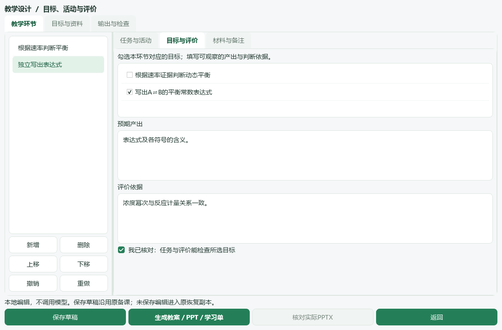

### 维护源码：题目范围改变后整理自动建议

1. 在本地Word题库读完题面、答案与全部原图。展开题目设置，调整起止，先看完整来源和本次范围预览，再保存范围；检查下一道题是否被并入。
2. 当旧自动标签对应其他范围时，点 **按新范围整理自动建议…**。对照旧／当前区块和标签，再切 **当前依据** 查看原文引句。取消不保存。
3. 核对后点 **保存自动建议**。旧标签修订留在历史，当前标签仍是自动候选；教师修改、固定、注释或确认过的字段需要走已有标签复核入口。来源或版本在预览后改变时须重新预览。
4. 再预览完整题加入课件，在 **知识卡…** 选择对应教材知识并读原页。知识卡、完整题和活动按课堂顺序排列，生成教师与学生文件后分别检查。

当前例子：结构题范围50—53，排除54起顺铂题；“不对称碳原子的结构判据”回选必二PDF51／印刷47。维生素C仍65—72，自动建议主知识点保留待确认。原考试、答案和化学判断仍据原件核验；自动建议保存不代表教师审核通过。

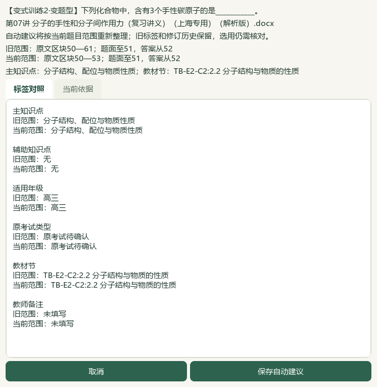

## 教案Word、课堂PPT与Word讲义（维护源码）

1. 在 **教学设计** 填教案框架与教学环节，从教材章节和讲义知识网确定本课知识关系，安排现象、定义、条件、图表解释与少量练习，并留出整理笔记的时间。
2. 在 **素材与页面编排** 选择 **课堂投影 · 16:9**，用 **讲义知识…**、**知识卡…**、**教材图…**、**完整题…** 与 **个人文字…** 组织内容。左上标题可以写成“壁虎为什么能爬上光滑的墙？”这类具体问题，再安排观察和解释。讲义知识段、知识卡或个人文字可选 **知识讲解与笔记（完整文字，正文24磅）**，完整定义、条件与解释保留；超页时拆段或增加页面。
3. 点 **讲义图…**，选择已导入Word资料，可按资料名、原栏目或附近文字查找。点 **通读原文并继续选图…** 查看整份讲义与知识结构，点击原图后 **选用当前原图** 返回。点 **放大查看** 查看细节。填写 **引导问题／图题** 与 **讲解用途**，确认范围后点 **加入当前课件**。原知识网可作为知识主线，实验图、结构图与表格可与教材解释相连；同图相同用途去重，取消不导入，加入可一次撤销。已在课件中的讲义原图，选中后可点 **从这份讲义继续选图…** 回到同一原文，继续挑选配图。受支持PNG、JPEG与WebP可直接使用，其他格式从原Word查看。
4. 选中知识卡，点 **从这张知识卡选例题…**，按原卡真实教材章节或原标题检索继续选题；也可选中讲义知识段或原图，点 **从这份讲义选例题…** 限定到同份Word。本次勾选只用于当前课件，不改历史选题。阅读完整题面、公共材料和原图，再切换答案页签查看教师答案；点 **将这道题加入本次选择**，预览后点 **完整题加入课件**。同版本题目只加入一次，已有编辑保留；取消返回原课件，加入后可一次撤销与重做。[知识卡选题](#knowledge-card-questions)。
5. 点 **备课图片…** 用缩略图、图题与用途查找本课图片。点 **从已有备课选图片…** 按作品名或原课题搜索当前架上的课程，每页25份，选课后预览原图；也可 **从本机导入图片…** 选择相关实景照片（每张不超过10MB）。填写引导问题与课堂用途后加入。照片需要帮助解释当前知识：例如双手与镜像对应手性，干冰区别分子内外作用，回形针连接表面张力。同图不同用途可分别使用，维护源码每课最多128张不同图片；v0.1.101试用包仍为48张。原课程保持；仅教师图片保留范围，原题图沿 **完整题…** 入口使用。[查找与管理](#material-discovery)。
6. 用 **分步讲解…** 填写问题和2—6个完整步骤，或对已有2—6段个人文字选 **用箭头连接讲解步骤** 或 **沿竖向连接讲解步骤**；2—3段可选 **按共同维度并列比较**。第一行写步骤或对象，后续写完整解释。框、箭头、文字可编辑；勾选 **课堂PPT中点击后显示**，逐次显示步骤及箭头，导学问题常显，也可在同页点击例题反馈。预览放不下时调整布局并保留全部内容，修改可撤销、重做和保存恢复。[分步讲解操作](#step-flow-entry)。
7. 原题教师答案保持原角色，课堂反馈单独编写。教师答案图保持仅教师可见；缺完整题范围的图从 **完整题…** 加入。静态学生画布和历史学习单隐藏点击素材，PPT的静态PDF显示步骤完成后的页面，动画在PowerPoint放映中使用。
8. 在 **教学环节 → 材料与备注** 写连贯知识解释并选择原知识网、教材图和结构图，勾选 **材料和勾选图片用于学生页**。在 **输出与检查** 勾选 **Word 学生文档按课件顺序生成课堂讲义（含分步讲解）**。讲义先串知识，再附原图、完整题、比较表与分步解释；本次课堂反馈收入讲义，原题教师答案保持隐藏。
9. 保存草稿，点 **生成教案 Word / 课堂 PPT**，分别实际预览并导出所选新版本，得到 `教案.docx`、`课堂讲义.docx`、`课堂演示.pptx`。旧成品保留，全部六份成品可另行导出。

生成教案、课件、图注和讲稿备注直接呈现教学内容，正文不附来源、路径、核验提醒或制作说明；出处、版本、原题及图片依据保存在素材记录与草稿中。

当前“分子的手性”设计为六环节40分钟、14页、22素材。3处教材裁片、4张讲义讲解图与实拍双手贯穿镜像观察、概念定义及四基团判断；两道完整原题保留选项，课堂反馈同页点击展开。4个点击素材设置8步解释与反馈，静态学生画布12页隐藏两页点击流程，课堂PPT保留14页。实际文件及放映检查范围见[本轮记录](../qa/2026-10-07-same-lecture-questions-and-guided-titles-qa.md)。

原“分子间作用力”25页设计保留：10处教材裁片和4张实景照片串起解释，第5、11、20页为完整知识笔记；原教材例题、课堂练习、课后题及配套Word成品保持。

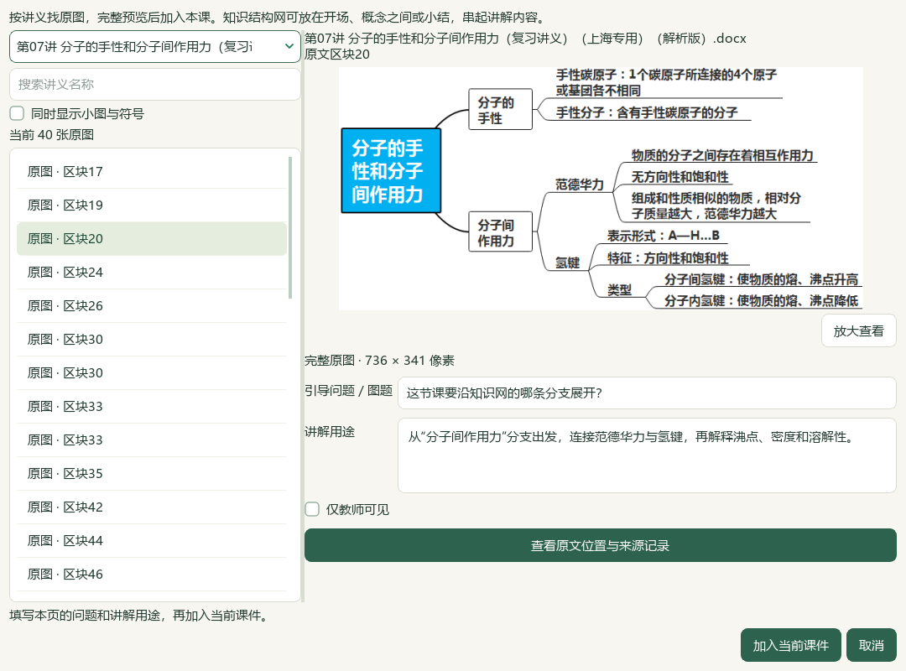

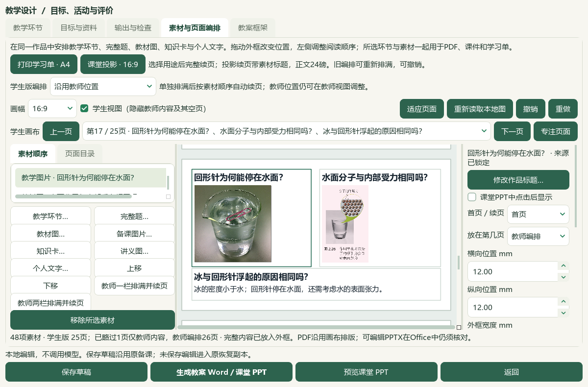

[前序分子间作用力成品与恢复检查](../qa/2026-10-06-handout-maps-and-classroom-images-qa.md) · [保存范围](save-and-support.md#save)。

## 从完整讲义知识继续选图与例题（维护源码）

1. 在 **素材与页面编排 → 讲义知识…** 选择Word，通读栏目后勾选本课知识段或原知识网。每批1—20段，各填本课问题标题，按需要选择 **仅教师讲解**，确认后一起加入。知识段保留完整正文、表格和原图；含题答的栏目用 **完整题…** 入口。
2. 选中已加入的讲义知识段，右栏上方先 **阅读／编辑完整素材…**，或点 **从这份讲义继续选图…**。窗口直接打开它的原Word，可按栏目和附近文字查找、通读原文、放大原图，再填写问题图题和讲解用途。没有图片的Word仍可继续选完整题。选材入口位于位置与尺寸参数之前。
3. 点 **从这份讲义选例题…**，在同份Word内阅读与勾选完整题。本次勾选独立；完整预览后加入当前课件。这里按原文件限定候选题，仍需选择适合当前知识的例题。
4. 同一原图和用途再次选择会保留已有课堂标题与讲解修改；不同用途可以另行选用。完整题按来源版本去重。新增素材自动选中，可一次撤销、重做，取消保留本课。
5. 本次打开工作台期间，点 **返回** 退出教学设计，再打开会记住页签、素材、续页、页面目录和教师／学生视图；进入其他课件时不沿用它的位置。从教材或题库新加入的素材优先显示。这些位置不写入教案或课件，也不随ZIP保存。

[本轮连续选材与恢复验收](../qa/2026-10-07-same-handout-material-flow-qa.md)。

同源读取现在只核对所选原件，复用本次打开期间已解析的预览。所有资料与图片仍在选用时核对版本；[入口与读取验收](../qa/2026-10-07-scoped-source-performance-qa.md)。

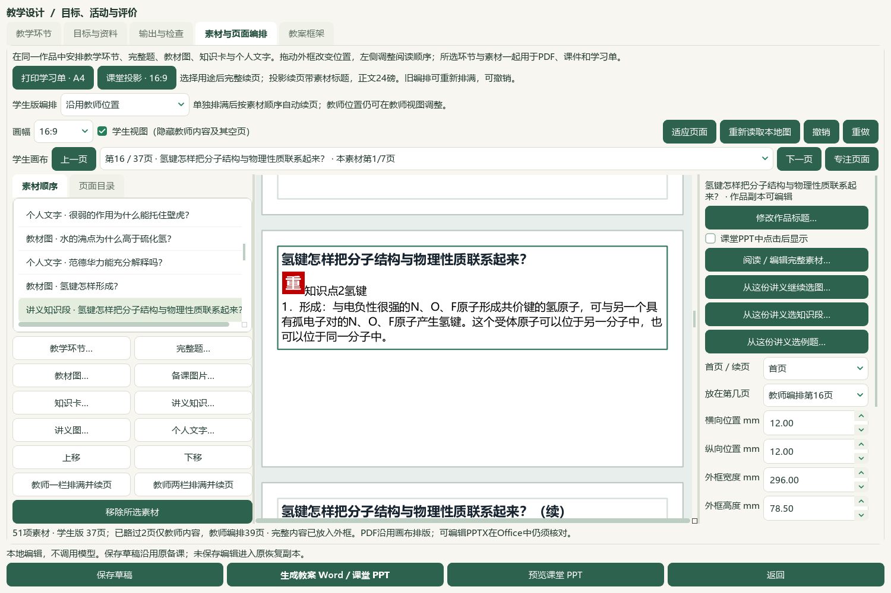

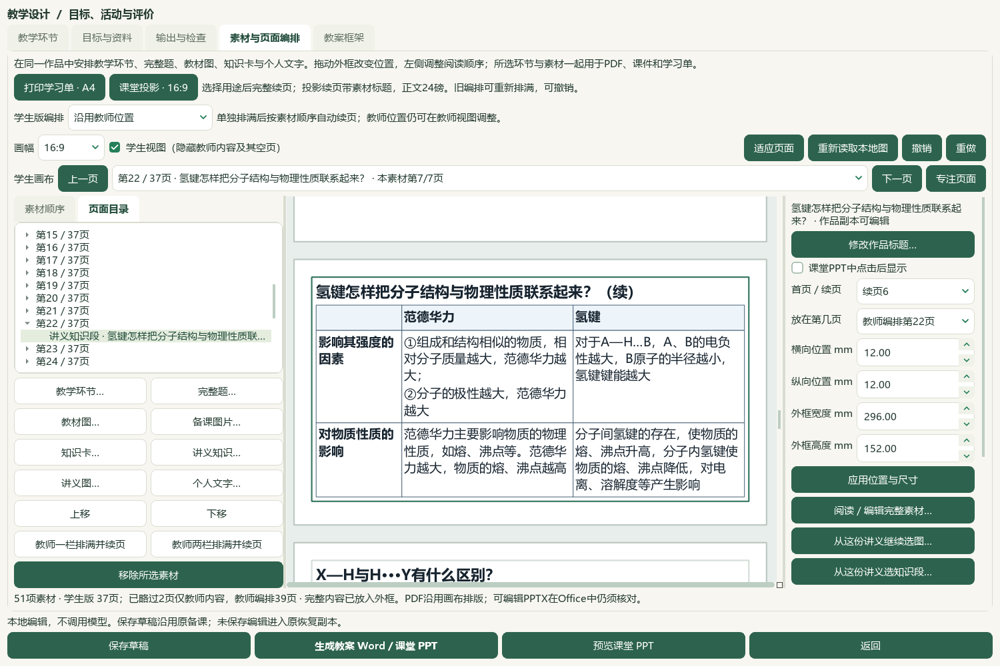

## 教案框架与课件一起编辑（维护源码）

1. 在备课中打开 **教学设计**，切换 **教案框架**。
2. 填写 **知识与技能、过程与方法、情感态度与价值观**，再填写重点、难点、方法、导入、巩固、作业和板书；课堂活动继续在“教学环节”或“素材与页面编排”中安排。
3. 点击 **预览并同步教案栏目到课件…**，勾选本课需要的目标、导入、小结、板书和课后任务，切换教师／学生视图阅读完整内容，再点 **同步到课件**。取消不改变作品。
4. 目标和导入放在作品开头，小结、板书及任务在结尾。之后修改框架时，已经关联的课件栏目会同步更新；**保留已经单独编辑的课件文字** 默认勾选。需要用框架覆盖所选栏目中的独立编辑时，取消此选项再同步。
5. 点击 **保存草稿**、**生成教案 Word / 课堂 PPT** 或 **返回** 会应用本次框架输入，无需再点击“应用教案框架”。也可用“应用”提前查看，修改支持撤销、重做。框架、课件副本和关联随草稿及恢复副本保存。
6. Word教案按教学目标、重难点、教学方法、教学过程、板书五部分输出一次。学生学案及投影显示已同步栏目中的教学内容，隐藏重点、难点、方法备注和教师答案；已有完整题继续保留原文和图像。

生成教案、学案和课件正文直接呈现教学内容。流程性核验提醒与长原页摘录只在来源记录中保留；化学比较条件和单位继续呈现。已有原题全文与原图保持。AI自动备课提示同步采用这个框架，具体质量按实际材料与供应商结果核对。

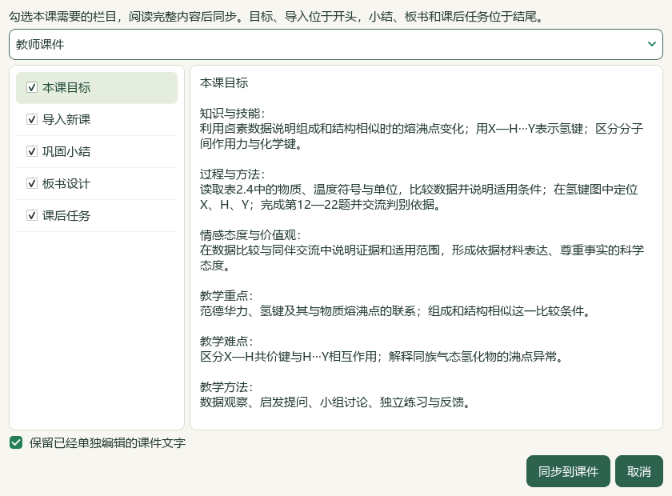

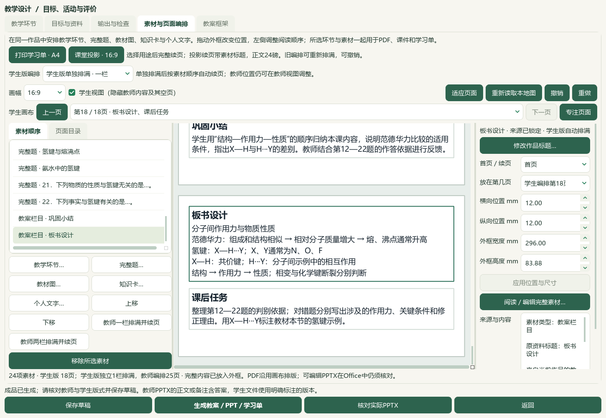

[新版教案、课件、入口与两类备份](../qa/2026-10-06-framework-slide-link-qa.md)。该联动快照为24素材／11题／40分钟／15输出版本；当前课堂设计见[Word与PPT](#classroom-purposes)。

## 个人教材笔记直接加入课件（维护源码）

1. 在 **教材** 选择已导入原书和章节。知识笔记可以手工填写，也可用 **从所选章节批量整理知识…** 每批读取1—8页，核对原页并修订后保存。本机文字摘录不发送原页给供应商。
2. 勾选本课需要的笔记，点击 **预览备课参考**。核对全部文字和原页；选材或笔记版本变化后，需要重新预览。
3. 点击 **知识卡加入课件…**，打开当前备课的“素材与页面编排”。用 **上移／下移** 安排先讲知识、再做练习，也可修改作品标题；原笔记和来源快照保留。
4. 点击 **生成教案 Word / 课堂 PPT**，再 **保存草稿**。已经加入的同一版本不会重复添加；换机恢复后，即使原文件路径变化，也会保留作品中的已编辑副本。原图副本缺失时先补齐图片，再重试。

个人笔记三条位于既有练习活动之前：卤素熔沸点与范德华力、氢键的形成与表示、氢键对物质性质的影响。来源为选必二2.2节PDF54—56；可见印刷页50—52，系统未自动回填印刷页字段。加入五个教案栏目后的前序快照为24素材／11完整题／40分钟／15输出版本；可在[教案框架](#teaching-framework)继续填写并联动三类目标及板书。

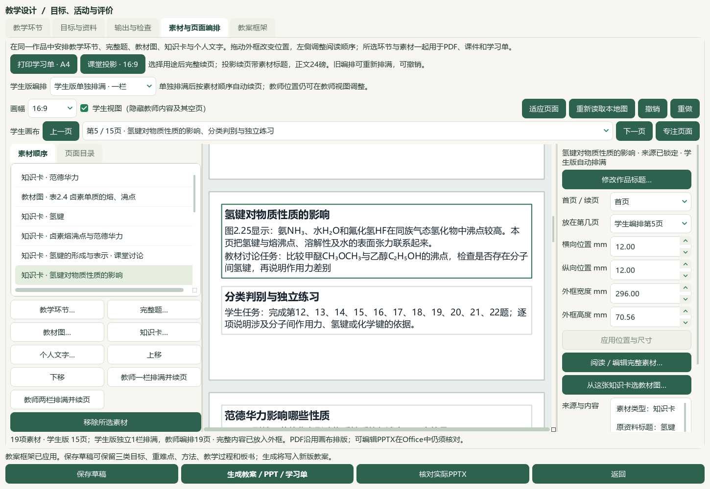

原页摘录和核验记录可在来源详情中查看，生成文件不混入流程提醒或长摘录；学生版显示知识卡正文与适用条件，隐藏教师答案。原图仍需从原页单独框选。在“阅读／编辑完整素材…”修改作品副本时，原来源记录继续保留。

普通备课ZIP与个人教材专用ZIP分别保管，详见[保存与备份](save-and-support.md#save)。[本轮验收、入口与成品](../qa/2026-10-06-personal-notes-to-lesson-qa.md)。

## 按原文位置阅读含图题目（维护源码）

1. 从教材章节的 **本节题目…** 或本地Word题库打开题目。先在题面页阅读全部条件和选项，结构图会出现在原文位置；窄窗可向下滚动读完全部内容。
2. 切到答案页查看原资料答案与解析。题面页仅显示题面和共同材料；**查看原文文字** 可展开当前页的完整检索文字，图像占位仍保留在来源记录中。
3. 图文位置或版本无法核对时，窗口会保留完整文字及逐图预览，并提示核对原Word。按来源核对图形、条件和答案后，勾选完整题，预览所选题目并加入当前备课。
4. 在“素材与页面编排”调整标题及课堂顺序，生成教师和学生成品。当前第20题作品标题为“氨水中的氢键”；两版Word题面与四幅选项图同页，24磅投影在两页显示，第二页带续题标题。

前序原图切片11题为原讲义12—22题，16素材／40分钟；第20题题面131—133、答案134—135块，6原图保留，原参考答案B照录。当前三条个人笔记接入后为19素材，见[知识卡加入课件](#personal-knowledge-cards)。块号不是印刷页码，化学与正式四层审核仍待完成。

[本轮验收、启动与成品](../qa/2026-10-06-word-inline-image-reader-qa.md) · [教材章节选题](#textbook-section-questions)。

## 从教材章节选择题目（维护源码）

1. 打开“教材”，选册与章节，点 **本节题目…**。个人导入教材也可使用；先保存并选中章节。当前仍在读的原页和已有备课保留。
2. 原书与全部页范围唯一对应时，窗口带入本节的教材册、章、节条件；结果来自已保存标签。自动建议仍待教师核对，题目不会自动勾选。未建立唯一对应时，会显示文字检索说明，可以修改章节搜索词。
3. 按来源和化学内容查看完整题面、全部原图与单独的答案。可跨章节保留选择，使用 **恢复本节检索** 重新核对本节范围，或 **查看全部题目** 明确清除条件。原书或目录变化时先回教材刷新。
4. 勾选后点 **预览所选题目**，核对完整题、来源、范围及缺口，再点 **完整题加入课件**。在当前教学环节中编排、保存草稿并生成教案、PPT与学习单。重复题按已核验来源版本去重，原作品的标题和修订保留。

前序十题候选从选必二2.2节接入第07讲第21／22题，原参考答案C／B；随后第20题6原图接入成为十一题。当前增加三条个人笔记，为19素材，详见[知识卡联动](#personal-knowledge-cards)和[按原文位置阅读](#word-inline-reading)；化学与正式四层审核仍待完成。

[验收、候选启动与输出位置](../qa/2026-10-06-textbook-section-question-link-qa.md)。普通备课ZIP不包含原教材或本地Word库；备份范围见[保存与支持](save-and-support.md)。

## 找回缺分隔符题目并用于八题备课（维护源码）

1. 在本地Word题库打开原资料，核对题干、全部选项和参考答案。题号后缺分隔符时会显示独立候选与范围提示；先读完整原文。
2. 展开 **题目设置**，点 **调整本题范围…**，设置题面和答案起止，再点 **查看本次范围预览**。原文第13题为88—92块；第18题为116—122块，排除123块起的“03氢键”标题。块号不是印刷页码。
3. 对照预览勾选 **已核对缺少分隔符题号的独立题面与答案边界**，再保存；改变范围后须重新预览与核对。第19题为124—130块。范围调整后，旧自动标签仍须按当前依据另行核对。
4. 勾选完整题，预览选题后加入当前备课；在素材列表用 **上移／下移** 按原题顺序排列。更新练习环节并核对关联活动，保存草稿，再生成新版本。
5. 打开实际教师与学生文件，分别核对题面、选项、原图、答案与分页。当前候选为第12—19题、13素材／40分钟／8输出版本；另存第25份草稿，原23份及第24份中间稿均保留。

本轮实际学生Word3页／学生PPT9页，八题在两版Word与学生PPT中分别保持完整题干与选项同页。学生版不带教师答案；教师PPT13页，第16题按教师编排续页。原表图与两张教材卡保持，个人教材仍可继续2.2节PDF54。原文题号缺分隔符照录，参考答案仅按来源保存，题目化学判断、四层身份和旧自动标签还须核对。

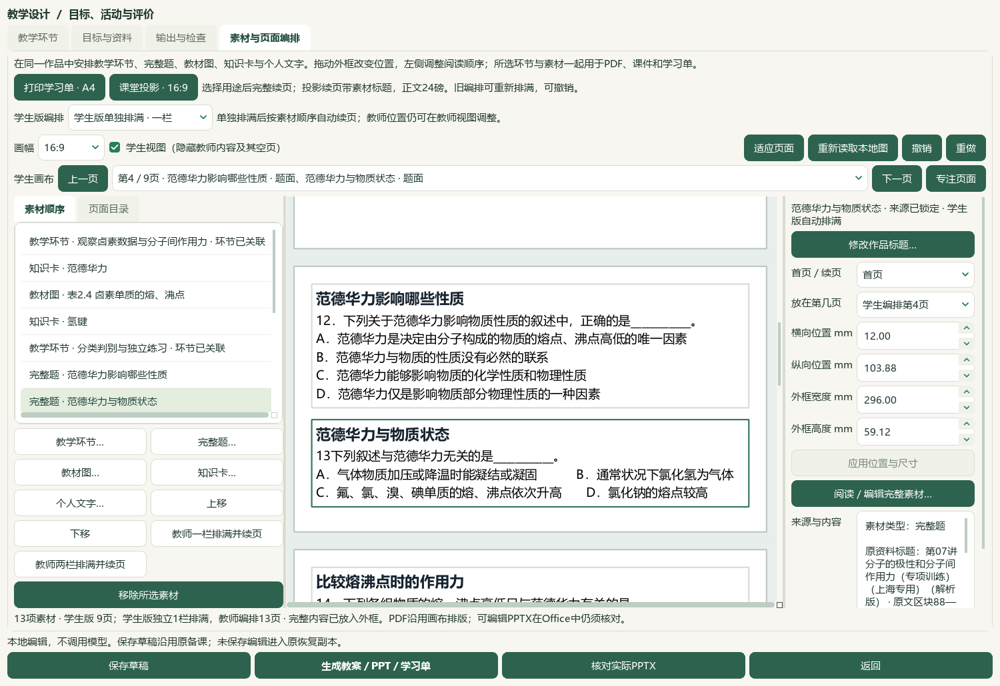

## 前序五题备课与完整题库复核

1. 打开五题候选入口，载入第23份备课草稿；原22份仍可通过草稿列表打开。进入素材编排查看教材知识卡、原表图、教学活动与5道完整题。
2. 点击完整题，先看来源题面和答案，再用关键词或教材标签筛选；跨来源切换保留已选5题。第17题来自原讲义109—115块，Word块号不等于印刷页码。自动教材和作答形态标签仍须核对。
3. 练习环节当前为第12、14、15、16、17题。改动环节后须显式核对和刷新关联活动，保存草稿，再生成新版本；已生成成品不随编辑自动改变。
4. 当前学生Word3页／学生PPT6页，第17题题干与四选项完整同页，学生版隐藏教师答案。普通备课ZIP恢复23草稿／138成品；另外保管465个Word库文件、标签／范围／选择及原教材。

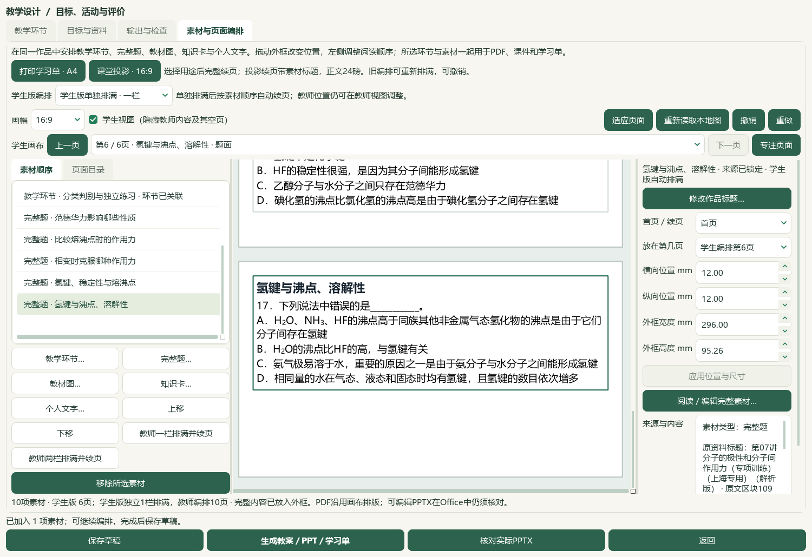

### 维护源码：完整短题分页与复制库去重

1. 从 **完整题…** 核对题干、选项及答案范围，再预览所选题接入课件。同一文件、同一版本和同一题目范围在复制资料库后再次接入，会保留已有的作品标题与现用副本；来源版本或范围变化仍分别加入。
2. 新增题目后在教学环节更新练习任务，再选择关联活动的 **用当前环节更新**。当前第16题原范围102—108、原参考答案A，现用标题“氢键、稳定性与熔沸点”；知识点与教材映射仍是待审校候选。
3. 生成新版本，分别打开实际Word和PPT检查。可以容纳在一页的题干、公共材料与全部选项一起移到打印页；长题、答案与教师备注继续正常分页。当前四题已在两版Word及学生PPT中逐题核验，教师PPT仍可能跨页。
4. 保存新草稿、导出普通备课ZIP，并另外保管本地Word库与原教材。第21份纯Word修复草稿和第22份四题草稿均保留，旧成品可继续打开。

### 维护源码：学生版单独排满

1. 在 **素材与页面编排** 的 **学生版编排** 选择 **学生版单独排满 · 一栏**，或按课堂用途选两栏。学生可见题目、知识卡、图表与任务会按左侧素材顺序完整续页。
2. 查看页面目录和学生画布。能够放入一页的短题连同全部选项一起移动；长题保留正文24磅和续页标题。这是画布、PDF与PPT的编排；Word按打印页另行分页；维护源码现将可放入一张打印页的完整短题整组分页，两版Word及学生PPT已核验第12、14、15、16题各自同页。缩小窗口时当前页自动适应，也可点 **专注页面** 放大阅读。
3. 在教师视图调整教师位置；学生自动模式下的外框只供预览。修改素材、作品标题或阅读顺序后，学生版自动重新排满。选择 **沿用教师位置** 可恢复共享位置；该选择和修改均可撤销。
4. 保存草稿并生成新版本，再分别核对实际教师／学生Word和PPT。旧成品保留，页面编排选择随普通备课ZIP恢复；旧EXE不能使用维护源码的新编排选项。

当前分子间作用力课有9素材、40分钟、4题；学生PPT5页，教师为容纳第16题重新编排至9页；Q12、Q14、Q15、Q16在两版Word和学生PPT中均各保留完整题干与选项在一页。所有题答与教材卡仍是待教师审校的来源候选。

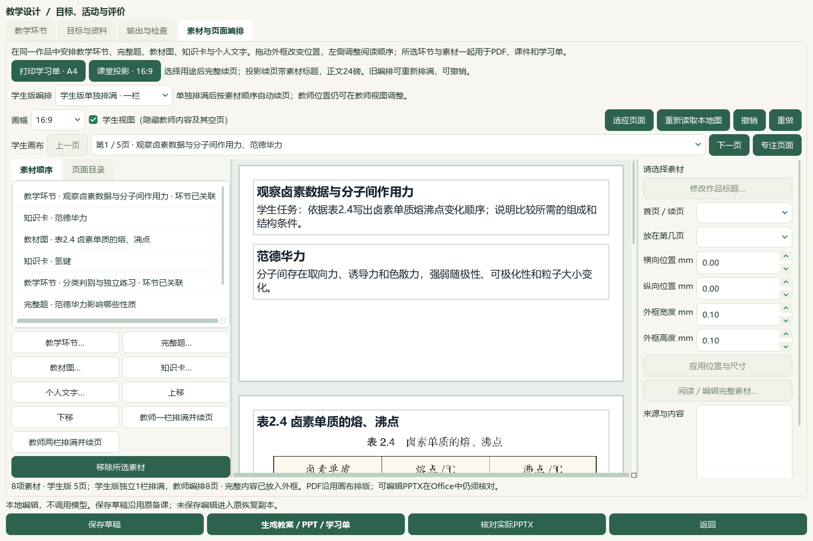

### 维护源码：分子间作用力备课示例

1. 在本地Word题库预览完整题与答案。Q12使用81—87区块，排除88起的下一题；范围变化后先对照自动建议再保存。Q14和Q15分别使用93—97、98—101区块。
2. 用 **知识卡…** 选“范德华力”和“氢键”，在阅读器查看选必二原PDF52与55。点关联原页选材，在PDF54页面裁出表2.4，核对四行熔沸点及℃单位后加入。
3. 新建独立备课，把观察活动、知识卡、原表和练习按课堂顺序排列。本例2环节40分钟，3完整题、2卡、1裁图和2活动共8素材；保存草稿并生成教师、学生文件。
4. 核对学生文件中题目和图表是否完整，教师答案是否隔离，再打开实际Word和PPT。当前可用学生版单独排满，按可见内容消除教师内容隐藏后留下的位置空白；具体操作见上节。

本段为前序三题示例；Q13现已恢复独立候选，原文88—92区块，保留缺分隔符题号及范围核对入口，已加入后续八题备课，见[恢复记录](../qa/2026-10-06-word-omitted-question-recovery-qa.md)。Q11答案与教材表述问题仍待处理。原讲义答案与自动标签的审核范围分别保留。

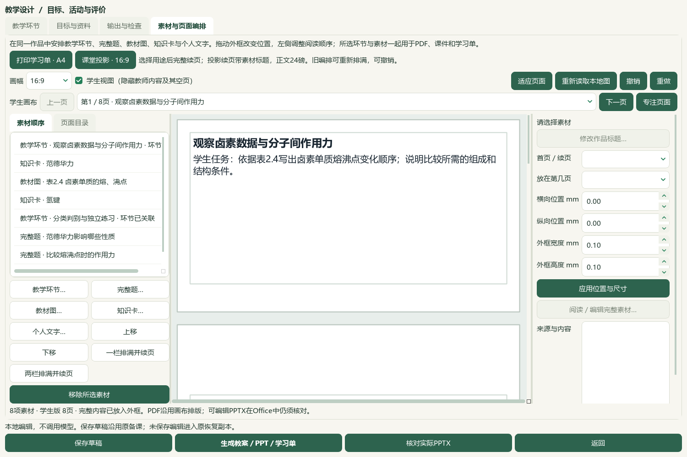

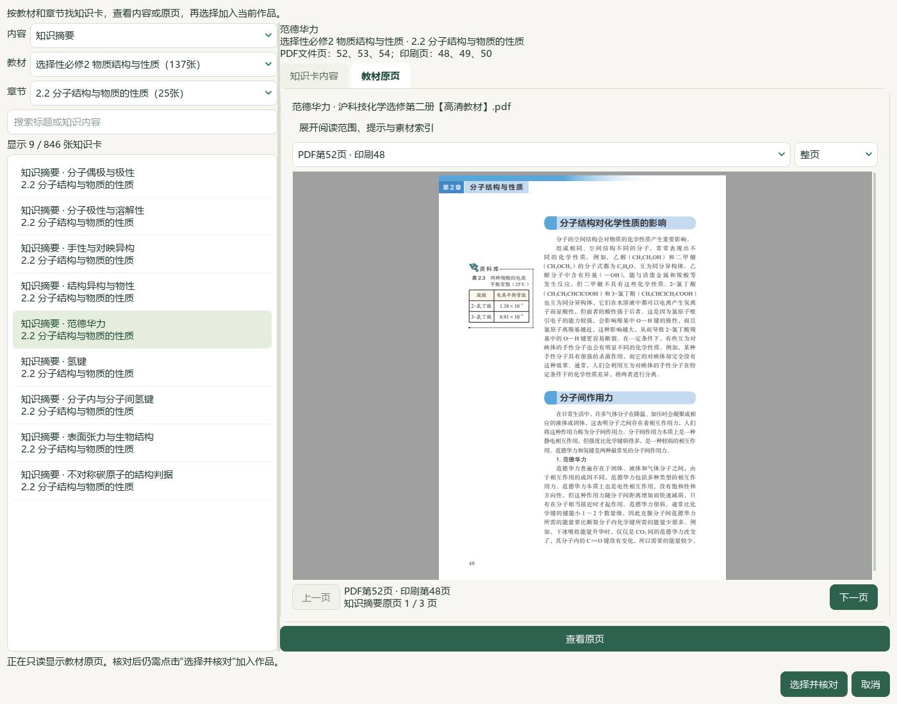

### 维护源码：长题投影与续页阅读

1. 先将完整题、知识卡和活动加入当前课件，按课堂阅读顺序排列；核对题面、答案角色及全部原图。
2. 选择 **课堂投影·16:9**，点击 **一栏排满并续页** 更新页面。长素材续页显示“作品标题（续）”；正文保持24磅。已有手工编排可撤销后另行安排；较长内容继续分页，整图保留。
3. 切到 **学生视图**，在 **页面目录** 按“本素材第n/N页”和 **题面** 找到连续材料；教师视图还列出 **讲评**。目录只数当前视图可见的素材片段，右侧编排位置仍是原教师页。用 **专注页面** 核对题干、选择项和图像，返回后继续编排。
4. 保存草稿、生成新版本，打开实际学生和教师Word／PPT核对正文、续页标题、图片与答案范围，再导出所选版本；旧版本仍可查看。学生版用于交付，教师编辑窗的素材列表仍可能显示教师条目。

本地J题新增K13与选修第二册2.2节自动关联候选，依据原题和教材原页保留在属性历史；选用前仍须核对。维生素C题保留65—72区块，已另存当前范围自动建议，主知识点仍待确认。来源讲义中的年份、区域和答案只按原记录展示，不凭候选标签认定官方题目、难度或化学审校通过。

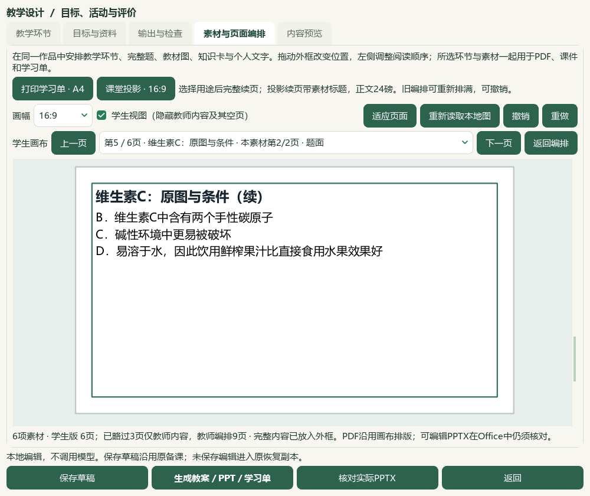

### 维护源码：从本地题库选完整题用于课件

1. 先在 **备课** 填好当前课题、授课对象和学习目标；已有作品可从“我的备课”继续。
2. 在 **题库 → 本地Word题库** 点 **选完整题加入课件…**。按来源、教材或已保存知识点筛选，逐题阅读题面和答案；需要改起止时在题目设置中预览并保存范围，再核对原图。缺失或不能完整读取的对象须回到来源处理。
3. 勾选1—20道题，点 **预览选题**，核对后点 **完整题加入课件**。原图随完整题进入；答案和解析用于教师版。窗口打开当前教学设计的 **素材与页面编排**，可继续加入 **知识卡…**、教材图或教学环节。
4. 同版本已在当前课件中的完整题保持一份，已改标题和作品副本保留。需要新来源版本时重新选择；只查看或取消不加题。只需追加备课文字时，在原文管理窗口使用已有的参考接入操作。
5. 选中素材可 **修改作品标题…**，按教学进程调序。用 **打印学习单·A4** 或 **课堂投影·16:9** 选择用途，核对续页及学生版范围；保存草稿、生成新版本并检查实际Word／PPT，再导出所选版本。

当前维护窗口用于教师编辑，素材列表仍可显示教师内容名称。发给学生应使用明确标注的学生文件，核对实际正文及图片；原讲义中的答案、引用出处和化学解释仍须教师判断。

### 维护源码：教材摘要直接用于课件

1. 在 **教材** 勾选知识摘要或研读提示，点 **预览备课参考** 核对完整文字和原页位置，再点 **知识卡加入课件…**。当前课件会接收独立知识卡并打开素材编排；同版本已有卡不重复加入。手工摘录使用 **加入当前备课** 追加。
2. 也可在 **教学环节 → 素材与页面编排 → 知识卡…** 按 **内容：知识摘要／研读提示／个人笔记**、教材与章节筛选并勾选，最多30条。切换筛选保留勾选，可在 **已勾选** 移除或清空。复习和附录按各自栏目列出，待归章节保留原样；只查看或取消不加卡。
3. 选卡后点 **查看原页**，在旁边核对该摘要明确引用的教材页；上下页只在该页码清单内移动。点 **预览勾选知识卡**，在 **本次加入预览** 阅读全部课堂正文，再确认加入。确认前重新核对来源与版本，取消不改变课件；一次加入可一次撤销，同版本去重。原记录保留在详情中，可编辑课堂副本。
4. 在画布选中知识卡，可先点 **对照教材原页…** 阅读本课讲解与绑定教材原页，再点 **从这张知识卡选教材图…**。核看同页或同栏目候选，或打开明确引用的原页框选；填写图题和用途、预览后确认。裁图保留选图所用知识卡与版本。[对照阅读](#knowledge-card-original-reading)。
5. 调整素材顺序和页面，核对学生视图，再保存草稿并生成新版本；打开实际Word／PPT核对文字、图像和教师内容范围。来源变化时重新选卡，选用仍需教师核对化学内容。

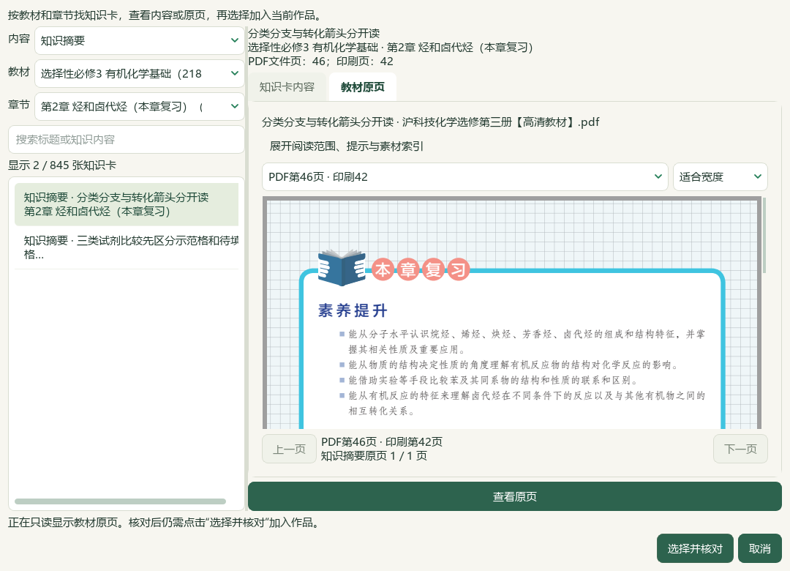

### 维护源码：对照知识卡讲解与教材原页

1. 在 **素材与页面编排** 选中已加入的知识卡，点右栏 **对照教材原页…**。登记知识摘要、教材概念与个人教材笔记均可打开各自绑定的教材原页；课件中改过的问题标题不改变封存原卡和原页依据。
2. 阅读本课知识卡完整讲解文字，旁边查看教材原页、页码及相关内容。宽窗并排，420px窄窗上下排列并可滚动；翻页和关闭只用于阅读，不保存备课或追加素材。
3. 需要配图时，点 **从这张知识卡选教材图…** 返回原有批量裁图流程。原卡来源与当前草稿重新核对后，逐张框选、填写本课问题图题与用途，再整批预览确认加入；取消返回当前课件，原有文字和设计保留。

本轮原生验收正在进行，[检查范围](../qa/2026-10-07-knowledge-card-original-reading-qa.md)由本轮回执记录。第07讲11—19题关系仍为候选，原Word排版尚未视觉证实；本入口使用已绑定的教材PDF原页。

### 维护源码：从知识卡继续选择课堂例题

1. 在 **素材与页面编排** 选中已加入的知识卡，点 **从这张知识卡选例题…**。窗口核对原卡身份、原标题、教材和笔记版本；课堂副本的文字修改不改变选题依据。
2. 有真实教材章节对应时，先带入该章节作为初始筛选；未归节概念或没有已登记章节对应的个人笔记，按原卡标题文字检索。默认收起筛选区，点 **调整选题条件（展开）** 可修改条件；窄窗向下滚动读完整题面。章节或标题命中不表示每题都已精确对应这个概念，也不会据此编造知识标签。
3. 本课使用独立勾选。阅读题面、共享材料、全部原图和教师答案，勾选后点 **预览选题**，核对再点 **完整题加入课件**。交接前后重新核对原卡、来源版本与本课状态，取消或版本变化不追加；原题答案身份保留。
4. 加入后安排知识讲解、观察和少量例题的顺序。同版本题目去重并保留已有编辑，本次加入可一次撤销与重做；保存草稿，再生成所需Word与PPT。

[本轮操作与验收范围](../qa/2026-10-07-knowledge-card-question-link-qa.md)。教材原图仍可从同一知识卡批量框选，已有课程图片也可按本课引导问题复用，见[教材裁图](#textbook-crop)和[课堂编排](#classroom-purposes)。

### 维护源码：从章复习原页安排复习课

在 **教材** 选择 **选择性必修3 有机化学基础 → 第2章 烃和卤代烃（本章复习）**，点 **阅读栏目原页**，按PDF46—48／印刷42—44阅读。**知识（2）**中的候选可先勾选，点 **预览备课参考**，核对后 **加入当前备课**；图片另行选取，不随文字自动加入。

在备课的 **教学环节** 按本课进程填写任务与时间，再点 **把所选环节加入课件画布**。本次候选有5环节，共40分钟。点 **教材图…** 选择章复习原页，逐张框选、预览并明确加入；第3题跨两页，题干／A项与B—D项须连续放置。比较表要保留示范列和待填格，转化路线要保留条件与全部小问。

修改关联环节后，在画布点 **核对／更新环节关联…**，先看现用副本与当前环节，再明确更新；重新排满、保存草稿并生成新版本。切到 **学生视图** 核对教师说明的隐藏范围，再打开实际Word和PPT检查图文。候选尚未附教材答案与评分细则，使用前由教师核对。

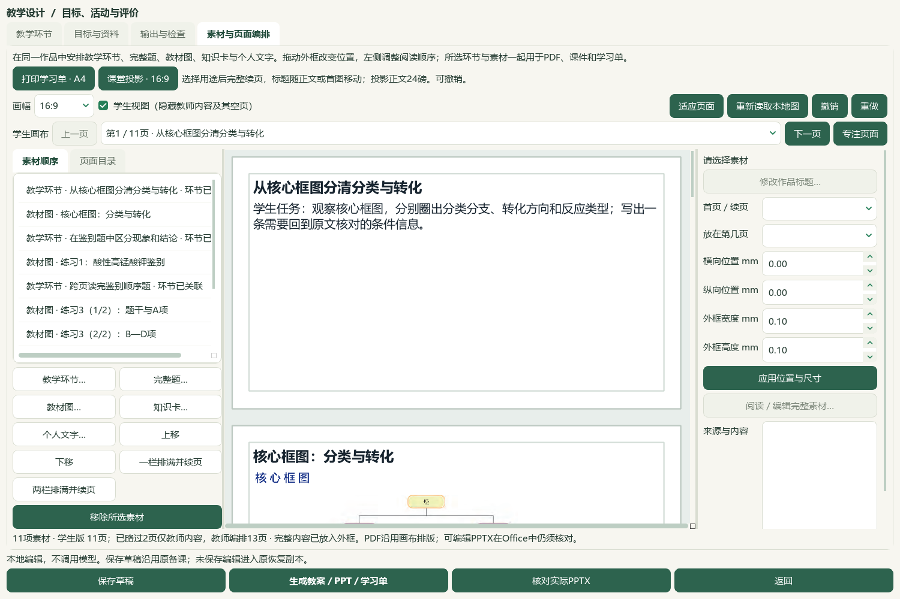

 
### 维护源码：边编辑边核对内容

宽窗的 **教学环节** 有三栏：选环节、修改属性、查看 **所选环节·内容预览**。桌面窄窗打开外层 **内容预览** 页签；当前环节、范围与完整文字保留。

先选 **学生学习单** 核对学生任务、材料和图片。只有勾选 **材料和勾选图片用于学生页** 的环节才显示材料与图片。切到 **教师教案** 可核对目标、活动、产出、评价、答案和备注。编辑文字会即时更新；本地图片缺失或摘要不符时会显示提示，可点 **重新核对所选图片**。

该预览核对内容范围；实际PPT、公式、图形和分页仍要打开成品核对。长文字完整保留，PPT输出超长时须拆分环节。完整参考仍保存在原备课材料中。

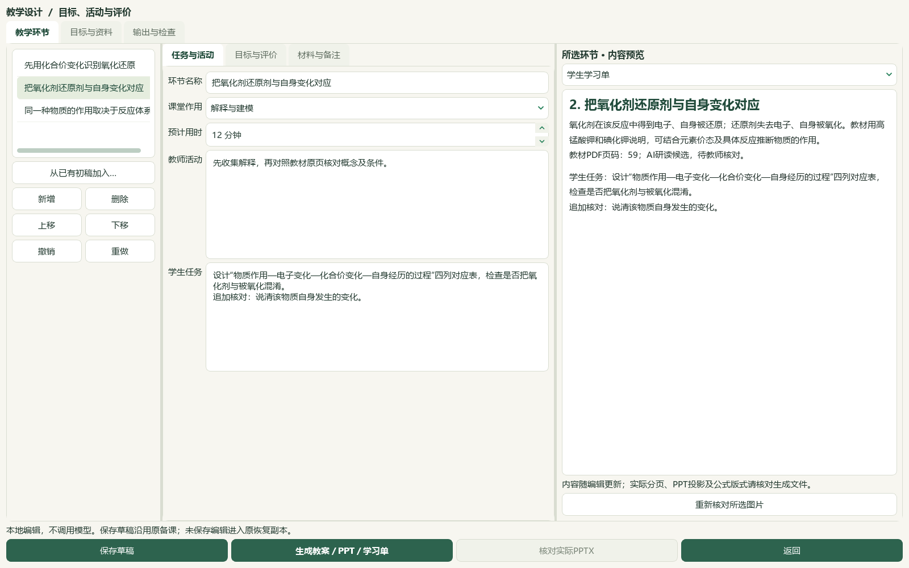

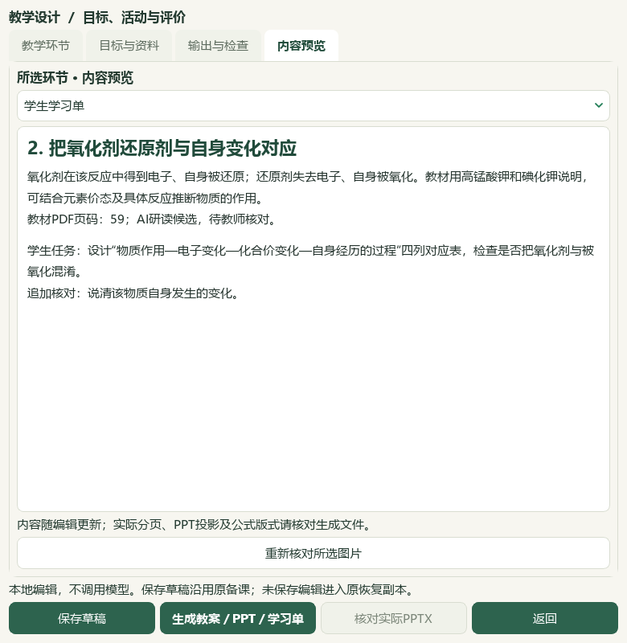

### 维护源码：对照实际课件整理逐页讲稿

1. 在 **备课 → 教学设计 → 输出与检查** 选择已生成版本，在 **核对／朗读课件** 选学生或教师课件。默认优先学生；教师课件可含答案。
2. 点击 **核对实际PPTX → 本页讲解稿与本机朗读**。宽窗左右对照页面和讲稿，桌面窄窗上下排列；需要缩略导航时点 **页码导航**。
3. 输入适合口播的讲稿。可点 **追加本页文字** 保留已有输入并追加实际页的可提取文字；图片或无法提取的内容须对照页面自行填写。核对顺序、物质名称、公式条件、单位和图形说明。
4. 选择本机声音与语速，点 **朗读本页**；可暂停、继续或停止。语速0是默认，调小变慢，调大变快。翻页、修改讲稿或关闭会停止；不会自动逐页播放。
5. 点 **应用讲稿到备课**，或正常返回时应用有效修改，再点 **保存草稿**。需要放弃尚未应用的改动，点 **撤销未应用讲稿**。保存失败时保留输入并按提示处理。

教师／学生讲稿分别保存，重开同一课件版本继续；PPT正文或版式改动后须生成新版本并重新核对讲稿页。讲稿随已应用的备课设计、恢复副本与ZIP备份保存，原PPTX不被改写。应用前异常退出的输入不保证恢复，声音与语速选择是当前窗口设置。没有可用本机声音时仍可编辑保存；尚不导出音频文件或配音HTML，语音与化学术语必须自行核听。此功能尚未进入v0.1.101试用包。

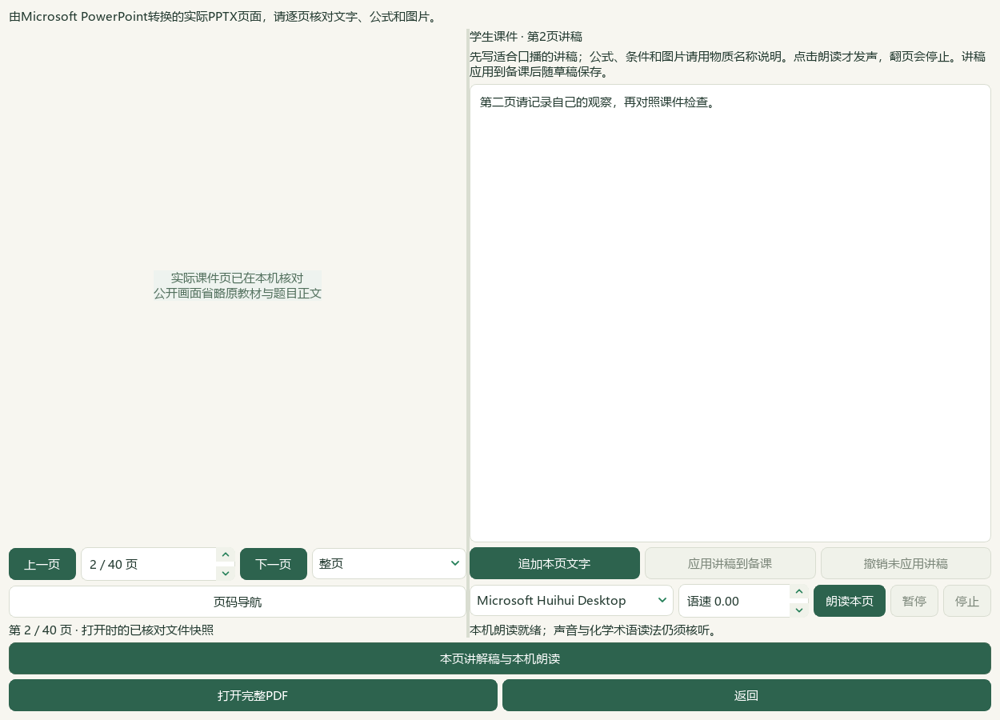

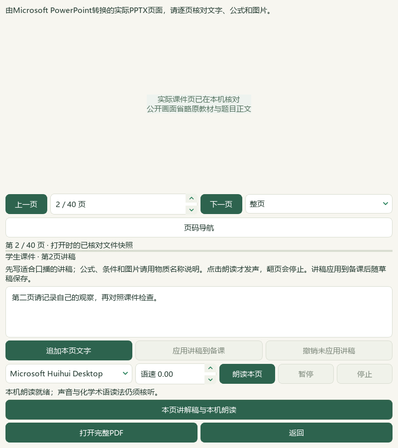

已加入知识卡后，在左侧选中该卡，再点右侧 **从这张知识卡选教材图…**。同页图优先，本节其他图也可选；**知识卡原页** 只列该卡明确引用的页，即使原页没有独立图表登记也能打开并框选。个人教材笔记同样按原页选择。查看候选后仍要填写图题和用途、预览并勾选确认。加入后在作品中核对位置并保存、生成；同页或同节不能代替教师判断图片用途，原书或笔记变化时需重新选择。

从知识卡新选的图会保留选图时的卡及版本。选中图，右栏可见 **选图来源知识卡**；点 **查看选图所用知识卡** 返回所选卡。卡被移除或版本不再对应时仍保留来源说明，但不能跳转。旧裁图和独立从“教材图…”加入的图需要教师自行核对用途，不补推关联。

点 **一栏排满并续页** 后，完整图、标题和较短用途说明尽量一起移动到下一页；Word还会连同短来源说明安排。较长用途和手工缩小外框仍可能跨页，生成后核对实际Word／PPT。切换 **学生视图** 检查已隐藏的教师用途，窄窗用 **适应页面** 查看整图。调整后保存草稿并生成新版本，旧成品保留。

教材知识卡需要结构或装置原图时，在页面编排点 **教材图…**，选择正式图表；个人导入整书可选择PDF原页。框选后填写图题与本次用途，点“预览裁片”，核对完整文字、公式和边缘，再勾选并加入备课。加入同一作品后主动编排并生成，最后打开实际Word／PPT检查图片。选图不会自动审校或为所有知识卡匹配图形。
### 维护源码：把完整素材编排成页面与课件

多页作品可在左侧 **页面目录** 点选页或素材续页，也可用上方页码、**上一页／下一页** 直接定位。目录按教师／学生视图列出实际可见画布页；右侧 **放在第几页** 仍指教师编排原页，Word成品页码另核。点 **专注页面** 展开图文，**返回编排** 回到同一页及来源；翻页、专注与切换视图保留已有内容和位置。

在 **备课 → 教学设计 → 素材与页面编排**，点 **完整题…** 选择本地已导入题目，或用 **教材图…** 框选并确认原页裁图、**知识卡…** 选择来源绑定知识摘要或研读提示、**个人文字…** 填写本课文字。加入时重新核对原文件、版本和图片；现有环节、备课材料及来源原件保留。**知识卡…** 提供教材知识摘要、研读提示与个人笔记。先选 **内容／教材／章节**，再搜索标题或内容；右侧 **知识卡内容** 显示摘要、文件页、印刷页和适用范围。点 **查看原页** 在 **教材原页** 中核对原书，再点 **选择并核对** 加入作品。只阅读或取消不改变当前作品；版本变化时需重新选取。窄桌面窗以上下布局显示同一组操作。**教材图…** 可选已登记图表或个人导入教材；个人原书先输入PDF文件页，再框选、预览并确认。印刷页未知时保留待核对，选用不会自动审核原书或笔记。
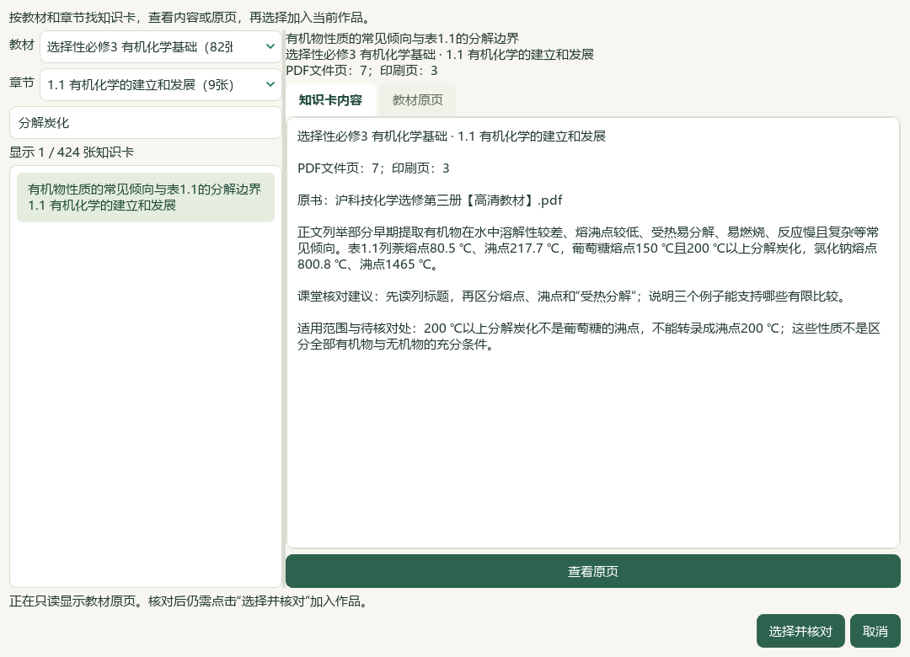

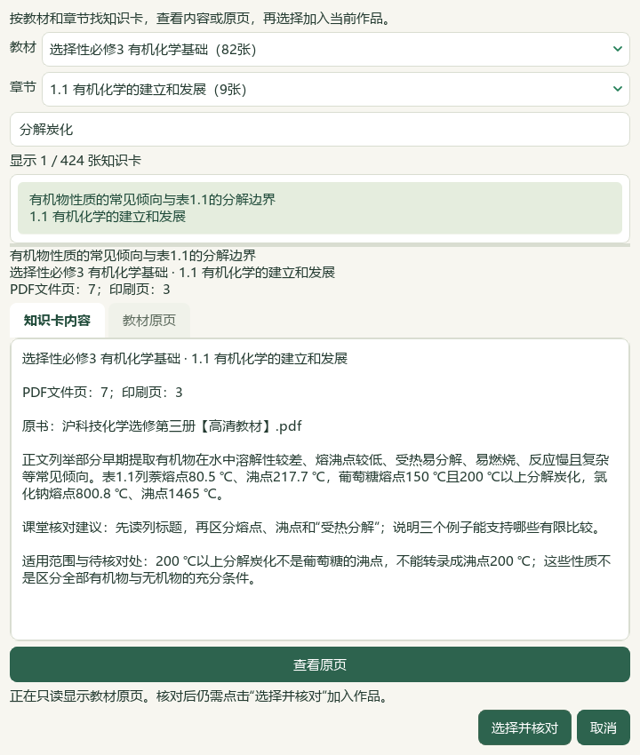

完整题含多张图片时，会在当前题面或答案页一起读取，并显示完成情况；等待图片完整显示后再勾选。切换题目可停止旧题加载，缺失图片仍须回到来源处理。加入前的完整预览与再次确认会重新核对文件和标签。

**修改作品标题：** 选中素材，在右栏点 **修改作品标题…**。题干锁定时也能改名；可取消或撤销。新选入完整题先用题面开头作标题，旧素材和已自定标题保留。完整文件名、原文区块与来源仍在下方可核对。较长题面标题只是显示摘录，全文不删减。

改名同步到素材顺序、页面目录和画布；调整后点 **一栏排满并续页**，保存草稿并生成新Word／PPT，旧成品保留。在 **阅读／编辑完整素材…** 中也可直接修改作品标题；修改题干或答案仍须先明确解锁作品副本。

**先读来源：** 选中素材后，右栏显示原资料标题、题面和教师答案所属原文区块，或教材PDF文件页与印刷页。Word区块是文件中的位置；题号与整卷层级按原卷另核。未知印刷页保留“待核对”。用 **阅读／编辑完整素材…** 切到原资源页，按原顺序查看全部题面、答案和图片位置说明；详细来源数据默认收起，点展开才显示。图片在完整素材及画布核对。点击 **取消** 保留当前作品；解锁后应用修改只改作品副本，原资源快照继续可对照。

**把教学环节和资料放在一起：** 在环节页选中一个环节，点 **把所选环节加入课件画布**；批量用这里的 **教学环节…** 勾选本课环节，按设计顺序加入。学生任务和已明确勾选的材料／图片进入学生版，教师活动、目标评价、答案及备注保留在教师版。已关联环节再次加入会定位现有素材。

**继续修改原环节：** 选中环节素材，点 **回到关联教学环节**。修改原环节或所关联目标后，画布保留已有副本并提示待更新。打开 **核对／更新环节关联…** 比较现用副本、原快照和当前环节，选择 **用当前环节更新** 或 **保留独立副本**；编辑过画布标题或正文时，要另勾选允许替换。更新保留外框与阅读顺序，可撤销；字变长后仍须处理溢出。原环节已删除时只能保留独立副本或移除素材，再生成。已有成品继续保留，关联状态未处理时阻止新生成。

自动重排时，标题随正文开头或首图续页；能放在同页的短相邻图注随图移动，单段开头和末尾尽量留两行。长题仍可分到多页；手工外框较小时，可拆软分组但保留整行和整图。核对题干、图形与答案的位置，必要时调整外框，再生成。已有文件保留，重新生成使用当前分页规则。

1. 按用途点 **打印学习单 · A4** 或 **课堂投影 · 16:9**。投影正文24磅，原图等比放大；切换按完整内容重排，可撤销。也可在 **画幅** 选择A3等格式，再点 **一栏排满并续页** 或 **两栏排满并续页**。旧草稿若仍用旧外框，明确用途后重新排满；短题干与独立图或行内整图在容量允许时保持同页；来源徽标与短导语也计入实际高度；长素材、长导语及选项仍可能续页，完成后核对全部页面。旧成品须重新生成才能采用本次分页。
2. 在画布拖动素材外框；也可在右侧选择首页／续页和页码，填写毫米位置、宽高，再点 **应用位置与尺寸**。左侧 **上移／下移** 单独改变阅读顺序。**撤销／重做** 可返回当前打开期间的编辑。
3. 用 **阅读／编辑完整素材…** 查看作品副本与原资源快照。先取消 **锁定来源内容** 才能修改副本文字，完成后重新锁定并 **应用到作品**。来源快照和答案所属类型保持，取消编辑不应用修改。行内图片标记须保留，可改标记前后的文字；实际来源上下标仅在原内容未被修改处保留格式。移除素材不删除来源文件。
4. 勾选 **学生视图（隐藏教师内容及其空页）** 核对可见页数。仅因隐藏教师内容形成的整页空白会被略去，原本两版都空的手工空页保留；顶栏和目录表示当前视图可见页，右侧外框归属仍指教师编排原页。教师专用素材的标题也从学生文档隐藏，原框内局部留白可能保留。图片缺失、内容超出外框或外框重叠会提示处理，须重新排版或调整位置后生成。
5. **保存草稿**，再生成成品。已有明确选材且“本次资料范围”为空时，保存会列出本次资料概况；已有文字保留，之后修改选材时仍须核对说明。生成并核对教师／学生PDF、学生PPTX与文档后再保存，使成品版本记录一起保留；用 **导出所选版本的全部文件…** 另存当前版本，修改后重新生成。

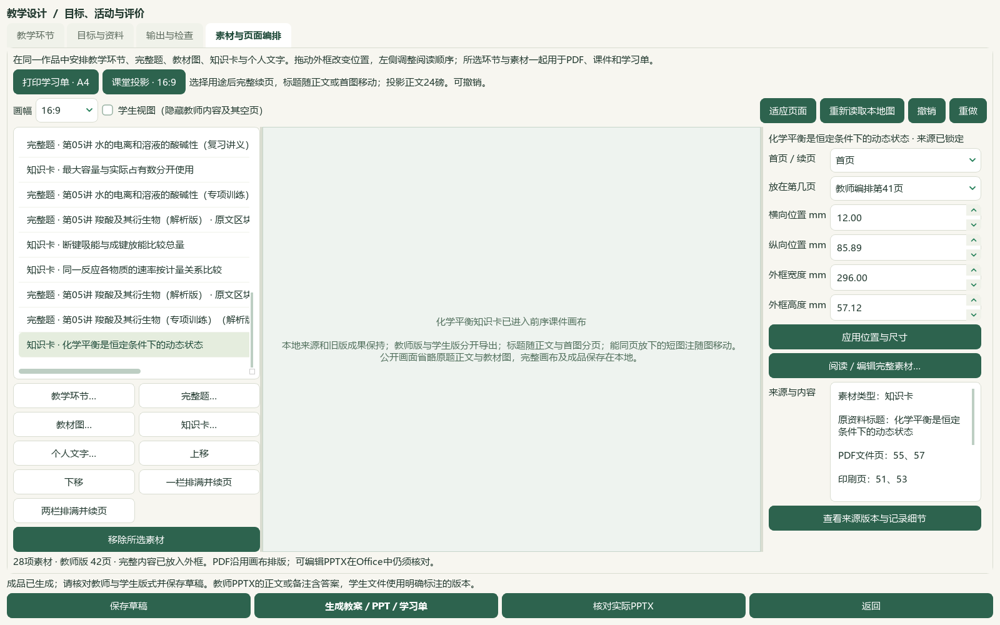

启用页面编排后生成六份文件：`lesson_plan.docx`、`student_worksheet.docx`、`lesson_presentation.pptx`、`student_presentation.pptx`、`lesson_canvas.pdf`、`student_canvas.pdf`。**教师PPT正文含答案；给学生投影或分发使用student_presentation.pptx和student_canvas.pdf。** 已加入画布的环节与素材按位置输出PDF与可编辑文字／图片PPT；教案中的同一关联环节只输出一次，未加入画布的环节仍只保存在教案中；未加入画布素材的旧设计继续生成原三份文件。

画布和PDF共用文字换行与图像尺寸，超出时保留内容并阻止生成。PPT沿用这些位置，但仍须打开Office核对字体与版面；实际PPT预览优先使用已安装LibreOffice，未发现时可用本机PowerPoint，预览标题显示实际引擎。已有PowerPoint窗口时先保存并自行关闭，再重试；转换不会接管该窗口。当前4原题、3卡与教师说明候选经36实际Office页核对；Word有限长度的标题、短题干与首张装置图尽量同页，小公式与徽标不会提前结束分组。长题、过高图和解析仍完整续页，PPT保留24磅正文；仍须核对本课全部跨页、图形、选项与留白，真实课堂投影待教师确认。当前生成Word与PPT不显示来源附注，完整字段保留在素材记录和备课草稿中。已验证Word图片按原生对象位置显示，文字上下标使用实际Word格式与简单OMML依据；字面的括号记号保留原样。复杂嵌套公式仍显示完整转录，复杂表格、对象和原版布局未无损还原。原文完整保存不代表已完成化学或正式教学审核。

短纯文字知识卡或活动能放进一整页时，点 **课堂投影16:9** 或主动顺序重排可把标题和完整可见正文一起换页。已有作品先主动重排，再重新生成；历史文件保留。Word对限定长度的纯文字知识卡和活动使用同页段落规则，教师知识卡来源也跟随正文。长卡与长活动保留全文并续页，投影正文仍为24磅；手工较小外框仍可能按整行拆分。

保存／恢复保留素材文字、位置、阅读顺序、原始快照及本地图像引用。备课ZIP勾选 **包含已结束任务与成品** 可纳入所选作品登记的六份文件及旧版本；恢复需支持页面编排的维护源码，v0.1.101旧包不支持。原Word、正式五册原PDF和完整题库仍须另外备份。[当前验收](../qa/2026-10-06-composition-page-navigation-qa.md)。

### 得到什么

未加入画布素材的同一设计生成 `lesson_plan.docx`、`lesson_presentation.pptx` 和 `student_worksheet.docx`。草稿保存环节、目标和输出版本；下一次可以继续修改。

### 怎么确认完成

学生任务能在计划课时内实施，公式、条件、单位与图像可读，学生文件中没有教师答案。普通环节PPT的讲者备注可能含答案；页面编排的教师PPT正文含答案，投影与分发使用明确标注的学生PPT。

引用材料默认供教师查看并锁定。要放到学生页，先核对题答分离和条件完整，再明确调整可见范围。初稿转换不保证复杂 Word 公式、图表或原 PPT 版面无损重建。

环节或目标有实质修改后，应生成新成品并重新检查。“核对实际PPTX”查看由实际 PPTX 转换的预览；快速结构预览不等于实际 Office 渲染。外部修改导出副本不会反向更新工作台设计。

## 查看教材原页与研读提示（维护源码）

从侧栏 **教材** 或备课页 **从教材选材** 进入教材书架。先选册，再点左侧章节，原书在目录旁打开；用页列表、前后页和缩放阅读。正式目录为5册、19章、60节。章首页、复习和项目列在所属章内，册级内容放在 **本册导读与附录**；选中后点 **阅读栏目原页**，知识与素材随栏目显示。当前77个补充栏目另计，23条已有明确栏目归属的知识已归组。**原书已在本地** 只表示文件位置可用，打开时才核对原书版本与页范围；确实无法核对归属的内容仍单列。

拉宽窗口后可开启 **原页与选材并排**，同时阅读原文与 **知识／研读／素材／备课参考**。宽窗点 **对照提示原页** 会进入并排核对；窄窗用页签切换，拉宽恢复并排。切换布局保留当前PDF页和勾选，切换章节关闭旧阅读范围；阅读不会自动勾选或审核材料。可再次点并排按钮回到单栏。

原页阅读时点 **收起目录** 留出宽度；窄窗会默认收起目录，需要换章节时点 **展开目录**。点 **放大阅读** 暂时收起目录和选材页签，仍可翻页、缩放；点 **返回选材** 恢复选材。页码和勾选保持，拖动目录分隔条后同一宽度范围内调整窗口不重置比例。点 **预览备课参考** 自动退出放大阅读，让参考内容可见，再明确加入备课。

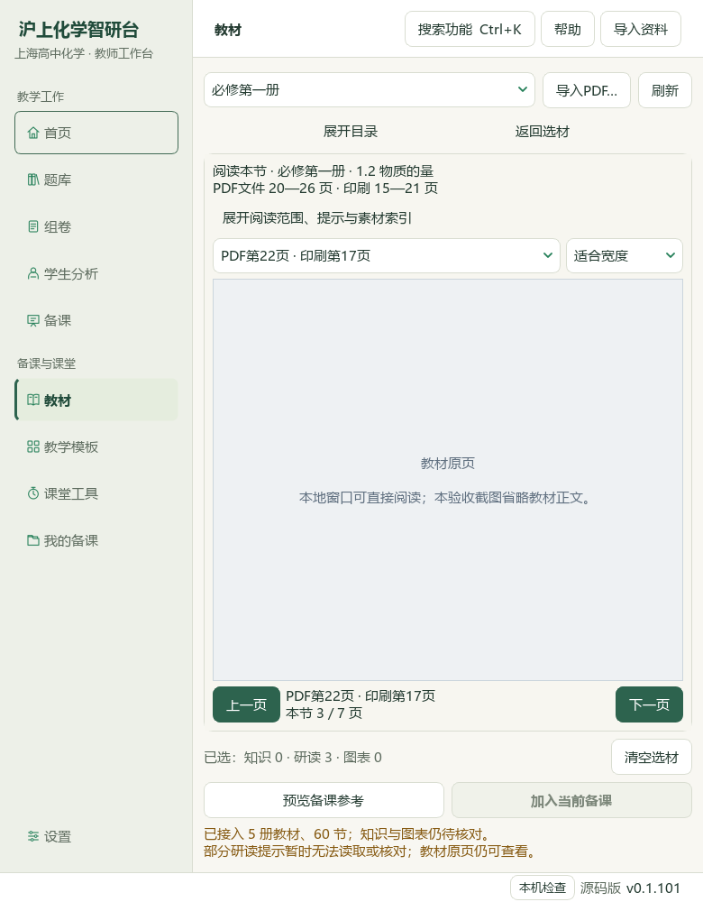

切到 **知识** 可看本节完整候选摘要，切到 **素材** 可打开图表所在原页。阅读范围、研读提示与页内素材索引可在原书阅读区按需展开，把空间留给正文。若要摘录教材原句，选中知识再点 **阅读知识 / 摘录…**，在原有独立窗口核对并手工确认；整节与素材阅读不提供摘录操作。

补充栏目按登记的页列表翻阅，未知印刷页显示待核对。阅读整个项目不会把知识点的关联页自动扩大；栏目知识仍按下面的勾选、预览、加入备课步骤使用。窄窗口阅读时收起暂不用的备课按钮，切回知识页即可继续选材。[栏目阅读与备课示例](../qa/2026-10-04-textbook-supplement-bookshelf.md)。

**研读** 页列出匹配当前教材版本与本节页范围的提示；可看摘要、课堂核对建议和适用范围，点 **对照提示原页** 定位。提示是AI整理的候选，待教师核对。章节旁的数量表示可选笔记数，不代表整节已读完或审核；部分旧笔记证据不足时暂不显示，原书仍可阅读。当前496条已存笔记中457条可选，覆盖60个正式节；39条旧缺项待核。

勾选知识或研读提示后，点击 **预览备课参考**。预览以标题、摘要和页码呈现；完整来源与版本信息收在 **查看来源核验详情**。再点 **加入当前备课**，软件重核当前来源后追加到备课资料，课题、目标和原有资料保留。知识与研读提示合计每次最多30条；来源或笔记变化会要求重新选择。跨章节勾选会保留；**清空选材** 只取消本页勾选及暂存摘录，已加入备课的资料仍在。

回到 **备课 → 教学设计 → 教学环节**，在对应环节引用当前备课资料，再制作教案、PPT和学习单。引用后的资料是该环节的快照，默认只供教师查看、处于待核对状态；教材摘要不会自动成为学生页或已审核结论。保存草稿后可继续编辑。素材目录仍定位原页；需要图片时由教师明确框选，操作见下文。

**导入资料 → 教材与课程文件** 也提供教材书架入口和 **保存整本教材PDF…**。普通题目／讲义导入仍按页处理；整本教材请用专用入口。新书或不同版本的章节整理按下面的个人教材流程处理，正式五册目录保留。

### 关闭后继续阅读教材（维护源码）

1. 在教材页阅读现有编号节、补充栏目或已导入原书／章节，用页列表或前后页移动。页面停留片刻会自动记住位置，显示 **已记住阅读位置**；返回选材或正常关闭时也保存最后页。
2. 再次进入教材页，点 **继续上次阅读**。旁边显示上次章名和PDF页；打开时重新核对同版本原文件及阅读范围，返回原册／章节／页。看图表后重新 **阅读本节原页** 也继续该节上次位置。原册或章节版本变化时重新选择范围。
3. 从 **对照提示原页** 或个人目录 **定位所选原页** 打开时先到明确的依据页。阅读不会勾选知识、确认章节或加入材料；仍须选取、预览，再明确加入备课或知识卡课件。
4. 窄窗原页阅读默认收起目录与多余操作。个人教材点 **展开章节** 查看目录，收起后继续原页；拉宽恢复完整目录。核对失败时保留提示和重新阅读操作。
5. 个人原书与阅读位置用 **章节整理 → 备份全部个人教材与笔记…** 保管。普通备课ZIP不含阅读位置或完整教材；外部正式五册原书及其阅读记录另存。专用教材ZIP的恢复服务可读旧备份，界面尚无恢复按钮。

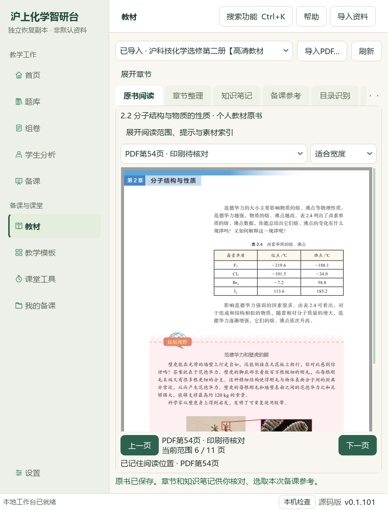

当前示例导入选必二原PDF、保存9个同版本目录候选，目录仍待核对；2.2节PDF49—59可继续54页。既有范德华力与氢键知识卡经预览再加入五题课件，同版本去重，旧作品内容保持。原书阅读位置不是候选知识核对进度，也不认证化学正确性。

### 导入新教材、整理章节并用于备课（维护源码）

1. 从 **教材 → 导入教材PDF…** 添加完整、未加密的本地PDF，点 **预览教材 → 保存到本机**。单书最多256MiB、3000页；每批最多100份、512MiB。内容相同的书沿用已有记录，同名但不同内容的书分别保存；原文件保留。
2. 在册列表选择 **已导入 · 文件名**，到 **章节整理 → 识别并整理目录**。软件依次尝试同版本已登记目录、PDF书签和正文标题，在 **目录识别** 页显示名称、PDF页及识别依据。选中一项点 **定位所选原页**，核对后可取消不需要的勾选，再点 **保存勾选的目录候选**。保存只追加候选，已有章节和笔记保留；相同候选不重复添加，预览后来源或整理内容变化时须重新识别。
3. 保存后会按所选章节打开原页，目录中的 **待核对** 表示范围仍需检查。书签和正文标题的结束页可能由下一标题推定。到 **章节整理** 修订名称、起止PDF页，明确勾选已对照原书，再 **保存章节范围**。识别不到目录时也可 **阅读整书 → 添加章节**。若新范围会排除已有笔记原页，软件保留旧范围并提示处理。
4. 在左侧选择章节，到 **知识笔记 → 从所选章节批量整理知识…** 整理并核对候选，见下方步骤；也可用 **添加笔记** 手工填写名称、对应PDF页与正文，勾选已对照原页，再 **保存手工笔记**。每条最多1200字；条件、符号和单位按输入保留，编辑后须重新确认。手工笔记表单在切换教材、章节、关闭窗口或新增笔记前仍须先保存；候选核对窗口另有保存进度功能。
5. 勾选本次要用的笔记，点 **预览备课参考 → 加入当前备课**。预览先显示笔记与原页位置，完整来源和版本信息可按需展开。跨章节勾选保留；改变笔记版本或原书内容后要重新选择、预览。备课原课题、目标、已有资料和图片用法保留。
6. 回到 **备课 → 教学设计 → 教学环节** 引用资料，先作为教师参考。要用于学生页时，解锁并明确填写该环节实际展示的文字，保留所需条件和单位，核对所选课堂文字后勾选学生可见；再生成三类文件。完整来源仍在备课草稿中。学生文字过长会提示拆分环节，不自动截断原文。

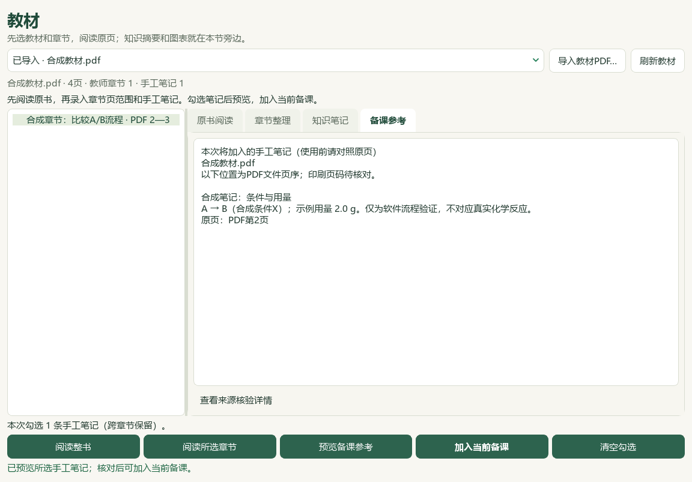

个人原书保存在个人工作台目录的 `textbook-sources/<SHA>.pdf`，目录候选、识别依据、教师章节与笔记随 `desktop-state.v1.json` 保存。**章节整理 → 备份全部个人教材与笔记…** 新建专用ZIP，包括全部已登记个人原书、已保存整理记录及已归档候选快照；已有备份不覆盖。专用ZIP另含这些已登记个人原书的阅读位置；旧版无阅读位置的ZIP仍可恢复。专用ZIP不含备课成品、学生档案、未归档候选文件、正式五册外部原书和图表裁选回执。内置服务可校验后恢复到新独立目录；当前此入口提供导出，尚未提供恢复按钮。普通备课ZIP不代替这个教材备份。

目录识别先核对原书内容。同版本登记目录须匹配完整文件；其他书仅识别PDF中的书签或部分中文章标题、数字节标题，不提供OCR。正文识别限前600个PDF页、500条候选；扫描PDF、复杂排版和重复页眉可能识别不到或需要修订。印刷页码、出处年份等未知字段保持待核对，保存目录不代表化学内容已审校。个人笔记不自动并入原383条概念或获得命题、发布资格。新书可直接从任意PDF页框选图表，不必先建立章节；知识候选按已保存章节分批整理，图表可同窗逐张核对后一次加入备课。全部功能目前仅维护源码可用，v0.1.101 EXE保持。[自动目录验证范围](../qa/2026-10-04-personal-textbook-auto-outline.md) · [整书导入与备份验证](../qa/2026-10-04-personal-textbook-intake.md)。

### 从章节批量整理知识，核对后加入备课（维护源码）

1. 在已导入的教材中选择已保存章节，进入 **知识笔记 → 从所选章节批量整理知识…**。明确起止PDF页，每批连续1—8页，不会自动扩大到整章或整书。
2. 选择 **本机文字摘录**，读取PDF可提取的文字。扫描页无原生文字时会提示，也可手工记笔记；要用 **AI原页归纳**，先配置支持视觉和结构化输出、允许发送资料原页的模型，再勾选本批发送确认。只有所选页的图片会随此请求发送；改变页码、方式或模型后须重新确认。失败不自动重试，手动重试可能再次产生费用。
3. 点 **整理本批知识**。候选批次保存后，整理设置自动收起，留出核对区。左侧选一条，点 **定位这条知识的原页**，在同一窗口逐页阅读，可缩放；回到 **核对与修订** 修改名称、正文并核对全部依据页、条件、公式和单位。原页依据保持，AI改述及其短引文仍须核对，图表需另行选用。
4. 勾选这条的 **我已核对…**，再选下一条。编辑文字会撤销该条确认与勾选。**勾选已核对条目** 只选择逐条已确认项；**保存勾选知识笔记** 将其保存到当前章节，随后在父页自动勾选，供本次备课预览。保存失败时不会只写入本批前面的条目。
5. 尚未完成时点 **保存进度，稍后继续**。关闭空闲窗口、切换已有批次或整理下一批之前，会先保存当前文字修订；重新打开已有批次保留修订，核对与备课勾选清空。超过1200字等保存失败时窗口保留，并显示原因。任务运行期间关闭窗口会请求取消，已经保存的候选与进度保留。
6. 回到 **备课参考 → 预览备课参考 → 加入当前备课**；既有课题、目标、参考和图片用法保留。保存草稿，再到 **教学环节** 引用完整资料、明确填写学生可见文字，生成教案、PPT及学习单。教师答案仅用于教师文档和PPT讲者备注，仍须检查成品。

每批最多20条候选，每条正文最多1200字；超量时提示减少页数，不截断正文。工作台最多保存200个知识候选批次，暂未提供批次清理按钮。每次备课引用1—30条笔记；原书、章节或候选版本变化会要求重新核对。旧章节批次仍可阅读绑定原书，但须重新整理后才能采用。原始候选依据和既有笔记不会被新候选覆盖；从知识候选保存的笔记可在父页修订，原页依据保持。

专用教材ZIP也包含已保存知识候选、文字修订进度和知识笔记。此步骤完成个人教材候选与本课选用，不自动合并正式知识库，不认证化学正确性。真实供应商识别质量、扫描书全量整理、复杂公式与课堂效果仍须按实际资料核验；本次界面和导出验证使用合成材料。[验证范围与记录](../qa/2026-10-04-personal-textbook-knowledge.md)。

### 从教材裁图直接进入课堂编排，并返回原页（维护源码）

在教材书架、个人教材或当前原页选图，填写 **图题** 与 **本次用途**，预览并确认裁片。图题可写成本课导学问题，例如“为什么实验方案要从目标产品倒推？”，用途写明学生观察什么、教师怎样接着讲。

- **加入并编排**：单张或完成逐张确认的整批图片直接进入当前课件，打开 **素材与页面编排**；整批可一次撤销、重做。已在课件内选图的入口仍直接加入当前画布。
- **只入备课图库**：先把图片保存在本课图片区域，随后自行选择用在哪个环节或页面。
- **对照教材原页…**：在课件中选中教材裁片，点击此按钮查看对应完整PDF页，支持缩放；点 **返回课件** 回到原位置。当前备课ZIP自动保存所选范围中已引用且唯一有效的裁选回执；原教材PDF仍需另存。[回执备份与原书搬迁](save-and-support.md#course-source-continuity)。

同图不同导学问题或讲解用途可保留为不同课堂资源，共用原图；重复导入同一用途保留教师已改的副本。撤销恢复课件编排，已保存的图库图片和裁选记录仍可继续使用。选图过程中换课、修改内容或停止操作后需重新加入，原有课程保留。正文沿用既有课堂设计，不加入来源或核验提醒。[实际操作与验证范围](../qa/2026-10-08-textbook-crop-roundtrip-qa.md)。当前源码重开后使用，v0.1.101试用包未更新。

### 原书搬家后继续对照（维护源码）

1. 在课件中选中教材裁片，点 **对照教材原页…**。若当前资料库已登记同一原书的新位置，窗口会显示 **关联同一原书的新位置**。
2. 核对书名、**保存时的位置** 与 **当前资料库位置**，点 **关联并打开原页**。程序重新核对原书、原页和裁片，再打开对应完整PDF页。
3. 查看后点 **返回课件**，接着当前课件与原位置继续编排。确认前取消、关闭窗口或换课，均不保存这次关联。

此入口只关联当前资料库中已核对为同一原书的文件；同名文件或内容不同的PDF不能替代。缺少目录登记、原书或裁选回执时，先补回对应资料。关联只记录本机位置，不改课堂素材的原始来源，也不进入备课ZIP；在另一处恢复后，保留原资料库登记信息和同一原PDF，再确认该机位置。[备份范围](save-and-support.md#course-source-continuity) · [当前核验范围](../qa/2026-10-09-course-source-continuity-qa.md#course-source-continuity)。

### 选取教材图表并用于课件（维护源码）

**从知识卡连续选图：** 在 **教学环节 → 素材与页面编排** 选中知识卡，点 **从这张知识卡选教材图…**。勾选多个相关教材原页或登记图表，搜索后仍保留勾选顺序，点 **逐张框选所选图（N张）**。逐张框选并填写本课问题图题与讲解用途，预览确认后点 **加入当前备课（N张）**，全部裁片一次进入当前课件，并保留返回原知识卡的入口。整个批次可一次撤销与恢复。取消任一选择窗口不追加；选择期间草稿、图片或原知识版本变化须重选。维护源码最多128张，沿用当前备课图片容量限制。[操作与验证](../qa/2026-10-07-knowledge-textbook-batch-qa.md)。

**正在读的个人教材页：** 不用返回图表页签重新输入页码。在原书阅读器点 **框选当前页，加入备课…**，直接打开正在显示的PDF页，预览裁片后加入本课。整书和已保存章节阅读均可使用；取消后保留原页及缩放。翻页本身不选材。

**看图找材料：** 教材书架的图表页、**浏览教材素材…**、课件 **教材图…** 及知识卡关联教材图入口，会在选择条目后显示完整原页预览，列表保留最近查看条目的缩略图。宽窗列表与原页并排，窄窗上下排列；书架内容可滚动。预览是整页，具体图表仍在原页中框选。只读预览不勾选、不导入；改变原书版本后不会继续展示旧图。[本轮操作与验证](../qa/2026-10-07-textbook-visual-selection-qa.md)。

**选用多张图表：** 已登记素材可逐条勾选或点击 **勾选本节图表**，跨章节和册别保留；点 **核对勾选图表（N张）…**。个人整书在 **图表选用** 输入PDF页，点 **加入本批待选页**，依次添加需要的页，再点 **逐张核对本批图表（N页）…**；可移除或清空待选页。一个PDF页本批选一张图，同页其他图可另开一批。

在同一窗口逐张框选、填写图题和用途、预览后勾选确认，点 **确认本图并继续**。完成全部图后另点 **加入当前备课（N张）**。切换图表保留未完成的选区与文字；重新打开已确认图需再次核对。点 **返回教材，暂不加入** 会取消整个批次。选择仅为本次临时选材，不自动保存。

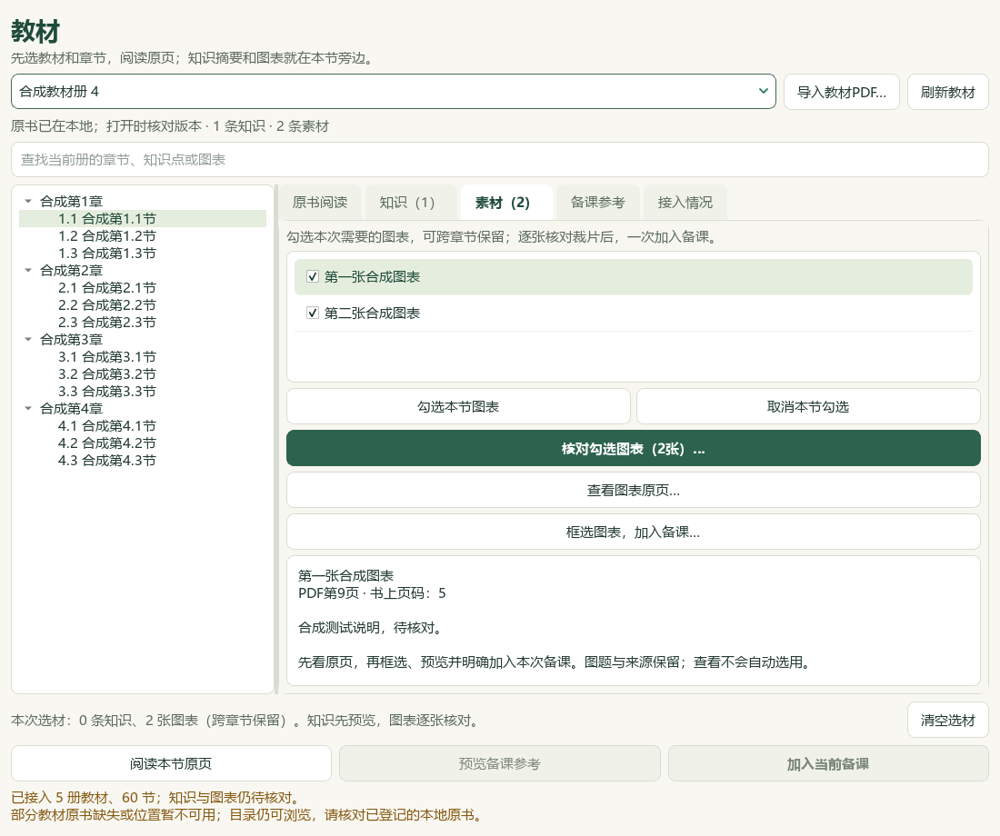

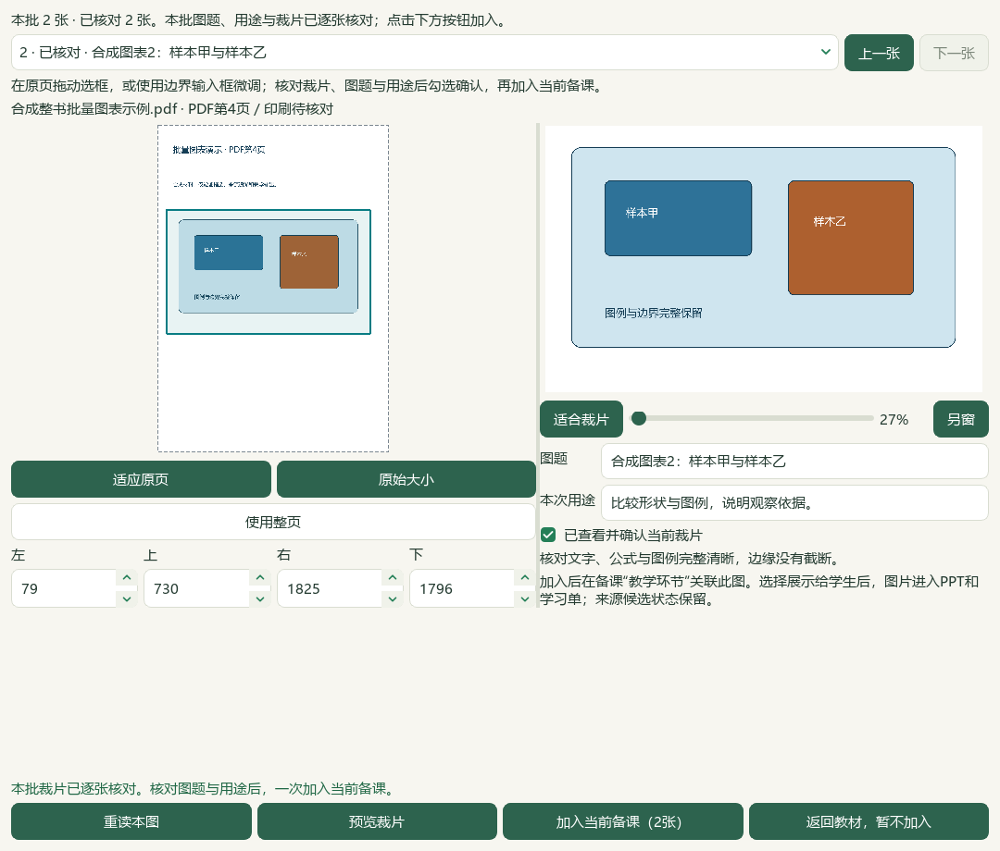

1. 已登记素材：在 **教材 → 素材** 选中条目，点击 **框选图表，加入备课…**。新整书：选择 **已导入 · 文件名 → 图表选用**，填写图表所在PDF页，可先 **定位图表原页**，再点 **框选本页图表，加入备课…**；没有章节也可使用，选中章节时默认从该章起始页开始。先在原页拖动选框，可用 **原始大小** 放大检查，用四个像素边界微调；整页需要点 **使用整页** 明确选择。
2. 填写 **图题** 和 **本次用途**，点击 **预览裁片**。裁片可同窗缩放、拖动或另窗查看。检查文字、公式、图例及边缘，勾选 **已查看并确认当前裁片**，选择 **加入并编排** 或 **只入备课图库**；课件内部选图仍为 **加入当前备课**。修改选框、图题或用途后须重新预览。小窗口可向下滚动，预览、加入和返回按钮保留在底部。
3. 软件重核原页与裁片后，按所选动作进入课件画布或备课图片区域，保留原有课题、目标、材料和图片用法。直接入画布的图题与用途可继续编辑；这次本地读取、裁选和追加不调用模型。保存草稿后可继续使用。
4. 打开 **教学环节**，选中对应环节，点 **引用当前备课资料（完整内容）**。图片会随资料绑定，默认锁定且仅教师可见。核对题答分离后解锁，在 **材料与备注** 勾选需要的图片，再明确选择 **材料和勾选图片用于学生页**。
5. 点击 **生成教案／PPT／学习单**。学生可见图片进入PPT图页和学习单；教师教案保留关联图片。PPT备注仍含教师答案，发放前按实际用途检查文件。

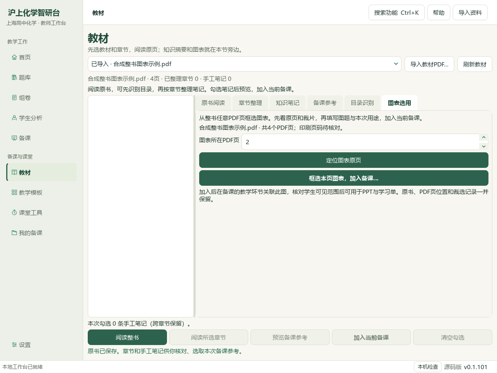

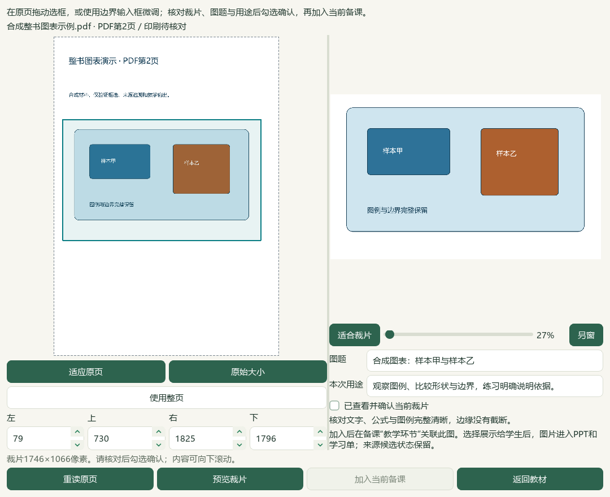

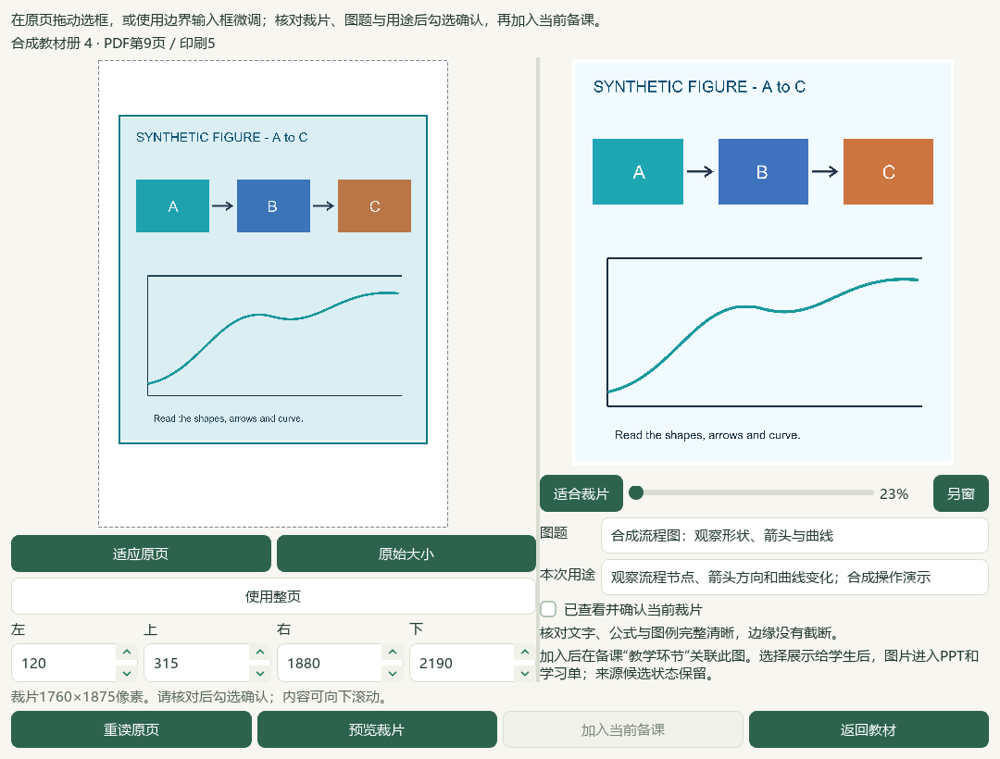

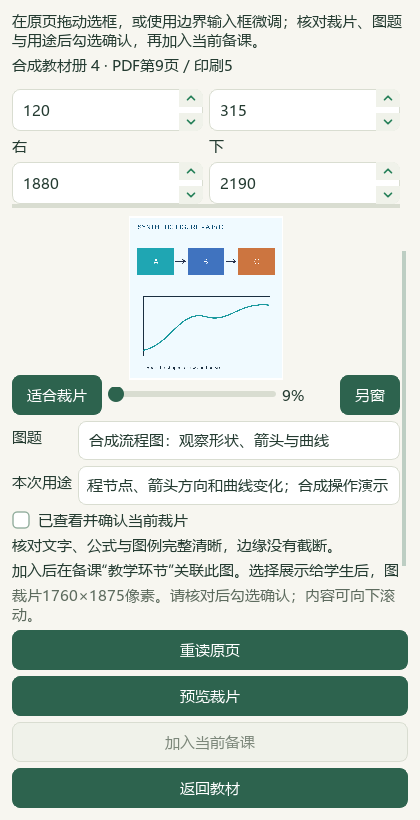

图片保存为本地PNG，维护源码沿用备课图片库和128张上限；重复裁片保留已有图题与来源。来源回执另存于个人状态的 `tasks/preparation-v1/textbook-crops/`，记录原PDF摘要、素材或个人整书身份、页码、原页渲染尺寸及选框。个人新书不会仅凭文件名获得正式册别，印刷页码需另行核对。印刷页码未知仍显示待核对。图片按备份选项保存；当前备课ZIP自动带上所选范围中已引用且唯一有效的裁选回执，**原教材PDF仍需另存**。[保存与关联](save-and-support.md#course-source-continuity)。来源候选状态保持；教师选择图片不等于完成资料库化学审校或发布审核。[整书图表验证范围](../qa/2026-10-04-personal-textbook-crops.md)。

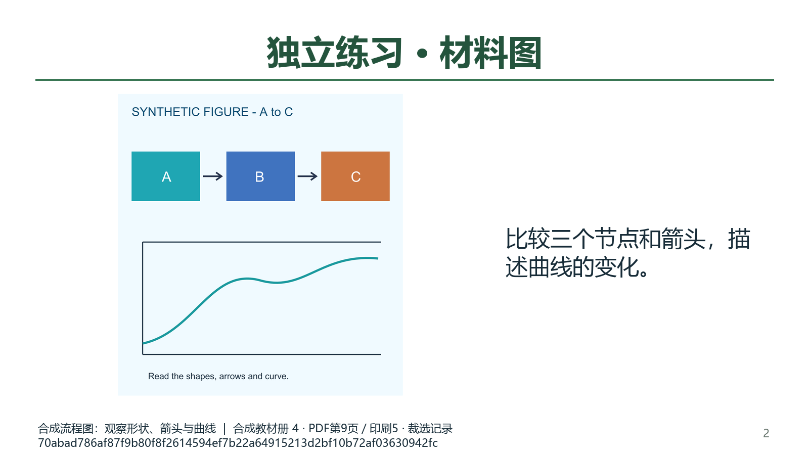

维护源码单批及当前备课最多128张，重复裁片保留已有或本批首张的图题、用途和来源。本批有一张未通过核对、原页或目录版本变化、裁片不一致、已有文件损坏或容量超限时，整批不会追加到备课；磁盘失败可能保留关闭使用资格的候选缓存，重试仍需完整核对。[批量验证范围](../qa/2026-10-04-textbook-batch-crops.md)。导入期间暂不能新建或切换备课；取消或读取失败后可重新选择。这项联动仅在当前维护源码，尚未进入v0.1.101 EXE。[验证范围](../qa/2026-10-03-textbook-crop-lesson.md)。

在从Word与教材知识点导入备课参考的窗口，先高亮一个教材知识点。点击 **查看选中知识点的教材原页…** 查看该知识点关联页；点击 **阅读本节…** 可连续查看教材目录中这一节的全部页面。两种阅读都不改变勾选，可用页列表、前后页和缩放核对内容。

知识点窗口上方包含 **知识摘要** 和 **研读提示**；整节窗口包含 **阅读范围** 和 **研读提示**，并显示册名、节名和本节页数。存在匹配提示时初次打开会显示提示页签，先读适用范围，再对照摘要与课堂核对建议。**PDF文件页序** 按文件顺序计数，**书上印刷页码** 按书内标注，引用时分清两者。

**素材索引（候选）** 列出当前阅读范围内已登记的教材图表或实验素材。双击条目或选中后按 Enter，跳到对应教材原页；右侧说明随当前页更新。条目仅定位到整页，尚未裁图，说明仍需对照原页核对。印刷页码缺少核验时显示“待核对”，可以结合原页和上方双页码自行检查。较窄窗口中列表可横向滚动，说明可独立上下滚动。

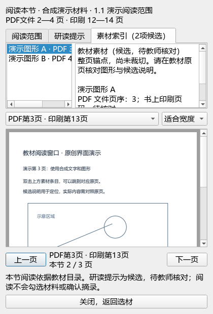

教材书架与独立 **浏览教材素材…** 入口可定位当前319项整页素材候选，原16项复习、导言和附录的入口缺口已补全。3处标题或说明通过待核对覆盖层更正，原目录与产品清单保持；281项未核验印刷页码继续显示待核对。目录缺失、记录冲突或对应不同PDF版本时，窗口显示具体提示。查看素材不会自动选材、摘录或带入AI参考。这些新增入口尚未进入v0.1.101 EXE；其他源码工作区须分别核对是否已合入。

提示只在当前教材版本、节和完整依据页范围都匹配时显示；离开适用页会清除旧内容。出现“当前页面暂无匹配的研读提示”不表示没有知识点，也不代表题目已核验；可能尚无笔记，或所选知识点未覆盖笔记的全部依据。后者可以尝试 **阅读本节…**。部分旧笔记格式暂未接入，资料读取提示不妨碍查看教材原页。没有可靠节目录的知识点会提示暂不能整节阅读，仍可使用原有知识点原页入口。

小窗口中提示内容可独立向下滚动，底部翻页和返回按钮保留。研读内容是AI整理的候选，须结合原页核对；不会自动变成教材原句或加入备课材料。整节窗口的翻页限定在该节内，不提供摘录操作；需要原句时返回知识点入口，使用 **摘录/修改教材原句…** 的原有核对流程。这项界面改进尚未进入v0.1.101 EXE。

## 翻页、核对与处理缺图（维护源码）

打开 **核对实际PPTX** 或组卷的 **真实分页预览**，输入页码跳转，也可用前后页按钮。默认按窗口宽度显示，可选择放大并滚动；PPT另有 **整页** 模式。页面按需读取，先显示当前页。高分屏会按实际缩放倍率生成显示图像，原文件本身的清晰度仍决定可见细节。

点击 **页码导航** 展开或收起导航条。小窗口默认收起，展开后可横向滚动并选择页面；没看过的页显示页码和状态，读取成功后才出现缩略图。之前看过的缩略图可能因释放内存而消失，页码和本次核对状态仍保留；再选择时重新读取。

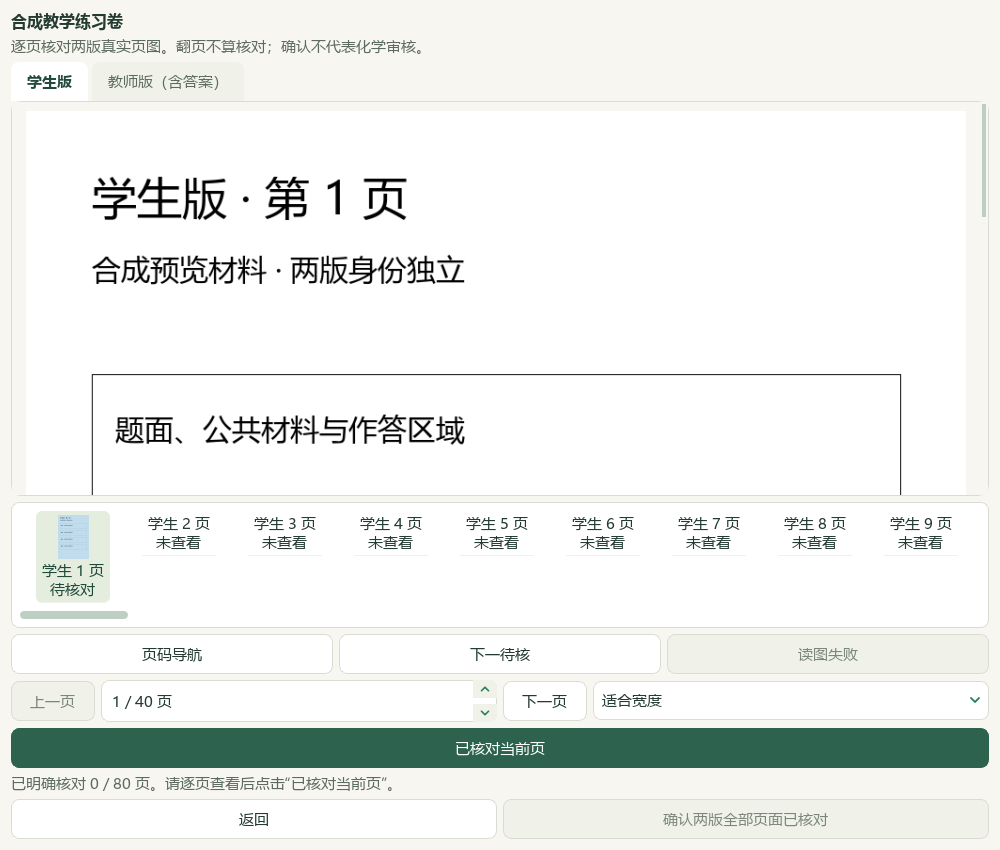

组卷中先核对 **学生版**，再核对 **教师版（含答案）**。**下一待核** 可以跨两版跳到尚未核对的页；看完一页后点 **已核对当前页**。翻页、显示缩略图或放大都不会自动算作核对。两版全部页面核对且没有读图失败后，才可确认本次预览。

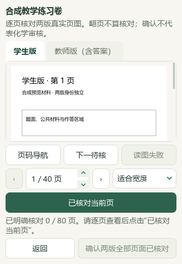

出现缺图或文件变化时，点 **读图失败** 返回具体页面。其余页面仍可查看，本次预览不能确认；返回重新生成后再核对。图表是否裁切、公式是否正确、题目和答案是否完整，仍需教师检查。PPT的“已读取”也不表示内容已审核。

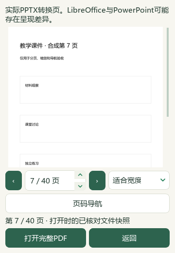

PPT预览保存打开时的文件快照；如果外部修改了PDF，**打开完整PDF** 会提示重新生成，避免打开不同版本。关闭窗口会释放页图和缩略图，重新打开需重新读取；组卷已经确认并保存的预览记录仍沿用原来的保存流程。这些导航改进尚未进入v0.1.101 EXE。

## 处理中需要停止或返回（维护源码）

组卷生成实际分页或导出文件、教学环节生成成品或核对实际PPTX时，支持停止的任务会显示 **停止本次任务**；旧组卷导出入口显示 **停止本次导出**。复练预览与导出使用考试分析窗口的停止入口。

点击一次后，等待“正在停止”变为最终状态。停止期间不重复启动同一任务，当前输入、已保存卷稿和已有成品保留。教学环节中的 **停止并返回** 会等待任务结束再返回；保存草稿等短操作显示 **完成后返回**，先核对保存结果。

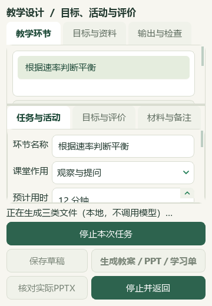

窄窗中，环节列表和操作按钮可以单独向下滚动；下方属性编辑与底部保存、返回按钮保持可达。

取消的分页不能代替已确认版本。继续处理时，重新生成并核对本次学生版、教师版，再确认导出。若提示 **已停止等待** 或 **清理尚未确认**，说明本次结果不可用，后台转换的结束状态尚不能确认；保留提示并按[问题排查](save-and-support.md#problems)处理。

这些操作属于维护源码，尚未进入v0.1.101 EXE。停止本地任务不等于撤回已经发给模型服务商的请求。

## 给班级出一份练习卷

### 准备什么

本次练习目标、预计用时、分值安排，以及已经导入并核对来源的完整题目。题库筛选结果只是候选，难度与教学适配仍需教师判断。

### 先整理题目、教学标签与裁片（维护源码）

以下待处理清单属于维护源码，旧 v0.1.101 EXE 不包含这个可点入原题的新界面。已经核对完整的题目可直接进入下方选题流程。

1. 在 **首页** 展开 **题库与教材状态**，点击 **检查本地题库进度**；也可按 Ctrl+K 搜索“题库进度”。
2. 选择 Word 或图片题，再按来源、待办类型、人工保护状态和关键词缩小清单；图片题还可按来源中明确的主题筛选。选中一条待办，点击打开原题；双击该行或按 Enter 也可打开。
3. 对照原题，在“题目设置与标签”中点 **修改教学标签**。补全有依据的知识点、教材节、适用年级或原考试类型，再点 **预览变更 → 确认保存修改**。原图或公共材料缺口应回到来源核对补齐。
4. 关闭原题窗口回到清单，等待自动更新。原筛选保留；这道题仍有待办时继续选中它，已不符合筛选时选中附近的下一条待办。取消修改或保存失败，也按重新读取的实际状态继续处理。

原考试类型没有来源依据时保留“待确认”，不从讲义名称猜填。字段齐备不代表化学审核完成，Word 候选与个人图片题分开统计。窗口较窄时可垂直滚动到原题入口、刷新和导出按钮。

**Word整库读取：** 打开逐题窗口时查看来源与题数读取进度，目录核对完成后再筛选、阅读和明确选择。暂不继续时关闭窗口；旧进度不会写回关闭的窗口。首次整理来源仍需等待，已显示的题数不代表原题与答案已审核。

**Word 旧标签重核：** 出现“题目范围已变化”时，旧标签只供对照，下方表单是当前范围的建议。先核对题干、共同材料与答案范围，再修改或保留标签，勾选 **已核对新范围与下列标签**，点 **预览变更** 查看旧范围与本次保存值，最后确认保存。即使标签值不需要修改，也可以明确完成范围重核；待确认字段仍保持待确认。关闭或取消不会保存，旧标签历史继续保留。

**AI 标签变化对照（维护源码）：** 在 Word 选题的 **AI标签整理** 窗口中，默认只补缺失标签；需要重新检查已有自动分类时，选择 **重新核对自动标签**。先预览本次题目、公共材料、图片和接收模型，再明确确认发送并分析。查看 **标签建议与依据**，按“保留、补充、替换、移除”对照当前标签与建议；“本次第N题”表示本次选择顺序，不是原卷印刷题号。

勾选要采用的题目，核对下方仅包含所勾选变化的摘要，再点 **保存勾选的标签建议**。重核模式默认不勾选；教师修改、教师确认、固定修订、无变化及失败项不计入保存。点击 **停止分析** 后，等待当前请求结束，再核对已经完成的建议。保存失败或回执不完整时，先重新打开原题查看实际状态；AI 建议不会变为教师审核结论。

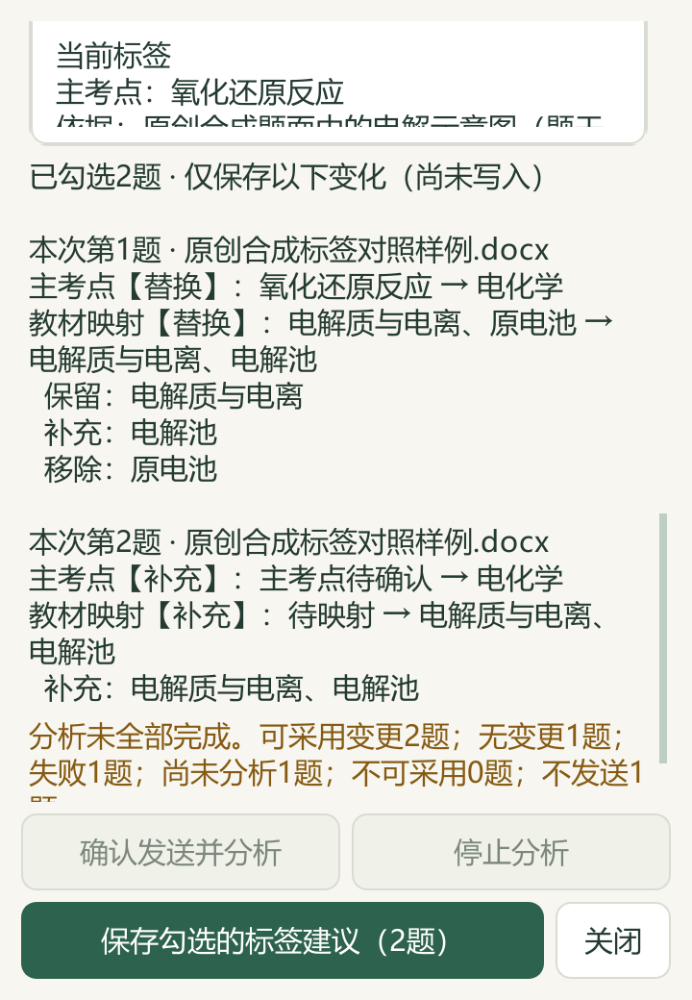

**图片裁片审核：** 在原题图片旁打开截取范围编辑器，默认对照原页与当前裁片。顶部可切换本题的题面、共同材料和参考答案页；两侧均可放大，裁片放大后可拖动查看。框选或调整像素边界后，点 **预览截取结果**，核对新裁片、受影响题目及边界，再勾选确认并点 **确认保存裁剪**。切换页面会暂存各页框选；保存只提交当前裁片并关闭窗口，其他暂存框不保存。共同材料可能影响多题，旧标签会保留待重核，已带入备课的副本需要重新带入。窄窗口可滚动查看原页与裁片，底部操作按钮保持可见。

### 核对公式、旧对象在原文中的位置（维护源码）

在 Word 题目的题面或答案页，点击 **核对本页公式与对象的原文位置**。在完整教案阅读器中，可点段落旁的 **核对公式与对象位置**，也可在选段区域点 **核对所选段落的公式与对象位置**；查看位置不会改变已有备课选段。

选择左侧的一处对象，右侧显示它所在段落或表格单元格的原文、具体位置和可读取的原图。输入附近文字可筛选对象，同一图片在不同位置出现时分别列出。图片可放大；窄窗口上下排列，详情和长提示均可滚动。

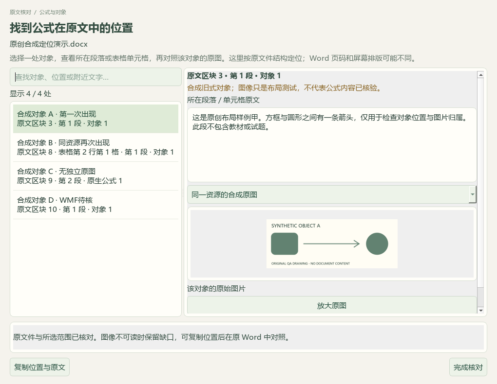

窗口先检查文件和对象是否支持 **在 Word 中选中**。按钮可用时，先关闭已有的 Word 窗口，再点击；本机打开只读原件并核对实际选区，通过后显示 Word。处理中可取消；若窗口已经打开，请手动关闭。Word 退出可能需要片刻，未退出前请稍候再试。按钮下的提示会说明当前限制；结构检查通过也不代表实际选区已经确认。

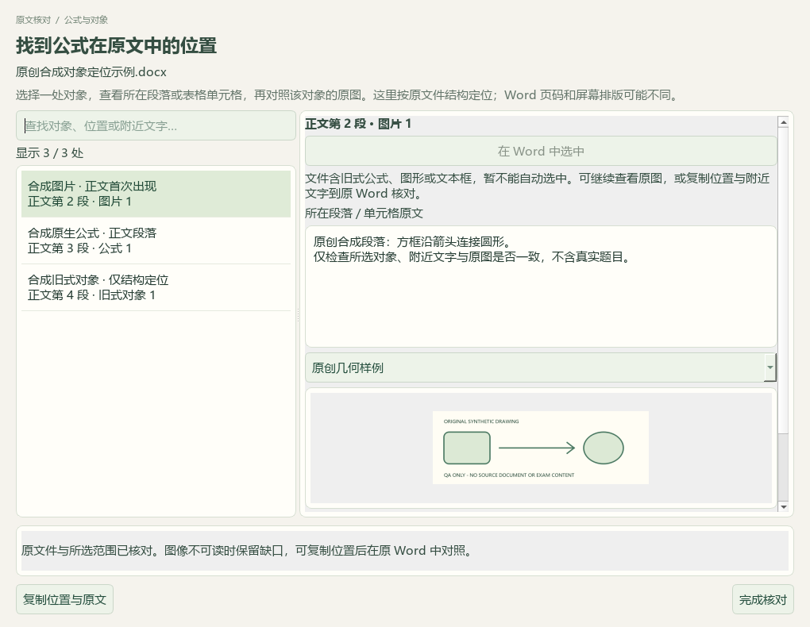

**展开文件内定位详情**可查看完整定位记录；复制内容也保留这些信息，便于追溯。默认页面使用中文原因提示，不展示冗长的文件内部路径。

旧式嵌入公式、浮动对象、表格内原生公式，以及含未支持字段或显示结构的文件，暂不能自动选中。可点 **复制位置与原文**，再打开原 Word 对照附近文字。这里的段落、表格行列来自原文件结构，可能与 Word 排版页码不同。隐藏内容、修订或兼容显示分支会保留提醒，不能当成已经确认可见。题面与答案共用一段且无法可靠分开时，请回完整教案核对。原图读取失败会保留缺口，不自动补写公式。

### 怎么做

1. 在“题库”按来源、教材章节和知识点筛选，打开题面与答案核对后加入选题篮。保留主题公共材料及依赖前文条件。
2. 在题篮检查是否混入其他备课的题目，到“组卷”安排题序和配分。需要修改题号时核对题面、答案与引用的对应。
3. 生成并逐页查看学生版、教师版实际分页，检查长题、表格、图片、答案和作答空间；全部核对后再导出。
4. 打开导出的 DOCX 与 PDF，按学生稿和教师稿分别命名、发放或打印。

### 得到什么

学生版与教师版 DOCX、PDF，以及本次组卷的预览和确认记录。原题文件不因重新组卷而被改写。

### 选题篮中移出、调序与撤销（维护源码）

在选题篮中选中一项，使用 **上移、下移、移出题篮**。保存成功后可点 **撤销上一步（Ctrl+Z）**，恢复完整题目引用、原顺序与原有设置；Word原题、图片完整主题和原卷完整主题共用这套操作。移出最后一项后仍可撤销。

本轮维护源码将最近30步已保存的调序与移出操作随题篮保存，关闭重开后仍可撤销，并可点 **重做上一步（Ctrl+Y）**。其他窗口或入口改变题篮、来源变化、读取失败或保存未能确认时，须先点 **重新读取题篮** 核对实际内容。上方已发布v0.1.103包保留原窗口内撤销范围。

小窗口可上下滚动到撤销、重读和组卷按钮，保存状态与 **继续选题** 保持可见。题篮顺序与已有组卷草稿分别保存；这里的撤销不会回退草稿中的配分、版式或已导出文件。v0.1.101 EXE 尚不包含此功能。

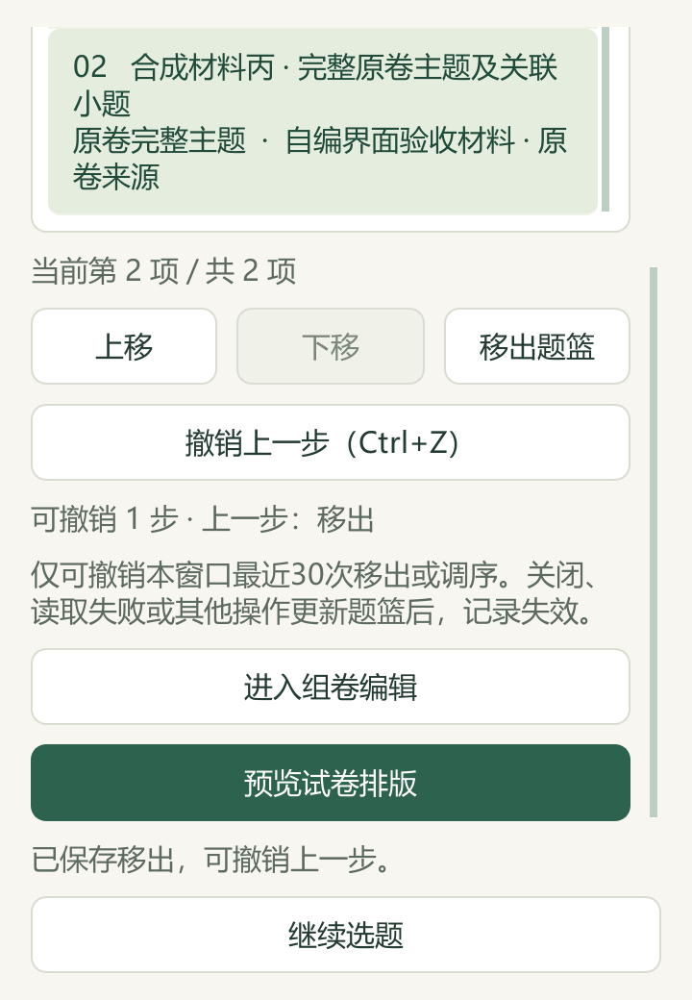

### 新建、保存与继续一份卷（维护源码）

1. 在公共选题篮整理这次要用的题目，进入 **组卷**，点 **从题篮新建**。新卷保存本次有序题目引用，已有卷保留。
2. 修改卷名、题序、配分与答题空间，点 **保存当前卷**。从本卷移除题目后，可用 **恢复本卷移除项** 加回，或撤销最近已保存编辑；本轮维护源码也支持跨重开撤销与重做。
3. 下次在顶部列表选择保存卷，点 **继续所选卷**。公共题篮可以用于下一份练习；即使清空，也不改变这份保存卷。
4. 查看当前卷细目表，再核对学生版、教师版实际分页，确认后导出两版 DOCX、PDF。对本卷的修改会使本卷旧预览确认失效；每份卷分别确认。

题篮中的排版预览会按当时题篮新建一份卷；要接着已有卷，请从保存卷列表继续。需要加入本卷原来未包含的新题时，先在题篮准备完整选题，再明确新建，原卷保留。

保存卷引用原题，原文件、题目范围和相关标签依据仍需可核验。来源缺失或变化时会停止沿用旧稿；先处理来源，再决定新建。保存失败或冲突时先重新读取，不反复点击来覆盖其他编辑。

列表中的旧稿经核验后另存为独立卷，保留原记录。缺少完整来源引用、无法无损迁移的旧小问编排会提示原因，不按当前题篮猜补。窄窗口顶部保留选卷入口，正文可滚动，保存状态、保存、撤销和返回题库保持可见。v0.1.101 EXE 尚不包含独立当前卷功能。

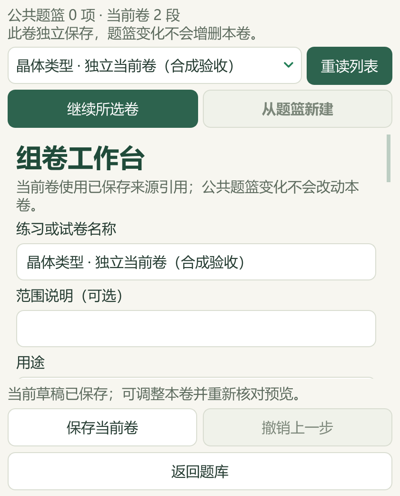

### 编辑当前卷与撤销草稿（维护源码）

在 **组卷工作台** 选择题目，调整题序、配分或支持的额外答题行数；也可 **从本卷移除**、**恢复本卷移除项**，或修改卷名、范围说明、用途、时长及显示分数。每次成功保存后，底部 **撤销上一步（Ctrl+Alt+Z）** 可恢复前一步及原选中项。图片主题保留来源配分和答题区；Word题和原卷主题分别使用页面提供的设置。

本轮维护源码为每份保存卷分别保留最近30步已保存编辑，可在重开后 **撤销上一步／重做上一步**，快捷键为 **Ctrl+Alt+Z／Ctrl+Alt+Y**。输入框内的 Ctrl+Z 仍由输入框处理。公共题篮及其他保存卷保持各自范围；来源变化或并发更新后先重读核对。上方已发布v0.1.103包仍为窗口内撤销。

题名与范围说明在结束输入时合并保存；预览、切卷和离开前也会处理未保存输入。若异常重开恢复出短文字，点 **保存恢复的题名或范围说明** 明确保存后继续。缓冲写入失败时窗口保留当前文字并显示状态；尚未落盘的文字无法保证异常恢复。

看到读取、保存或其他入口修改的提示时，先点 **重新读取已保存草稿** 核对实际结果。独立卷的版本或来源身份无法沿用时，原记录保留；先返回题库核对来源，再通过顶部 **从题篮新建** 建立新卷。旧版仍依赖题篮的编辑入口可使用 **保留旧稿并重新开始**，新稿使用默认顺序和配分；这一操作不会迁移无法核验的小问编排。

编辑和撤销都会使旧预览确认失效，须重新查看完整学生版与教师版，再确认导出。小窗口可滚动查看全部设置，底部保存状态、撤销与返回题库保持可见。草稿操作不回退已经导出的文件；v0.1.101 EXE 尚不包含此功能。

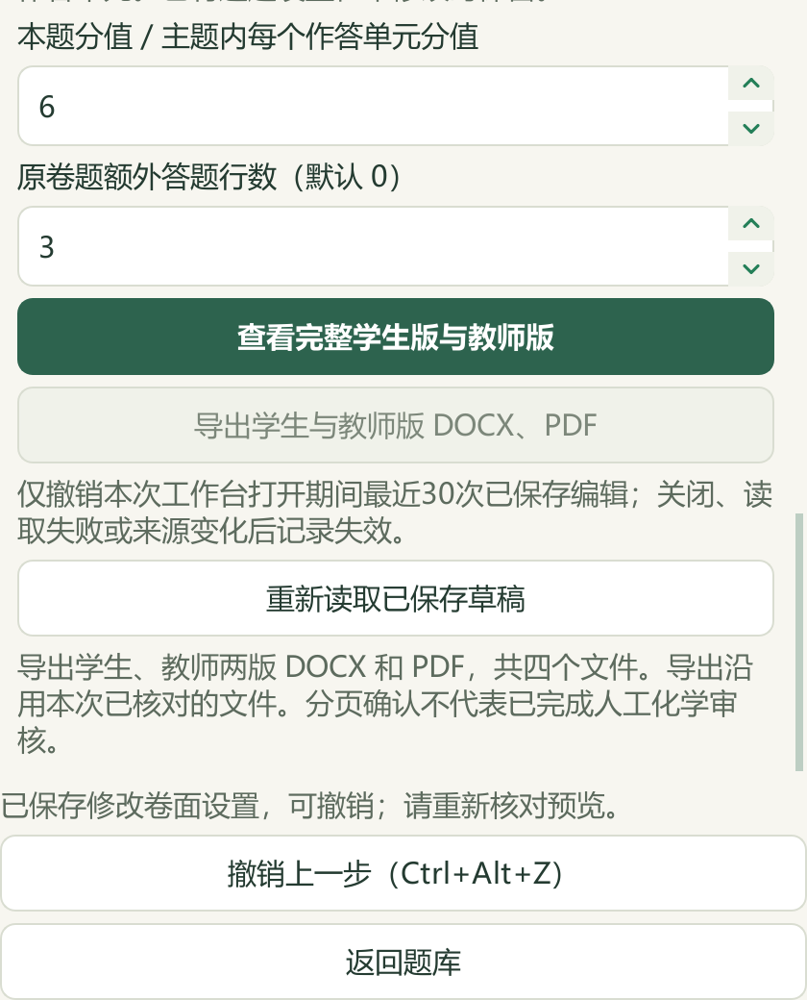

### 查看当前卷结构与分值（维护源码）

在 **组卷工作台** 点击 **查看当前卷细目表**。窗口会先读取当前草稿及来源，再显示 **全卷总览**；按当前题序查看时切换到 **逐项细目**。**来源追溯**保留文件、题段范围和版本信息，其中Word区块序号不是印刷题号。已经从本卷移除的题目不参与统计。

- **结构：** 主题大题、印刷小题和最小作答单元分别统计。Word完整题段可能包含多个作答任务，没有明确登记的层级保持未知，不从文字题号猜数量。
- **分值：** 本次配分与原来源分值分开显示；部分已知时显示已知合计及缺失项数，总分仍为未知。图片候选沿用来源记录的分值，这不等于官方评分已核验。
- **时间与目标：** 显示本次卷面设置的时长；缺少逐题用时依据或目标清单时，不计算预计用时与目标覆盖率。

选好当前段后点击 **返回编辑当前段**，在工作台修改题序、配分或移除项；保存或撤销后重新打开细目表核对。点击 **重读草稿与来源** 可再次检查；出现版本变化或读取失败时旧统计会清除，回到工作台重新读取并核对实际草稿。

查看细目本身不生成DOCX/PDF，也不调用模型或Office。层级与分值只是对当前已登记资料的检查，仍需阅读原题、答案和公共材料；实际分页继续使用学生版、教师版预览。此功能尚未进入v0.1.101 EXE。

从旧版原卷编排进入时，可以带入完整主题的顺序、移除项、逐单元配分及时长。若主题内部已经删改或调序小问，无法完整转换时会保留旧编排并停止转换；已有统一草稿时须明确选择打开它，不自动覆盖。

### 怎么确认完成

检查卷名、范围、总分与用时；两版编号一致，学生版没有答案；共同材料没有被截断，图表和公式没有挤出页边。扫描图内部旧号、图中“见第N题”等引用不能只靠页外新号判断正确。

图像换号只适用于已有工具支持的场景；复杂彩底、旋转或多义对应先保留原件并人工核对。材料或组卷内容变化后重新预览，旧确认不当作新版本确认。

## 课堂上使用工具，课后补记反馈

### 准备什么

课堂活动目标、所需时间、已核对的分组或点名资料。投影前确认当前画面没有私人资料或教师答案。

### 怎么做

进入“课堂工具”，选择倒计时、点名、随机分组或随堂反馈。根据学生当堂表现记录观察依据，必要时追加回备课材料，然后保存草稿。

### 得到什么与完成检查

工具辅助组织课堂，反馈供下次备课参考；它不是自动测量学生能力。动态平衡演示是简化示意模型，不是实测化学数据。课后重开草稿确认追加内容已保存。
